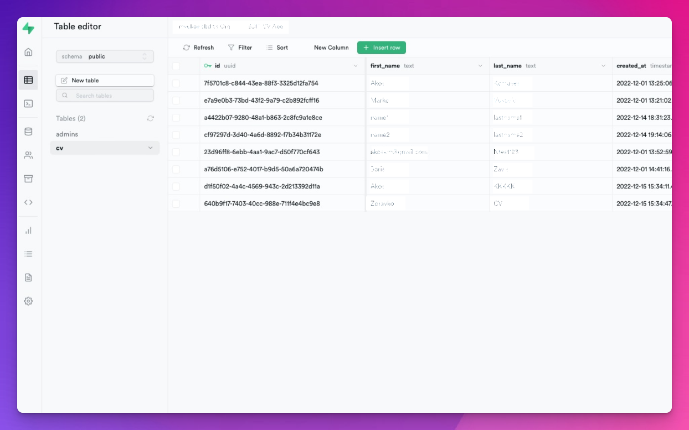
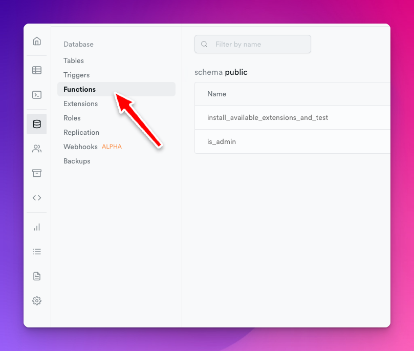
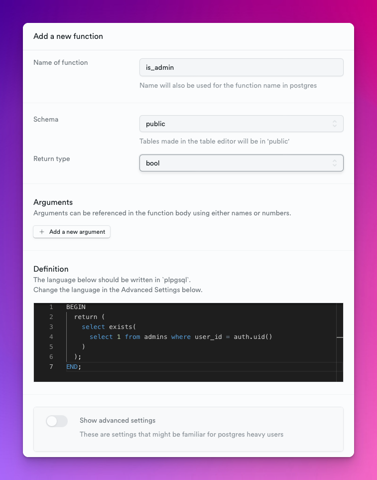
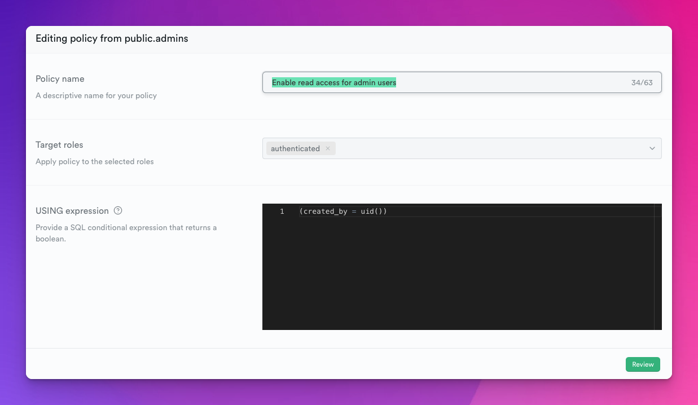
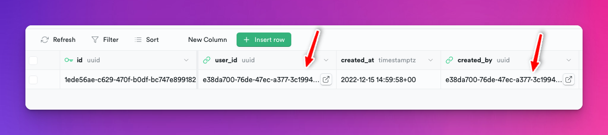
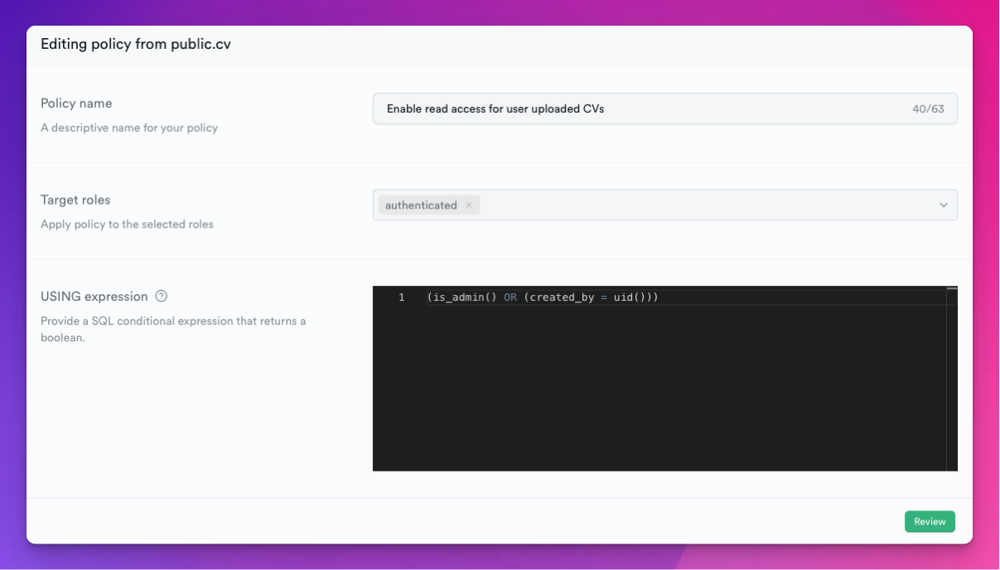

I struggled to find simple and working implementation or guides for this super-common use case in Supabase:

You have a table with some use generated data.

Users can add data to this table and read and write only the data they added.

Admin users (who are some of the registered users) can read all data.

In this post, we will set up a stored procedure in Supabase that can identify if the user making the request is an actual admin user.

If it's an admin user, we will allow the user to read all data, not just the entries this user created.

We won't be using the special `service_role` for this.

<div class="hn-embed-widget" id="substack"></div>

# A simple Employee Directory app {#heading-a-simple-employee-directory-app}

We recently started working on an in-house application to store some data about our employees.

We wanted the system to be autonomous, meaning that employees sign up for an account and fill out a form themselves.

Later the employee can sign in and see and update the form they've filled out.

Restricting updates only to the rows a particular user added is super easy ni Supabase. It only needs a simple [Row Level Security](https://supabase.com/docs/guides/auth/row-level-security) (RLS):

```sql
created_by = uid()
```

This RLS makes sure that the signed in user has access only to the rows where the `created_by` column is the same as the requesting user's ID.

As our next feature, we started thinking about adding an administrator user.

A user that could see it's own data as well as the data added by other users.

We wanted to be able to promote one or more of the signed-up users to be administrators.

* * *

At this point, we already have some user registration, and some users have already logged in and filled in their first and last names and some other data.

Since Supabase already supplies the Users table as a built-in feature, we only created a single table called `cv` where we store our employee data:



Here are some of the solutions we considered for creating an administrator user:

## The built-in service\_role {#heading-the-built-in-servicerole}

Supabase has a unique JWT token that can skip the RLS checks so that we can use this token to read and update any record in our table.

However, the Supabase description on the API Settings page states:

> This key has the ability to bypass Row Level Security. Never share it publicly.

And because we planned to have no backend for this application, we had no idea where we would put this token where it can't be abused.

Or if we were to create a serverless function and expose an endpoint for the admins they can use to list all employees, how would we restrict other clients not calling the endpoint?

## Stored procedures {#heading-stored-procedures}

The only thing that kept me going and looking for a solution was that, on a DB level, this problem is trivial to solve.

You have an incoming network request. You know the user's ID who made the HTTP request in your SQL queries.

Technically all you need to do is an `admins` table where you store all user IDs that you promoted to be admins:

```plaintext
+---------------+---------------+-------------+
| id            | user_id       | created_at  |
+───────────────+───────────────+─────────────+
| 1ede56ae-...  | e38da700-...  | 2022-12-15  |
+───────────────+───────────────+─────────────+
```

Where the columns are as follows:

*   `id` is an autogenerated ID for this row
    
*   `user_id` is an ID from Supabase's built-in Users table
    
*   `created_at` - when the entry was created, it defaults to `now()`.
    

With a table such as this in place, we should be able to create a stored procedure that checks if the user making the current request exists in the above table.

More precisely, we want to find out if the user's ID that you can get with `auth.uid()` present in the above table:

```sql
select exists(
  select 1 from admins where user_id = auth.uid()
)
```

# Supabase setup {#heading-supabase-setup}

## Stored procedure {#heading-stored-procedure}

Supabase allows you to add stored procedures through their web interface:



Although I would much prefer an input where I define the entire procedure in the language I chose than a window where you can define only part of the procedure.

It took me some time until I figured out the parts I had to omit:



The other problem is that you can't edit the function's return type or the advanced parameters in the edit dialog once you save this function.

So make sure you get it right on the first try.

Otherwise you have to delete and re-create it.

Here's the procedure's code:

```sql
BEGIN
  return (
    select exists(
      select 1 from admins where user_id = auth.uid()
    )
  );
END;
```

Make sure you set the return type to `bool` inside the dialog!

## RLS {#heading-rls}

### admins table {#heading-admins-table}

The next and equally important step is setting up the RLS for the `admins` table.

First, I made a mistake by not setting up a RLS for the `admins` table at all.

This resulted in all `is_admin()` returning false - even if I knew the user who made the request was in the `admins` table.

It was, except that the `admins` table hasn't had an RLS that allows data read.

*Users can't read the table if you turn on RLS for a table but set up no RLS rules.*

The RLS is super simple for this use case because I want the user to be able to read the row that the same user created:



So when I'm adding a new admin user, I have to make sure that I set the `created_by` to the same ID as the `user_id`:



Although, I believe I would also be safe with a simple `true` expression for this RLS.

This would enable reads for every authenticated user.

Because the table doesn't contain any sensitive information, only if a user is an administrator or not, this could work too.

### cv table {#heading-cv-table}

Finally, add a `SELECT` RLS for your cv table:

```sql
(is_admin() OR (created_by = uid()))
```



If you're new to RLS, I highly suggest you read the official [documentation](https://supabase.com/docs/guides/auth/row-level-security), which will answer most of your questions.

# Conclusion {#heading-conclusion}

Here's a summary of what we needed to promote some of our existing Supabase users to admin users:

*   `admins` table to keep track of user IDs that belong to users we want to have admin rights
    
*   `is_admin` stored procedure
    
*   RLS for the `admins` table so users making the request can figure out if they're admins or not
    
*   RLS for our `cv` table to allow reads if the user is admin or it created the entry
    

Need help with configuring your Supabase setup, let me know in the comments below or reach out to me on Twitter [@akoskm](http://twitter.com/akoskm).
