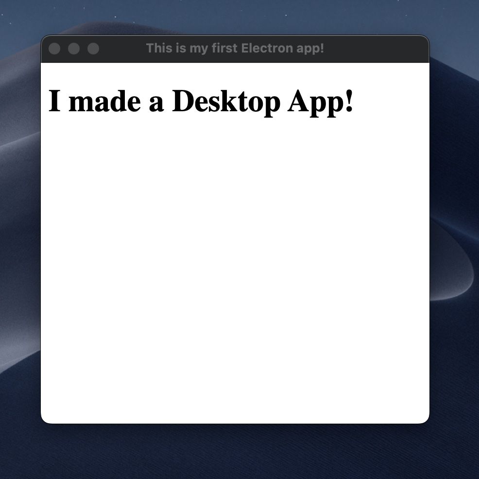

In this blog post, I'll show you how easy it is to build a JavaScript Desktop app with Electron.
After about 13 lines of code, you'll have a fully functional Electron app!

I will walk you through the code and explain everything there is to know. 🤝

# What is Electron {#heading-what-is-electron}

We're going to use the Electron framework to create this app. Electron is a free and open-source framework maintained mainly by [GitHub](https://github.com).

It powers dozens of apps, that most of you already heard of: Discord, Slack, Notion, VSCode, Spotify, and many [more](https://www.electronjs.org/apps).

The framework is designed to let developers create desktop applications using web technologies such as JavaScript, HTML, and CSS and run those applications inside a flavor of the Chromium browser engine while using NodeJS for the backend environment.

Electron exposes useful APIs such as the IPC (Inter-process communication module) that lets you to use the power of NodeJS from your Desktop app.
Electron was originally built for Atom that's an IDE developed also by GitHub.

# Structure of an Electron app {#heading-structure-of-an-electron-app}

Here's the directory layout of a really simple electron application:

```
.
├── index.html
├── index.js
├── node_modules
├── package-lock.json
└── package.json

1 directory, 4 files
```

Let's kick off by making an npm project, adding some scripts, and installing electron.

For this purpose, let's create a simple `package.json` file with `npm init`.

Make sure you also install the only library we're going to use in this project, Electron:

```
npm i electron
```

The `package.json` file will look something like this:

```json
{
  "name": "electron-blog-example",
  "version": "1.0.0",
  "description": "",
  "main": "index.js",
  "scripts": {
    "test": "echo \"Error: no test specified\" && exit 1"
  },
  "author": "",
  "license": "ISC",
  "dependencies": {
    "electron": "^20.0.2"
  }
}
```

Now run `npm i` to install all your dependencies.

Electron applications consist mainly of two things.

You can think of them as the front and the backend of an application.

## Backend {#heading-backend}

In every electron app, you'll have an `index.js` file. This is the file you're actually going to run.
This file is responsible for creating your desktop application's main window and it's going to look like this:

```js
const { app, BrowserWindow } = require("electron");

const createWindow = () => {
  const win = new BrowserWindow({
    width: 400,
    height: 400,
  });
  win.loadFile("./index.html");
};

app.whenReady().then(() => {
  createWindow();
});
```

Let's go over each of these lines.

```
const { app, BrowserWindow } = require("electron");
```

This is where you import the two most important things you need from Electron:
 - [app](https://www.electronjs.org/docs/latest/api/app); controls your application lifecycle
 - [BrowserWindow](https://www.electronjs.org/docs/latest/api/browser-window); a class that you can use to create a new browser window

Let's use `BrowserWindow` to create an actual browser window:

```
const createWindow = () => {
  const win = new BrowserWindow({
    width: 400,
    height: 400,
  });
  win.loadFile("./index.html");
};
```

`createWindow` function does two things:

1. it specifies some properties for the browser window, such as width and height
2. it loads a file called `index.html`

This is pretty much equivalent to opening a web page `index.html` in your browser.

However, `createWindow` should not be called until Electron is fully initialized. We can be sure that it's fully initialized when `whenReady` is called. This function returns a Promise so you can chain it with `then` and have something like this:

```
app.whenReady().then(() => {
  createWindow();
});
```

## Front end {#heading-front-end}

Similar to the `index.js` file, there's an `index.html` file that contains the UI of your application.

Let's create an `index.html` file with some simple content:

```html
<!DOCTYPE html>
<html>
  <head>
    <title>This is my first Electron app!</title>
    <meta http-equiv="Content-Security-Policy" content="default-src 'self'; script-src 'self'">
  </head>
  <body>
    <h1>I made a Desktop App!</h1>
  </body>
</html>
```

So far we have a JavaScript file that creates a BrowserWindow and a simple HTML file that's displayed when Electron becomes ready.

# Running your first Electron app {#heading-running-your-first-electron-app}

But how do we run this thing?

Add `"start": "electron .",` to `"scripts"`:

```json
{
  "name": "electron-blog-example",
  "version": "1.0.0",
  "description": "",
  "main": "index.js",
  "scripts": {
    "start": "electron .", // this is new
    "test": "echo \"Error: no test specified\" && exit 1"
  },
  "author": "",
  "license": "ISC",
  "dependencies": {
    "electron": "^20.0.2"
  }
}
```

Finally, all you have to do is to run the following command:

```
npm start
```
and your first Electron app will start up in a few seconds:



Congratulations! You just built your first desktop application with JavaScript!

In the next tutorial, we're going to explore some of the electron APIs, such as `ipcMain` and `ipcRenderer`.
