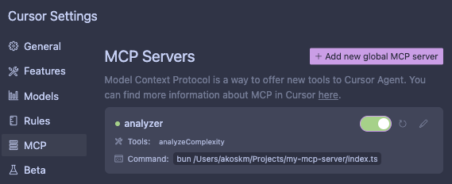
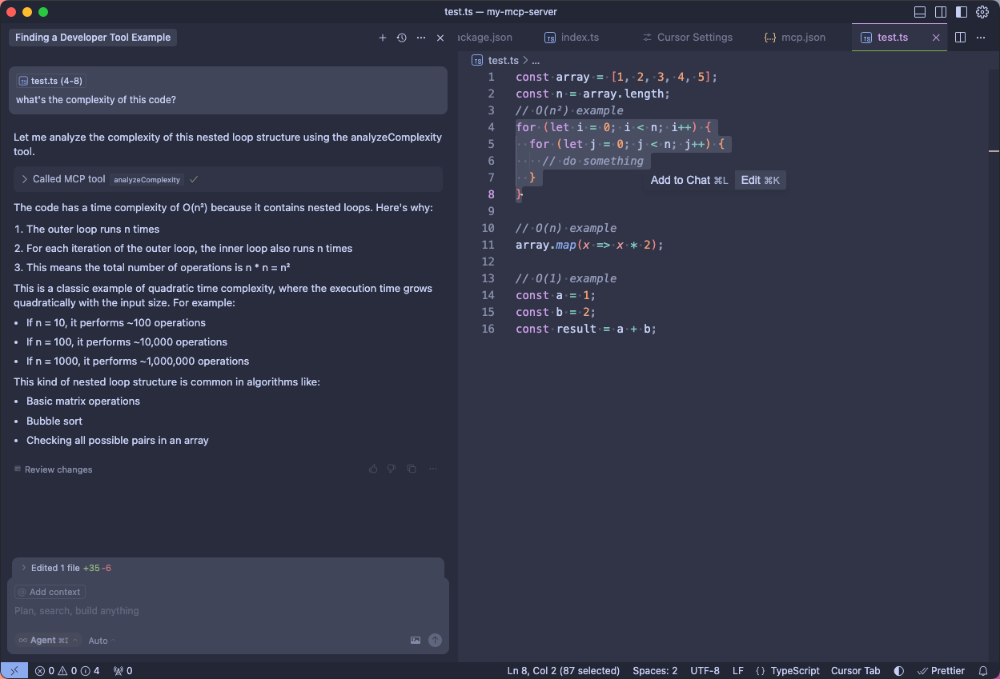
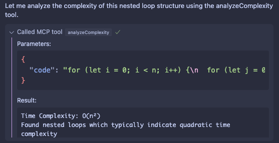

I’ll show you how to write and use your first Model Context Protocol (MCP) Server in Cursor. In the future, you can use your MCP Server in any MCP-compatible client (like Claude Desktop).

We’ll build an stdio MCP Server that communicates with clients using standard input/output streams.

There are three different types of protocols for MCP Servers right now:

* **stdio transport**: Used for local integrations, command-line tools, simple process communication, and shell scripts
    
* **SSE transport**: Used when only server-to-client streaming is needed or working with restricted networks
    
* **Custom transports**: Can be implemented for custom network protocols, specialized communication channels, integration with existing systems, or performance optimization
    

Each server type uses JSON-RPC 2.0 as its wire format for message transmission.

If you’re new to MCP Servers, I suggest you check out my previous post, which is a short introduction to the world of MCPs:

<div class="embed-wrapper"><div class="embed-loading"><div class="loadingRow"></div><div class="loadingRow"></div></div><a class="embed-card" href="https://akoskm.com/mcp-model-context-protocol-a-simple-guide/">https://akoskm.com/mcp-model-context-protocol-a-simple-guide/</a></div>

So let’s go ahead and build our first MCP Server using the stdio transport.

# Project Setup {#heading-project-setup}

Create an empty folder `my-mcp-server` and inside initialise a new package using `pnpm init`:

```bash
mkdir my-mcp-server
cd my-mcp-server
pnpm init
```

If you’re using Cursor, you can use the `cursor . -r` command to reload Cursor with the `my-mcp-server` folder open.

Let’s install the only two dependencies we’ll use for our MCP server:

```bash
pnpm i @modelcontextprotocol/sdk zod
```

# Stdio MCP Server {#heading-stdio-mcp-server}

Create a file `index.ts` in the root of your project folder.

You can either choose to compile this file into js using tsc or you can run your mcp server with bun, deno or even the [newest node versions because they have some TypeScript support of the box](https://akoskm.com/how-to-run-typescript-2025/). In this tutorial I’m using bun.

Import the modules we’ll use:

```typescript
import { McpServer } from "@modelcontextprotocol/sdk/server/mcp.js";
import { StdioServerTransport } from "@modelcontextprotocol/sdk/server/stdio.js";
import { z } from "zod";
```

Here’s what they can do:

* **McpServer**: This is a server component from the Model Context Protocol SDK. It helps you set up and manage a server that can communicate with MCP-compatible clients.
    
* **StdioServerTransport**: This component from the Model Context Protocol SDK allows the server to communicate with clients using standard input/output streams.
    
* [**Zod**](https://www.google.com/search?client=safari&rls=en&q=zod&ie=UTF-8&oe=UTF-8): This is a library used for schema validation. It helps ensure that data matches a specific structure, making it easier to catch errors and enforce data integrity.
    

Now create a new instance of an MCP server specifying the name and the version of your server:

```typescript
import { McpServer } from "@modelcontextprotocol/sdk/server/mcp.js";
import { StdioServerTransport } from "@modelcontextprotocol/sdk/server/stdio.js";
import { z } from "zod";

// Create an MCP server
const server = new McpServer({
  name: "Demo",
  version: "1.0.0",
});
```

In this example, we’ll focus on exposing a tool because I think that’s the most interesting to work with, but there are other capabilities you can define on your server:

* **Resources** - Data access points similar to GET endpoints in REST APIs
    
    * Static resources
        
    * Dynamic resources with parameters
        
* **Tools** - Action endpoints that perform computation with side effects - *we’re using these now*
    
    * Simple parameter-based tools
        
    * Asynchronous tools (e.g., with external API calls)
        
* **Prompts** - Reusable templates for LLM interactions
    

We’ll build a tool that helps you understand code complexity using the Big O notation, which is a mathematical concept used to describe the performance or complexity of an algorithm.

```typescript
import { McpServer } from "@modelcontextprotocol/sdk/server/mcp.js";
import { StdioServerTransport } from "@modelcontextprotocol/sdk/server/stdio.js";
import { z } from "zod";

const server = new McpServer({
  name: "Demo",
  version: "1.0.0",
});

server.tool("analyzeComplexity",
  "Analyzes the time complexity of a given code",
  { code: z.string() },
  async ({ code }) => {
    let complexity = 'O(1)'; // Default complexity
    let explanation = '';

    // Check for nested loops
    const nestedLoops = code.match(/for\s*\(.*\)\s*{[\s\S]*?for\s*\(.*\)/g);
    if (nestedLoops) {
      complexity = 'O(n²)';
      explanation = 'Found nested loops which typically indicate quadratic time complexity';
    }
    // Check for single loops
    else if (code.match(/for\s*\(.*\)|while\s*\(.*\)/g)) {
      complexity = 'O(n)';
      explanation = 'Found a single loop which indicates linear time complexity';
    }
    // Check for array operations
    else if (code.match(/\.map\(|\.filter\(|\.reduce\(/g)) {
      complexity = 'O(n)';
      explanation = 'Found array operations which typically have linear time complexity';
    }

    return {
      content: [
        {
          type: "text",
          text: `Time Complexity: ${complexity}\n${explanation}`
        }
      ]
    };
  }
);
```

Besides the name and the description of the tool we pass a parameters part:

```typescript
  { code: z.string() },
```

And this is where the magic happens! 🪄

Cursor will automatically try to get the right parameters from your prompt based on what you specified in the params section.

You’ll see this in a minute.

Finally start your server using Server transport for stdio through a new instance of the `StdioServerTransport` class. This instance communicates with a MCP client (Cursor or Claude desktop) by reading from the current process' stdin and writing to stdout.

```typescript
// Start receiving messages on stdin and sending messages on stdout
const transport = new StdioServerTransport();
await server.connect(transport);
```

Let’s see how we can register this server in Cursor.

# Register the MCP Server in Cursor {#heading-register-the-mcp-server-in-cursor}

Open Cursor Settings and under MCP click **Add new global MCP server**.

In case you want to add project-local MCP server, you’ll need the same configuration file, just put it inside a `.cursor/mcp.json` file inside your project.

We’ll go with the global settings, which first looks like this:

```typescript
{
  "mcpServers": {
  }
}
```

You’ll be extending this with the tool’s name and how it should be run. You can see the configuration file schema here: [Configuring MCP Servers](https://docs.cursor.com/context/model-context-protocol#configuring-mcp-servers), but it goes like this:

```typescript
{
  "mcpServers": {
    "analyzer": {
      "command": "bun",
      // replace /Users/akoskm/Projects with the full path to your project
      "args": ["/Users/akoskm/Projects/my-mcp-server/index.ts"]
    }
  }
}
```

I recommend you use the full path to the MCP server script when using global MCP servers. After switching back to Cursor MCP Settings you should see something like this:



You can also verify that the tool exposed by the MCP server is visible by Cursor simply by asking it to list the available tools.

To demonstrate the usage of this tool create a simple script `test.ts` with some for loops:

```typescript
const array = [1, 2, 3, 4, 5];
const n = array.length;
// O(n²) example
for (let i = 0; i < n; i++) {
  for (let j = 0; j < n; j++) {
    // do something
  }
}

// O(n) example
array.map(x => x * 2);

// O(1) example
const a = 1;
const b = 2;
const result = a + b;
```

Now select the two `for`s from the `// O(n²) example` and ask this in the chat:

> what's the complexity of this code?

As you will see Cursor will realize it needs to make a cool call and automatically discover that it needs to pass in the selected code as the argument.



You can see this when you expand the **Called MCP Tool** section:



And that’s it!

You just created and used your first MCP server for something amazing!

What will you create next?

# GitHub {#heading-github}

You’ll find my studio starter project on GitHub here: [https://github.com/akoskm/create-mcp-server-stdio](https://github.com/akoskm/create-mcp-server-stdio).

You can also just run this command:

```bash
npm create @akoskm/mcp-server-stdio my-mcp-server
```

And it’ll create a stdio MCP server in `my-mcp-server`. 🙂

# Video {#heading-video}

You can also check out the video I just recorded, where I’m showing you how to build an MCP server:

<div class="embed-wrapper"><div class="embed-loading"><div class="loadingRow"></div><div class="loadingRow"></div></div><a class="embed-card" href="https://youtu.be/YJ3iPXqiN7g?si=wnnrNdsfIbYD_4Ux">https://youtu.be/YJ3iPXqiN7g?si=wnnrNdsfIbYD_4Ux</a></div>

# Resources {#heading-resources}

* [The MCP protocol’s website](https://modelcontextprotocol.io/introduction)
    
* [Official MCP TypeScript SDK](https://github.com/modelcontextprotocol/typescript-sdk)
    
* [Cursor MCP Docs](https://docs.cursor.com/context/model-context-protocol)
