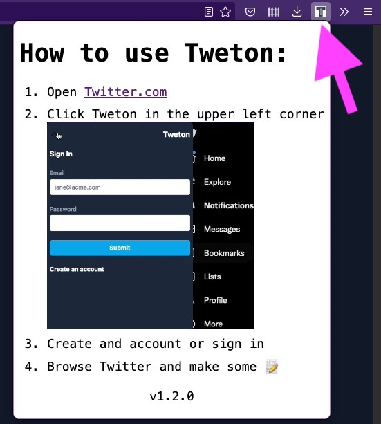
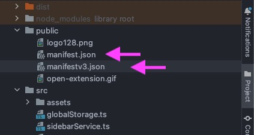

> 2023 Update: Although Manifest v3 support was added in [Firefox 109.0](https://www.mozilla.org/en-US/firefox/109.0/releasenotes/) it’s far from being compatible with Chrome’s Manifest v3 so I still recommend you use this setup.

First of all, congratulations for not turning your back on browsers other than Google Chrome and building a Cross Browser Extension! 👏

I've encountered many issues and spent hours and days looking for solutions while trying to support multiple browsers. By sharing my experience, I hope you will spend less time fixing the incompatibility issues and more time working on your plugin.

GitHub repo: [https://github.com/akoskm/vite-react-tailwindcss-browser-extension](https://github.com/akoskm/vite-react-tailwindcss-browser-extension)

Before we dive into, you can support me by subscribing to my newsletter. It's all about writing, stats and strategies for growing at a sustainable peace.

<div class="hn-embed-widget" id="substack"></div>

## The current state of WebExtensions {#heading-the-current-state-of-webextensions}

WebExtensions is a platform for building extensions for both Firefox and Chrome since 2015 - that's when Firefox [adopted this standard](https://blog.mozilla.org/addons/2015/08/21/the-future-of-developing-firefox-add-ons/).

One platform to rule them all!

<div class="embed-wrapper"><div class="embed-loading"><div class="loadingRow"></div><div class="loadingRow"></div></div><a class="embed-card" href="https://media.giphy.com/media/zGnnFpOB1OjMQ/giphy.gif">https://media.giphy.com/media/zGnnFpOB1OjMQ/giphy.gif</a></div>

Sounds cool, right? Well...

The platform has different versions in different browsers.

While writing this, Firefox and Chrome (and the rest of the Chromium squad) support two different Manifest versions, Manifest v2 and v3.

Because of the different Manifest versions, if you want to create a Cross Browser extension in 2022, prepare to support two entirely different specifications.

This will already be a huge bottleneck if you're new to making browser plugins.

<div class="embed-wrapper"><div class="embed-loading"><div class="loadingRow"></div><div class="loadingRow"></div></div><a class="embed-card" href="https://twitter.com/akoskm/status/1581223328001708032">https://twitter.com/akoskm/status/1581223328001708032</a></div>

You might find a repository template or blog posts that use your favorite JavaScript stack, but it easily could be that it's not adopted for Manifest v2 or v3.

## Manifest v2 vs v3 {#heading-manifest-v2-vs-v3}

*I couldn't pick a worse time to build a cross browser browser extension.*

So these specifications, called Manifest files, essentially contain information about your extension. What it is allowed to do, what resources it uses, the JavaScript and CSS files required to make it work, and so on.

There are currently two Manifest versions in play: v2 for Firefox and v3 for Chrome.

While you can write your entire plugin in Manifest v2 and test it in *both* browsers, the Chrome web store won't allow you to publish a new extension with Manifest v2.

Firefox plans to support Manifest v3 fully by the [end of 2022](https://blog.mozilla.org/addons/2022/05/18/manifest-v3-in-firefox-recap-next-steps/).

So If you're planning to go live with an MVP, I'd probably wait for the end of the year or build it for Chrome and hope Firefox will make the support happen as planned.

However, if you still want to go this route, read on because this is what I did.

Are you already moving from Manifest v2 to v3? Check out [this guide](https://extensionworkshop.com/documentation/develop/manifest-v3-migration-guide/) from Mozilla.

Let's take a look at all the steps where I failed big and spent quite some time making this work:

## Bundlers {#heading-bundlers}

There's a good chance you'll not write your extension in Vanilla JavaScript.

While it's trivial and probably works for your first-ever browser extension - if you want to build a product on top of this Vanilla JS stack, you'll hate it before you finish the plugin.

While working a ton with Webpack and being aware of its flaws, like the speed and the extensive configuration, I decided to try something new: Vite.

Vite has been gaining popularity, and it was replaced as the default bundler in some known companies I worked with before.

So I picked Vite over Webpack, and it hurt me twice 😄

Not just because Vercel recently introduced [Turbopack](https://vercel.com/blog/turbopack), which might have a 700% speed increase compared to Webpack - [or might not](https://twitter.com/youyuxi/status/1586042491739860993), depending on who you ask - but because Vite also bundles to ESM by default. The browse plugin format must be [IIFE](https://developer.mozilla.org/en-US/docs/Glossary/IIFE).

<div class="embed-wrapper"><div class="embed-loading"><div class="loadingRow"></div><div class="loadingRow"></div></div><a class="embed-card" href="https://twitter.com/akoskm/status/1582267969014726656">https://twitter.com/akoskm/status/1582267969014726656</a></div>

## Scripts {#heading-scripts}

Another point of incompatibility is `scripts`, specifically, background scripts.

In short, the anatomy of a browser extension can be summed up as three scripts:

### Popup {#heading-popup}

Popup is essentially the script responsible for rendering the UI that shows when you click the extension icon in the toolbar. Here's what it looks like for [Tweton](https://tweton.com/), a browser extension that I'm building:



### Content {#heading-content}

The Content script is the one that has access to the page DOM that you're currently visiting, and it can even modify it. But it can't do much besides basic DOM operations and UI building. For example, you can't make network requests from it. This is why we need the Background Script:

### Background {#heading-background}

A background script allows you to set up a listener that will be called on specific browser events. Such as changing the tab or receiving a message from the content script.

For my plugin, I essentially used it as the "backend" for my content script. This was where I handled my API calls, prepared the request/response objects, and forwarded them to the content script.

These background scripts in Manifest v3 are called service workers, which makes things a little bit complicated:

Let's say you want to use localStorage.

While in Firefox (remember, it supports Manifest v2), this code would work fine:

```javascript
localStorage.setItem('sidebarState', 'open');
localStorage.getItem('sidebarState'); // open
```

a Chrome plugin's service worker (Manifest v3) doesn't have the concept of `localStorage`, and it uses something called [chrome.storage.local](https://developer.chrome.com/docs/extensions/reference/storage/), that's not just a completely different function, but it's also async:

```javascript
chrome.storage.local.set({ open: true })
chrome.storage.local.get(['open'])
```

So in case you want to have an API that supports a localStorage-like operation that's Cross Browser, you'll probably need a helper like this:

```typescript
const chromeLocalStorageApi = {
  async getItem(key: string): Promise<string | null> {
    const storage = await chrome.storage.local.get(key);
    return storage?.[key];
  },
  async setItem(key: string, value: string): Promise<void> {
    await chrome.storage.local.set({
      [key]: JSON.parse(value)
    });
  },
  async removeItem(key: string): Promise<void> {
    await chrome.storage.local.remove(key);
  }
};

export default function getLocalStorage() {
  if (chrome?.storage === undefined) return localStorage;
  return chromeLocalStorageApi;
};
```

However, by looking at the browser-specific naming, `chrome`, I would still assume that even in Manifest v3, you would need some helper module that returns the correct API for the current browser.

## Building the app and testing {#heading-building-the-app-and-testing}

I've experimented with programmatically generated Manifest files too, but it turned out to be a lot simpler to have two Manifest files:



Then in my build scripts, as the last step for the Chrome-specific step, I'm copying the `manifestv3.json` into my dist folder:

```javascript
"build:web": "tsc && vite build",
"build:js": "vite build --config vite.content.config.ts",
"build:firefox": "NODE_ENV=production run-s build:js build:web",
"build:manifest:chrome": "mv dist/manifestv3.json dist/manifest.json",
"build:chrome": "NODE_ENV=production run-s build:js build:background:chrome build:web build:manifest:chrome",
"package": "zip -r extension.zip dist/*",
```

So when I run the last command, `npm run package` it gets bundled with the correct manifest version.

The only drawback of this method is that I can only build a Firefox or a Chrome version, but not both.

This hasn't been an issue since I'm testing the plugin mostly in Firefox.

## Conclusion {#heading-conclusion}

It's possible to build a cross browser extension in 2022, but would I do it again knowing what I'll encounter? I probably wouldn't.

I would build for Chrome-only plugin and develop the core features while Firefox delivers the Manifest v3 support by the end of the year.

By building for Chrome-only now, you can spend more time developing the actual features than supporting browser incompatibilities that will most likely go away in the next few months.

Do I regret doing it? No!

I learned a ton, got sponsored deal out of it, and learned to use not one but two new technologies that will change how I build web applications. (More on this in December)

Finally, and obligatory:

How it started:

<div class="embed-wrapper"><div class="embed-loading"><div class="loadingRow"></div><div class="loadingRow"></div></div><a class="embed-card" href="https://twitter.com/akoskm/status/1580082441276256256">https://twitter.com/akoskm/status/1580082441276256256</a></div>

How it's going:

<div class="embed-wrapper"><div class="embed-loading"><div class="loadingRow"></div><div class="loadingRow"></div></div><a class="embed-card" href="https://twitter.com/akoskm/status/1587354756548362240?s=20&amp;t=bTWvz6UrDmv__c_AroCyfg">https://twitter.com/akoskm/status/1587354756548362240?s=20&amp;t=bTWvz6UrDmv__c_AroCyfg</a></div>

If you liked this post, give it some Emojis so more people can see it. 🙇‍♂️
