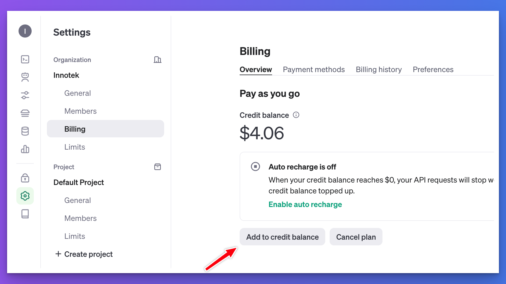
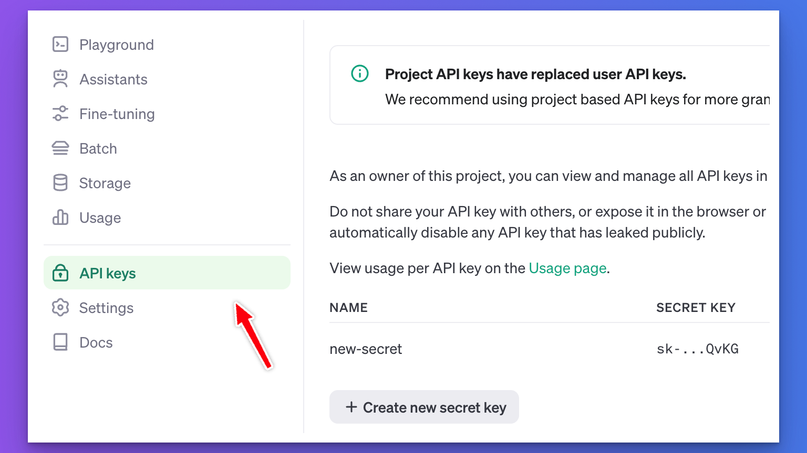
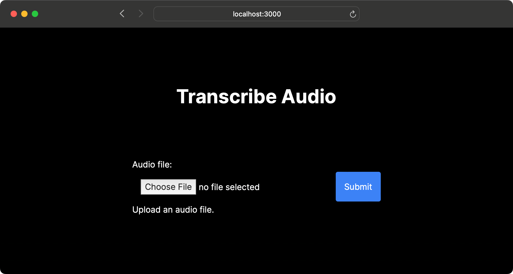

Hi friends –

In this blog post, we'll learn how to use OpenAI's speech-to-text API to transcribe our voice notes into text.

An application like this can be handy if you use voice notes, record videos, and want to repurpose audio files and turn them into text you can post on your blog or social media.

Our application uses Next.js, TypeScript, and Tailwind for styling.

🚨👉 If you're wondering how you can do all this on a production server and create an app that people will use and pay for, I wrote a book for you: [**OpenAI Crash Course in One Hour: Build Production-Ready Generative AI Apps with React, TypeScript & Remix**](https://a.co/d/iqaStzx)

If you're stuck, reply to this post, and I'll help!

Let's get started!

# Uploading Audio Files in Next.js {#heading-uploading-audio-files-in-nextjs}

In the previous blog post, we created a basic app for uploading audio files to our Next.js server. Please follow the post here:

<div class="embed-wrapper"><div class="embed-loading"><div class="loadingRow"></div><div class="loadingRow"></div></div><a class="embed-card" href="https://akoskm.com/file-upload-with-nextjs-14-and-server-actions">https://akoskm.com/file-upload-with-nextjs-14-and-server-actions</a></div>

The rest of the post will assume that you followed the previous tutorial.

Your form is working, and when you submit it with a selected file, Next.js uploads and saves it in your project's root directory.

# Setting up OpenAI {#heading-setting-up-openai}

To use OpenAI's Speech to text API, you'll need three things:

1. An OpenAI account
    
2. A positive OpenAI credit balance
    
3. an API key
    

If you don't have an account, head to [https://platform.openai.com/](https://platform.openai.com/) and create one.

You can add credits in Settings. Select your organization and go to Billing:



While writing this post, the minimum credit you can add is $5, which is *plenty* for building small demo apps.

Now, let's obtain the API keys by selecting the option with the same name from the sidebar:



Finally, click the **Create new secret key** button to create a new API key.

**Don't share this key with anyone.** If you accidentally publish your key, make sure you delete it. Third parties can use up your OpenAPI credits and might even incur significant charges for you.

For this project, we'll store the API key in a `.env` file. We haven't created this without our project yet, so go ahead and create it with the contents of your key:

```typescript
OPENAI_API_KEY=sk-proj-byoV4D8Fx2YOfV8ahhyqR3BlbkFJOGdM65Du3JDA1mHUzjb9
```

*This is a fake one. You should be using the* ***API key*** *you just created.*

## Making requests to OpenAI {#heading-making-requests-to-openai}

Now that we have the API key ready, it's time to make our first request to the OpenAI API.

To do this from Node.js, we'll need the official `openai` library. Go ahead and add this to your dependencies by running:

```bash
npm i openai
```

Once installed, open `page.tsx` created in [File Upload with Next.js 14 and Server Actions](https://akoskm.com/file-upload-with-nextjs-14-and-server-actions#heading-persisting-the-file).

Let's create a helper function returning the initialized instance of `OpenAI`:

```typescript
// page.tsx
import OpenAI from "openai";

let openai: OpenAI | null = null;

function getOpenAI() {
  if (openai === null) {
    openai = new OpenAI();
  }
  return openai;
}
```

We do this simply to avoid calling the `new OpenAI()` constructor every time and create a new instance whenever we want to make API calls.

Also, there's no need to pass the API key to the `OpenAI` constructor since `OPENAI_API_KEY` is automatically picked up from `.env`.

The Speech to Text Audio API currently has two main modules: transcriptions and translations. You can use these to transcribe audio into the same language as the audio or to translate and transcribe the audio into English.

We'll use OpenAI's speech recognition model, *whisper-1*, for the transcription.

The transcriptions module has a `create` function that expects a JSON in the following format:

```json
{
  file: ReadStream,
  model: "whisper model name",
}
```

We'll work on `handleUpload` that we created in our previous project.

The function already saves the uploaded file to the filesystem, which is handy because we can create a ReadStream from this file.

Go ahead and rename the `handleUpload` function to `transcribeAudio` to better reflect what the function is doing. I'll include the entire function later, but here's what we'll do.

After saving the file, we'll use OpenAI's audio API with the following JSON object:

```typescript
const transcription = await getOpenAI().audio.transcriptions.create({
  file: createReadStream(audioFile.name),
  model: "whisper-1",
});
```

The result of this call is a transcription object that will have the text in `transcription.text`. The `createReadStream` function comes from `import { createReadStream } from "fs";` - don't worry. I'll include the complete `page.tsx` file at the end of this section.

Let's also add a console log at the end of the call, logging `transcription.text` for now. Later, we'll send this result back to the client.

Here's how `transcribeAudio` looks now:

```typescript
  async function transcribeAudio(formData: FormData) {
    "use server";
    const audioFile = formData.get("audio") as File;

    const buffer = await audioFile.arrayBuffer();
    const audioBuffer = Buffer.from(buffer);

    await fs.writeFile(audioFile.name, audioBuffer);

    const transcription = await getOpenAI().audio.transcriptions.create({
      file: createReadStream(audioFile.name),
      model: "whisper-1",
    });
    console.log("result", transcription.text);
  }
```

Let's give this a spin in the browser. If you followed the steps and set up your API key correctly, this is how it should work on your end:


If you get something different at this point, feel free to reach out to me in the comments or drop an email to `support@akoskm.com`!

# Updating the UI {#heading-updating-the-ui}

Our users will have little use for the transcription if they can't see it! So, in the next step, we'll return the transcription result to the user and display it on the UI.

## Update the Server Action {#heading-update-the-server-action}

As the first step, let's move the `transcribeAudio` function to a separate `app/actions.ts` file:

```typescript
// app/actions.ts
"use server";

import fs from "fs/promises";
import { createReadStream } from "fs";
import OpenAI from "openai";

let openai: OpenAI | null = null;

function getOpenAI() {
  // same as before
}

export async function transcribeAudio(prevState: any, formData: FormData) {
  // same as before
  return { result: transcription.text };
}
```

We changed four things here compared to the version that you copied from `page.tsx`:

1. we move `"use server"` to the top of the file from `transcribeAudio`
    
2. we added `export` in front of `async function transcribeAudio` so we can import it in `page.tsx`
    
3. when using a Server Action through `useFormState`, the signature changes, and the first parameter `prevState: any` is required before `formData: FormData`.
    
4. instead of console logging the result, we return it as `return { result: transcription.text };`
    

Now we're ready to use this updated Server Action on the UI:

## Update the UI from Server Action result {#heading-update-the-ui-from-server-action-result}

We'll make two changes to the UI – `page.tsx`:

1. turn it into a client component
    
2. use the `useFormState` hook to call the Server Action
    

Let's add `"use client"` at the top of the file, import `transcribeUrl` from the newly added `actions.ts` module and also import `useFormState` from `react-dom`:

```typescript
// page.tsx
"use client";

import { transcribeUrl } from "@/app/actions";
import { useFormState } from "react-dom";
```

The hook `useFormState` expects two parameters: the first is the Server Action, and the second is the initial state – this will help us render an initial result until we call the Server Action.

In our case, we'll use this to display *"Upload an audio file."* to the user:

```typescript
export default function Home() {
  const initialState = { result: "Upload an audio file." };
  const [state, formAction] = useFormState(transcribeUrl, initialState);

  return (
    //...
        <p>{state?.result}</p>
    //...
  );
}
```

This is what it looks like when rendered in the browser:



For reference, here's the entire `page.tsx` again:

```typescript
"use client";

import { transcribeUrl } from "@/app/actions";
import { useFormState } from "react-dom";

export default function Home() {
  const initialState = { result: "Upload an audio file." };
  const [state, formAction] = useFormState(transcribeUrl, initialState);

  return (
    <main className="flex min-h-screen flex-col items-center justify-center p-24">
      <h1 className="text-4xl font-bold pb-24">Transcribe Audio</h1>
      <form action={formAction}>
        <label htmlFor="audio" className="block">
          Audio file:
        </label>
        <input type="file" name="audio" className="w-96 p-4" />
        <button className="bg-blue-500 text-white p-4 rounded">Submit</button>
        <p>{state?.result}</p>
      </form>
    </main>
  );
}
```

Let's give this a shot!


# Next steps {#heading-next-steps}

You might have already noticed a few way we could improve our app:

1. Right now, the Form placement changes when the text appears. It would be nicer to avoid the layout shift.
    
2. The Submit button doesn't have any feedback when it's clicked. It would be nice to set it to disabled and have visual feedback.
    

## Fixing the layout shift {#heading-fixing-the-layout-shift}

I'll leave you some time to find a solution for 1).

...

... some more time

... don't scroll just yet

Okay, here you go:

The layout shift could be avoided by simply moving the `<p>` outside of `<form>`:

```xml
        // <p>{state?.result}</p> // this is where we had it before
      </form>
      <p>{state?.result}</p> // move it here
    </main>
```

After this change the form should stay in place and the text should appear right below the form.

## Adding a loading indicator {#heading-adding-a-loading-indicator}

This is a bit more tricky, but I'll give you a hint:

There's a new [`useFormStatus`](https://react.dev/reference/react-dom/hooks/useFormStatus) hook in React Canary that you can already use in Next.js 14.

It works like this `const { pending } = useFormStatus();` – pending is `true` while the form is submitting.

I'll leave you some time again.

....

...

..

.

Okay, one more hint: before you add this to your main component containing the form, keep in mind that `useFormStatus` can only detect a form submission from the parent component.

So, instead of adding it right below `useFormState`, move the submit button into a separate component and use it in your form like this:

```typescript
      <form action={formAction}>
        // ... no change here but the button is now inside SubmitButton:
        <SubmitButton />
      </form>
```

Let's see what you've come up with!

....

......

........

All right, here's the `SubmitButton` component:

```typescript
function SubmitButton() {
  const { pending } = useFormStatus();
  return (
    <button
      disabled={pending}
      className="bg-blue-500 text-white p-4 rounded disabled:opacity-50"
    >
      Submit
    </button>
  );
}
```

Simple, right?

Now let's demo the new and improved behavior:


Great job! 👏👏👏

# Conclusion {#heading-conclusion}

Let's recap what you've learned in this blog post:

* Creating an OpenAI API key that you can use in your apps
    
* Use of OpenAI's Speech to text functionality with the `whisper-1` model
    
* Returning a response from your Server Action to the client in Next.js
    
* **Bonus:**
    
* Creating a loading indicator using the `useFormStatus` hook
