With the shutdown of StackOverflow jobs, independent job boards are becoming increasingly popular. In this tutorial, we'll create a statically generated job board using Next.js, Airtable, and TailwindCSS. We'll set up an Airtable table as our database, fetch data from it, and generate static pages for each job listing. This approach offers fast response times, low resource usage, and great SEO. The complete source code can be found [here](https://github.com/akoskm/job-board).

While not as powerful as a database, Airtable has its advantages. It's super easy to integrate, and the visual, excel-like layout helps you quickly add new entries to your table. Although Airtable API enforces rate limits, we'll overcome those by fetching the data only once during build time and caching the response.

# Creating a Next.js project {#heading-creating-a-nextjs-project}

To create an empty Next.js project with TypeScript, run:

```bash
$ npx create-next-app@latest job-board --typescript --eslint
```

I'll use TailwindCSS for this project, but it's completely optional. You can create the project without it, and later, if you decide to add it anyway, just follow their [documentation](https://tailwindcss.com/docs/guides/nextjs) on how to add it to your Next.js project.

Here are my choices for `create-next-app`:

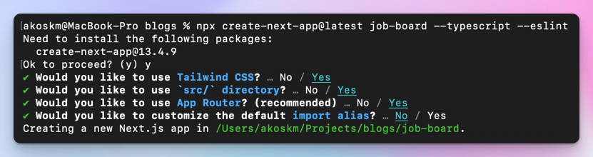

After running the script, move to the created directory and start the Next.js server:

```bash
$ cd job-board
$ npm run dev
```

This is what you should see on `http://localhost:3000`:

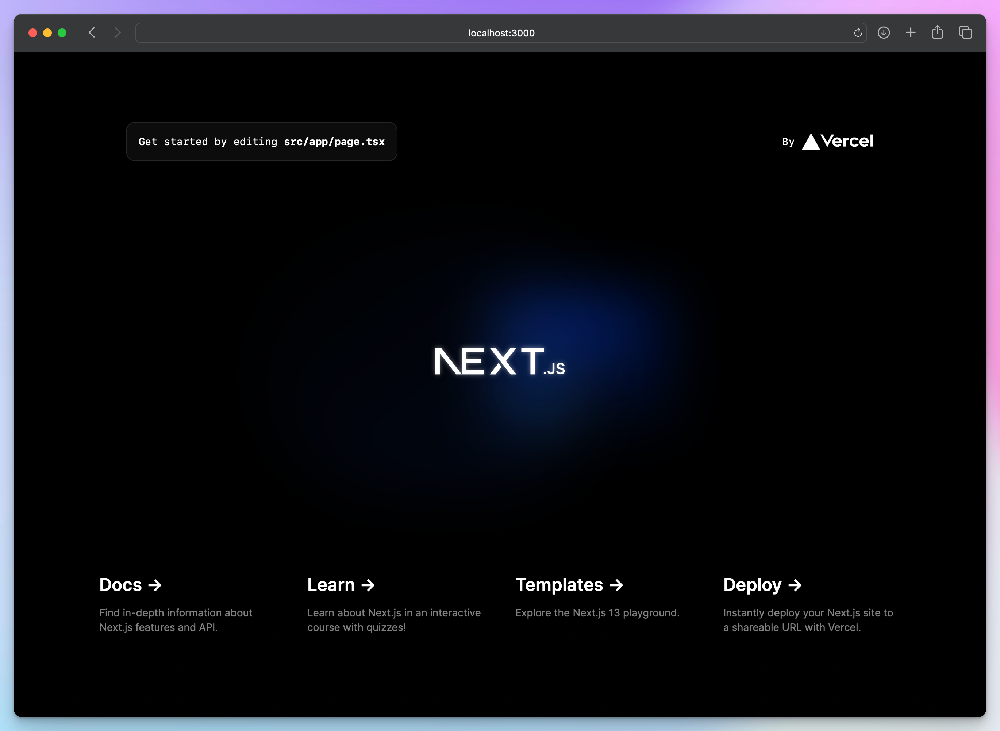

# Creating an Airtable table {#heading-creating-an-airtable-table}

Next, set up an Airtable account using my referral link (use the free tier) at [https://airtable.com](https://airtable.com/invite/r/pXhZVTHB), then create a new (data) Base:

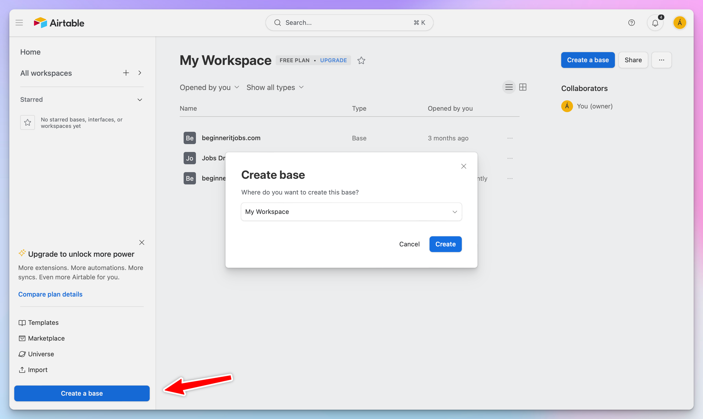

After clicking "Create", Airtable will create and open for you an empty Airtable Base:

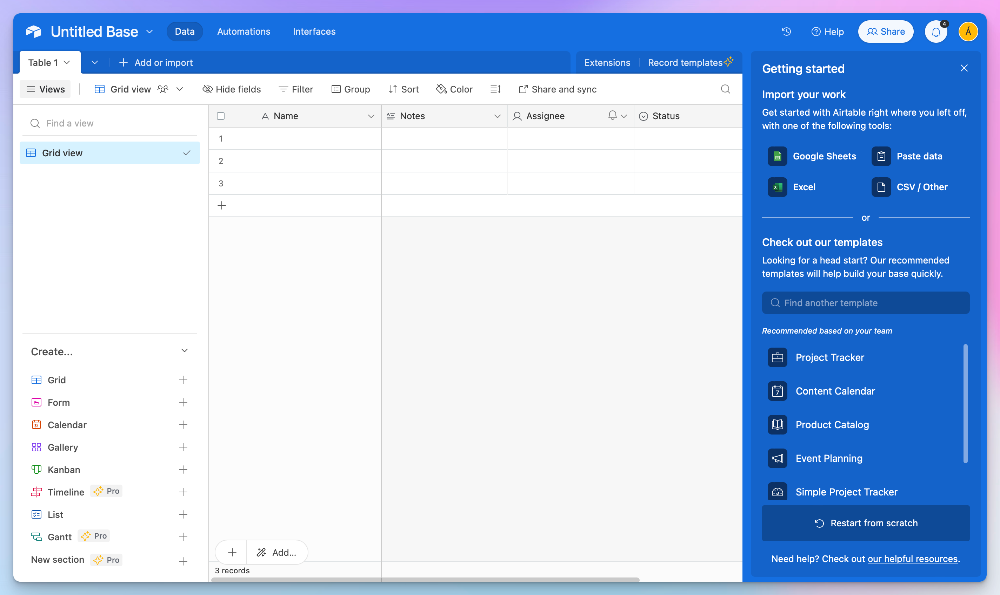

We'll only make a few changes here and swap our Notes for Link with the type of URL that will hold the URL to the actual job on a company website and Assignee for Description that will contain the actual job description, and also add a couple of jobs:

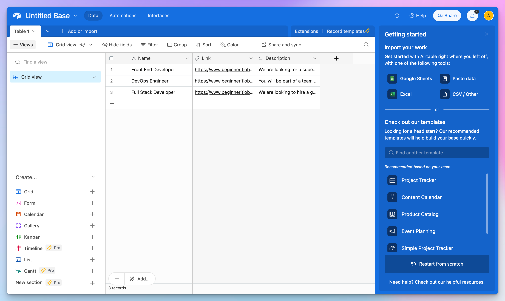

You should also rename Untitled Base to Job Board or whatever you prefer. It'll be important in the next step.

# Connecting Airtable to Next.js {#heading-connecting-airtable-to-nextjs}

Now that we have a couple of jobs added, it's time to connect the Next.js app to our Airtable database and fetch this data.

## Setting up a Personal Access Token {#heading-setting-up-a-personal-access-token}

To use the interactive docs of Airtable, you need to set up a Persona Access Token (PAT) at [https://airtable.com/create/tokens](https://airtable.com/create/tokens).

Since our app will only read the entries, adding the `:read` scope to our PAT will be sufficient:

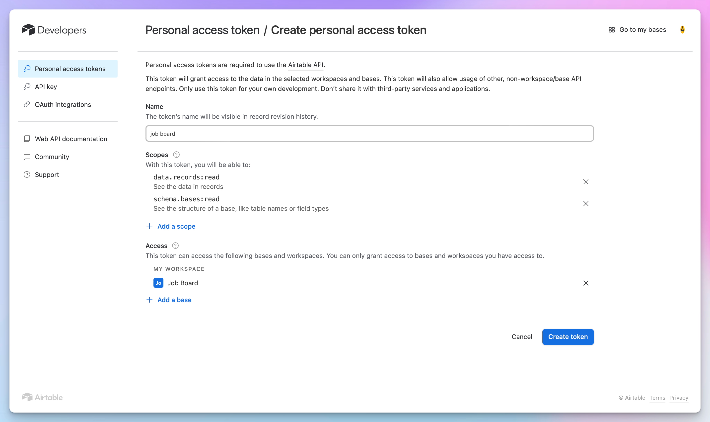

Next, click Create token, copy the created token, create a `.env` file in your Next.js app's folder and add the token:

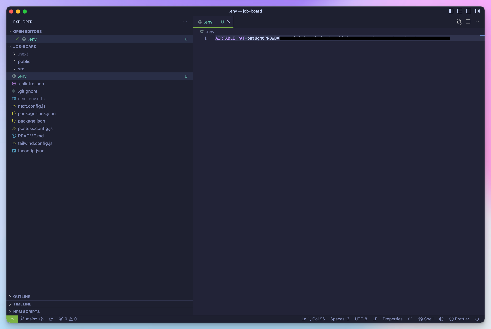

## Set up the airtable.js client {#heading-set-up-the-airtablejs-client}

To fetch data from Airtable, we'll use the official client. You can add it to your project by running `npm install airtable`.

Now that our PAT is ready let's make our first API call toward Airtable.

Replace the contents of `src/app/page.tsx` with the following

```typescript
import Airtable from 'airtable';
var base = new Airtable({
  apiKey: process.env.AIRTABLE_PAT
}).base('appT3mGfQjmWSFaGW');

base('Table 1').select({
    view: "Grid view"
}).all(function page(err, records) {
    if (!records) return;

    records.forEach(function(record: any) {
        console.log('Retrieved', record.get('Name'));
    });
});

export default function Page() {
  return (<div>Page</div>)
}
```

Here's what these lines do:

`new Airtable` creates the client with the `AIRTABLE_PAT` token we added earlier to our `.env` file.

`base('Table 1').select({` is a function, much like in SQL, that tells the Airtable client what records to select from `Table 1`

As you can see on the next line `}).all(function page(err, records) {`, we select all records for now.

Finally, we loop over the array of records and print out the name of each record.

`records` is an array of Airtable Records. For each row, you should use `Record.get(columnName)` to access the column name for the current row.

Now if you navigate to `http://localhost:3000/`, you'll see only Pages, but if you look at the console where `npm run dev` is running, you should see this:

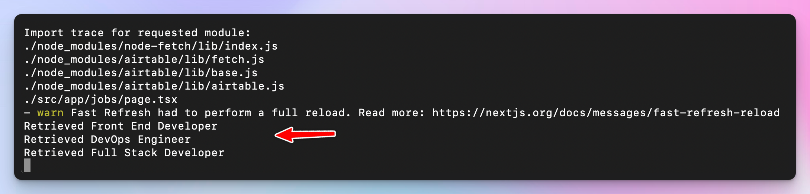

This data is already coming from Airtable! Congrats! Now let's add some more records to your table so we'll have more data to work with!

# Generating static pages at build time {#heading-generating-static-pages-at-build-time}

Our app will have two static pages:

* the root page served at `/` - this is the page that will list all jobs from our job board
    
* the single job page served at `/jobs/[id]` - one page for each job we have in our Airtable table
    

Both pages will be generated as static HTML. But first, we have to pre-fetch some data to generate the static pages, so let's start with that.

## Data Fetching Service {#heading-data-fetching-service}

We will consolidate the Airtable-specific components in one location to make our code reusable. By doing this, if we ever decide to transition from Airtable to a hosted database, we will know that the only implementations needing replacement are found here.

We'll need two methods in our data fetching later: one for fetching all jobs and one for fetching the contents for a single job.

Create a file `src/services/index.tsx` and copy the contents of `src/app/page.tsx` without the default export at the end.

We'll make two simple modifications:

* Remove the console log and simply resolve with the results of `base.select.all`
    
* Save the records in a local variable so when we fetch single jobs, we don't go again to Airtable and ask for the data. This is important because Airtable has [rate limits](https://airtable.com/developers/web/api/rate-limits)!
    

```typescript
import Airtable, { FieldSet, Records } from 'airtable';
import { JobData } from '@/types';

const base = new Airtable({apiKey: process.env.AIRTABLE_PAT}).base('appT3mGfQjmWSFaGW');
let jobs: null | Records<FieldSet> = null;

export default async function getJobs(): Promise<Records<FieldSet>> {
  return new Promise((resolve, reject) => {
    base('Table 1').select({
      // Selecting the first 3 records in Grid view:
      view: "Grid view"
    }).all(function page(err, records) {
      if (err) reject(err);

      if (!records) {
        reject("No records found");

        return;
      }

      // save the fetches records in a local variable
      // will be useful later
      jobs = records;

      resolve(records);
    });
  });
}
```

## Root page {#heading-root-page}

It's time to create the root page of the app.

This page will list all jobs from the Airtable table.

Replace the contents of `src/app/page.tsx` with the following:

```typescript
import getJobs from "@/services";
import Link from "next/link";


export default async function Page() {
  const jobs = await getJobs();

  if (!jobs) return (
    <div>AI has taken all programming jobs. Check back later!</div>
  );

  return (
    <div>
      <h1 className='text-2xl pt-4'>Jobs</h1>
      <div>
        {jobs.map((job) => (
          <Link key={job.id} href={`/jobs/${job.id}`}>
            <div>
              {job.get('Name') as string}
            </div>
          </Link>
        ))}
      </div>
    </div>
  )
}
```

We call `getJobs` from our data fetching service and simply loop over the results and create a link for each job.

Easy!

When you navigate to `localhost:3000` it should look something like this (okay, not exactly, because I've added some extra styles to the base Next.js layout [here](https://github.com/akoskm/job-board/blob/main/src/app/layout.tsx)):

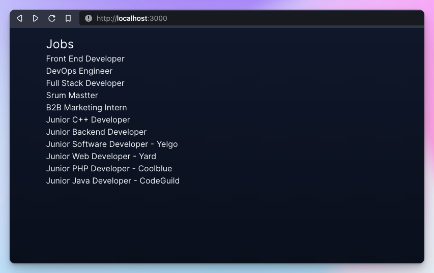

Try clicking any of the links. Because we haven't implemented the `jobs/[id]` page yet, you'll receive 404:

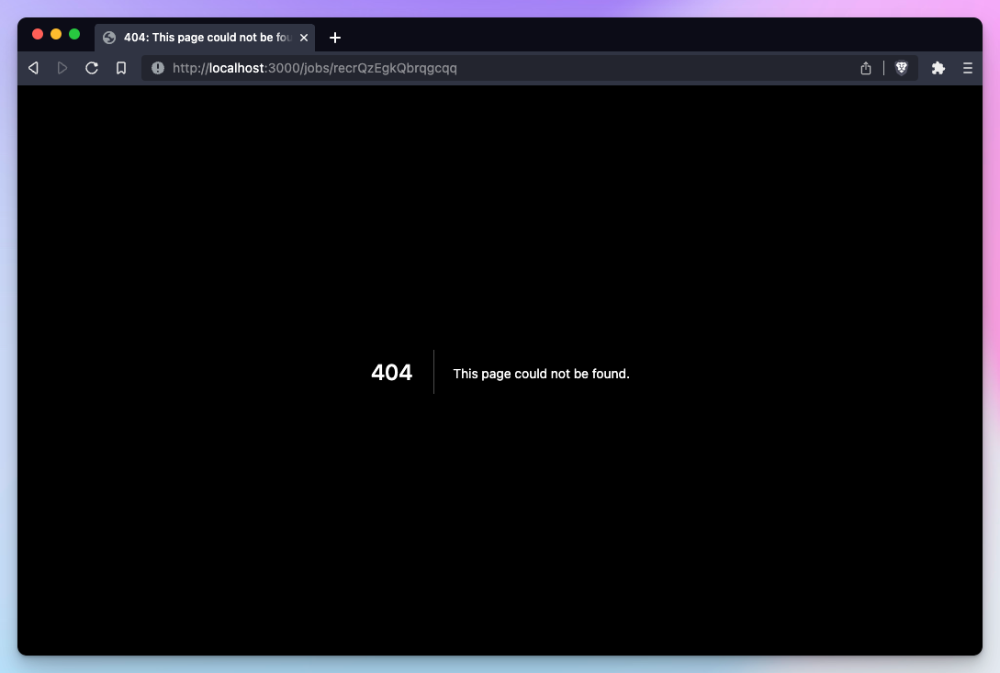

Let's fix this by implementing the single job page.

## Single Job page {#heading-single-job-page}

The purpose of the single job page is to display a job with a specific ID. Remember that we want all these pages to be generated at build time, so we'll have to use a special Next.js function [`generateStaticParams`](https://nextjs.org/docs/app/api-reference/functions/generate-static-params).

This function allows us to create a list of specific parameters that will be used to generate multiple static pages at the time of building the website. By using this function, you can ensure that all the individual job pages are created during the build process, which means they will be available for users to view without additional server-side processing. This approach not only improves the performance of your website but also makes it more efficient in terms of resource usage.

Create a new file `src/app/jobs/[id]/page.tsx` with the following contents:

```typescript
import getJobs from "@/services";

export async function generateStaticParams() {
  const jobs = await getJobs();

  return jobs.map((job) => ({
    id: job.id,
  }));
}
```

In the context of our single job page implementation, we will utilize the `generateStaticParams` function to generate a list of job IDs. Next.js will then use this list to create separate static pages for each job, displaying the job's name and description for now. But to fetch a single job we'll need a new method in our Data Fetching Service, so let's add that. Open `src/services/index.tsx` and add `getJob`:

```typescript
export async function getJob(id: string) {
  if (!jobs) {
    await getJobs();
  }

  const job = jobs?.find((job: JobData) => job.id === id);

  return job;
}
```

`jobs` is a local variable holding the data we already fetched from Airtable. Now that we have a fetch for a single job, here's what the entire `src/app/jobs/[id]/page.tsx` looks like:

```typescript
import getJobs, {getJob} from "@/services";

export async function generateStaticParams() {
  const jobs = await getJobs();

  return jobs.map((job) => ({
    id: job.id,
  }));
}

export default async function JobPage({ params: { id } }: { params : { id: string}}) {
  const job = await getJob(id);

  if (!job) return (<div>Job {id} doesn’t exist</div>);

  return (
    <div>
      <h1>{job.get('Name')}</h1>
      <p>{job.get('Description')}</p>
    </div>
  )
}
```

# Test Run! {#heading-test-run}

To test the production build of the site, first, we have to generate all the static pages. Run `npm run build` and watch what happens in the command line:

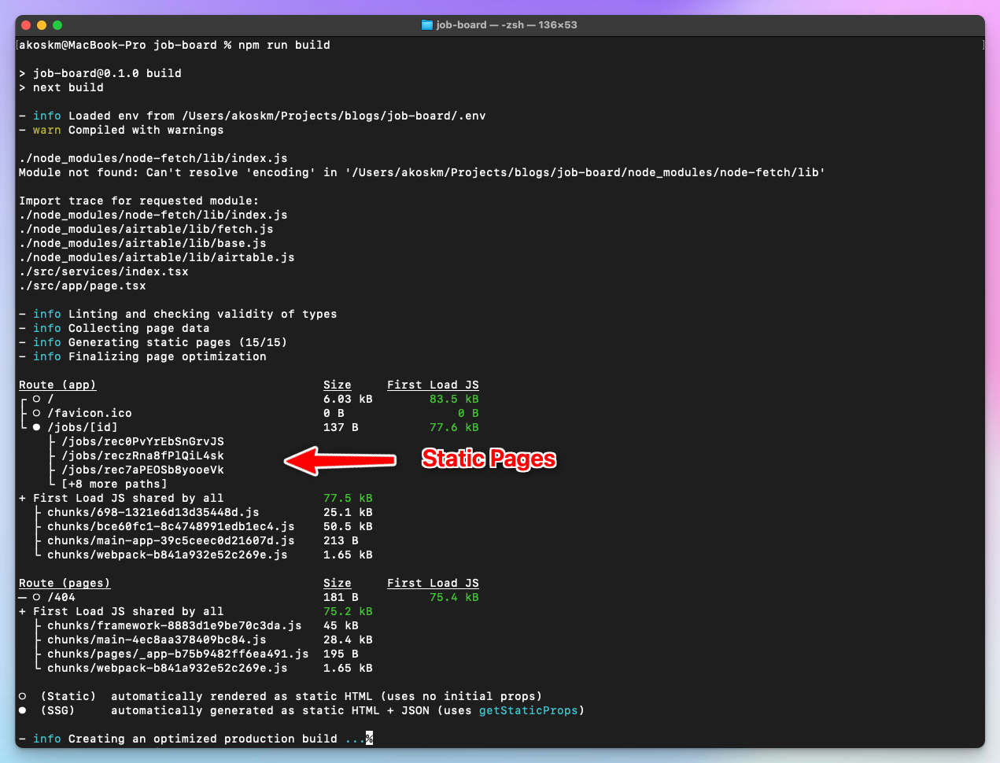

Next.js generated one static page for every job in our Airtable table. Bingo!

Let's give it a spin by running `npm start`:


Subsequent pages load instantly because there are no calls to Airtable. Every page we open is a page that was built during `npm run build` which gives us blazing-fast response times, uses fewer resources, and results in great SEO!

# Next Steps {#heading-next-steps}

## Customization {#heading-customization}

Although you can use this as a backbone for your job board, there is plenty of room for improvement. For example, I did minimal customization of the look of the job board. Luckily, the project was created with TailwindCSS enabled, so adding more styling to the pages should be easy.

## Rebuild {#heading-rebuild}

Since the pages are generated during the build process, the only job listings displayed on your landing page will be those available during the most recent build.

To revalidate and get the latest version of the page based on your Airtable data, you could periodically revalidate your static pages using the special `revalidate` variable. You can read more about it [here](https://nextjs.org/docs/app/building-your-application/data-fetching/revalidating).

## Updates {#heading-updates}

The job board I built with this template, [http://beginneritjobs.com/](http://beginneritjobs.com/), features job postings suitable for beginners or developers with minimal experience. I still haven't found a great way to add new entries to the job board regularly besides manually looking for jobs and adding them.

---

As always, thank you for reading this tutorial!

You'll find the complete source code [here](https://github.com/akoskm/job-board).

If you have any questions, let me know in the comments or open an issue on GitHub!

See you in the next one, bye 👋

\- Akos
