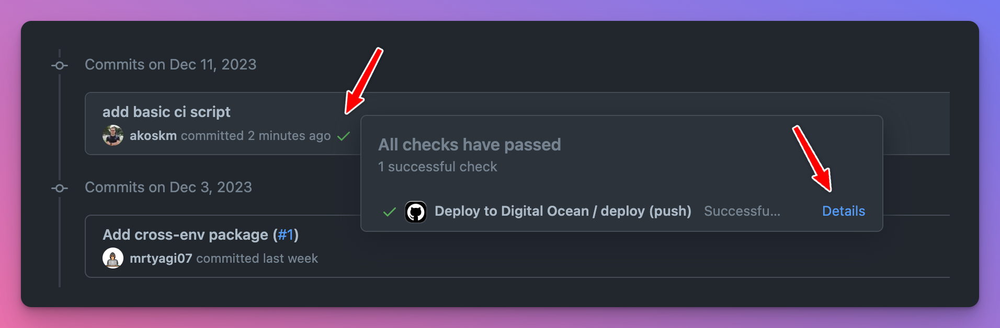
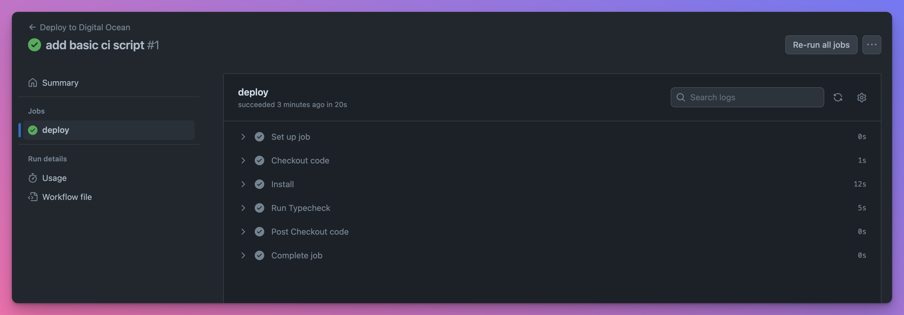
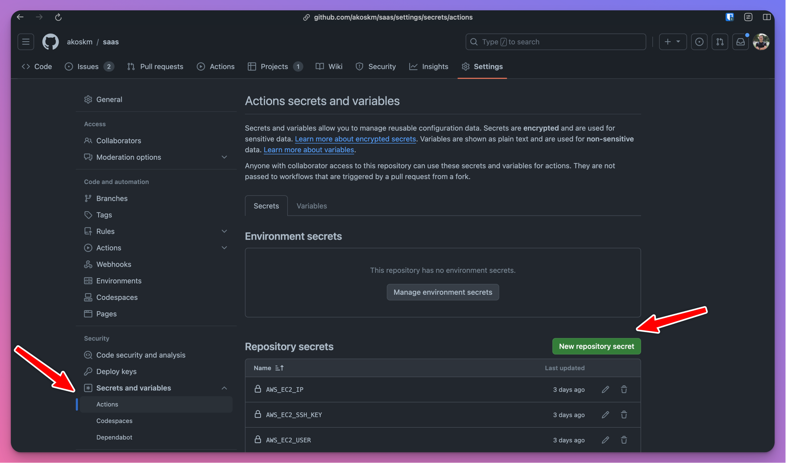
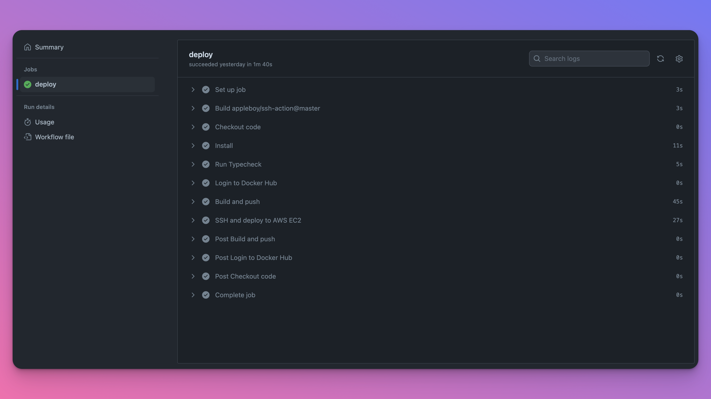

Imagine this: It's Cyber Monday, the busiest online shopping day of the year. You've worked tirelessly on a project for your client, launching an irresistible 50% off deal.

Excitement is in the air, but then, disaster strikes – the payment system crashes. That's exactly what happened to us a few weeks ago, and it was a wake-up call.

**Why a Robust CI/CD Pipeline Matters**

This experience underscored a crucial lesson: the importance of a rock-solid Continuous Integration and Continuous Deployment (CI/CD) pipeline. As developers, we thrive on innovation and creativity, shipping new features and building amazing things – it's the heartbeat of our profession. But, without a reliable CI/CD process, even the best ideas can come crashing down at the worst possible moment.

**The Hidden Dangers of Development**

In web development, things usually run smoothly until they don't. When they break, the impact is twofold:

1. **The Detective Work**: Discovering what went wrong and when is a daunting task. Sometimes, issues lurk beneath the surface for weeks or months, only to emerge at the least opportune moment, like during a major sale.
    
2. **The Cost of Bugs**: Imagine launching a much-anticipated Cyber Monday deal on your brand-new SaaS platform, only to find the payment system is down. For early startups, the financial aspects of this can be severe.
    

**From Experience to Action**

Having been through both of these challenges, I've learned that establishing a CI/CD pipeline is not just an option; it's a necessity for any project I plan to launch.

**Demystifying CI/CD**

But what exactly is CI/CD, and why do these terms always seem to go hand-in-hand? Let's dive into the world of Continuous Integration and Continuous Deployment, using GitHub Actions and Docker, to see how they can safeguard our projects from the kind of nightmare we experienced on Cyber Monday.

## Terminology {#heading-terminology}

### CI {#heading-ci}

CI stands for Continuous integrations. When you change your application code, you'd like it to work with the rest of the code. CI helps you verify this.

Without automation, you'd test all app functionality manually before shipping the change to the users. With automation, these changes are tested as part of CI.

Running a linter or the TypeScript compiler is a great way to start your CI workflow. They catch early bugs fast and prevent your more resource-intensive steps, such as unit or integration tests, from running.

Once the CI step is done, you're confident your new code works with the rest of the code.

### CD {#heading-cd}

CD is *showtime*. 🚀 It's time to ship this change to your users, usually by deploying the app on a remote server. But for desktop applications, it means packaging and uploading the executables to storage.

Because of this, I use CD as an acronym, Continuous Delivery, and not Deployment – not everything is a web app and can be deployed.

Whatever you do, at this point, CI has already given you the confidence that you're ready to move forward and introduce this change to your users.

### GitHub Actions {#heading-github-actions}

GitHub Actions is a feature of GitHub for CI/CD within your GitHub repository. It allows you to create custom workflows to build, test, package, release, or deploy your code based on specific triggers such as a push event, a pull request, commits, etc. Workflows consist of one or more **jobs**, which are series of **steps** that run commands.

## Adding CI to your existing project {#heading-adding-ci-to-your-existing-project}

First, we'll build a simple CI workflow that will run `tsc` when we make a commit. Creating a workflow starts with creating a workflow file.

### Creating a Workflow file {#heading-creating-a-workflow-file}

Jump into your project's root directory and create the file `.github/workflows/main.yml`:

```plaintext
mkdir -p .github/workflows
touch .github/workflows/main.yml
```

The first command creates the folder structure (make sure you use `-p` otherwise you'd have to create the `.workflows` folder separately) and the second creates an empty file.

Open this file and then proceed to the next step.

### Adding steps to your workflow file {#heading-adding-steps-to-your-workflow-file}

There are three elements of a workflow file you need to define:

```yaml
name: Deploy to Digital Ocean
on:
jobs:
```

* name – the name of your workflow.
    
* on – a rule that describes when this workflow is triggered.
    
* jobs - you can have as many jobs as you want. GitHub Actions jobs run in parallel. This means that if you have multiple jobs defined in your workflow, they will all start running simultaneously when the workflow is triggered. You can also make them dependent on each other with the `needs` keyword, but we'll explore that next time.
    

The steps listed in jobs can be many things:

* single line commands such as copying files or logging parameters
    
* running npm, yarn, or any other executable on the system
    
* running other GitHub actions
    

### Example of a workflow file {#heading-example-of-a-workflow-file}

If you want to work with your repository in the workflow – and what else you would do anyway – the workflow must access it.

We already mentioned that GitHub Actions can run other GitHub actions. Luckily, there's a GitHub action for checking out the current repository's source code. You'll be using it like this:

```yaml
jobs:
  deploy:
    runs-on: ubuntu-latest
    steps:
      - name: Checkout code
        uses: actions/checkout@v4
```

Now that you have the source code in place, you can do `npm install` and do some type-checking.

Here's how the workflow will look like that does all this:

```yaml
name: Deploy to Digital Ocean

on:
  push:
    branches:
      - main # Set a branch to deploy when pushed

jobs:
  deploy:
    runs-on: ubuntu-latest
    steps:
      - name: Checkout code
        uses: actions/checkout@v4

      - name: Install
        run: npm install

      - name: Run Typecheck
        run: npm run typecheck
```

### Testing the workflow file {#heading-testing-the-workflow-file}

It's time to commit and push these changes to our main branch. Once you open the commit history, you'll notice a ✅ appeared next to your commit message.



This indicates that the commit triggered a workflow run. Click the ✅ to explore further.

You recognize the steps from our workflow file:



Great job! You just triggered your workflow run that will automatically check for TypeScript errors every time a commit is made to the main branch!

## Server Setup - AWS/DigitalOcean {#heading-server-setup-awsdigitalocean}

Now that we have some basic checks in place and the confidence in our codebase has grown, it's time to deploy our application.

### Deployment options {#heading-deployment-options}

There are countless options for where to deploy your application, and new ones are added almost every month.

Choosing a service provider is not an easy task, but I have two go-to solutions:

* DigitalOcean - I use it most of the time. Suitable for small MVPs as well as for more complex apps. Super versatile and easy to use. Simply pricing, fixed-price instances.
    
* AWS - endless solutions, a lot more complex, but it's more feature-rich. DigitalOcean runs on AWS. Pay-as-you-go model - takes some time to understand, but it's flexible.
    

Luckily, both let you rent a single server instance that you can connect to with SSH and deploy your stuff, set up a database, and other applications that will support your main app, and so on.

### Deployment Overview {#heading-deployment-overview}

On a high level, for both providers, you have to do three things:

1. Generate a pub/private key pair locally
    
2. Create a server on the platform – EC2 for AWS, Droplet on DigitalOcean
    
3. Tell the server to trust the pub key – I'll describe this later
    
4. SSH into the server and deploy your app using Docker
    

### Create a Server {#heading-create-a-server}

You'll need a passwordless keypair for both providers.

To create one use `ssh-keygen -t ed25519 -a 100 -f ~/.ssh/deploy_key_aws`. To make it passwordless, simply don't specify a password when prompted.

**AWS**

1. Sign up for AWS
    
2. Go to **Key pairs** and do **Import key pair**. This is the only way I found to import locally created keypairs to AWS and avoid using their pem keys - that you have to download, store, etc. Click Browse under **Key pair file** and upload `~/.ssh/deploy_key_aws.pub`. Click **Import key pair**. You can also follow the official docs [here](https://docs.aws.amazon.com/AWSEC2/latest/UserGuide/create-key-pairs.html#how-to-generate-your-own-key-and-import-it-to-aws).
    
3. Create an EC2 Instance, and at the **Key pair (login)** section, specify the keypair you imported. If you have an existing instance, see the docs [here](https://docs.aws.amazon.com/AWSEC2/latest/UserGuide/replacing-key-pair.html).
    
4. Launch the instance
    

**DigitalOcean**

1. Sign up for DigitalOcean with my [referral link](https://m.do.co/c/f54dc1760678) or by going to [www.digitalocean.com](https://www.digitalocean.com/). In the sidebar, click Droplets, choose Create Droplet, and follow the wizard. You'll find the detailed instructions on creating your first Droplet from the Control Panel [here](https://docs.digitalocean.com/products/droplets/how-to/create/#create-a-droplet-in-the-control-panel).
    
2. Copy the public key value. You can print it to the console using `cat ~/.ssh/deploy_key_aws.pub`.
    
3. Create a Droplet
    
4. Connect to the Droplet using their Console
    
5. Open the file `.ssh/authorized_keys`
    
6. Add the value of Step 2. as a new line in this file and save the file
    

### Docker Setup {#heading-docker-setup}

Neither the DigitalOcean Droplet nor the AWS EC2 instance will have docker installed by default, so you have to follow the official guide to install and set them up correctly:

**AWS**

This could be a guide for itself, but GitHub Copilot told me these are the steps – and they worked.

Log into your AWS EC2 machine and run the following:

```bash
sudo yum update -y
sudo yum install docker
sudo service docker start
sudo usermod -a -G docker ec2-user
sudo chkconfig docker on
```

Log out and log back in again to pick up the new `docker` group permissions. But you don't have to do this because we'll deploy from GitHub Actions anyway.

**DigitalOcean**

They actually have a guide! 👏

[https://www.digitalocean.com/community/tutorials/how-to-install-and-use-docker-on-ubuntu-22-04#step-1-installing-docker](https://www.digitalocean.com/community/tutorials/how-to-install-and-use-docker-on-ubuntu-22-04#step-1-installing-docker)

Don't read the whole thing, just Step 1 and Step 2.

## Adding CD {#heading-adding-cd}

Now, you'll connect your GitHub workflow to one of these servers and deploy your application.

You'll use Docker Hub to store the images and Docker to deploy them.

You'll find a detailed guide on Dockerizing your Node.js applications in [**How to Publish Docker Images to Docker Hub with GitHub Actions**](https://akoskm.com/how-to-publish-docker-images-to-docker-hub-with-github-actions)**.**

For this guide, I'll assume you already read the previous guide and successfully dockerized the app you want to deploy.

The previous guide ended with building and pushing the image to Docker Hub, pulling and running it locally.

This time, instead of running it locally, you'll SSH into the AWS EC2 or Digital Ocean Droplet, pull and deploy the app there.

To do this, extend your workflow file `.github/workflows/main.yml` with the following:

```yaml
name: Deploy to Digital Ocean

on:
  push:
    branches:
      - main # Set a branch to deploy when pushed

jobs:
  deploy:
    runs-on: ubuntu-latest
    steps:
      # this is unchanged
      # checkout & typescript checks
      # pushing the image to docker hub - see the link above
      - name: SSH and deploy to AWS EC2
        uses: appleboy/ssh-action@master
        with:
          host: ${{ secrets.AWS_EC2_IP }}
          username: ${{ secrets.AWS_EC2_USER }}
          key: ${{ secrets.AWS_EC2_SSH_KEY }}
          script: |
            docker pull akoskm/saas:latest
            docker stop saas_container
            docker rm saas_container
            docker run -d --name saas_container --env-file .env -p 3000:3000 akoskm/saas:latest
```

This GitHub action uses `appleboy/ssh-action` to log into the target machine specified by `AWS_EC2_IP` and using the credentials `AWS_EC2_USER` and `AWS_EC2_SSH_KEY`.

These will be your Action Secrets, which you must create by going to repository Settings. Select **Secrets and Variables** &gt; **Actions** in the sidebar and click **New repository secret**.



Here's how to find the values for all three secrets:

* `AWS_EC2_IP` - [Get information about your instance](https://docs.aws.amazon.com/AWSEC2/latest/UserGuide/connect-to-linux-instance.html#connection-prereqs-get-info-about-instance) to find out the IP address of your EC2 - screenshots included.
    
* `AWS_EC2_USER` - the value of this, as I'm writing the blog post, is `ec2-user`. If this changes, it'll probably be updated in [Connect to your Linux instance from Linux or macOS using SSH](https://docs.aws.amazon.com/AWSEC2/latest/UserGuide/connect-linux-inst-ssh.html).
    
* `AWS_EC2_SSH_KEY` - this is the value of the passwordless key we created in **Create a Server**. Run `cat ~/.ssh/deploy_key_aws` and use that as the value.
    

### Testing CD {#heading-testing-cd}

Push a new commit to the main branch and watch the workflow trigger. Compared to what you were seeing in **Testing the workflow file** previously, you should have these additional steps:



Congratulations, you just created a fully integrated CI/CD workflow for your application!


## Conclusion and further improvements {#heading-conclusion-and-further-improvements}

CI/CD doesn't stop here! While this was enough to get you started, here are some more ideas:

* include in the workflow your unit and integration tests
    
* create a workflow that deploys to a staging server from a `development` branch and a workflow that deploys to production from `main`
    
* try creating multiple jobs inside the same workflow file. You could create a `static-checks` job that runs npm install, build, typechecks, and lint, and a `deploy` job that builds the image and deploys it, but only if `static-checks` is successful. See [`jobs.<job_id>.needs`](https://docs.github.com/en/actions/using-workflows/workflow-syntax-for-github-actions#jobsjob_idneeds).
    

Good luck with taking your app development workflow to the next level.

I understand this process is not trivial, so if you have any questions, please reach out to me on X [@akoskm](https://x.com/akoskm) or in the comments.

Thanks,

Akos
