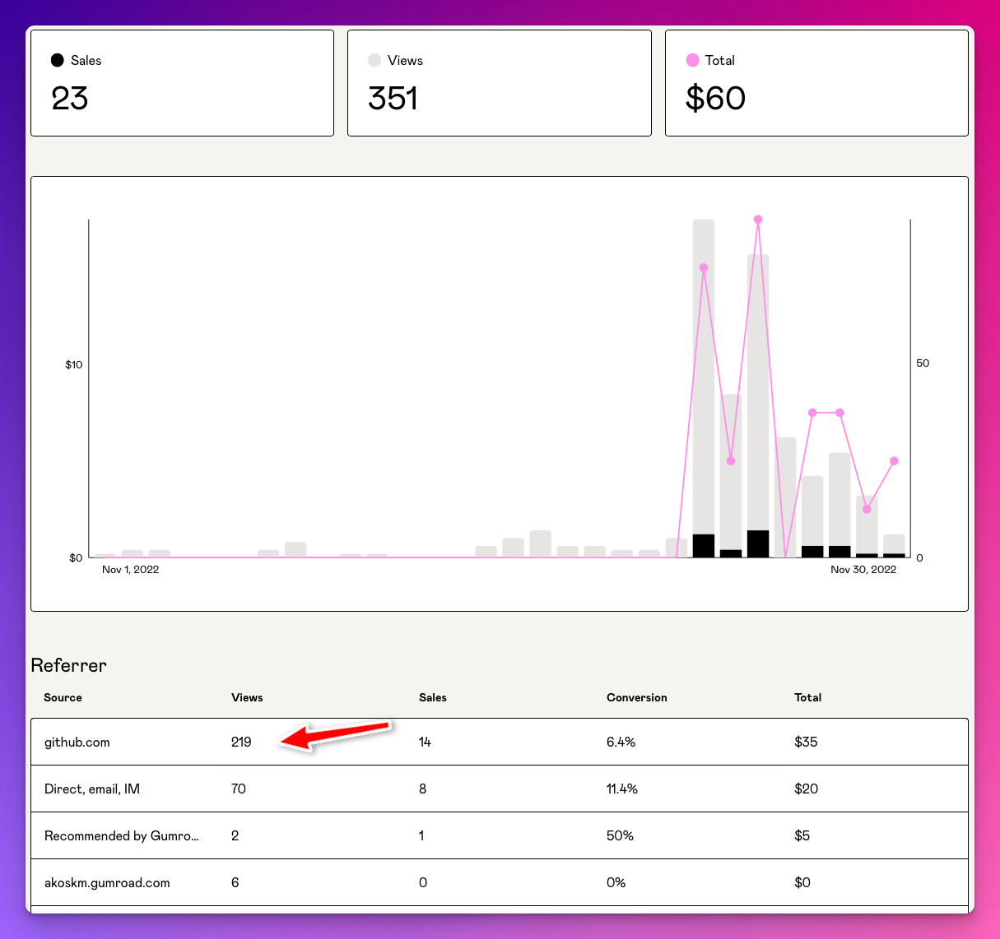
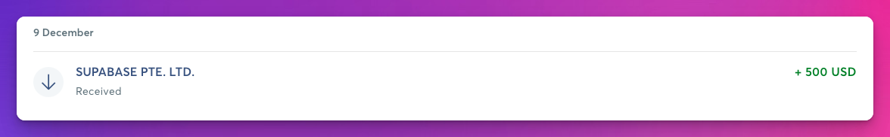
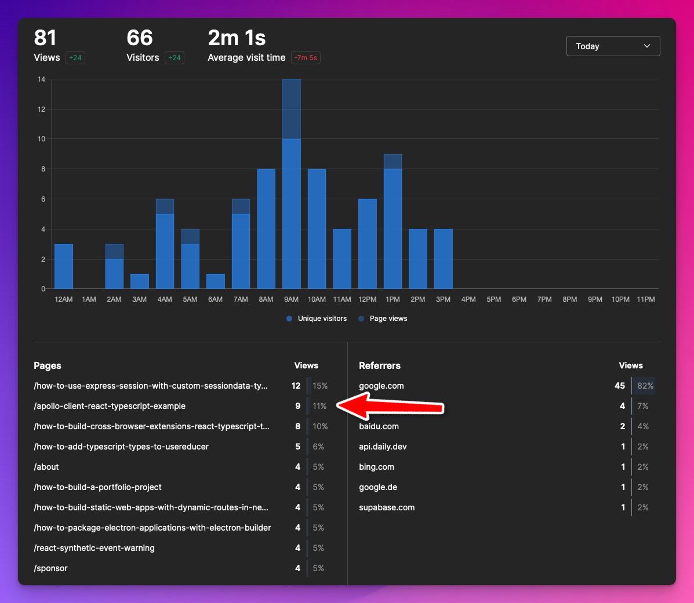

Before jumping into it, I'd like to thank you for doing what you're doing now.

Reading.

Reading my content here, on Twitter, and in my newsletter.

Without you, this writing thing would have been just another failed experiment.

Thank you!

---

The structure I've come up with for this post is pretty simple.

Things I'll be doing more and less of.

Writing my newsletter is one of the things I'm doing more of.

Toward the end of this blog, I'll explain in detail why.

If you'd like to connect with me in a form that's resilient to platform takeovers, shutdowns, and account bans, consider subscribing to my newsletter:

And now, let's see what I will be focusing on in 2023:

# Creating info products - more {#heading-creating-info-products-more}

Info products are one of the best ways to establish a side-revenue stream.

They require minimal maintenance and are mostly hustle-free.

In a SaaS business, things can break, bugs can appear, and you must handle support and keep your systems alive.

Once you publish an info product, all it remains is marketing and eventually fixing minor things in the product itself.

I simplified this a lot, but you get the point.

In 2022 I launched a single info product that I consider a success, despite being a failure in numbers. But it taught me:

I could write something people would buy.

Before and even while I was working on my first paid guide, I was full of questions:

* Is this useful?
    
* Why would anyone pay for this?
    
* Would I pay for that if I was in their position?
    

Not to talk about imposter syndrome.

So despite fighting off all these questions and eventually making it to the launch, the launch was a massive failure. Here's why:

## Picking a launch date {#heading-picking-a-launch-date}

I know little about launching products, but make sure you don't do it on a national holiday in the US. Especially if like half of your readers are from the US.

I'd suggest launching on multiple platforms, such as ProductHunt and IndieHackers - I didn't do any of this.

Overall, I left a bunch of untapped potential with my first info product on the table, but making money with it wasn't my primary goal.

I wanted to prove myself wrong on all the above points and prove that this is:

* Useful
    
* People would happily pay for it
    
* I would have bought it in the past if something like this had existed
    

So to recap: launch on the right date, on multiple platforms, and have some confidence in yourself.

## Consider ads {#heading-consider-ads}

Twitter, Reddit, and Facebook ad campaigns or even reaching out to influential people in your niche and paying them directly to promote your info product can be a good idea.

You're winning if you get more sales than you pay for the ads.

## Black Friday deals - worth it 100% {#heading-black-friday-deals-worth-it-100}

Last year I was nowhere near working on my first info product, but I clearly remember the moment when Black Friday hit:

How cool it is to offer a discount on your product. - I was thinking.

How cool it is to have a product at all!

It was around this time that I decided to create an info product.

If for nothing else, I can offer it at a discounted price a year later!

I eagerly awaited this part of the year and knew I'd make a 50% discount.

Then at the last minute, before I started on my own, I ran into a Tweet from Tony:

<a class="embed-card" href="https://twitter.com/tdinh_me/status/1594941911105560576?s=20&amp;t=Ymq6ommJYh1j8mEd72WTUA">https://twitter.com/tdinh_me/status/1594941911105560576?s=20&amp;t=Ymq6ommJYh1j8mEd72WTUA</a>

I made a PR with my link and promo code added and waited.

Who would have thought that GitHub would be my primary acquisition channel in November? 😄

# Twitter - less {#heading-twitter-less}

## Viral content {#heading-viral-content}

Creating zero viral content is my motto for 2023.

So here's your Twitter playbook:

* engage with people in your niche
    
* write threads because the algorithm likes them
    

What do you end up with?

People push each other's threads, and the algorithm shows them to more and more people.

But threads take time to write, so what can we do better?

Reduce the time needed to create one!

This is how scripts and tools for writing algorithmic resource threads were born.

I'm 100% guilty of pushing this garbage with a 50-line Ruby script.

”So you're saying I run a script that generates content, do minimum work, and get followers. Where’s the catch?”

## You are the algorithm {#heading-you-are-the-algorithm}

This kind of content cemented my Twitter profile as a prolific thread generator.

As such, 80% of the time, I attracted two types of followers:

* prolific thread generators (remember, engage with people in your ”niche”)
    
* people who have no idea what's going on but see the 🧵 and click follow
    

The other 20% of my following came from threads and tweets that I wrote either about blogging or software development.

These people constantly engage with me and actively participate in the discussions, and really, the only kind of people you want to have in your following.

This thread generation thing was so frustrating after some time that, numerous times, I wrote about it to vent.

Both in my blog:

<a class="embed-card" href="https://akoskm.com/i-want-to-build-my-blog-because-thats-one-of-the-best-ways-to-gain-credibility-in-my-niche">https://akoskm.com/i-want-to-build-my-blog-because-thats-one-of-the-best-ways-to-gain-credibility-in-my-niche</a>

and in my newsletter [here](https://akoskm.substack.com/p/creating-better-content-1304872) and [here](https://akoskm.substack.com/p/how-do-you-write-for).

## The good side of Twitter {#heading-the-good-side-of-twitter}

But there’s another side to Twitter, the one that the people I mention in the above post, such as [Arvid Kahl](https://twitter.com/arvidkahl), [Daniel Vassallo](https://twitter.com/dvassallo), [Gergely Orosz](https://twitter.com/GergelyOrosz), [Oliver Jumpertz](https://hashnode.com/@OliverJumpertz), and the list goes on.

These individuals produce 100% original content worth reading wherever you are in your career.

This is what Twitter should look like.

So I’m planning on further growing my Twitter to contribute to a better feed from which you can learn more.

But why I’m doing less Twitter?

Because it’s not my platform and not my followers.

I’m renting the attention of Twitter followers for a snap second until Twitter shows them my tweet.

And all this can be taken away in a second.

## Vanity metrics {#heading-vanity-metrics}

I was pretty happy seeing my ”follower” count reduce on Twitter. Before Elon publicly announced it, I knew the followers I was losing were mostly bots and throwaway accounts.

<a class="embed-card" href="https://twitter.com/akoskm/status/1590244874954997761">https://twitter.com/akoskm/status/1590244874954997761</a>

I don’t see Twitter going anywhere anytime soon.

Sure there will be hiccups, but I’m hoping for the best.

The recent bot purge signifies that Twitter cares about its actual users.

And you should, too!

I recently started applying the practice to vet my follower base.

<a class="embed-card" href="https://twitter.com/akoskm/status/1601502003951042560">https://twitter.com/akoskm/status/1601502003951042560</a>

I stopped looking at my new followers once I reached 5k or something like that.

Especially after making more and more viral tweets because over 100 people followed me for over one hour. I couldn’t keep up.

Now I’m more careful and immediately remove followers who look like bots or fake accounts.

The reason is simple. According to the above tool, I have 20% fake followers.

If 5% of your followers see your tweet, and 20% are fake followers, then 20% will never engage with your tweet, which is a huge hit.

So from now, I made it a habit to look at who follows me, and you should do the same.

---

Originally I wanted to dedicate an entire section to Mastodon in this blog post, but it has been a month since I opened it.

Mastodon might be a great platform, but it has many problems - just like Twitter - the problem for me is that it’s for more tech-savvy people.

I like to write and tweak things, but when it comes to consuming content, I’d like it to be as simple as possible.

It’s enough for the development workflows to be complicated.

When I want to rest or read something meaningful, I want to get to it straightforwardly and conveniently.

Mastodon currently does not provide a way to do this.

The registration is super complicated. Most of the smaller servers are self-hosted in someone’s basement with no guarantee that they won't pull the plug at some point.

## YouTube - a different algorithm? {#heading-youtube-a-different-algorithm}

The only platform I’d eventually consider besides Twitter.

Unlike Twitter, where after a day or two, it’s a real hustle to find your old tweets and content, and you have to keep your account alive by spilling out content, YouTube might recommend me a Video that was made a year ago.

This would never happen on Twitter.

On Twitter, every keystroke is wasted and will disappear into the void after 48 hours.

On YouTube, you have the feeling you’re creating something that lasts.

Something like blogging but on video.

Why I’m still not doing it?

Simply because it’s a whole lot of work.

I can create a 1000-word blog article in 30 minutes because my workflow is efficient.

If I had an efficient workflow for video production, it would be the same.

But I don’t have one - yet.

# Blogging - more {#heading-blogging-more}

## Sponsored posts {#heading-sponsored-posts}

I love building things!

It’s just that I have a limited attention span, so I stay away from projects that take more than two weeks.

My goal with these short projects is not to make lifechanging money but either to:

* solve a problem I’m currently having
    
* see if I can deliver something from an inspiration
    

Two things I’ve built in the past couple of months were:

* Tweton - browser plugin
    
* beginneritjobs - a job board
    

None of these made a single penny, and I spent about $30 on virtual assistants to keep adding jobs to the job board.

I built these things in public.

Tweton got Supabase’s attention because I used it as the backend for the plugin.

They contacted me to write a sponsored blog post for their December launch week.

This doesn’t sound like an awful lot of money, but considering that I would have done a blog post on Tweton anyway, it was a good deal.

They were super nice, communicated everything well, and, most importantly, I could post the blog on my platform - they even retweeted my announcement tweet.

Essentially they paid me to write about the things I love and to promote my content.

Supabase, if you’re reading this, I’m up for the next collab! 😁

### Getting into writing - the practical way {#heading-getting-into-writing-the-practical-way}

To get” lucky” and find such opportunities, you need a consistent blog with content other than the 10 best chrome plugins.

But it’s hard to come up with something that’s not curation, right?

I don’t think so.

Think about it this way: the most successful people in blogging or on Twitter did something outside these platforms. They made a proof of work before they became known on Twitter and started producing original content.

Arvid Khal sold his startup for life-changing money, and David Perell launched a successful and well-known writing course.

Louie Bacaj spent years working as an engineering manager at big companies before he started to write for engineers about his experiences.

Of course, you don’t have to do any of these things.

What you have to do is try something new.

Take a technology you always wanted to try, tackle a problem you always wanted to solve, or wanted to find a more elegant solution for.

You could write about your experiences!

Just to let you know, other people would like to try the same thing or are currently looking for the elegant solution you’re about to present.

*Write!*

## Hashnode Writeathon win {#heading-hashnode-writeathon-win}

In October, I was also participating Hashnode’s writeathon.

I won a prize of $500 for nothing else but writing about interesting topics for fellow developers.

I started writing for the “4articles4weeks” challenge because I thought:

What could go wrong? This challenge motivates me to create *more content* for *my blog,* and I can eventually win a prize for doing so.

It’s a win-win.

The topics were super interesting, and I could give my two cents on every topic.

I was shocked when I learned I was one of the winners!

But of course, there’s more to this.

## The value of Writing {#heading-the-value-of-writing}

I see every article as a store of value — almost something like real estate.

Once you buy an apartment and the tenants move in, they start living their own lives.

Of course, you might visit the apartment now and then to fix something’s that broken or to collect the rent, but it’s something that can function without you, 24/7.

Take a look at today’s traffic on my blog:

I wrote that post in July 2021.

Today it was visited by nine people.

I’m not actively marketing this blog post or talking about it.

Still, it keeps being used for good by people who stumble upon it.

And if only for 2 minutes, they’re on *my* blog, where I’m trying to help them the best I can without actively participating.

Some of these visits occurred while I was sleeping.

How amazing is this?

# Newsletter - more {#heading-newsletter-more}

My blog has taken a tech-writer shape.

People come here and expect to see articles about tech, which I like to write.

But I also like to write non-tech articles. Articles about writing and content creation.

I’m using my newsletter to think out loud or write about meta-topics such as writing and growing your blog.

Of course, it would be much easier for me to talk about the same things on all platforms: blog, Newsletter, and Twitter.

As you can see, I still need to figure this out.

## Why it is the most future-proof platform {#heading-why-it-is-the-most-future-proof-platform}

Email is one of the oldest networking technologies around.

It’s both simple and personal.

Having someone’s email address means a direct connection with that person without any intermediary platforms.

All the social networks in the world can disappear, but if you have John’s old email address, you email him about your latest project or that idea that you’ve been thinking about for soo long.

Email tops every other way of communication and connecting with people, community-driven blogs, and social media such as Twitter and Facebook.

Did you get banned from a social network?

All your connections are gone.

Is the newsletter provider you were using shutting down next week?

You hit the export button and import your subscribers into a new platform.

The only problem with mailing lists:

It takes a lot of work to get people to sign up.

One of the major advantages of email (it’s private) is also its disadvantage and the reason why people are hesitant to give it out just like that.

This is why mailing lists try to get subscribers by providing something for free in exchange for your address.

Platforms such as Substack also realized this problem.

They introduced an Explore feature- similar to Hashnodes’ - feed where you can discover and subscribe to new email newsletters.

This is a brilliant take, making growing your list of emails much more manageable. But it’s still much harder than growing a Twitter account, so don’t expect miracles.

But it’s all worth doing.

---

What would I do differently?

I would turn on from day one the newsletter feature on Hashnode and start collecting emails.

It’ll come in handy once you start a mailing list or switch platforms.

# Conclusion {#heading-conclusion}

It feels weird to write a conclusion for a blog post that's a conclusion of 2022, so instead of that:

Thank you again for being part of my writing journey in 2022, and I wish you a happy and prosperous 2023.

Please share your ideas and questions about your experiments in 2022 or what you want to try in 2023.

It would make me more than happy if I could help you in any way.

Until next time

\- Akos
