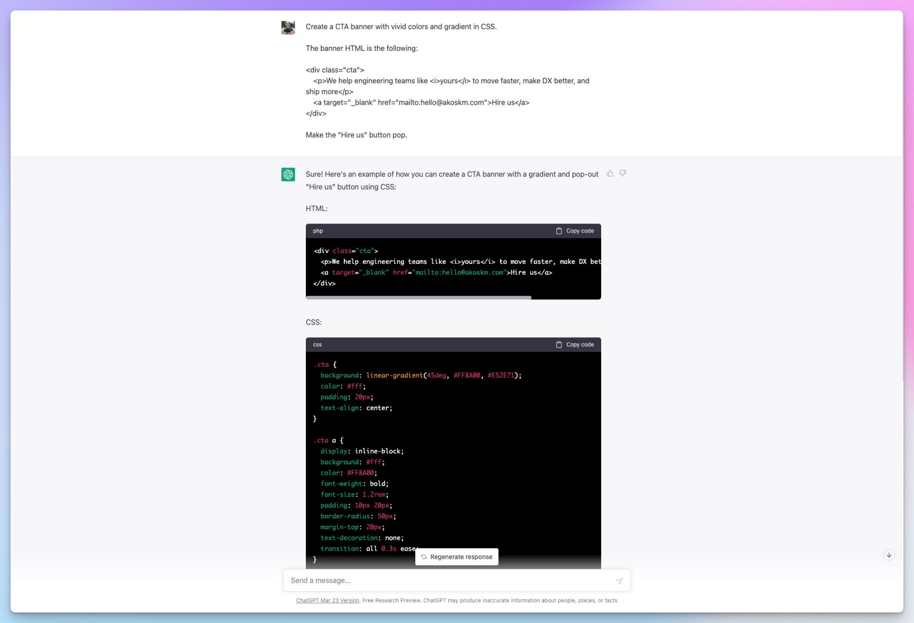
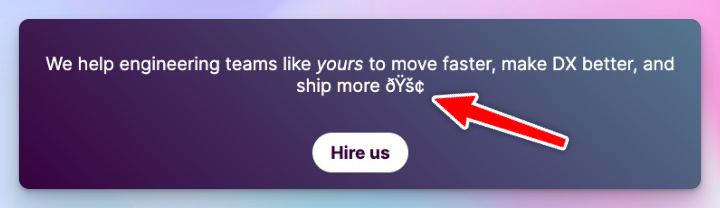
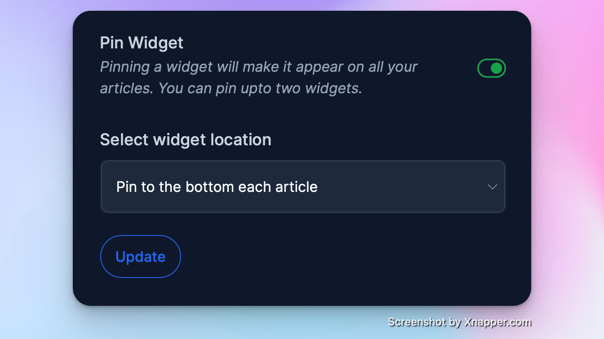

As I started expanding my freelance work since I left my full-time CTO job this February, I figured I was missing out on potential clients because they don't have an easy way to reach me through my blog.

If you're curious, this blog post brought my highest-paying client this year, and I'm going to write about it soon:

<a class="embed-card" href="https://akoskm.com/building-a-cross-browser-extension">https://akoskm.com/building-a-cross-browser-extension</a>

So I figured, what if I add a beautiful CTA at the end of each blog post to make it easier for clients to find me if they want to work together?

# Structure and basic style with ChatGPT {#heading-structure-and-basic-style-with-chatgpt}

Since I haven't touched basic HTML and CSS for a long time, especially in designing visually compelling stuff, I invited a developer superstar to help me - ChatGPT:

I pasted this code into Hashnode's widget editor and immediately knew I wanted to tweak some parameters. Right now, it's not the easiest to develop a widget with the built-in editor (you have to re-insert the widget every time you change it), so here's how I worked on it:

# CodePen for testing {#heading-codepen-for-testing}

I opened a CodePen account and created a blank project where I pasted the code ChatGPT generated (this is already the end result, feel free to grab it):

<a class="embed-card" href="https://codepen.io/akoskm/pen/poxvYWy">https://codepen.io/akoskm/pen/poxvYWy</a>

# Rendering emojis {#heading-rendering-emojis}

Emojis in the CTA text got escaped. I wanted to use a 🚀 at the end of the text - though it would look cool, then I got this:

I figured I had to use something markup-based so it won't get escaped. Heroicons is a great icon library from the creators of TailwindCSS. For each icon, you have a JSX and an SVG version: [http://heroicons.com](http://heroicons.com).

Just hit Copy SVG, and paste it where you want to see it in the DOM. Make sure you set `viewBox="0 0 24 24"` otherwise, it'll be too big. The size `24` was OK for the size of the text I'm using, you might have to use different numbers.

# Rendering apostrophes {#heading-rendering-apostrophes}

There are smart and dumb quotes.

This is a smart quote: `’` and it is [good typography](http://smartquotesforsmartpeople.com).

And this is a dumb quote: `'` not good typography.

`’` got also escaped, just like the emojis, but luckily all these ASCII characters have an HTML character escape you can use to [instruct HTML to render the character](https://stackoverflow.com/questions/419718/html-code-for-an-apostrophe).

# Setting up the widget {#heading-setting-up-the-widget}

The last thing you have to do is go to your Hashnode Dashboard and select Widgets.

Click Add New Widget, paste the code we created in CodePen, and set the widget where you want it to appear.

In my case, it’s the end of every blog post.

If you want to appear the widget other than at the beginning or the end of your blog post, just type `%%[` where you want the CTA to appear and click ”Insert a widget”.

Boom!

If this still works, the CTA should appear right here 👇 Thanks for your time :) - Akos
