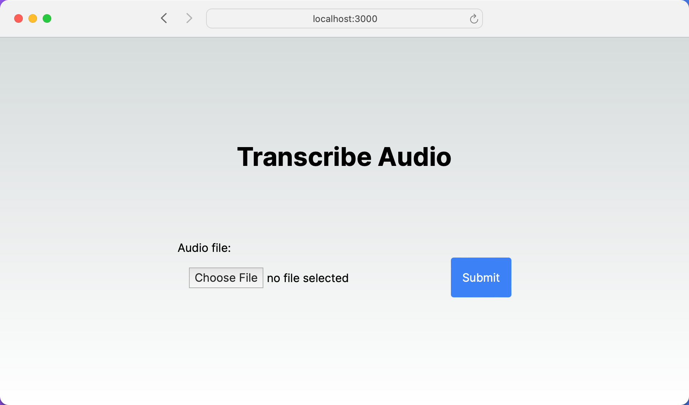
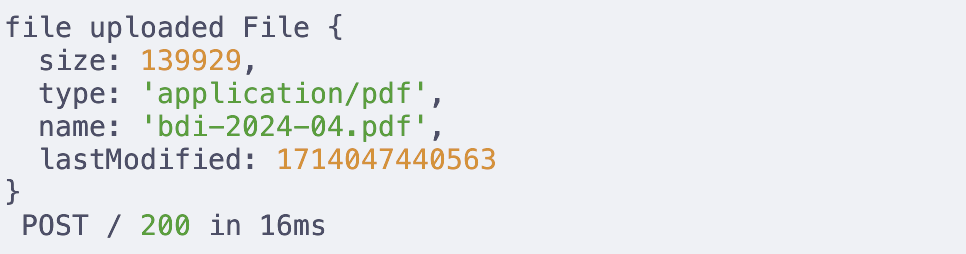

Hey friends –

In this article, you'll learn to handle file uploads using Next.js Server Actions. We'll explore the concept of Server Actions introduced in Next.js 14 and build a React form where the user can upload files to your server.

This short blog post will focus on the practical use of Next.js Server Actions.

Let's jump right into it!

# Old Approach with API routes {#heading-old-approach-with-api-routes}

Let's quickly recap how we uploaded files before this version and what has changed.

In older Next.js versions, you'd typically create separate API routes to handle form submissions or data mutations.

```typescript
import { NextApiRequest, NextApiResponse } from "next";

export default async function handler(
  req: NextApiRequest,
  res: NextApiResponse,
) {
  ...
    const uploadResult = await upload.single('file')(req, res);

    return res.status(200)
  ...
}
```

Then you had a component on the client side sending a request to this API route:

```typescript
import { useState } from 'react';

const UploadForm = () => {
  const handleSubmit = async (event) => {
    ...
    formData.append('file', file);
    await fetch('/api/upload', {
      method: 'POST',
      body: formData,
    });
  };

  return (
    <form onSubmit={handleSubmit}>
      <input type="file" name="file" onChange={handleChange} />
      <button type="submit">Upload</button>
    </form>
  );
};

export default UploadForm;
```

This always implied writing some boilerplate code, keeping track of separate files for server and client-side logic, and switching between server and client components and contexts in your head!

# Server Actions {#heading-server-actions}

At the end of last year, I wrote about Remix and how their action/loader architecture felt more full-stack than anything else we have done in JavaScript or TypeScript. You can read more about "The Remix Way" [here](https://akoskm.com/the-ultimate-full-stack-framework-for-2024-remix#heading-the-remix-way/).

If you think about your applications high-level, whether you use REST/GraphQL is an implementation detail.

Most of the time, you simply want to process user-entered data on the backend.

Username, password, email inputs, file upload. How does it get to the server? That's an implementation detail that's not really important in the early stages of apps. But let's say you're going with REST because you're more familiar with the protocol. Again, you have another plethora of things to decide:

* What are the best practices for structuring the API?
    
* Should I use JSON-API or maybe Swagger?
    
* Should I use API versioning?
    
* What's with the client, should I use fetch, axios, something else?
    
* Is it too early to think about this stuff?
    


There are many things to consider, and you still haven't written a useful line of code.

**I've done this so many times.**

So naturally, when I discovered [Server Actions](https://nextjs.org/docs/app/building-your-application/data-fetching/server-actions-and-mutations), I realized that you're basically saying to me:

I don't have to think about any of this.

I can write the React component and the backend function in the same file, next to each other.

# File Upload with Next.js 14 and Server Actions {#heading-file-upload-with-nextjs-14-and-server-actions}

Let's build a simple Next.js 14 app to see Server Actions in action!

To kick off with an empty Next.js project, run the following command in your terminal:

```typescript
npx create-next-app@latest file-upload-server-action
```

During the initialization, I also opted to use TailwindCSS for styling.

This command will create a folder `file-upload-server-action`. Jump right into it and run the application:

```typescript
cd file-upload-server-action
npm run dev
```

You should see the default Next.js application.

## The React form {#heading-the-react-form}

Now go ahead and open `page.tsx`, and replace the default contents with the following:

```typescript
export default function Home() {
  return (
    <main className="flex min-h-screen flex-col items-center justify-center p-24">
      <h1 className="text-4xl font-bold pb-24">Transcribe Audio</h1>
      <form>
        <label htmlFor="audio" className="block">
          Audio file:
        </label>
        <input type="file" name="audio" className="w-96 p-4" />
        <button className="bg-blue-500 text-white p-4 rounded">Submit</button>
      </form>
    </main>
  );
}
```

Nothing special so far, just a simple form styled with Tailwind that looks like this when you open `localhost:3000`:



*If you wonder why I picked the title Transcribe Audio: we'll build out an entire audio transcription tool in the next blog post:*

<div class="embed-wrapper"><div class="embed-loading"><div class="loadingRow"></div><div class="loadingRow"></div></div><a class="embed-card" href="https://akoskm.com/building-an-audio-transcription-app-with-nextjs">https://akoskm.com/building-an-audio-transcription-app-with-nextjs</a></div>

The server action is happening in the next step.

So usually, at this point, you would write a `<form onSubmit={handleSubmit}>` where `handleSubmit` would be a simple function on the client side, sending a `POST` request using `fetch` or some other libraries like `axios`.

We don't need to think about any of these - *one more implementation detail is gone.*

With Next.js Server Actions, you can call backend functions to your front-end forms.

So, let's create that backend function first.

## The Server Action {#heading-the-server-action}

We'll work inside the same `page.tsx` file creating a new `async function handleUpload`. When a form submission invokes this function, it automatically receives a standard [`FormData`](https://developer.mozilla.org/en-US/docs/Web/API/FormData/FormData) object.

```typescript
async function handleUpload(formData: FormData) {
```

A special `"use server"` directive is needed right at the top of the function to help Next.js sort things out:

```typescript
async function handleUpload(formData: FormData) {
  "use server"
```

But how do you get to the user-entered values inside your form? Where are the `useStates` and the `onChange={handleChange}` listeners?

Luckily, no form or state management libraries are needed anymore – *one less implementation detail!*

`formData` contains every input inside the form, and you can use a simple `get` method to access form inputs by their name.

Our file input is named `audio`, so you can write something like this:

```typescript
async function handleUpload(formData: FormData) {
  "use server"
  const audioFile = formData.get("audio") as Blob;
  console.log("file uploaded", audioFile);
}
```

Here's how you need to modify the previous form:

```typescript
export default function Home() {
  async function handleUpload(formData: FormData) {
    "use server";
    const audioFile = formData.get("audio") as Blob;
    console.log("file uploaded", audioFile);
  }

  return (
    // unchanged
      <form action={handleUpload}>
        ...
      </form>
    // unchanged
  );
}
```

Now, try uploading a file and examine your server logs. Look at the terminal where you have `npm run dev` running. You should see something like this:



## Persisting the File {#heading-persisting-the-file}

Now that we can access the file object on the server, we can persist it. We cannot do this on the [File](https://developer.mozilla.org/en-US/docs/Web/API/File) object, but we can do it on a [Buffer](https://nodejs.org/docs/v20.12.1/api/buffer.html#class-buffer).

Fortunately, File has an async function `arrayBuffer` and we can use its result to create a Buffer:

```typescript
    const buffer = await audioFile.arrayBuffer();
    const audioBuffer = Buffer.from(buffer);
```

`audioBuffer` is now an instance of `Buffer` that we can persist using `async writeFile` from `fs/promises`. For reference, here's the entire `handleUpload` function:

```typescript
  async function handleUpload(formData: FormData) {
    "use server";
    const audioFile = formData.get("audio") as File;

    const buffer = await audioFile.arrayBuffer();
    const audioBuffer = Buffer.from(buffer);

    await fs.writeFile(audioFile.name, audioBuffer);
  }
```

After we save this, the server reloads, and we can upload a document. The document will appear in the directory where `npm run dev` is running–that is, the root folder of your project.

# Conclusion {#heading-conclusion}

In this post, we covered setting up a Next.js 14 project, creating a React form for file uploads, and writing server-side logic directly alongside your front-end code, eliminating the need for separate API management and simplifying state handling with direct access to form data.

I hope this helped you understand how to handle file uploads in Next.js using Server Actions, a simpler and more integrated approach than traditional API routes.

In the next post, we'll connect this application to OpenAI, and we'll transcribe the uploaded audio files using the `whisper-1` model!
