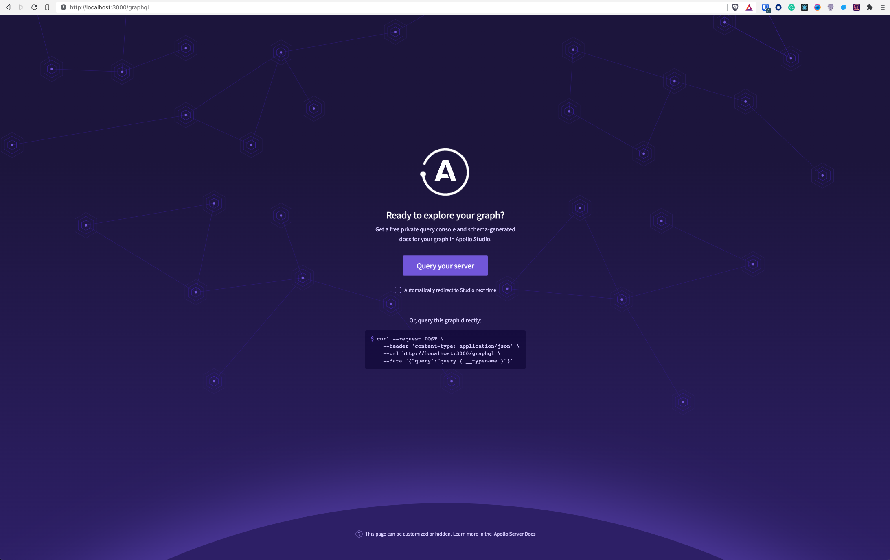
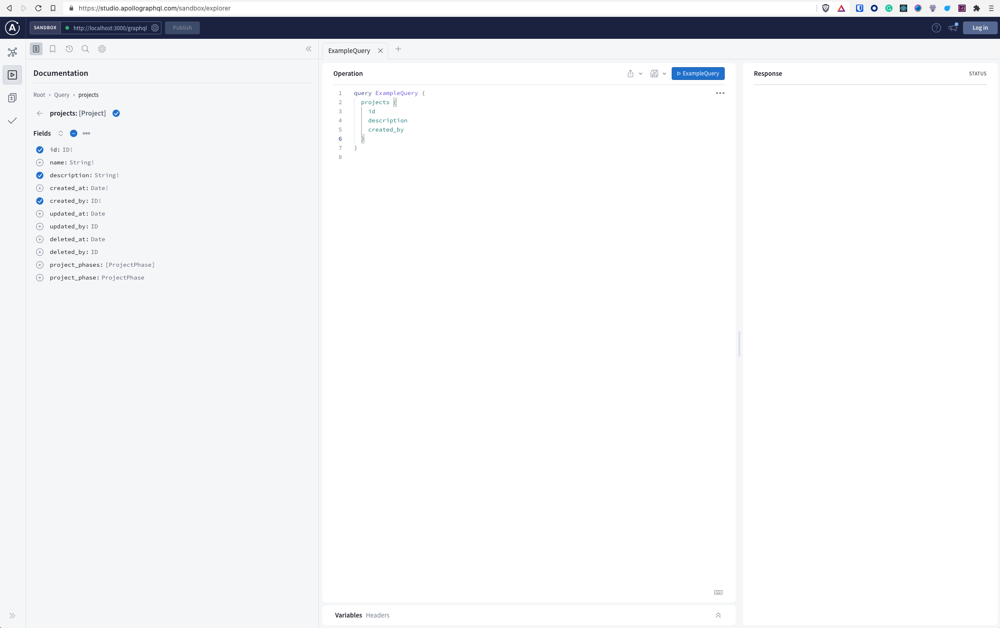

## Intro {#heading-intro}
I’ve spent the last year working only with GraphQL in a fintech application. After recently switching to a project that still uses REST, I thought I could summarize the important differences between GraphQL vs. REST aka what you're getting into when you pick GraphQL over REST.

This post will be slightly opinionated since I lean towards GraphQL, more specifically Apollo GraphQL. You can use GraphQL alone or with some other - minimalistic libraries. I’ll mention those in this post as well in case you're interested. However, I believe the tools Apollo GraphQL provides cover most business cases. They have comprehensive documentation and great tutorials.

In this post, I’ll compare the difference in how fast you can learn GraphQL or REST. What tooling do I use, and how the development looks like for each? Enjoy!

## Learning curve {#heading-learning-curve}
GraphQL has a steeper learning curve because it has a specific query language with its own rules. If you are new to GraphQL and REST, it is much easier to learn REST. It has pretty much no rules on what your REST resource can return or consume. Initially, you have to invest more time to learn GraphQL, but it will pay off in the long run. You also need fewer tools to develop and test with GraphQL. The schema also gives you a coherent way to handle all your responses - no more debates around how a top-level object should look like:
```json
{
  data: {},
  error: {},
}

// OR

{
  payload: {}
  error: {}
}
```

## Development Speed {#heading-development-speed}
One of the things I like most about GraphQL is the rapid development cycle. Since we can change the GraphQL query response on the fly, front-end developers don’t have to wait for backend developers to add a specific field to the response. You could argue that with REST, all fields are already present in the response, so it's even faster! True, but what if some of these fields are unused? This is called over-fetching. You fetch more data than required. And then there is under-fetching when you do the exact opposite.

You can also benefit from the generated Schema and Type system with [Apollo GraphQL Codegen](https://www.apollographql.com/blog/tooling/apollo-codegen/typescript-graphql-code-generator-generate-graphql-types/). While working with TypeScript, you would manually write Types for each of the responses that your endpoints can return.

```ts
type Tag = {
  id: ID,
  name: string
}

const res = await axios.get<Array<Tag>>("https://akoskm.com/tags");
```

while with Apollo GraphQL and Codegen, you are ready to import the types Codegen generated for you:

```ts
import type { Tag } ./generated;

const res = await axios.get<Array<Tag>>("https://akoskm.com/tags");
```

One of the advantages of this over manually defining the types is that if the type changes - you just rerun Codegen, and it’ll regenerate your types ➡️ No need to update them manually ➡️  less room for errors.

## Tooling {#heading-tooling}

### Apollo Studio {#heading-apollo-studio}
One of the other things I like about Apollo GraphQL is the built-in schema explorer and testing tool.



You can use the Apollo GraphQL Studio with or without creating an account. Luckily no additional setup is needed if you want to use it without an account. Once you set up Apollo Server, you can access the Studio. Here’s [the official step-by-step](https://www.apollographql.com/docs/apollo-server/getting-started) guide to doing this. 
Apollo Studio features an interactive schema explorer. You can use this to build a query that you can also execute:




### Other tools for GraphQL {#heading-other-tools-for-graphql}
Can I do all this without Apollo GraphQL? Kind of. There are tools built explicitly for exploring your schemas, such as [graphql-voyager](https://github.com/IvanGoncharov/graphql-voyager).
And If you’re looking for a more minimalistic approach to running GraphQL queries, try https://github.com/prisma-labs/graphql-request. It’s more lightweight than Apollo GraphQL, but you don’t get the additional tooling bundled with Apollo. I’d use something as [graphql-request](https://github.com/prisma-labs/graphql-request) with the combination of graphql-voyager, but still, you would miss out on the interactive query builder.

### Postman, Swagger {#heading-postman-swagger}
For working with REST, the most popular tool out there is [Postman](https://www.postman.com/). It’s an API development environment that’s been around for a long time now and got polished. They also support workspace that can be useful if you’re developing API as part of a team. You can use workspaces to share some variables or templates that are required by your entire team for API development.

The schema explorers for REST APIs would be the API explorers that visualize all the API routes available on the backend. If you’re using something like ExpressJS, you can build this in-house because it’s not that complicated. Check out the source of https://github.com/samundrak/expressjs-api-explorer. Or you can use a tool like Swagger for your API development and have a more feature-rich development tool. Swagger UI also acts as an API explorer and a testing tool making the experience similar to Apollo Studio.

## Data fetching style {#heading-data-fetching-style}

While with REST, you organize your resources with the help of routers as:

```
/authors
/authors/:id/posts
/authors/:id/posts/:post_id/comments
```

That on the server side register something like this:

```js
router.get('/authors', function (req, res, next) {
  const result = authors.findAll();
  res.send(result);
})
```

In GraphQL, you have resolvers. Resolvers connect fields requested by the client side to the server side. When the client requests a field, the resolver resolves the field on the backend to a function. This function must return some data that corresponds to the fields defined in the schema.

```gql
query GetAllAuthors {
  author {
    id
    name
  }
}
```

For GraphQL to process this, you need to have an author resolver on the server side:

```js
const resolvers = {
  Query: {
    author(parent, args, context, info) {
      return authors.findAll(); // [{ id: 1, name: 'Akos' }, { id: 2, name: 'Tom' }]
    }
  }
}
```

You can read more on resolvers [here](https://www.apollographql.com/docs/apollo-server/data/resolvers).

You can immediately see the problem of under-fetching and over-fetching in this comparison.

Let’s say you’re displaying a list of recently active authors on your page.

With REST, when you find all authors, you send back to the client whatever the array of authors contains. The client can’t request specific fields - if you only need the author’s name.

GraphQL has a built-in solution for this. Through the `GetAllAuthors` query, you already specified which fields you expect back from the backend - id, and name. The response will contain a list of authors, each having only these two fields.

And finally some annoyances - for now:

### File uploading {#heading-file-uploading}
File uploading is not supported natively, but it’s available in [Apollo GraphQL](https://www.apollographql.com/docs/apollo-server/data/file-uploads/).

### Web caching {#heading-web-caching}
Caching in REST is supported by the HTTP protocol itself. In GraphQL, the developers should worry about setting it up. But this shouldn’t be an issue for web applications anyway.

I’m confident that GraphQL, given its rising popularity and adaptation, will receive more improvements in the future.

Ready to get started with GraphQL? Check out my post [Tutorial: Apollo Client with React and TypeScript](https://akoskm.com/apollo-client-react-typescript-example).

Let me hear in the comments below why have you switched to GraphQL or why haven't you switched already!

See you in the next one 👋
