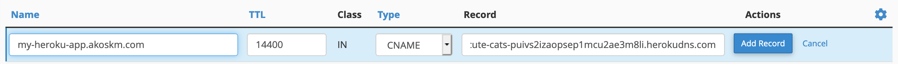

Got a Heroku app and want to make it public with some fancy domain with HTTPS enabled?

I compiled this list to help you set up HTTPS for your next awesome project on Heroku.

*I had to do this a few times last month, so this is an extended version of the guide I wrote to myself.* 😬

## Step 1. {#step-1}

Buy a domain.

## Step 2. {#step-2}

Log in to your Heroku console:

```
$ heroku login
heroku: Press any key to open up the browser to login or q to exit:
Opening browser to https://cli-auth.heroku.com/auth/browser/f34512meow-d14c-11c0-bafd-f12ff3d2499d
Logging in... done
Logged in as hello@akoskm.com
```

## Step 3. {#step-3}

Assign the custom domain to your Heroku app:

```
$ heroku domains:add -a my-heroku-app my-heroku-app.akoskm.com
Adding my-heroku-app.akoskm.com to ⬢ my-heroku-app... done
 ▸    Configure your app's DNS provider to point to the DNS Target cute-cats-puivs2izaopsep1mcu2ae3m8li.herokudns.com.
 ▸    For help, see https://devcenter.heroku.com/articles/custom-domains

The domain my-heroku-app.akoskm.com has been enqueued for addition
 ▸    Run heroku domains:wait 'my-heroku-app.akoskm.com' to wait for completion
```

## Step 4. {#step-4}

Wherever you bought your domain, it should have a DNS editor where you can add a CNAME entry. The naming in your DNS editor might be different but here are the things you have to fill:

```
Zone name: my-heroku-app.akoskm.com
Fully qualified domain name: cute-cats-puivs2izaopsep1mcu2ae3m8li.herokudns.com. <- should be the DNS Target heroku domains:add gave you
Type: CNAME (this is usually prefilled if your DNS editor is smart enough)
TTL: 14400 (mine says 14400, that's the default)
```

If you're using CPanel as your DNS editor you'll see something like this:



At this point, you should be able to navigate to http://my-heroku-app.akoskm.com and see your Heroku app.
HTTPS access shouldn't work at this point.

## Step 5. {#step-5}

Now it's time to add SSL. Check if the [automated certificate management](https://devcenter.heroku.com/articles/automated-certificate-management) is enabled for your app:

```
$ heroku certs:auto -a my-heroku-app
=== Automatic Certificate Management is disabled on my-heroku-app
```

If it's not already enabled, you have to enable it:

```bash
$ heroku certs:auto:enable -a my-heroku-app
Enabling Automatic Certificate Management... starting. See status with heroku certs:auto or wait until active with heroku certs:auto:wait
=== Your certificate will now be managed by Heroku.  Check the status by running heroku certs:auto.
```

When you check the status, it should display something like this:

```bash
$ heroku certs:auto -a my-heroku-app
=== Automatic Certificate Management is enabled on my-heroku-app

Certificate details:
Common Name(s): my-heroku-app.akoskm.com
Expires At:     2019-12-09 07:19 UTC
Issuer:         /C=US/O=Let's Encrypt/CN=Let's Encrypt Authority X3
Starts At:      2019-09-10 07:19 UTC
Subject:        /CN=my-heroku-app.akoskm.com
SSL certificate is verified by a root authority.

Domain              Status       Last Updated
──────────────────  ───────────  ──────────────────
my-heroku-app.akoskm.com  Cert issued  less than a minute
```

https://my-heroku-app.akoskm.com should be accessible at this point.

Hope this little guide saved you some time! If you found it useful, please share it with others. Thank you!

Source:

- [Heroku Dev Center: Custom Domain Names for Apps](https://devcenter.heroku.com/articles/custom-domains)
- [Heroku Dev Center: Automated Certificate Management](https://devcenter.heroku.com/articles/automated-certificate-management)

Cover Photo by panumas nikhomkhai from Pexels
