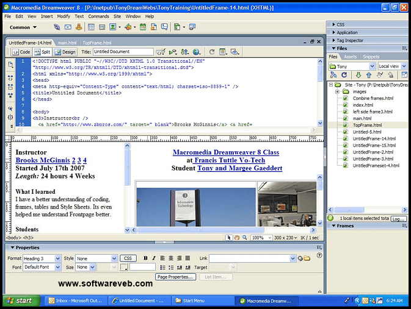

I often post Twitter threads about React, TypeScript, and JavaScript courses. However, after every successful post, my DMs are almost full of people asking, How to become a Web Developer?

So this got me thinking, am I approaching teaching the wrong way, and should I start from the basics? You can learn a lot from what I share, but only if you're already familiar with programming. But if you're a beginner, they probably aren't that helpful.

At some point in my career, I was also a beginner, and if you are too - I don't want to let you down.

So here's my journey of becoming a Web Developer with no formal education when I was about to start middle school.

# How to become a Web Developer, or really, anything {#heading-how-to-become-a-web-developer-or-really-anything}

There has to be some initial motivation to learn more about the profession. You most definitely can't become something you don't know anything about. You can't become a carpenter if you've never heard about carpenters.

But I'm sure - since you're reading this - you already heard about web developers.

In 2001 I got my first computer and my first dial-up modem.

In my community, people knew almost nothing about computers, except that they are the next big thing and are expensive. Kind of like Crypto these days. For the price of a PC, you could have bought tons of stuff. My dad was thinking hard about buying a trailer or a computer. He could've bought a trailer for work for that money. But in the end, I think he made the right choice. 😄

So we discovered this thing called: the Internet. I was fascinated by the fact that anyone in the world can make a website, a creation, a hello world with a marquee effect - and it becomes a thing for everyone. You can go, see it, tell it to other people where they can find it - if they had Internet, it was rare back then.

<a class="embed-card" href="https://media.giphy.com/media/krtDmVuQGssOtMWfRg/giphy.gif">https://media.giphy.com/media/krtDmVuQGssOtMWfRg/giphy.gif</a>

I knew I had to understand how people create websites and how I could make them too.

*At this point in my life, I had little clue what HTML or CSS is. I knew some tools make a website appear in a certain way. My initial motivation wasn't to learn the tools but to learn to build the thing.*

So how to become a web developer? What's the neverending source of drive that can last forever?

Is it HTML? I doubt so. I don't even write pure HTML anymore. Is it CSS? I never truly learned CSS and use UI Frameworks like Bootstrap and TailwindCSS to this day.

I'd say it's the curiosity to explore the web and understand what you can do with it. To unleash what you have learned, again and again, to build different things with or without purpose.

# Reverse engineering at 16 {#heading-reverse-engineering-at-16}

By 2003, the Internet was already "big" among the local nerds. I knew one other guy in my entire school who also knew what HTML is and how you can build basic websites.

How did we learn to create HTML sites? Macromedia Dreamweaver!

*This is version 8, I used something soo old I couldn't find a picture of it* 😂

What? No books? No Fancy editors?

Back in 2003 - for a teenager - it was almost impossible to find programming HTML books, especially where I was living. We had a couple of software of unknown origin 🏴‍☠️ and we had to work with what we had.

We built a ton of websites in Dreamweaver's visual editor. And I mean a Ton. A website for our local school, the kindergarten, one for each neighbor's dog, for our favorite movies, anything you can imagine.

But some annoying bugs forced us to look under the hood and switch to the Code view of Dreamweaver.

<a class="embed-card" href="https://media.giphy.com/media/qRVDIxBnu57gP0Jkg6/giphy.gif">https://media.giphy.com/media/qRVDIxBnu57gP0Jkg6/giphy.gif</a>

And this is how we got introduced to HTML.

Yep! No books, no tutorials, but out of necessity.

As we built and tweaked more and more websites, we realized that coding some stuff in the code editor is much faster. It also produced fewer bugs than the UI builder.

And this is how we switched from the visual to the HTML editor.

In the meantime, our English has improved, and we started looking at online forums to expand our knowledge.

One of the most important technologies that I picked up next and that led to my first client was: JavaScript? No. PHP. No! ASP? Nah It was Joomla!

Why on Earth did you learn Joomla - you're wondering (Joomla is a Content Management System written in PHP).

I won't surprise you if I tell you that most people don't know how to build websites. And it wasn't any different 20 years ago! I knew that to make some real money with the web, I have to give people more freedom. I can't tell them: "Hey if you don't like the footer you can change it on line 59!"

So I started building out my new websites - you can call these portfolio websites - with Joomla.

Being part of a small community, people already knew I do websites. Fortunately, a festival was preparing in my village around that time of the year.

The organizers reached out to me and asked if I could make a website for them. They would update the contents later, the program schedule if it changes, publish new performers, etc.

I showed them Joomla and they were blown away. And this is how I landed my first paid gig for some big money back then.

# PHP, more side hustles, University {#heading-php-more-side-hustles-university}

In 2004 I was already learning PHP, and a year later tweaking Joomla. I also built a PHP app that was able to bulk-modify excel files.

I sold this software to a local shop with a huge inventory where the prices were changing frequently based on the exchange rate of the local currency compared to USD. They were calculating and updating every price manually.

I told them they could do this with a click of a button - you can imagine their reaction.

But you can also imagine me slowly understanding where this can lead.

I started middle school and focused on programming (Turbo C and PHP) - and pretty much-neglected everything else there was for me to learn. Learn about an operating system called Linux that changed everything for me forever.

My final work in middle school was an online platform that schools in my country used to register their pupils for a National Math competition. It contained all elements of registration for school, and teachers, handling files uploads of CSV, excel, and transforming and saving them to a MySQL database.

The system was used extensively for three months while the registrations lasted.

It served the entire country and I felt super proud.

One of my teachers only told me this after I presented my final work:

> you could have sold this for a fortunate.

<a class="embed-card" href="https://media.giphy.com/media/l0IsH7VVszP2tnzuo/giphy.gif">https://media.giphy.com/media/l0IsH7VVszP2tnzuo/giphy.gif</a>

He was right. I wanted to finish my studies ASAP and make money with programming. I didn't want to go to University - I was thinking, why waste four years when I could be selling people what they need?

Finally, thanks to my parents, I decided to give the University a shot. I'll skip the debate on formal education or Bootcamps. I believe they don't compare. They provide different opportunities. If you go to the University, you'll encounter some situations only a University can bring. For example, I was able to publish a scientific work that has an ISBN! Whether they are relevant for what you'll be doing later, you'll find that out.

One of my dear friends, who's a brilliant mind and is programming to this day, couldn't go the University, but instead, he invested that time into getting better at coding. He not only made a living for himself but helped his parents and now works for a company that everyone reading this knows.

For me, the University was somewhat relevant. I learned a lot about data structures and algorithms at a very advanced level, and I worked a ton with Java - which later became the language I did Web Development with for four years.

And the rest is history.

# Conclusion {#heading-conclusion}

I admit I originally titled this post "How to became a Web Developer" and wanted to turn it into a guide-like thing. But instead, I decided to write about how I did it.

Because those were different times, learning and networking were also different.

These times have their challenges.

I respect everyone who tries to make sense of this neverending stream of programming content these days.
