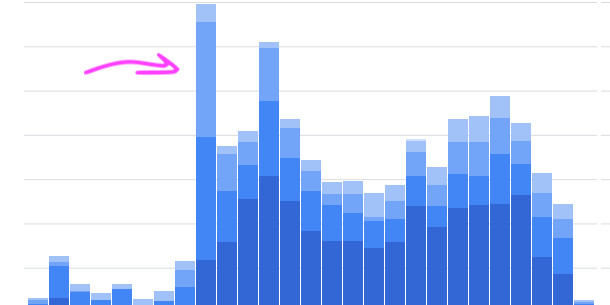

Here are some stats:

I started blogging early (15y ago) but I wrote most of my professional blog posts in the past 8 years.

I have 21 posts, that's **2,6 articles a year**. Here you can read more about the blogging journey that led me to [Hashnode](https://akoskm.com/why-i-moved-my-blog-to-hashnode).

One of my articles this year generated an insane amount of attention and blew everything out of proportion.

Multiple companies contacted me if I would write for them as well.

They obviously didn't pick me because I write a lot (remember, 2,6 articles a year 🙄)

The key is to get noticed. To find a relevant topic. One of the best ways to ride the wave of attention is to write something people care about. And to write about it a lot.

Here are some actionable tips on how I speed up my time to deliver when writing blog posts:

<a class="embed-card" href="https://twitter.com/akoskm/status/1445332615788126209">https://twitter.com/akoskm/status/1445332615788126209</a>

If you're reading this tweet, chances are you're already following Tech Twitter.

You already know what's going to gain traction.

Don't write what's already out there like gazillion times or something people don't talk about.

Or be prepared that nobody's going to read it.

I have such posts because I had topics I wanted to talk about - but my goal wasn't to attract Tech Writing Opportunities back then.

So something relevant, drumroll please 🥁:

 Web 3.0 🤡 

Now, don't blog on Web 3.0. Try narrowing it down by adding some constraints to it:

 - Web 3.0 in React - is still too broad, we can do better
 - Web 3.0 NFT Marketplace App in React - much better

A few words on your English skills:

You don't have to be a native speaker to write successful blog posts.

Clarity is what makes those posts good.

The better people understand a topic the easier explanation they can give you.

Be this person!
