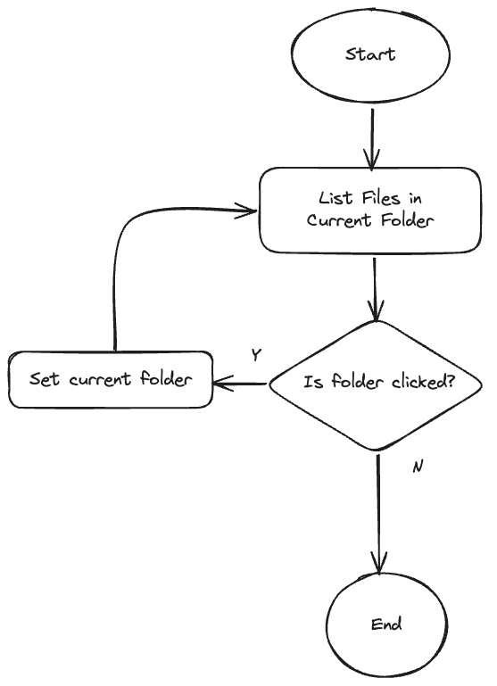
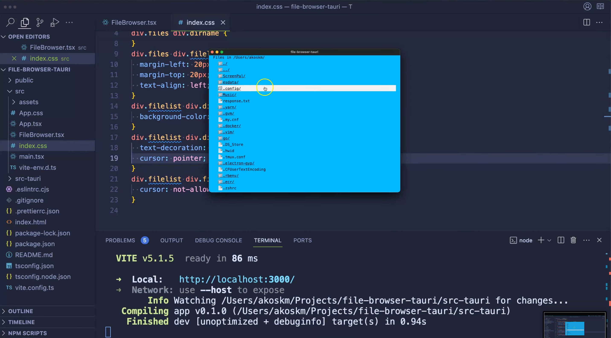

In this tutorial, we'll learn how to build a basic File Browser using Tauri, React, and Typescript. This guide covers setting up the project, creating the user interface, and implementing file listing with Tauri's APIs.

I've got you covered with step-by-step instructions, from configuring Tauri to allowing file operations to displaying and navigating files and directories.

*If you're in a hurry, scroll down to Resources, where you'll find a GitHub repo and a YouTube video tutorial explaining everything step-by-step. 😊*

Recently, I wrote about [making simple HTTP calls from Tauri](https://akoskm.com/how-to-make-http-requests-in-tauri) using Tauri's fetch implementation. We used `https` from `@tauri-apps/api` and now it's time to move on and explore the file-system capabilities of this package.

# **Setting Up the Project** {#heading-setting-up-the-project}

We'll first create a basic React application with Typescript. There are many ways to achieve this, but I like to generate a Vite project and turn it into a Tauri app.

I already made a video explaining how you can do this.

<div class="embed-wrapper"><div class="embed-loading"><div class="loadingRow"></div><div class="loadingRow"></div></div><a class="embed-card" href="https://youtu.be/XmTdvx4xM6I">https://youtu.be/XmTdvx4xM6I</a></div>

After creating the project, let's jump into the folder:

```bash
cd my-file-browser
```

For the file operations to work, we must tell Tauri, we want to allow file operations in our app.

Open `src-tauri/tauri.conf.json` and make the following changes to `tauri.allowList`:

```typescript
    "allowlist": {
      "fs": {
        "readDir": true,
        "scope": [
          "**"
        ]
      },
      "path": {
        "all": true
      }
    },
```

For reference, you can view the entire file [here](https://github.com/akoskm/file-browser-tauri/blob/main/src-tauri/tauri.conf.json#L14-L24).

# **User Interface** {#heading-user-interface}

Let's create the necessary UI elements for our file browser!

Each of our files (and folders) will be represented as an `Item`.

Go ahead and create `Item.tsx` in `src/`:

## Item.tsx {#heading-itemtsx}

```typescript
const Item = ({
  handleClick,
  file,
}: {
  handleClick: (fileName: string) => void;
  file: File;
}): JSX.Element => (
  <div
    key={file.name}
    className={file.isDir ? "dir" : "file"}
    onClick={() => {
      if (!file.isDir) return;

      handleClick(file.name);
    }}
  >
    {file.isDir ? "📁" : "📄"}
    {file.name}
    {file.isDir ? "/" : ""}
  </div>
);
```

This component takes a `name` prop indicating the folder name and an `onClick` function to handle clicks. It renders a `div` element with the folder icon and name, calling the `onClick` function when clicked.

We also apply some styling based on whether the item is a file or a directory.

Most of the work will happen inside the `FileBrowser.tsx` component. Go ahead and create this file:

## FileBrowser.tsx {#heading-filebrowsertsx}

```typescript
import { useEffect, useState } from "react";
import Item from './Item';
import "./index.css";

export interface File {
  name: string;
  isDir: boolean;
}

const FileBrowser = (): JSX.Element => {
  const [files, setFiles] = useState<File[]>([]);
  const [currentPath, setCurrentPath] = useState<string>("");

  return (
    <div className="files">
      <div className="dirname">Files in {currentPath}</div>
      <div className="filelist">
        {files.map((file: File) => (
          <Item handleClick={handleClick} file={file} />
        ))}
      </div>
    </div>
  );
};
export default FileBrowser;
```

This component manages the current path (`currentPath`) and the list of files (`contents`) in the state. It also defines the `handleClick` function which will be used later. We'll discuss the `useEffect` hook and updating `contents` in the next step.

## **App.tsx** {#heading-apptsx}

Well, this just renders `FileBrowser.tsx`:

```typescript
import "./App.css";
import FileBrowser from "./FileBrowser";

function App() {
  return <FileBrowser />
}

export default App;
```

# **Implementing File Listing with Tauri** {#heading-implementing-file-listing-with-tauri}

## Algorithm {#heading-algorithm}

Let's come up with an algorithm for how the app will work. After opening the app, the following should happen:

`#1` list files in `currentPath`, and listen for a click

`#2` user clicks and item

`#2a` if a user clicks a folder, set it as `currentPath`, repeat from `#1`

`#2b` if it's a file, continue

`#3` do nothing



## Implementation {#heading-implementation}

We'll leverage the Tauri APIs package to interact with the file system, so let's install the package:

```bash
npm install @tauri-apps/api
```

### **Item Clicks** {#heading-item-clicks}

Next, update the `FileBrowser.tsx` component to handle the item clicks:

```typescript
import { resolve } from "@tauri-apps/api/path";
// .. same as before
  async function handleClick(name: string) {
    const newPath = await resolve(currentPath, name);
    setCurrentPath(newPath);
  }

  return (
    <div className="files">
      <div className="dirname">Files in {currentPath}</div>
      <div className="filelist">
        {files.map((file: File) => (
          <Item handleClick={handleClick} file={file} />
        ))}
      </div>
    </div>
  );
```

Nothing new here, except [`resolve`](https://tauri.app/v1/api/js/path#resolve) that returns a new path with `name` resolved relative to `currentPath`.

Here are a couple of examples of how this works:

```plaintext
when currentPath is /Users/John and name is Projects it
resolves to /Users/John/Projects
```

or

```plaintext
when currentPath is /Users/John/Projects/file-browser and name is .. it
resolves to /Users/John/Projects
```

We pass this `handleClick` to our `Item` component. If you scroll back to its implementation, you'll see this is triggered when the user clicks an item (`#1` step of the algorithm) that is also a folder.

### **Relisting Contents** {#heading-relisting-contents}

After the `currentPath` is changed, we have to relist the files inside of that path:

```typescript
import { readDir } from "@tauri-apps/api/fs";
// .. same as before
  useEffect(() => {
    async function getFiles() {
      const contents = await readDir(currentPath);

      const entries = [
        { name: ".", children: [] },
        { name: "..", children: [] },
        ...contents,
      ];

      const names = entries.map((entry) => ({
        name: entry.name || "",
        isDir: !!entry.children,
      }));

      setFiles(names);
    }
    getFiles();
  }, [currentPath]);
```

We use [`readDir`](https://tauri.app/v1/api/js/fs/#readdir) to list the contents of the directory located at `currentPath`.

I would like to add the clickable `.` and `..` at the top of the file list, indicating the reference to the current and the parent folder respectively – that's why I have those as the first two elements in `entries`.

### **Initial Listing of $HOME** {#heading-initial-listing-of-home}

All that is left to do is to kick off the application by listing the contents of the starting directory, that is `$HOME`. Add this `useEffect` to `FileBrowser.tsx` :

```typescript
  useEffect(() => {
    async function getHomeDir() {
      const homeDirPath = await homeDir();
      setCurrentPath(homeDirPath);
    }

    getHomeDir();
  }, []);
```

Here's how the app looks like when started in my home directory - you will see some different files:



*And that's it!*

You just built a file browser from scratch using Tauri, Vite, React, and TypeScript!

Great job 🔥

Got stuck? Let me know in the comments. 👇 I'm happy to help you out!

Also, don't forget to check the **Resources**, they might answer some of your questions:

# Resources {#heading-resources}

* GitHub repo: [https://github.com/akoskm/file-browser-tauri](https://github.com/akoskm/file-browser-tauri)
    
* Video tutorial: [https://youtu.be/Azcw1-leCkQ?si=37qFWGmuPpGyM7B2](https://youtu.be/Azcw1-leCkQ?si=37qFWGmuPpGyM7B2)
