Authentication is no joke. When I first encountered the magic-link sign-in platforms, they blew me away with their simplicity and convenience.

Let me explain.

Most of you are already signed in to your email clients. Your email is probably tied to your bank account, GitHub, and hundreds of other services, so you keep it super secure. You probably have a `johndoe` user registered somewhere with the password `helloworld`, but I bet it's not your email account.

So your mailbox is secure by default, accessible, and uniquely identifies you.

Login forms already require an email. Most even use an email + password combination for authentication, so in theory, you always have the user's email.

Maybe we don't need anything more?

Enter **magic-links**!

*<mark>🌟 Supabase makes it super easy to implement magic links, but the fun doesn't end here. Check out my book to learn through practice how you build a Supabase-backed PWA, from scratch:</mark>* [<mark>https://a.co/d/dWzDolV</mark>](https://a.co/d/dWzDolV)

It allows users to log in by clicking a unique link sent to their email, eliminating the need for passwords. The unique link is like a temporary password. When clicked, the backend verifies the link's authenticity and generates a user session, and voila, you're logged in.

I hope you're excited to build such a system yourself. I almost feel bad for talking so long about the awesomeness of the **magic-link** idea.

It's time to get our hands dirty!

# Tech Stack and Requirements {#heading-tech-stack-and-requirements}

For this project, we'll use Next.js, Supabase, and SendGrid. To make SendGrid sending effective, you'll need an email address to verify it as a Single Sender, but don't worry—I'll walk you through that step-by-step!

Every tool and tier we use in the project is free, and with this guide, you can get into production for $0 in just a few minutes. If you have questions, comment or contact me directly at [support@akoskm.com](mailto:support@akoskm.com).

# Setup {#heading-setup}

## Next.js {#heading-nextjs}

Our framework of choice for this project, but note that the general approach of implementing magic-link sign-ins would be the same for Remix, but your actions and SSR components would have a bit different syntax.

If you're also interested in a Remix version, comment, and I'll create one!

If you want to check out the basics of Remix, I have another post that might interest you:

<div class="embed-wrapper"><div class="embed-loading"><div class="loadingRow"></div><div class="loadingRow"></div></div><a class="embed-card" href="https://akoskm.com/how-to-handle-multiple-form-actions-in-remix">https://akoskm.com/how-to-handle-multiple-form-actions-in-remix</a></div>

To create a Next.js project from scratch, run this in your terminal:

```bash
$ npx create-next-app@latest magic-link-demo
```

Accept the recommended defaults. On current Next.js 16 that means TypeScript, ESLint, Tailwind CSS, the App Router, no `src/` directory, and Cache Components. The files in the rest of this post sit in `app/`.

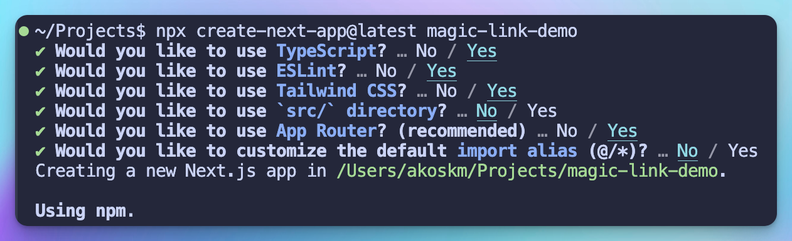

The prompt in that screenshot is from Next.js 14. `create-next-app` now asks if you want the recommended defaults.

Once this is done, switch to the generated directory `cd magic-link-demo` and if you're using VSCode, you can reopen the fresh project inside the current editor with this command `code . -r`.

Go ahead and create a `.env.local` file because in the next step we'll already put some values in there. Next.js loads `.env.local` and leaves it out of git.

## Supabase {#heading-supabase}

Supabase is a Firebase alternative. It provides a set of APIs that let you access a PostgreSQL database, Auth functionalities, and more.

To get started, head over to [supabase.com](https://supabase.com/) and create a new project.

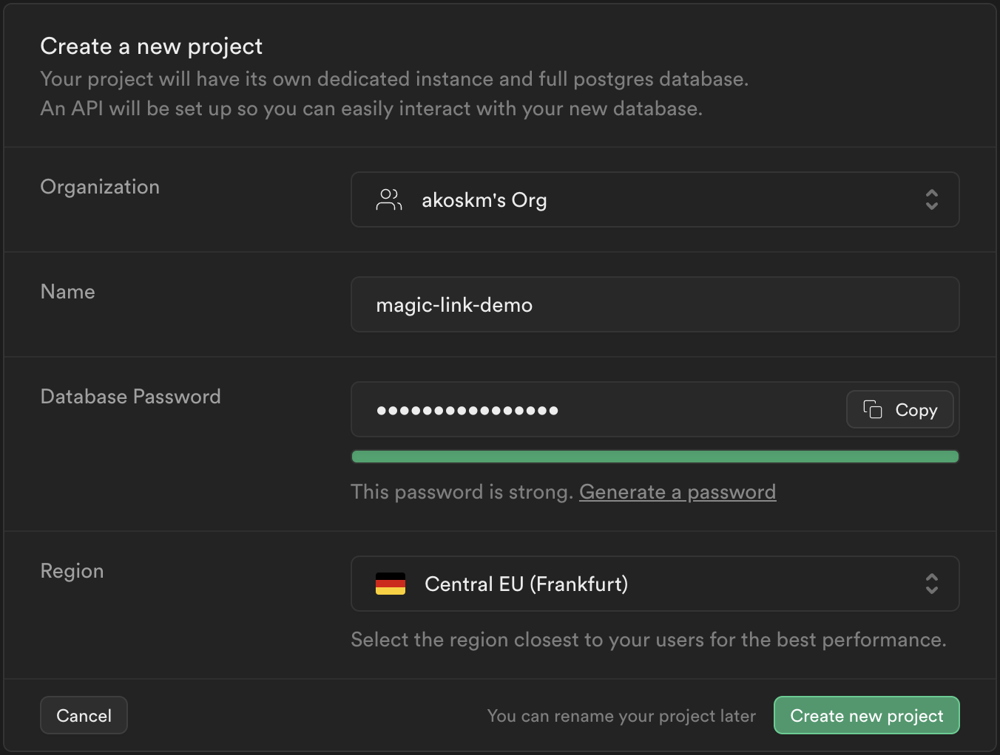

Once your project is created, open the Connect dialog and copy the project URL and the publishable key:

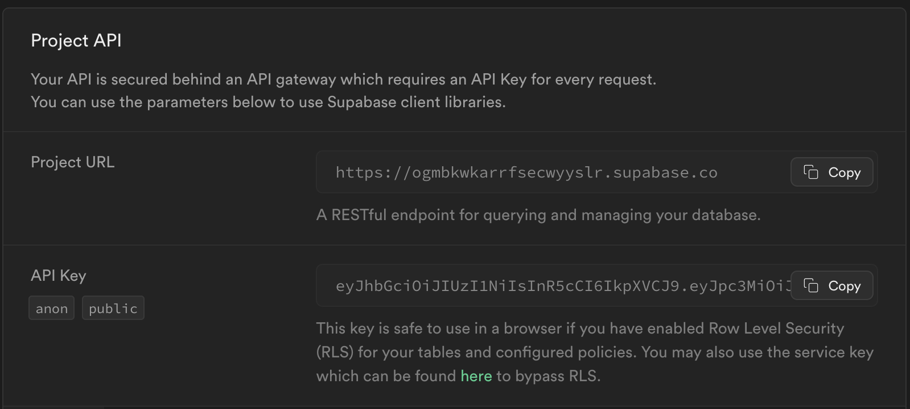

That screenshot still calls the key the anon key, and the snippet uses `NEXT_PUBLIC_SUPABASE_ANON_KEY`. The Connect dialog on a current project shows the publishable key, a short value that starts with `sb_publishable_`. Paste it like this:

```bash
# .env.local
NEXT_PUBLIC_SUPABASE_URL=<your_supabase_project_url>
NEXT_PUBLIC_SUPABASE_PUBLISHABLE_KEY=<your_supabase_publishable_key>
```

Then open Authentication > URL Configuration. Set Site URL to `http://localhost:3000`, and add that same URL under Redirect URLs. `signInWithOtp` sends `emailRedirectTo` to Supabase, and Supabase refuses to send the mail if that origin is missing from the list.

Next, in the sidebar, open Authentication > Emails and turn on Enable Custom SMTP:

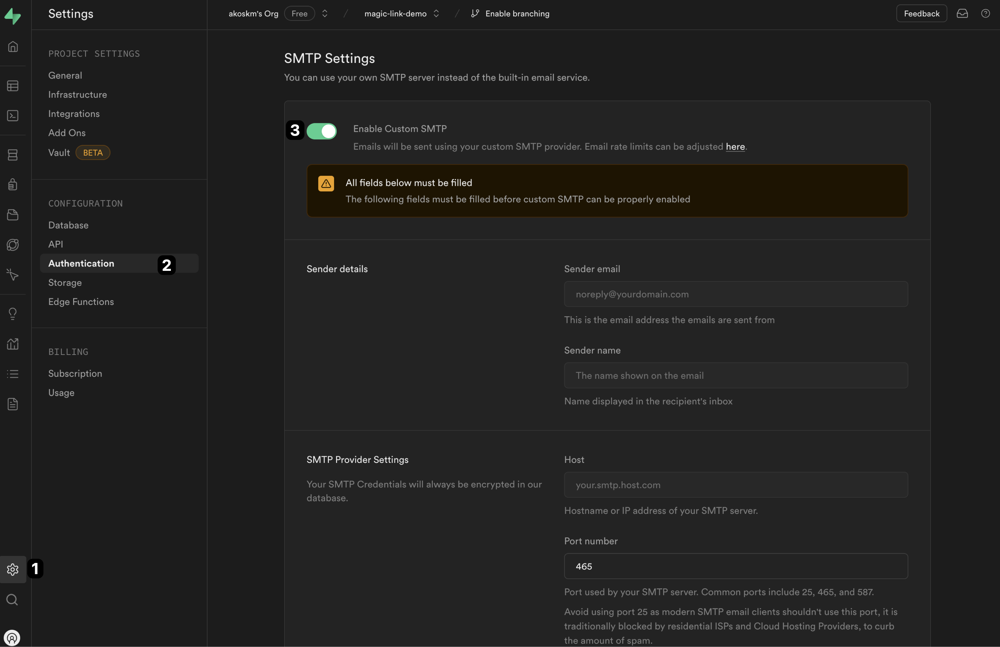

The screenshot still sits under Project Settings > Authentication. The switch moved to Authentication > Emails. It's the same Enable Custom SMTP toggle.

The built-in mailer only delivers to addresses on your project's team, and Supabase documents the cap as 2 emails per hour. That cap can change. A login form burns through it either way.

Let's go to Sendgrid and obtain our SMTP settings.

## Sendgrid {#heading-sendgrid}

SendGrid is a transactional email service that's super easy to use. Head over to [sendgrid.com](https://sendgrid.com).

### Setting up a Single Sender {#heading-setting-up-a-single-sender}

Expand the sidebar, and under Settings, select Sender Authentication. Follow the steps to configure a Single Sender.

You'll use this sender later in Supabase as a **Sender email**.

### Setting up an API key {#heading-setting-up-an-api-key}

Also, in the sidebar, under **Settings,** select **API keys**, then Create API key:

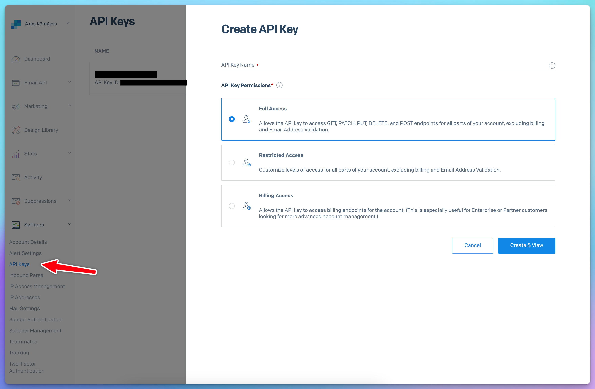

Give the key Mail Send access. Restricted Access with Mail Send turned on is enough, which is what the next screenshot shows.

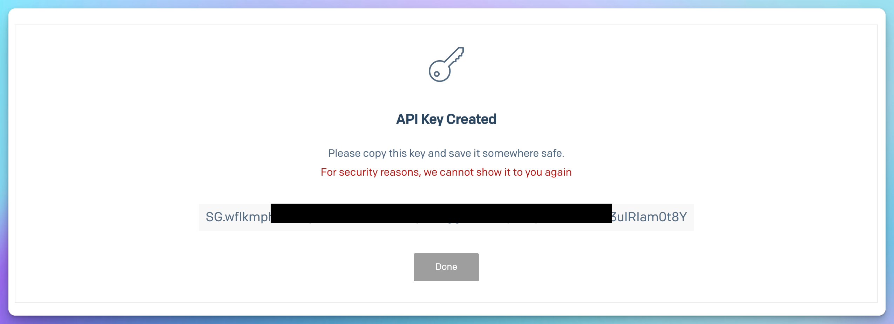

Click **Create & View** and copy the generated key.

## Configuring SMTP in Supabase {#heading-configuring-smtp-in-supabase}

Head back to Supabase and paste it under *SMTP Provider Settings* into the *Password* field. The *Username* will be **apikey,** and the Host should be set to **smtp.sendgrid.net**. Set the Port number to **587**.

[This page](https://www.twilio.com/docs/sendgrid/for-developers/sending-email/integrating-with-the-smtp-api) should contain the up-to-date documentation for using Sendgrid SMTP with your API key.

For the Sender details, use the same email you used to configure the Single Sender identity.

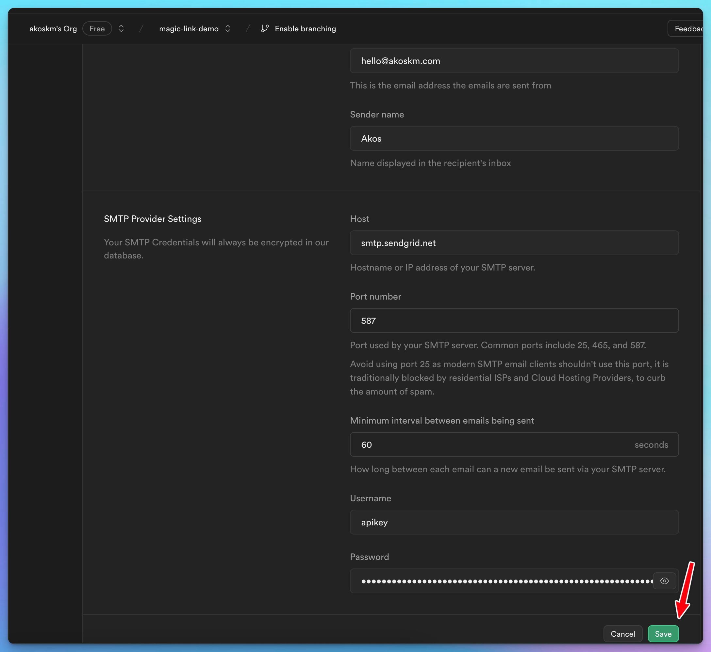

That screenshot is the same form, still framed by the old Project Settings sidebar. Host, port 587, username `apikey`, and the API key as the password are unchanged.

Once configured, click Save. Supabase will then send to any address, with its own cap of 30 emails per hour. The Rate Limits page under Authentication is where you raise that.

In SendGrid, open Settings > Tracking and turn Click Tracking off. Click tracking rewrites every URL in the message, so `token_hash` never reaches your confirm route. Supabase calls this out in the [email templates](https://supabase.com/docs/guides/auth/auth-email-templates) guide.

### Updating the Auth confirmation path {#heading-updating-the-auth-confirmation-path}

One last thing you have to do in Supabase. The default link in the auth emails goes to Supabase first, and the session comes back in the URL hash. A Server Component never sees that hash.

This app uses the PKCE flow. The email opens `/auth/confirm` on your site, and that route trades `token_hash` for a session with `verifyOtp`.

Edit the templates on the Email Templates page, linked from Authentication > Emails. In **Confirm signup**, replace `{{ .ConfirmationURL }}` with:

```text
{{ .RedirectTo }}/auth/confirm?token_hash={{ .TokenHash }}&type=email
```

Do the same thing in the **Magic link** template. Same `type=email` in both. `{{ .ConfirmationURL }}` is built with `type=email` now, and `verifyOtp` expects that type. `{{ .RedirectTo }}` is the origin you'll pass as `emailRedirectTo` in the server action.

The screenshots below still show `type=signup` and `type=magiclink`. Paste `type=email` instead. The old type values don't match the token Supabase puts in the email.

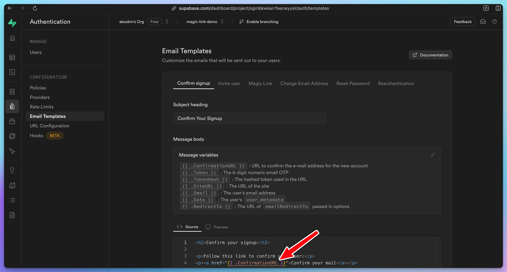

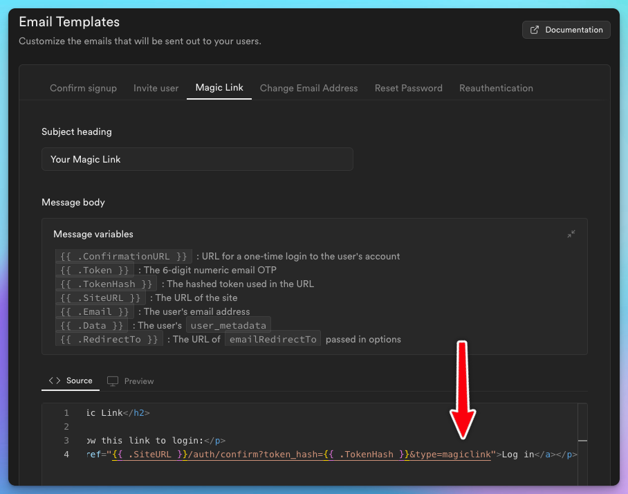

The first sign-in sends the Confirm signup mail. Later sign-ins send the Magic link mail. Both links have to hit `/auth/confirm`, which is why both templates change.

Let's return to our Next.js project and add a simple Sign-in screen.

## daisyUI {#heading-daisyui}

For the UI, we'll use [daisyUI](https://daisyui.com/docs/install/nextjs/). `create-next-app` already installed Tailwind, so you only add daisyUI:

```bash
npm install daisyui@latest
npm pkg set browserslist="> 1%"
```

`next dev` runs on Turbopack. Without that browserslist, Lightning CSS rewrites daisyUI's styles and the buttons come out unstyled. daisyUI's Next.js install page is where that command comes from.

There is no `tailwind.config.js` plugin line in a current Tailwind setup. Add the plugin under the Tailwind import in `app/globals.css`:

```css
@import "tailwindcss";
@plugin "daisyui";
```

Leave the rest of that file alone.

# Magic-link sign-in {#heading-magic-link-sign-in}

## Page {#heading-page}

Once this is done, create a new file in `app/login/page.tsx`:

```typescript
export default async function Login() {
  return (
    <main className="flex min-h-screen flex-col items-center p-24">
      <form className="flex flex-col gap-4 prose">
        <h1>Log in</h1>
        <label className="input input-bordered flex items-center gap-2">
          Email
          <input
            name="email"
            type="text"
            className="grow"
            placeholder="daisy@site.com"
          />
        </label>
        <button className="btn btn-primary">Submit</button>
      </form>
    </main>
  );
}
```

It's time to take our Next.js app for a spin, type in your terminal:

```plaintext
npm run dev
```

and head over to [localhost:3000/login](http://localhost:3000/login). You should see something like this:

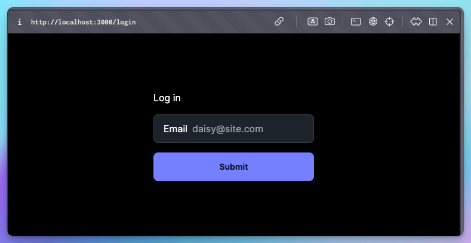

## Action {#heading-action}

Currently, the Submit button doesn't do anything, so let's implement the server action that will trigger Supabase's sign-in flow for us.

### Supabase Client util functions {#heading-supabase-client-util-functions}

First, you'll need a function to obtain the Supabase client in your server components. These functions aren't built into Supabase, but they are described in their official docs [here](https://supabase.com/docs/guides/auth/server-side/creating-a-client?queryGroups=framework&framework=nextjs).

Before creating the util function, install `@supabase/supabase-js` and `@supabase/ssr`:

```bash
npm install @supabase/supabase-js @supabase/ssr
```

And now, create the file `utils/supabase/server.ts`. This is taken from the [docs](https://supabase.com/docs/guides/auth/server-side/creating-a-client?queryGroups=framework&framework=nextjs), but I'll explain what it does below.

```typescript
import { createServerClient } from '@supabase/ssr'
import { cookies } from 'next/headers'

export async function createClient() {
  const cookieStore = await cookies()

  return createServerClient(
    process.env.NEXT_PUBLIC_SUPABASE_URL!,
    process.env.NEXT_PUBLIC_SUPABASE_PUBLISHABLE_KEY!,
    {
      cookies: {
        getAll() {
          return cookieStore.getAll()
        },
        setAll(cookiesToSet, _headers) {
          try {
            cookiesToSet.forEach(({ name, value, options }) =>
              cookieStore.set(name, value, options)
            )
          } catch {
            // The `setAll` method was called from a Server Component.
            // This can be ignored if you have proxy refreshing
            // user sessions.
          }
        },
      },
    }
  )
}
```

This util module defines a function `createClient` that initializes a Supabase client for server-side rendering in a Next.js application. It uses environment variables for the Supabase URL and the publishable key, and it keeps the session in cookies. `cookies()` from `next/headers` is async, so `createClient` is async, and every caller awaits it.

`getAll` and `setAll` are the cookie methods `@supabase/ssr` expects. The older `get`, `set`, and `remove` methods are gone. The try/catch is there because a Server Component can't write cookies. The proxy in the next section does that write.

### Session refresh {#heading-session-refresh}

`verifyOtp` runs in a Route Handler, so the confirm route can set the session cookie. The access token still expires. Next.js 16 refreshes it in `proxy.ts` at the project root, next to `package.json`.

On Next.js 15, name that file `middleware.ts` and export `middleware` instead of `proxy`. Next.js 15 never calls `proxy.ts`. The Supabase code inside is the same.

This proxy only refreshes the session. The home page already decides what to show when nobody is logged in, so it doesn't redirect strangers to `/login`.

```typescript
import { createServerClient } from '@supabase/ssr'
import { NextResponse, type NextRequest } from 'next/server'

export async function proxy(request: NextRequest) {
  let supabaseResponse = NextResponse.next({
    request,
  })

  const supabase = createServerClient(
    process.env.NEXT_PUBLIC_SUPABASE_URL!,
    process.env.NEXT_PUBLIC_SUPABASE_PUBLISHABLE_KEY!,
    {
      cookies: {
        getAll() {
          return request.cookies.getAll()
        },
        setAll(cookiesToSet, headers) {
          cookiesToSet.forEach(({ name, value }) => request.cookies.set(name, value))
          supabaseResponse = NextResponse.next({
            request,
          })
          cookiesToSet.forEach(({ name, value, options }) =>
            supabaseResponse.cookies.set(name, value, options)
          )
          Object.entries(headers).forEach(([key, value]) =>
            supabaseResponse.headers.set(key, value)
          )
        },
      },
    }
  )

  // Do not run code between createServerClient and
  // supabase.auth.getClaims(). A simple mistake could make it very hard to debug
  // issues with users being randomly logged out.
  await supabase.auth.getClaims()

  return supabaseResponse
}

export const config = {
  matcher: [
    '/((?!_next/static|_next/image|favicon.ico|.*\\.(?:svg|png|jpg|jpeg|gif|webp)$).*)',
  ],
}
```

Return `supabaseResponse` as it is. If you build a different response, copy the cookies onto it first, or the browser keeps the expired token and the next request signs the user out. The matcher skips images and Next's static files.

`getClaims()` checks the token. `getSession()` would trust whatever is in the cookie, so the proxy doesn't call it.

### Sign in Action {#heading-sign-in-action}

Inside this Server Action, we'll do three things:

1. obtain a Supabase client we just created

2. read the email from the form and call `signInWithOtp`, with `emailRedirectTo` set to the origin the form was submitted from

3. if there's an error, log it and redirect to the root page. In production, you might want to redirect to a dedicated /error page

Create a file next to `page.tsx`, called `action.tsx`:

```typescript
"use server";

import { createClient } from "@/utils/supabase/server";
import { headers } from "next/headers";
import { revalidatePath } from "next/cache";
import { redirect } from "next/navigation";

export async function signIn(formData: FormData) {
  const supabase = await createClient();
  const origin = (await headers()).get("origin") ?? "http://localhost:3000";

  const { error } = await supabase.auth.signInWithOtp({
    email: formData.get("email") as string,
    options: {
      emailRedirectTo: origin,
    },
  });

  if (error) {
    console.error("Error logging in:", error.message);
  }

  revalidatePath("/", "layout");
  redirect("/");
}
```

`emailRedirectTo` sits inside `options`. Passing it next to `email` does nothing. The value has to be on the Redirect URLs list from earlier, and it has to match `{{ .RedirectTo }}` in the templates. `http://localhost:3000` with no trailing slash keeps the confirm link as a single slash: `http://localhost:3000/auth/confirm?...`.

## Connect Action to Page {#heading-connect-action-to-page}

Finally, call this action on the main `form` element of the login page:

```typescript
import { signIn } from "./action";

export default async function Login() {
  return (
    <main className="flex min-h-screen flex-col items-center p-24">
      <form action={signIn} className="flex flex-col gap-4 prose">
        ... no changes here
      </form>
    </main>
  )
};
```

I know it's tempting, but don't test the form submission yet! You would get the email, but the `/auth/confirm` route the link would redirect to doesn't exist, so let's create that!

## Confirmation Route {#heading-confirmation-route}

Let's create a route handler in `app/auth/confirm/route.ts`.

This processes a GET request to verify an email OTP (one-time password) from Supabase. It extracts the `token_hash`, `type`, and `next` parameters from the request URL. If both `token_hash` and `type` are present, it creates a Supabase client and attempts to verify the OTP.

If the verification is successful, it redirects the user to the `next` URL, removing the `token_hash` and `type` parameters. If the verification fails or the parameters are missing, it redirects the user to an error page.

`createClient` is async here too.

```typescript
import { type EmailOtpType } from '@supabase/supabase-js'
import { type NextRequest, NextResponse } from 'next/server'

import { createClient } from '@/utils/supabase/server'

export async function GET(request: NextRequest) {
  const { searchParams } = new URL(request.url)
  const token_hash = searchParams.get('token_hash')
  const type = searchParams.get('type') as EmailOtpType | null
  const next = searchParams.get('next') ?? '/'

  const redirectTo = request.nextUrl.clone()
  redirectTo.pathname = next
  redirectTo.searchParams.delete('token_hash')
  redirectTo.searchParams.delete('type')

  if (token_hash && type) {
    const supabase = await createClient()

    const { error } = await supabase.auth.verifyOtp({
      type,
      token_hash,
    })
    if (!error) {
      redirectTo.searchParams.delete('next')
      return NextResponse.redirect(redirectTo)
    }
  }

  // return the user to an error page with some instructions
  redirectTo.pathname = '/error'
  return NextResponse.redirect(redirectTo)
}
```

We're almost there!

Before we test this, let's just update the root page of our app and render something different when we're logged in!

# Authenticated Dashboard {#heading-authenticated-dashboard}

Replace the contents of `app/page.tsx` with the following:

```typescript
import { createClient } from "@/utils/supabase/server";
import Link from "next/link";
import { Suspense } from "react";
import { signOut } from "./action";

export default function Home() {
  return (
    <Suspense fallback={<p>Loading...</p>}>
      <Dashboard />
    </Suspense>
  );
}

async function Dashboard() {
  const supabase = await createClient();

  const { data } = await supabase.auth.getUser();
  const isLoggedIn = !!data?.user;

  if (!isLoggedIn) return <Link href="/login">Log in</Link>;

  return (
    <main className="flex flex-col gap-5 items-center justify-between p-24">
      <div className="z-10 w-full max-w-5xl items-center justify-between font-mono text-sm lg:flex">
        Logged in as {data?.user?.email}
      </div>
      <form action={signOut} className="flex flex-col gap-4 prose">
        <button className="btn btn-primary">Log out</button>
      </form>
    </main>
  );
}
```

Above is a simple Server-Side Rendered page that does the following:

1. checks if the user logged in by simply requesting user from the supabase client

2. if not, returns a link to the `/login` page

3. if logged in, prints the email of the user and a **Log out** button

The outer `Home` component is only there because of Cache Components, which `create-next-app` turns on by default. Reading cookies in the page itself makes Next.js block the route. `Dashboard` sits under Suspense, and that's the component that calls `getUser()`.

The **Log out** button will call this simple server action that you can put into `app/action.ts`:

```typescript
'use server';

import { createClient } from "@/utils/supabase/server";
import {redirect} from "next/navigation";

export async function signOut() {
  const supabase = await createClient();

  await supabase.auth.signOut();
  redirect("/");
}
```

Don't forget `'use server'` directive at the top of the file! Otherwise, you'll be getting a message like this in your browser:

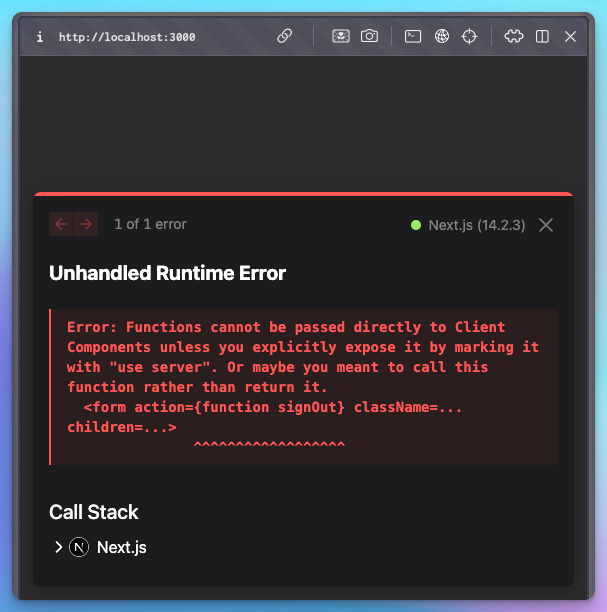

Now it's time to test the sign-in!

Open the login page, enter your email address, and click **Submit**.

⚠️ Note that if you've been testing too intensively, you might get the following error upon sign-in 😅:

```xml
Error logging in: Email rate limit exceeded
```

That message comes from Supabase. After custom SMTP is on, the cap starts at 30 emails per hour, on the Rate Limits page. Wait a few minutes, grab tea and coffee, and try again. 😊

If you've been waiting patiently – or didn't exceed your limit – an email like this will be in your mailbox:

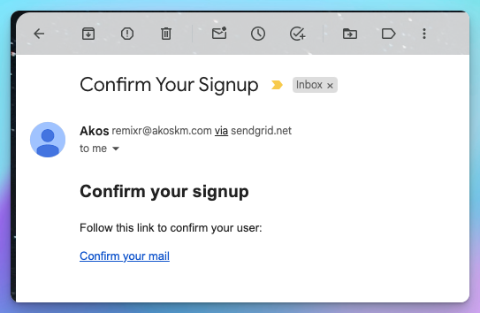

Note that this is our first sign-in, so the email body says **Confirm your signup**. You'll see soon that it'll look different when we try to sign in for the second time.

Clicking the link or copy-pasting it into your browser should redirect you to the customized dashboard page:

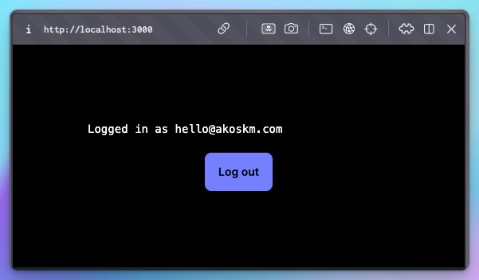

Hitting Log out should take you back to our very simple, unauthenticated page:

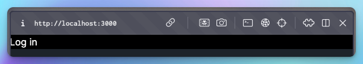

And signing in again should send you an email that now looks like this:

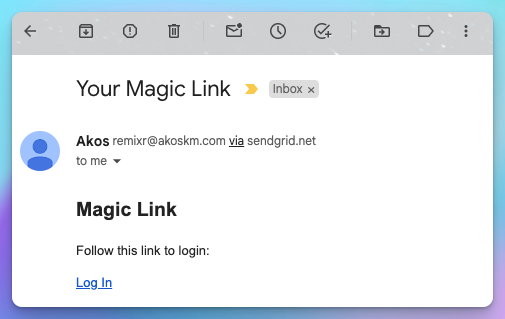

But clicking the link should lead you to the authenticated page, just like after confirming your registration.

# Conclusion {#heading-conclusion}

Well done! 🎉

You just got yourself a fully functional app with magic-link sign-ins using Next.js, Supabase, and Sendgrid.

If you ask me, I don't think much more is needed here. You have the sign-in and sign-up through the same form and an authenticated and unauthenticated version of a dashboard. What else is needed?

Add a payment system integration and start collecting money for your unique service!

If you'd like to extend your app with some AI features, like taking Voice notes and turning them into blog posts, [Building Cloud-Based PWAs with Supabase, React & TypeScript](https://akoskm.com/books) is a great way to start, and you're also supporting my work:

[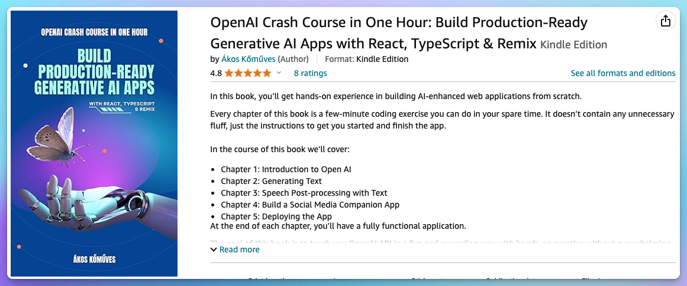](https://a.co/d/iollrhA)

I'm curious about what you come up with! Let me know in the comments! 👇

You'll also find this demo on my GitHub: [https://github.com/akoskm/magic-link-demo](https://github.com/akoskm/magic-link-demo).

# Resources {#heading-resources}

* Creating a Supabase client for SSR - [https://supabase.com/docs/guides/auth/server-side/creating-a-client?queryGroups=framework&framework=nextjs](https://supabase.com/docs/guides/auth/server-side/creating-a-client?queryGroups=framework&framework=nextjs)

* Passwordless email sign-in - [https://supabase.com/docs/guides/auth/auth-email-passwordless](https://supabase.com/docs/guides/auth/auth-email-passwordless)

* Redirect URLs - [https://supabase.com/docs/guides/auth/redirect-urls](https://supabase.com/docs/guides/auth/redirect-urls)

* Email templates - [https://supabase.com/docs/guides/auth/auth-email-templates](https://supabase.com/docs/guides/auth/auth-email-templates)

* Send emails with custom SMTP - [https://supabase.com/docs/guides/auth/auth-smtp](https://supabase.com/docs/guides/auth/auth-smtp)

* Twilio Integrating with the SMTP API - [https://www.twilio.com/docs/sendgrid/for-developers/sending-email/integrating-with-the-smtp-api](https://www.twilio.com/docs/sendgrid/for-developers/sending-email/integrating-with-the-smtp-api)
