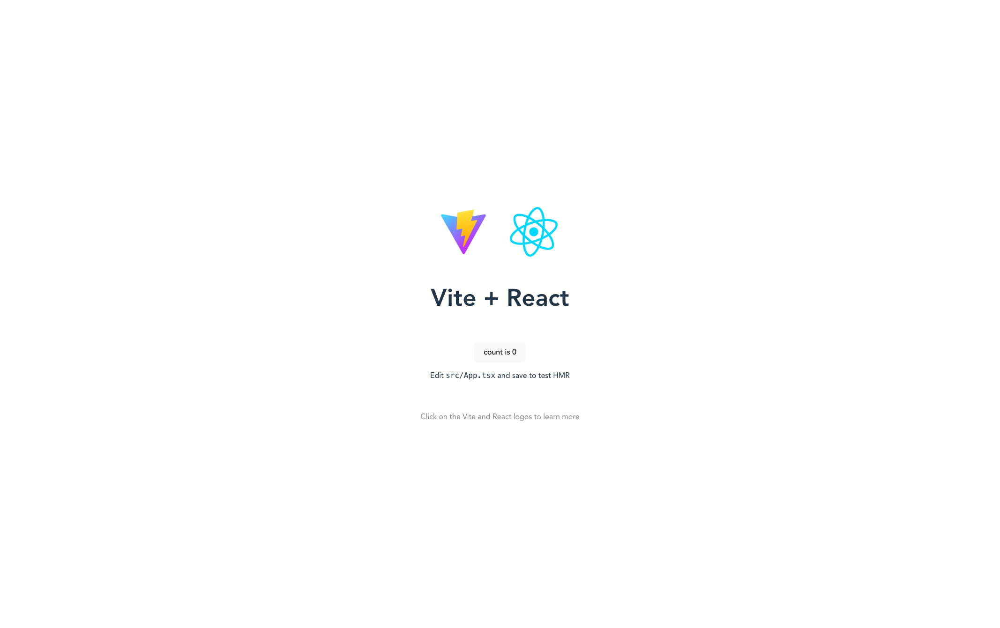
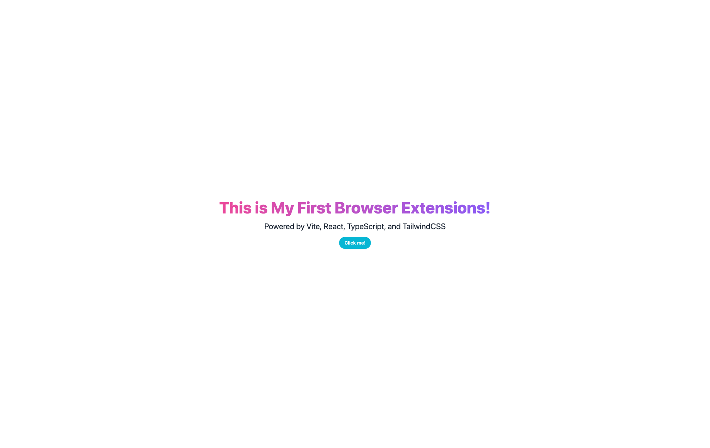
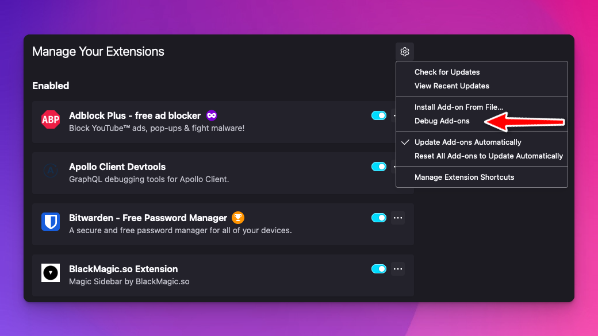
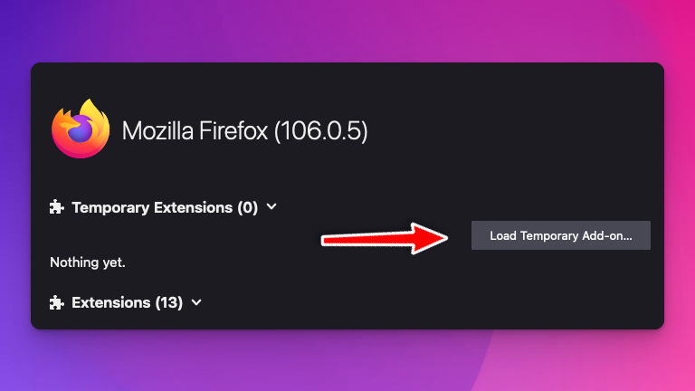
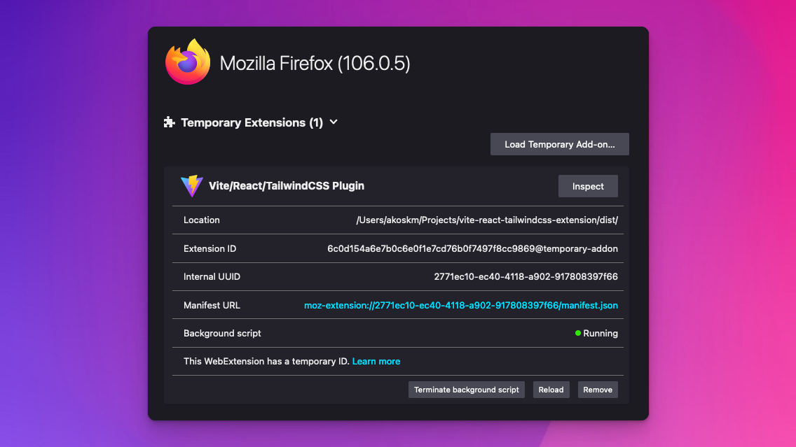
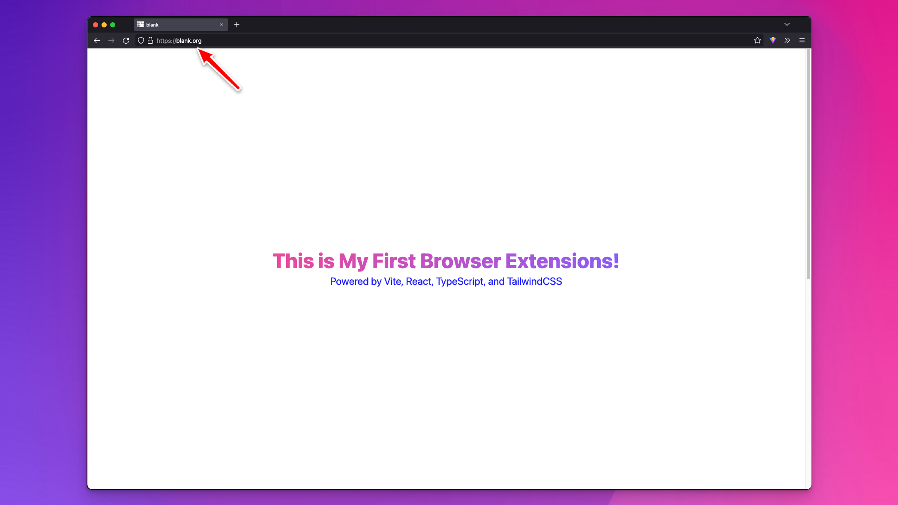
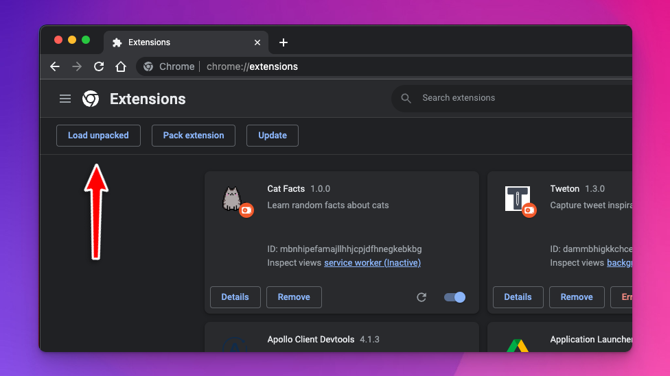
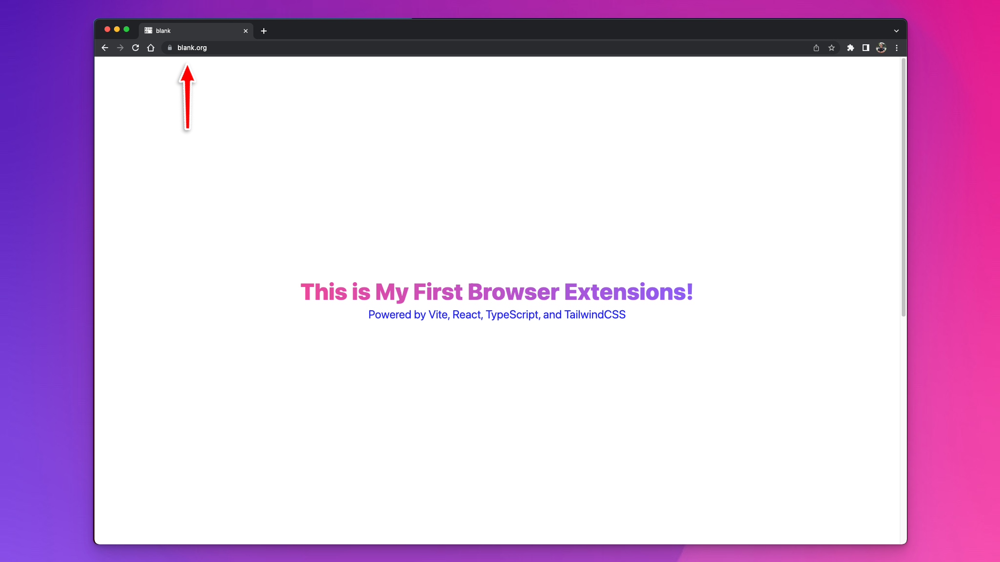
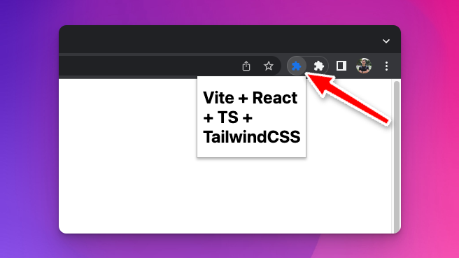

Bringing your favorite front-end development stack to browser extension development isn't too complicated. Once you figured out all the gotchas.

Many templates on GitHub don't offer a real cross-browser experience.

They either use:

*   Manifest V3 that Firefox does not yet support
    
*   Manifest V2. You can use it to build and test extensions for Chrome, but you can't publish them to the Chrome Web Store.
    

<div class="embed-wrapper"><div class="embed-loading"><div class="loadingRow"></div><div class="loadingRow"></div></div><a class="embed-card" href="https://twitter.com/akoskm/status/1581223328001708032">https://twitter.com/akoskm/status/1581223328001708032</a></div>

I'm a Firefox user, but I know most of you use Chrome.

Because I wanted my extension [Tweton](https://tweton.com) to be available to wider audiences, I made it cross browser with the above tech stack.

I'm sharing this tutorial so you can build proper cross-browser plugins that work with Manifest v2 and v3.

If you'd like to support my work and you're interested in the "behind the scenes" of this blog, check out my free newsletter:

<div class="hn-embed-widget" id="substack"></div>

Now let's get started!

## Setup {#heading-setup}

This section will be your casual how-to-set-up Vite with React and TailwindCSS tutorial, if you will.

Nothing in this section is specific to browser plugins.

You can use it as a reference for your next plugins or web applications.

### Create a Vite + React + TS project {#heading-create-a-vite-react-ts-project}

The fastest way to get started with Vite for empty projects is to scaffold from a `react-ts` template.

This template uses [@plugin-react](https://github.com/vitejs/vite/tree/main/packages/plugin-react) for Vite.

You don't have to worry about setting up TypeScript itself.

The template supplies a default tsconfig.json and all the required dependencies in `package.json`.

Open the command line and run:

```bash
$ npm create vite@latest vite-react-tailwindcss-extension -- --template react-ts
```

Run the command and enter the `vite-react-tailwindcss-extension` directory.

Install the packages, and make sure the template application works:

```bash
$ npm i
$ npm run dev

> vite-react-tailwindcss-extension@0.0.0 dev
> vite


  VITE v3.2.3  ready in 595 ms

  ➜  Local:   http://127.0.0.1:5173/
  ➜  Network: use --host to expose
```

If everything is setup correctly and you click the link in the command line or open it in your browser, you should see the scaffolded app that looks something like this:



### TailwindCSS {#heading-tailwindcss}

Next, we're adding TailwindCSS. There's an official [Vite-specific guide](https://tailwindcss.com/docs/guides/vite) I suggest you follow. I don't want to recite here the entire thing because the official docs are always up to date.

Once you installed the necessary dependencies and adjusted the `tailwind.config.cjs` , the template paths, and added the TailwindCSS directives to `index.css` files, replace the contents of `src/App.tsx` with the following:

```javascript
function handleClick () {
  // do nothing for now
}

function App() {
  return (
    <div className="App flex flex-col gap-4 h-screen items-center justify-center">
      <div className="text-5xl font-extrabold">
        <span className="bg-clip-text text-transparent bg-gradient-to-r from-pink-500 to-violet-500">
          This is My First Browser Extensions!
        </span>
      </div>
      <div className='text-2xl text-gray-800'>
        Powered by Vite, React, TypeScript, and TailwindCSS
      </div>
      <button className="px-4 py-2 font-semibold text-sm bg-cyan-500 text-white rounded-full shadow-sm" onClick={handleClick}>Click me!</button>
    </div>
  )
}

export default App;
```

If you run `npm run dev` again, you'll notice how the entire page has changed:



You can delete `App.css` and everything from `index.css`.

Leaving only the TailwindCSS directives:

```css
/* src/index.css */

@tailwind base;
@tailwind components;
@tailwind utilities;
```

Our favorite front-end stack is ready!

It's time to spice it up and turn this into a browser extension!

## Creating the Browser Extension Layout {#heading-creating-the-browser-extension-layout}

In this section, we're adding our first browser-plugin-specific files.

In [my previous guide](https://akoskm.com/building-a-cross-browser-extension#heading-scripts), we were already talking about what these files are used for in browser plugins.

But before, we're going to need a super important package:

### webextension-polyfill {#heading-webextension-polyfill}

This package lets us use the [standardized Browser Extension API](https://www.w3.org/community/browserext/) in Firefox and Chrome.

To install the package and its typing, run:

```javascript
npm i -D webextension-polyfill @types/webextension-polyfill
```

We will use this package in the background and the content script.

### Popup file {#heading-popup-file}

First, start with the popup file. The popup is the UI you get when you click on the plugin's icon in the browser's toolbar.

Create a `popup.html` file in the root of your project directory, next to `package.json`:

```xml
<!DOCTYPE html>
<html lang="en">
<head>
    <meta charset="UTF-8"/>
    <title>Vite + React + TS + TailwindCSS</title>
</head>
<body>
  <h1>Vite + React + TS + TailwindCSS</h1>
</body>
</html>
```

### Background files {#heading-background-files}

This is where we first run into browser-specific, more precisely, Manifest-specific conventions.

**background.html**

In Manifest v2, the way how you define the background script is through a particular HTML page. The sole purpose of this page is to import the background script.

```xml
<!DOCTYPE html>
<html lang="en">
<head>
    <meta charset="UTF-8" />
    <title>Vite + React + TS</title>
</head>
<body>
    <script type="module" src="./background.ts"></script>
</body>
</html>
```

Later, when we add our browser-specific Manifest files, you'll see that Chrome doesn't need this file.

This is because Manifest V3 uses service workers.

**background.ts**

Let's keep the background file simple for now:

```javascript
import browser from "webextension-polyfill";

browser.runtime.onMessage.addListener((msg, sender, response) => {
  console.log('message received from content script: ', msg);
  return true;
});
```

Note the `webextension-polyfill` import, the package we installed earlier.

### Content Script {#heading-content-script}

Content Script runs in the context of a particular web page and can directly access the contents of that page.

This can be useful if you want to make a plugin that interacts with the website's contents, such as Grammarly or [Tweton](https://tweton.com).

In this example, our main UI will render inside the web page, similar to the above two plugins.

To create a better separation, I suggest you create a new directory `content-scripts` where you'll place your content script files.

Move `src/index.tsx` and `src/index.css` files there.

Change the contents of `src/index.tsx` to:

```javascript
// src/content-script/index.tsx
import React from 'react'
import ReactDOM from 'react-dom/client'
import App from './App'
import './index.css'

const index = document.createElement('div')
index.id = 'extension-root';

const body = document.querySelector('body')
if (body) {
  body.prepend(index)
}

ReactDOM.createRoot(index).render(
  <React.StrictMode>
    <App />
  </React.StrictMode>
)
```

This snippet is close to what we originally had.

The only different thing is that with traditional React apps, you would create an empty `index.html` page with a `<div id="root"></div>` and use something like this to get the app rendered:

```javascript
ReactDOM.render(
  <React.StrictMode>
    <App />
  </React.StrictMode>,
  document.getElementById('root')
);
```

In the case of content scripts, you can target any part of the current webpage and render your entire React app there!

Finally, update the `handleClick` function in `content-script/App.tsx`:

```javascript
import browser from "webextension-polyfill";

function handleClick () {
 browser.runtime.sendMessage({ action: 'Hi from content script 👋' });
}

function App() {
 return (
// the rest is unchanged
```

With the new handler, clicking the button will send an object to your background script!

## Creating the Browser Manifest Files {#heading-creating-the-browser-manifest-files}

At this point, we have all the JavaScript files that a browser plugin will need.

It's time to describe how the browser will use these files.

Remember the differences from our [previous post](https://akoskm.com/building-a-cross-browser-extension#heading-manifest-v2-vs-v3) between different Manifest versions?

Because of this, we need two manifest files.

Manifest V2 for Firefox.

Manifest V3 for Chrome and other Chromium-based browsers.

### Firefox {#heading-firefox}

Let's create a `manifest.json` in the `public/` folder:

```json
// public/manifest.json
{
  "name": "Vite/React/TailwindCSS Plugin",
  "description": "A Cross Borwser Template for Firefox",
  "version": "1.0.0",
  "manifest_version": 2,
  "browser_action": {
    "default_popup": "popup.html",
    "default_title": "Open the popup"
  },
  "optional_permissions": [
    "<all_urls>"
  ],
  "content_scripts": [
    {
      "matches": [
        "https://blank.org/*"
      ],
      "run_at": "document_end",
      "js": [
        "./index.global.js"
      ],
      "css": [
        "./style.css"
      ]
    }
  ],
  "background": {
    "page": "background.html",
    "persistent": false
  },
  "icons": {
    "128": "vite.svg"
  }
}
```

Here are the key fields:

`"default_popup": "popup.html",` As you probably guessed, this is the location of the popup file.

`"content_scripts"` describes four essential things:

*   `matches` - this is the URL that the content script can access.
    
*   `js` and `css` - the respective files injected into the pages matched by `matches`
    
*   `run_at` - determines where the JS and CSS files are injected.
    

### Chrome {#heading-chrome}

Time to create the Manifest V3 for Chrome:

```json
// public/manifestv3.json
{
  "name": "Vite/React/TailwindCSS Plugin",
  "description": "A Cross Borwser Template for Firefox",
  "version": "1.0.0",
  "manifest_version": 3,
  "action": {
    "default_popup": "popup.html",
    "default_title": "Open the popup"
  },
  "content_scripts": [
    {
      "matches": [
        "https://blank.org/*"
      ],
      "run_at": "document_end",
      "js": [
        "./index.global.js"
      ],
      "css": [
        "./style.css"
      ]
    }
  ],
  "permissions": [
    "storage"
  ],
  "background": {
    "service_worker": "./background.global.js"
  },
  "icons": {
    "128": "logo128.png"
  }
}
```

This is pretty much the same file for the most part:

`browser-action` is `action` , `content_scripts` stays the same.

The only key difference is in the `background` section.

If you remember, when we were talking about the Background files, we mentioned that Manifest v3 uses service workers instead of specific HTML pages to inject the background scripts.

Manifest V3 does not need the `background.html` page. You can reference the background script directly from the Manifest file.

## Build scripts {#heading-build-scripts}

### Vite tweaks {#heading-vite-tweaks}

Because the content script does not support ESM and Vite bundles to ESM by default, we have to make some adjustments here.

Let's start by creating a `vite.content.config.ts` file.

Here we tell Vite to turn our contents-scripts files into an IIFE bundle:

```javascript
import { resolve } from 'path'
import { defineConfig } from 'vite'
import react from '@vitejs/plugin-react'

export default defineConfig({
  plugins: [react()],
  define: {
    'process.env': {}
  },
  build: {
    emptyOutDir: true,
    outDir: resolve(__dirname, 'dist'),
    lib: {
      formats: ['iife'],
      entry: resolve(__dirname, './content-script/index.tsx'),
      name: 'Vite/React/TailwindCSS Plugin'
    },
    rollupOptions: {
      output: {
        entryFileNames: 'index.global.js',
        extend: true,
      }
    }
  }
})
```

We can bundle the popup and the background files without this restriction. This config file becomes a lot simpler:

```javascript
import { defineConfig } from 'vite'
import react from '@vitejs/plugin-react'

export default defineConfig({
  plugins: [react()],
  build: {
    outDir: 'dist',
    emptyOutDir: false,
    rollupOptions: {
      input: {
        index: new URL('./popup.html', import.meta.url).pathname,
        background: new URL('./background.html', import.meta.url).pathname,
      }
    }
  }
})
```

### Background Script bundling for Chrome {#heading-background-script-bundling-for-chrome}

If you remember from the previous section, Chrome uses service workers instead of `background.html` for background files.

To bundle our `background.ts` file into a single `background.global.js` we'll add another Vite config file:

```javascript
import { defineConfig } from 'vite'
import react from '@vitejs/plugin-react'

export default defineConfig({
  plugins: [react()],
  build: {
    emptyOutDir: false,
    outDir: resolve(__dirname, 'dist'),
    lib: {
      formats: ['iife'],
      entry: resolve(__dirname, './background.ts'),
      name: 'Vite/React/TailwindCSS Plugin'
    },
    rollupOptions: {
      output: {
        entryFileNames: 'background.global.js',
        extend: true,
      }
    }
  }
})
```

### Scripts {#heading-scripts}

Let's add some handy scripts to out `package.json`:

```javascript
"build:manifest:chrome": "mv dist/manifestv3.json dist/manifest.json",
"build:background:chrome": "vite build --config vite.chrome.background.config.ts",
"build:js": "vite build --config vite.content.config.ts",
"build:web": "tsc && vite build",
"build": "NODE_ENV=production run-s build:js build:web",
"build:chrome": "NODE_ENV=production run-s build:js build:background:chrome build:web build:manifest:chrome",
```

I'm using `npm-run-all` so I can chain together npm commands without putting && in between them. It's optional.

Try running `npm run build`.

If you did everything right, you should see `dist/index.global.js` and the `dist/style.css` files from our content script bundling.

The bundling of the popup and background files should have resulted `dist/popup.html` and in `dist/assets/background.<some hash>.js` that's referenced from `dist/background.html` .

To bundle the extensions for Chrome run `npm run build:chrome`. The only difference is that our `dist` folder will also contain a `dist/background.global.js` file that Chrome's Manifest V3 uses.

## Testing in Firefox {#heading-testing-in-firefox}

In Firefox, open preferences from the menu or enter `about:preferences` in the address bar.

Go to `Extensions & Themes`, and click the little gear icon in the upper right corner.

Select Debug Add-ons:



On the next screen, click Load Temporary Add-on and locate the directory where your `dist/` is located:



select the `manifest.json` file and click Open.

It should appear under Temporary Extensions:



### Content Script {#heading-content-script-1}

Navigate to [https://blank.org](https://blank.org), and you should see your extension injected inside the page:



### Popup {#heading-popup}

The extension icon should automatically appear after installation in your extension area:


### Background {#heading-background}

To test the background script, go back to Temporary Extensions and click the Inspect button next to the addon's name. A debug panel will pop up.

Switch back to blank.org and click the button:


Similar to the above recording, `{ action: 'Hi from content script 👋' }` should appear in the console of the background script.

## Testing in Chrome {#heading-testing-in-chrome}

Type `chrome://extensions/` in the browser's search bar and click Load unpacked:



### Content script {#heading-content-script-2}

Navigate again to [https://blank.org](https://blank.org) and make sure the extension is running:



### Popup {#heading-popup-1}

Let's check our popup page as well! Click the 🧩 icon, find the **Vite/React/TailwindCSS Plugin**, pin it to the toolbar, and click it.



### Background {#heading-background-1}

To check the background script, go back to the extensions page `chrome://extensions/` and click the *service worker* link:


It already contains the `{ action: 'Hi from content script 👋' }` message because I already clicked the button before I clicked the *service worker* link, but you get the idea.

## GitHub repository template {#heading-github-repository-template}

[https://github.com/akoskm/vite-react-tailwindcss-browser-extension-simple](https://github.com/akoskm/vite-react-tailwindcss-browser-extension-simple)

## What's next? {#heading-whats-next}

Well, first of all: **Congratulations!**

Building cross-browser extensions isn't a simple task.

Enjoy the fruit of your hard work, and try to tweak the extension a bit.

Things you could try out:

*   create a floating extension that stays in the top-left corner of every page
    
*   an extension that attaches to a specific element inside your blog
    
*   build a sticky note-taking app
    

But you might ask - how do we save the notes?

That's what we're going to solve in our next blog post!
