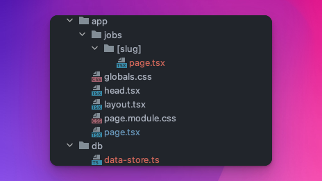
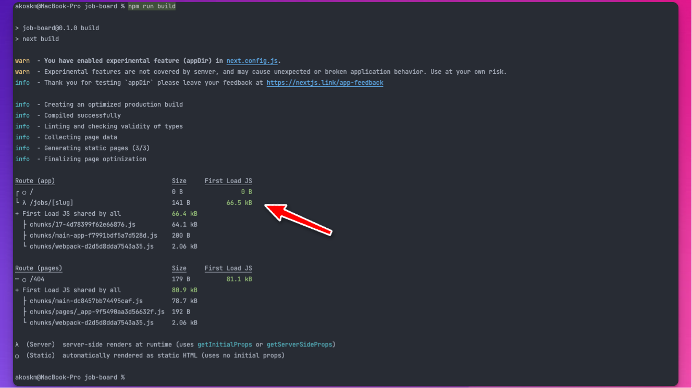
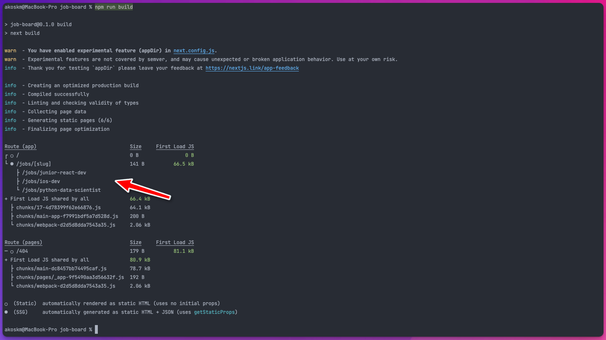

This article will show you how to take advantage of the latest Next.js features: *appDir* and *React Server Components*.

We will build a static web app with dynamic routes. Static pages will be pre-rendered from an external data source.

If you’d like to support me and read more articles like this, consider subscribing to my newsletter. It’s completely free:

<div class="hn-embed-widget" id="substack"></div>

Let me start with a personal story.

# Old is the new New {#heading-old-is-the-new-new}

I started working with PHP in 2003 and built a couple of different apps:

* exchange rate calculator
    
* a journaling app
    
* a public forum
    
* a registration platform for a national mathematical competition
    

All these apps revolved around the same pattern:

1. read data from the DB
    
2. show data to the user
    

As I worked on beginneritjobs.com, I realized I’m doing 1. and 2. in JavaScript, with ES6 and TypeScript in Next.js 13.

I have arrived at the pattern where it all started with PHP in 2003.

It was simple.

Pages were fast.

The code was clean.

Thanks to some of the new features of Next.js 13, we can now achieve this clear pattern again with JavaScript!

Let’s dive in!

# Create a Next.js app from template {#heading-create-a-nextjs-app-from-template}

We will build a static job board where each job page is pre-rendered based on some data.

To keep things simple, we’ll use a JSON for this. Your app will probably use a 3rd party API or database calls to get this data.

First, use `create-next-app` to generate a new Next.js application from scratch, with TypeScript and Eslint support and the new `appDir` feature.

```bash
% npx create-next-app@latest job-board --experimental-app --ts --eslint
```

# The `appDir` layout {#heading-the-appdir-layout}

`appDir` is the secret sauce enabling the use of React Server Components.

This will change how we write JavaScript apps.

No more loading states, spinners, or loading conditions.

You don’t worry about SSR setup or adding different quirks to your app to hydrate pages and all that stuff.

Components in the `appDir` are Server Components by default.

Go to the folder where `create-next-app` generated the Next.js template.

Replace the contents of `app/page.tsx` with the following:

```typescript
import styles from './page.module.css'

export default async function JobBoard() {
  return (
    <div className={styles.container}>
      <main className={styles.main}>
        <h1 className={styles.title}>
          Job Board
        </h1>
      </main>
    </div>
  )
}
```

`JobBoard` is a React Server Component.

It doesn't work with any data yet, so let's change that.

Next.js 13 documentation recommends that you *do the data-fetching in the server components*.

And this is where stuff becomes interesting.

# Server Components {#heading-server-components}

So how we fetched data before with client-side rendering?

```javascript
import { useState } from "react";

export default function JobBoard() {
  const [job, setJobs] = useState(null);
  const [loading, setLoading] = useState(false);

  async  function fetchData() {
    setLoading(true);
    const response = await fetch("URL");
    const body = await response.json();
    setBody(body);
    setLoading(false);
  }

  useEffect(() => {
    fetchData();
  }, [])

  if (loading) return <p>Loading...</p>;

  return (
    <div className={styles.container}>
      <main className={styles.main}>
        <h1 className={styles.title}>
          Job Board
        </h1>
        <div>
          {!!jobs && jobs.map((job) => (
            <div key={job.slug}>
              <div>
                <div><b>{job.title}</b></div>
                <div>{job.description}</div>
              </div>
              <div>
                <a href={`jobs/${job.slug}`}>View Job</a>
              </div>
              <hr/>
            </div>
          ))}
        </div>
      </main>
    </div>
  )
}
```

You might have used `useQuery` or some other tools to get the data, but the process was always the same:

1. open the webpage
    
2. send a bunch of JS to the client
    
3. start data fetch
    
4. show spinners
    
5. hide spinners
    
6. show data
    

With React Server Components, you can leave your logic and all the libraries needed to render the response on the server.

The client receives only the result of the rendering.

## Data fetching {#heading-data-fetching}

### Landing page {#heading-landing-page}

We will use a simple JSON object as our data source to keep things simple.

To simulate network requests, we’re going to delay every response by one second:

```typescript
// db/data-store.ts

const jobs = [{
  slug: 'junior-react-dev',
  title: 'Junior Web Developer',
  description: 'Familiar with modern front end development.'
}, {
  slug: 'ios-dev',
  title: 'iOS Developer',
  description: 'Passionate for crafting great mobile experiences',
}, {
  slug: 'python-data-scientist',
  title: 'Data Scientist',
  description: 'Love for big data'
}]

export async function getJobs(slug?: string): Promise<Array<Job>> {
  return new Promise((resolve) => {
    setTimeout(() => {
      if (slug) {
        const job = jobs.filter(j => j.slug === slug);
        resolve(job);
      } else {
        resolve(jobs);
      }
    }, 1000);
  })
}
```

In your application, you will probably replace this with a DB or an external API call.

Let’s add data fetching to JobBoard and also display the jobs:

```typescript
// app/page.tsx

import styles from './page.module.css'
import { getJobs } from '../db/data-store';

export default async function JobBoard() {
  const jobs = await getJobs();

  return (
    <div className={styles.container}>
      <main className={styles.main}>
        <h1 className={styles.title}>
          Job Board
        </h1>
        <div>
          {jobs.map((job) => (
            <div key={job.slug}>
              <div>
                <div><b>{job.title}</b></div>
                <div>{job.description}</div>
              </div>
              <div>
                <a href={`jobs/${job.slug}`}>View Job</a>
              </div>
              <hr/>
            </div>
          ))}
        </div>
      </main>
    </div>
  )
}
```

How cool is this?

You just wrote a TSX component in React that fetches data on the server side, and the only thing it returns to the client is a simple HTML page!

### Single page {#heading-single-page}

Let’s create the following structure for our single job page:



This will tell Next.js that we define a dynamic route: `jobs/:slug`.

Whenever an URL such as `jobs/some-random-slug` is opened, `pages.tsx` will render.

Here’s `jobs/[slug]/page.tsx`, our single job page:

```typescript
import styles from '../../page.module.css'

import { getJobs } from '../../../db/data-store';

interface Props {
  params: {
    slug: string
  }
}

export default async function Job({ params }: Props) {
  const [job] = await getJobs(params.slug);

  return (
    <div className={styles.container}>
      <main className={styles.main}>
        <h1 className={styles.title}>
          {job.title}
        </h1>
        <div>
          {job.description}
        </div>
      </main>
    </div>
  )
}
```

## Test run {#heading-test-run}

Run `npm run build` in the console to build the job board.



We notice that two pages were generated:

* `/`, our landing page, and
    
* `/jobs/[slug]` that is our dynamic job page
    

Now it’s time to test the application.

Run it with `npm start` and go to localhost:3000.

You’ll notice how each page load takes a little more than one second.

This is because the data is fetched dynamically while rendering the page:


Can we speed this up?

The job data is known at build time.

Is there a way to pre-render these job pages and return the HTML when a specific job page is opened?

There is!

# Static page generation {#heading-static-page-generation}

We will use the `generateStaticParams` function to create static pages with the combination of dynamic route segments.

Next.js has a pretty nice explanation of how [generateStaticParams](https://beta.nextjs.org/docs/api-reference/generate-static-params#generatestaticparams) work.

Basically, *during build time*, this function will return each possible path that can be rendered for your dynamic route, and Next.js will render an HTML page for them.

Without this function, your app will work, but the pages will be rendered only when accessed, as we saw earlier.

I made this error while building beginneritjobs.com and couldn't figure out why my pages are slow:

<div class="embed-wrapper"><div class="embed-loading"><div class="loadingRow"></div><div class="loadingRow"></div></div><a class="embed-card" href="https://twitter.com/akoskm/status/1591036944070606849?s=20&amp;t=4mQe_ivWGCYkXgip48TNew">https://twitter.com/akoskm/status/1591036944070606849?s=20&amp;t=4mQe_ivWGCYkXgip48TNew</a></div>

After implementing `generateStaticParams` I had blazing-fast load times because all pages were pre-rendered.

### Pre-rendering on a single page {#heading-pre-rendering-on-a-single-page}

Here’s how we do it for the `jobs/[slug]/page.tsx`:

```typescript
import styles from '../../page.module.css'

import { getJobs } from '../../../db/data-store';

interface Props {
  params: {
    slug: string
  }
}

export async function generateStaticParams() {
  const jobs = await getJobs();

  return jobs.map((job) => ({
    slug: job.slug,
  }));
}

export default async function Job({ params }: Props) {
  const [job] = await getJobs(params.slug);

  return (
    <div className={styles.container}>
      <main className={styles.main}>
        <h1 className={styles.title}>
          {job.title}
        </h1>
        <div style={{ marginBottom: '50px'}}>
          {job.description}
        </div>
        <a href={'/'}>Go Back</a>
      </main>
    </div>
  )
}
```

We’ll immediately see the difference in the `npm run build` output:



Next.js also generated one page for each job slug beside the `/` landing page!

## Test run {#heading-test-run-1}

Run `npm start` now and see the difference in the page load times:


Pages load instantly because they are pre-rendered at build time!

🚀

# GitHub Repository {#heading-github-repository}

[https://github.com/akoskm/nextjs-13-appdir-job-board](https://github.com/akoskm/nextjs-13-appdir-job-board)

---

If you liked this post, give it some emojis, comment, and share it on your social media!

Did you run into trouble? Don’t hesitate to comment or reach out to me on [Twitter](http://twitter.com/akoskm).

See you in the next one! 👋
