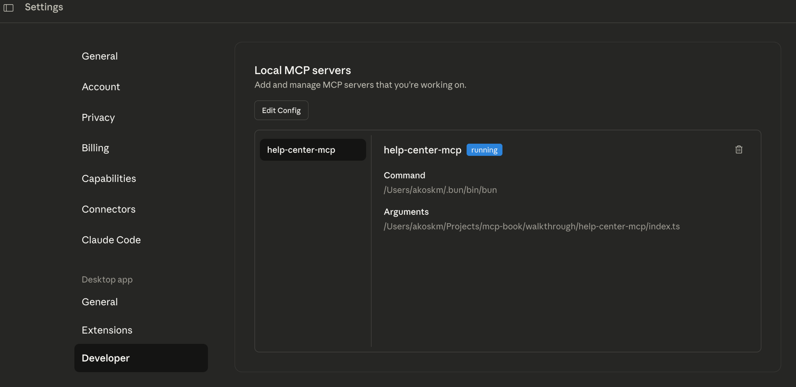
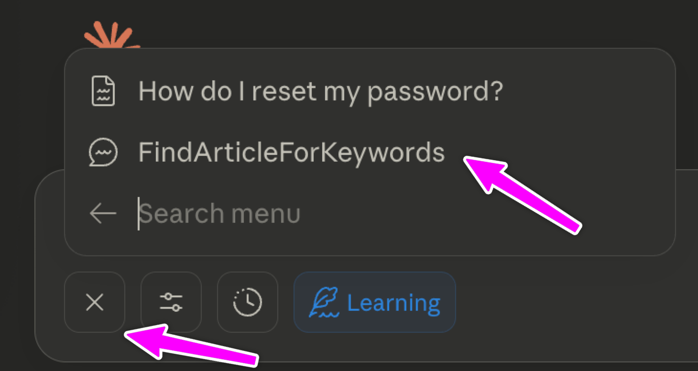
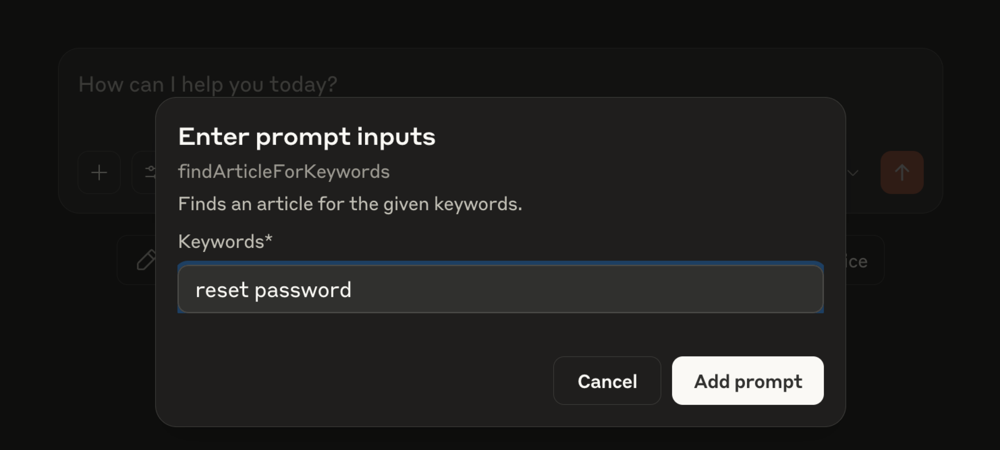
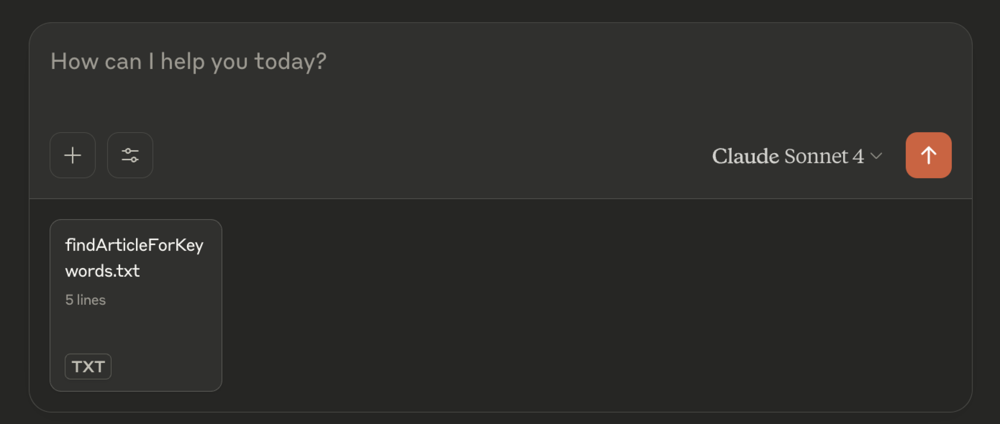
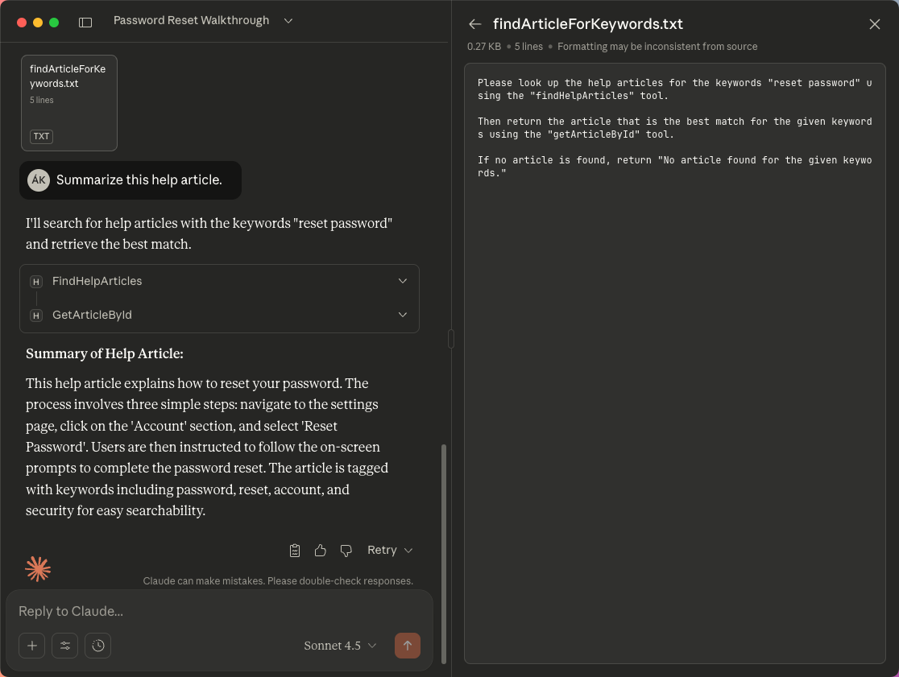

In this article, I’ll show you how you can program your MCP servers to execute a small program, pass context between steps, and keep the outputs consistent.

Imagine having a voice assistant that isn’t that smart.

Let’s say you’re in the middle of your workout and decide you want to listen to some Red Hot Chili Peppers.

The voice assistant doesn’t know how to play that music for you, but it can follow instructions very well.

So you go and explain:

1. Open my Music app
    
2. Search for Red Hot Chili Peppers and get the `bandID` for the band. Use the function `findBand()`
    
3. Search for the Best of albums for this `bandID`, and get the `albumID`. Use the function `band.findAlbum`
    
4. Get the first `songID` from `albumID`. Use the function `album.getSong`
    
5. Play the song with `songId`. Use `song.play`
    

I bet you wouldn’t be listening to music at all during workouts.

But now imagine having a *smart assistant*, which can understand and execute on:

“Hey Siri, play something from Red Hot Chili Peppers”.

Way different experience.

MCP Prompts are *smart assistants*. They know:

1. What tools do you have available
    
2. How and for what those tools can be used
    
3. How to pass the results around
    

Just like your voice assistant uses natural language to map your request to actions, MCP prompts let you describe *what you want to happen* — and the MCP runtime figures out *how* to get it done using your registered tools.

At their core, MCP prompts are **structured workflow definitions**.

They’re not free-form text; they’re **programmatic, natural language instructions** the model can reason about, execute, and chain together.

Here’s what that looks like in practice:

```typescript
server.prompt(
  "findArticleForKeywords",
  "Finds an article for the given keywords.",
  {
    keywords: z
      .string()
      .describe("The keywords to find an article for"),
  },
  async ({ keywords }) => {
    return {
      messages: [
        {
          role: "user",
          content: {
            type: "text",
            text: `
Please look up the help articles for the keywords \"${keywords}\" using the "findHelpArticles" tool.

Then return the article that is the best match for the given keywords using the "getArticleById" tool.

If no article is found, return "No article found for the given keywords."
              `.trim(),
          },
        },
      ],
    };
  },
);
```

Now let’s build the actual MCP server that implements the tools our prompt needs. We’ll create a help center server with three core tools: `findHelpArticles`, `getArticleById`, and `addHelpArticle`.

# Step 1: Set Up Your Project Structure {#heading-step-1-set-up-your-project-structure}

First, create a new directory and initialize your MCP server:

```bash
mkdir help-center-mcp
cd help-center-mcp
npm init -y
npm install @modelcontextprotocol/sdk zod
```

Create a `src` directory and an `index.ts` file:

```bash
mkdir src
touch src/index.ts
```

Create a `tsconfig.json`:

```json
{
  "compilerOptions": {
    "module": "NodeNext",
    "moduleResolution": "NodeNext",
    "target": "ESNext",
    "esModuleInterop": true,
    "strict": true,
    "skipLibCheck": true,
    "resolveJsonModule": true,
    "outDir": "dist"
  },
  "include": ["**/*.ts"],
  "exclude": ["node_modules"]
}
```

# Step 2: Define Your Data Storage {#heading-step-2-define-your-data-storage}

For this tutorial, we’ll use in-memory storage. In a real application, you’d connect to a database, but this keeps things simple for learning purposes.

```typescript
// src/index.ts
import { McpServer } from "@modelcontextprotocol/sdk/server/mcp.js";
import { StdioServerTransport } from "@modelcontextprotocol/sdk/server/stdio.js";
import { ResourceTemplate } from "@modelcontextprotocol/sdk/server/mcp.js";
import { z } from "zod";

// Our in-memory database
interface HelpArticle {
  id: string;
  question: string;
  answer: string;
  keywords: string[];
  createdAt: Date;
}

const articles: HelpArticle[] = [
  {
    id: "1",
    question: "How do I reset my password?",
    answer: "To reset your password, click on 'Forgot Password' on the login page...",
    keywords: ["password", "reset", "login", "security"],
    createdAt: new Date("2024-01-15"),
  },
  {
    id: "2",
    question: "How do I update my billing information?",
    answer: "You can update your billing information in Settings > Billing...",
    keywords: ["billing", "payment", "credit card", "invoice"],
    createdAt: new Date("2024-01-20"),
  },
  {
    id: "3",
    question: "How do I export my data?",
    answer: "To export your data, navigate to Settings > Data & Privacy > Export...",
    keywords: ["export", "data", "download", "backup"],
    createdAt: new Date("2024-02-01"),
  },
];
```

# Step 3: Create the MCP Server Instance {#heading-step-3-create-the-mcp-server-instance}

```typescript
const server = new Server(
  {
    name: "help-center-mcp",
    version: "1.0.0",
  }
);
```

# Step 4: Implement the Search Tool {#heading-step-4-implement-the-search-tool}

The first tool allows Claude to search for help articles based on a query:

```typescript
server.tool(
  "findHelpArticles",
  "Search for help articles based on a query string. Returns matching articles with their IDs.",
  {
    query: z
      .string()
      .describe("The search term or question to find help articles for"),
  },
  async ({ query }) => {
    const searchQuery = query.toLowerCase();
    
    // Search through articles
    const matches = articles.filter((article) => {
      const searchableText = `
        ${article.question} 
        ${article.answer} 
        ${article.keywords.join(" ")}
      `.toLowerCase();
      
      return searchableText.includes(searchQuery);
    });

    return {
      content: [
        {
          type: "text",
          text: JSON.stringify({
            query: searchQuery,
            resultsCount: matches.length,
            articles: matches.map((a) => ({
              id: a.id,
              question: a.question,
              keywords: a.keywords,
            })),
          }, null, 2),
        },
      ],
    };
  }
);
```

# Step 5: Implement the Get Article Tool {#heading-step-5-implement-the-get-article-tool}

Next, we’ll add a tool to retrieve a specific article by its ID:

```typescript
server.tool(
  "getArticleById",
  "Retrieve the full content of a specific help article by its ID.",
  {
    articleId: z
      .string()
      .describe("The ID of the article to retrieve"),
  },
  async ({ articleId }) => {
    const article = articles.find((a) => a.id === articleId);

    if (!article) {
      return {
        content: [
          {
            type: "text",
            text: JSON.stringify({ error: "Article not found" }),
          },
        ],
      };
    }

    return {
      content: [
        {
          type: "text",
          text: JSON.stringify({
            id: article.id,
            question: article.question,
            answer: article.answer,
            keywords: article.keywords,
            createdAt: article.createdAt,
          }, null, 2),
        },
      ],
    };
  }
);
```

# Step 6: Add the Create Article Tool {#heading-step-6-add-the-create-article-tool}

Finally, let’s add a tool to create new articles:

```typescript
server.tool(
  "addHelpArticle",
  "Adds a new question and answer article to the help center.",
  {
    question: z
      .string()
      .describe("The question this article answers"),
    answer: z
      .string()
      .describe("The detailed answer or solution"),
    keywords: z
      .array(z.string())
      .optional()
      .describe("Keywords for better searchability"),
  },
  async ({ question, answer, keywords }) => {
    const newArticle: HelpArticle = {
      id: String(articles.length + 1),
      question,
      answer,
      keywords: keywords || [],
      createdAt: new Date(),
    };

    articles.push(newArticle);

    return {
      content: [
        {
          type: "text",
          text: JSON.stringify({
            success: true,
            article: newArticle,
          }, null, 2),
        },
      ],
    };
  }
);
```

# Step 7: Add the Workflow {#heading-step-7-add-the-workflow}

This is where the magic happens. We define a prompt that tells Claude how to orchestrate these tools:

```typescript
server.prompt(
  "findArticleForKeywords",
  "Finds an article for the given keywords.",
  {
    keywords: z
      .string()
      .describe("The keywords to find an article for"),
  },
  async ({ keywords }) => {
    return {
      messages: [
        {
          role: "user",
          content: {
            type: "text",
            text: `
Please look up the help articles for the keywords \"${keywords}\" using the "findHelpArticles" tool.

Then return the article that is the best match for the given keywords using the "getArticleById" tool.

If no article is found, return "No article found for the given keywords."
              `.trim(),
          },
        },
      ],
    };
  },
);
```

# Step 8: Start the Server {#heading-step-8-start-the-server}

Finally, add the code to run the server:

```typescript
const transport = new StdioServerTransport();
await server.connect(transport);
```

# Step 9: Register the MPC Server {#heading-step-9-register-the-mpc-server}

To test this with Claude Desktop, edit the app’s configuration file that lists the MCP servers. On macOS, this file is in `/Users/<your user>/Library/Application Support/Claude/claude_desktop_config.json`.

You can also access this file from the app from Settings &gt; Developer &gt; Local MCP servers &gt; Edit Config:



You should put something like this into the configuration file:

```json
{
  "mcpServers": {
    "help-center-mcp": {
      "command": "/Users/akoskm/.bun/bin/bun",
      "args": [
        "/absolute/path/to/help-center-mcp/index.ts"
      ]
    }
  }
}
```

The good thing is that you can target the TypeScript file directly, no need to build it and use the built version.

After adding your MCP, you may need to restart Claude Desktop if it doesn’t appear immediately.

# Step 10: Execute the Workflow {#heading-step-10-execute-the-workflow}

Prompts can be accessed by clicking on the *+* sign, the same as for resources.



When you select the prompt, based on the input schema, Claude Desktop will present you with a nice dialog, asking for the inputs your prompt requires.



After you specify the inputs, click Add prompt. Same for resources, if you click the *findArticleForKeywords* tile, you'll see the prompt Claude Desktop generated based on your MCP server prompt. Click the "up arrow" to run it:



Here, you can see that the prompt took your input and used the `findHelpArticles` tool to find the article, and then the `getArticleById` tool to get the article by ID:



Let’s break down the workflow execution:

1. **You triggered the prompt**: By invoking the `findArticleForKeywords` prompt from the UI
    
2. **Claude read the instructions**: The prompt told Claude exactly which tools to use and in what order
    
3. **Tool orchestration**: Claude automatically called `findHelpArticles`, evaluated the results, then called `getArticleById`
    
4. **Context passing**: The `articleId` from the first tool call was passed to the second tool call
    
5. **Smart decision-making**: If no articles were found, Claude would have followed the fallback instruction
    

This is the power of MCP workflows. You’re not just exposing tools—you’re teaching Claude how to think about solving problems with those tools.

## Key Takeaways {#heading-key-takeaways}

* **Prompts are workflow definitions**: They guide Claude through multi-step processes
    
* **Tools are the building blocks**: Each tool does one thing well
    
* **Claude handles orchestration**: You define the what, Claude figures out the how
    
* **Context flows naturally**: Results from one tool can inform the next step
    

You now have a working MCP workflow! Try extending it by adding more tools or creating more complex prompts that chain multiple operations together.

If you’re stuck at any point, don’t hesitate to drop me an email at `hello@akoskm.com`!
