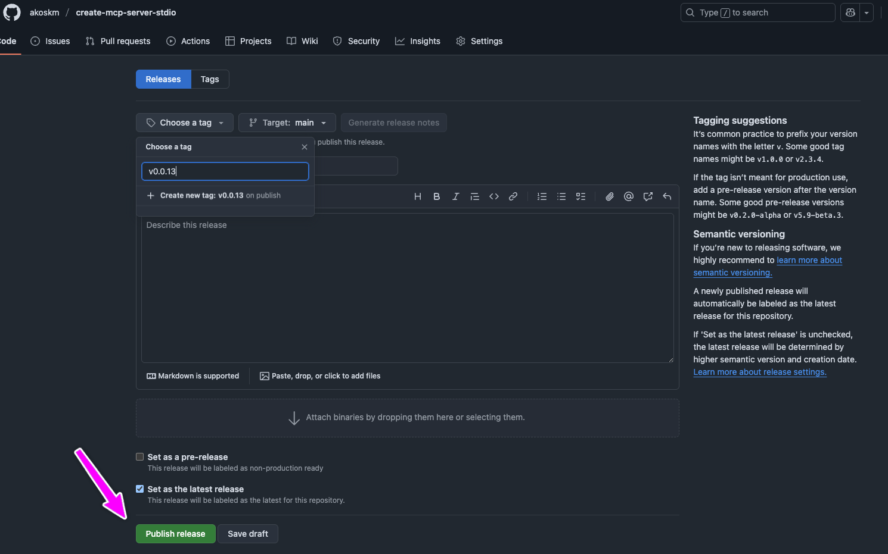

In this blog post, I’ll show you how to create an “npm create” package, also called npm template repository, a starter template, or a scaffolding tool. There are many names for this, but it’s basically a package that you can run with *npm create*, and it’ll copy a starter template to your machine.

`npm create` is actually just a synonym for `npm init`, but in the community, the *create* version is more popular.

Such tools might be familiar to you from Next.js or Remix. Both have these scaffolding tools that you can run with `npx create-next-app@latest` or `npm create react-router`.

Let’s see how we can build this!

# Project Setup {#heading-project-setup}

First, create a new directory and set up an empty npm project:

```plaintext
mkdir create-your-package
npm init -y
```

We’ll also install a simple tool that’s made to copy the contents of GitHub Repositories: [degit](https://www.npmjs.com/package/degit).

```plaintext
npm i degit
```

Depending on what you’re building, you might want to install other dependencies.

After the initial setup, we’ll add the most important script you’ll always need to build a scaffolding tool. The name isn’t important, but the contents are.

# Binary Script {#heading-binary-script}

Create `index.js` with a shebang directive. A "shebang" is a line at the start of a script that tells the system which interpreter to use to run the script.

```javascript
#!/usr/bin/env node
import degit from "degit";

const repo = "akoskm/mcp-server-stdio"; // replace this with your repository
const emitter = degit(repo, { cache: false, force: true, verbose: true });

const targetDir = process.argv[2] || ".";

emitter.clone(targetDir)
  .then(() => {
    console.log("Template copied!");
    process.exit(0);
  })
  .catch((error) => {
    console.error("Failed to copy template:", error);
    process.exit(1);
  });
```

Inside `index.js` I’m using *degit* to copy the contents of the `akoskm/mcp-server-stdio` repository to the user’s machine. The tool will automatically prefix this with GitHub’s URL and make a copy of the repository contents.

Now you must specify this as the binary script in `package.json`:

```json
{
  "name": "@your-username/create-your-package",
  // rest of the package.json ...
  "type": "module",
  "bin": {
    "create-your-package": "./index.js"
  }
}
```

The `bin` field in `package.json` specifies the executable files your package provides. It also runs after the user installs your package.

# Testing Locally {#heading-testing-locally}

After this, link your new npm package:

```plaintext
$ npm link

up to date, audited 3 packages in 635ms

found 0 vulnerabilities
```

`npm link` allows you to symlink a package folder to test the package locally without publishing it to the npm registry.

And now you should be able to run this command from the terminal:

```plaintext
$ create-your-package clone
Template copied!
```

And now, if you check the current folder, you’ll have a clone directory containing the code from the GitHub repository you specified:

```plaintext
$ ls -l
total 24
drwxrwxr-x@ 11 akoskm  staff  352 May  6 08:34 clone // this was created
-rwxr-xr-x@  1 akoskm  staff  454 May  6 08:30 index.js
drwxr-xr-x@  5 akoskm  staff  160 May  6 08:29 node_modules
-rw-r--r--@  1 akoskm  staff  727 May  6 08:33 package-lock.json
-rw-r--r--@  1 akoskm  staff  357 May  6 08:33 package.json
```

# Publishing {#heading-publishing}

For publishing my package [akoskm/create-mcp-server-stdio](https://github.com/akoskm/create-mcp-server-stdio) I’m using a slightly tweaked version of the [script provided by GitHub](https://docs.github.com/en/actions/use-cases-and-examples/publishing-packages/publishing-nodejs-packages), but only because I’m using `pnpm`.

You can see my build script [here](https://github.com/akoskm/create-mcp-server-stdio/blob/main/.github/workflows/npm-publish-github-packages.yml).

You’ll put this file in `.github/workflows/npm-publish-github-packages.yml`.

It’s not mentioned in the docs, but the pipeline failed for me until I added `--no-git-checks`. First, try it without this flag since it may not be necessary for you.

Once you have this set up, you can create a release by going to your repository in GitHub and navigating to the Releases tab, and clicking *Draft a new release*:



Once you click *Publish release*, the GitHub Action script will trigger and publish your package on npm.

# Troubleshooting {#heading-troubleshooting}

It took me a while to get this working, and I debugged my package a lot. Here’s a summary of the commands I used to debug `@akoskm/create-mcp-server-stdio`. Of course, you’ll use your package name in these commands.

## Check Global Installations {#heading-check-global-installations}

```bash
# Check if package is installed globally with npm
npm list -g @akoskm/create-mcp-server-stdio

# Check if package is installed globally with pnpm
pnpm list -g @akoskm/create-mcp-server-stdio
```

## Test Package Installation {#heading-test-package-installation}

```bash
# Install from npm registry
npm create @akoskm/create-mcp-server-stdio my-mcp-server

# Install directly from GitHub
pnpm dlx github:akoskm/mcp-server-stdio my-mcp-server
```

## Package Information {#heading-package-information}

```bash
# View package contents in registry
npm view @akoskm/create-mcp-server-stdio

# View published versions
npm view @akoskm/create-mcp-server-stdio versions

# View package contents before publishing
npm pack --dry-run
```

Check [https://github.com/akoskm/create-mcp-server-stdio/tree/main](https://github.com/akoskm/create-mcp-server-stdio/tree/main) if you need inspiration, or write me at [hello@akoskm.com](mailto:hello@akoskm.com).
