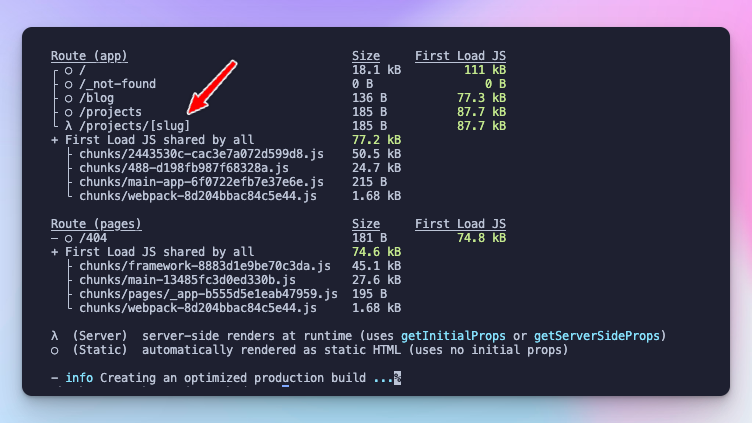

## Introduction {#heading-introduction}

I started exploring Headless CMS solutions a few weeks ago for a [couple of reasons](https://akoskm.com/headless-cms-why-its-worth-considering). One of the main motivations is, finding new clients interested in website development with CMS Solutions. After evaluating a few of the current CMS, I ended up with Strapi.

They have an active community on GitHub and Discord, extensive documentation, and useful community tools that help with the development.

There are two reasons why I wrote this post:

* When I asked ChatGPT how to fetch data from a Strapi GraphQL endpoint from Next.js 13 Server Components, it struggled a bit. This is because ChatGPT data was cut off while the Server Components were in Beta.
    
* I wanted to try something more lightweight than Apollo GarphQL – my go-to GraphQL solution since I've been using this tech. ChatGPT wanted me to use useQuery from Tanstack, but I couldn't make it work in Server Components, so I picked `graphql-request`.
    

Now let's see how to fetch data from a Strapi GraphQL endpoint with Next.js 13 Server Components:

### Brief overview of Next.js 13 Server Components {#heading-brief-overview-of-nextjs-13-server-components}

If you're new to Next.js 13, Server Components are considered one of the most anticipated solutions in Next.js. Server Components let you eliminate the fetch-setState-render combo by making the Server Components async and letting you await the response in the component code:

```typescript
async function Blog({ params: { slug }}) {
  // now it's simply this:
  const blog = await fetch(slug);

  // but before server components, you had something like this:
  // const [blog, setBlog] = useState(null);
  //
  // useEffect(() => {
  //   async function getBlog() {
  //     const blog = await fetch(slug);
  //     setState(blog);
  //   }
  //   getBlog();
  // })

  return (<h1>blog.title</h1>);
}
```

### Introduction to Strapi and GraphQL {#heading-introduction-to-strapi-and-graphql}

Strapi, by default, comes with a REST API, but they have [great docs](https://docs.strapi.io/dev-docs/plugins/graphql) that will help you turn on the GraphQL endpoints. I'll avoid repeating the docs (and you should, too!). But essentially, after you've done this and configured GraphQL correctly in Strapi, you can visit `localhost:1337/graphql` (or where your Strapi is running) to see if the interactive console loads - and it probably won't. But don't worry. Keep reading!

### Objective: Fetching data from Strapi GraphQL in Next.js 13 Server Components {#heading-objective-fetching-data-from-strapi-graphql-in-nextjs-13-server-components}

Now that we have a working Strapi GraphQL endpoint, `localhost:1337/graphql` it's time to prepare our local app so that we can fetch data inside Next.js Server Components.

## Setting up the environment {#heading-setting-up-the-environment}

We'll need two things:

* Next.js 13 - this will be our front end
    
* Strapi - the backend
    

Again, I'm not a fan of repeating docs - have I mentioned this already? - so I'll give you the link explaining how to do it.

### **Next.js** {#heading-nextjs}

Here's how to create a Next.js 13 sample app with create-next-app (1 minute): [https://nextjs.org/docs/getting-started/installation](https://nextjs.org/docs/getting-started/installation).

### **Strapi** {#heading-strapi}

Create and start a local Strapi instance (10 minutes): [https://docs.strapi.io/dev-docs/quick-start](https://docs.strapi.io/dev-docs/quick-start). This tutorial will also walk you through setting up your first collection and adding some content. I suggest you create a collection named Post with the fields `title` (Text), `slug` (Text), and `content` (Rich Text).

### Strapi + GraphQL {#heading-strapi-graphql}

Setting up GraphQL in Strapi (1 minute): [https://docs.strapi.io/dev-docs/plugins/graphql](https://docs.strapi.io/dev-docs/plugins/graphql)

Here's the `plugins.js` file I'm using that will let codegen retrieve and generate types automatically in the Next.js app with the `introspection` option and also starts the playground with `playgroundAlways`. These aren't turned on by default, and this is why you were getting an error earlier when you tried to access `localhost:1337/graphql`.

```typescript
module.exports = ({ env }) => ({
  graphql: {
    enabled: true,
    config: {
      apolloServer: {
        introspection: true,
      },
      playgroundAlways: true,
    }
  }
});
```

Now that you have a basic Strapi and a Next.js project configured, let's go to the Next.js project and add some packages for making a GraphQL request.

## Integrating GraphQL with Next.js Server Components {#heading-integrating-graphql-with-nextjs-server-components}

First, we must install a few dependencies to do the fetches and the code generation. For this, I choose `graphql-request` and `@graphql-codegen`.

```typescript
npm i -D graphql graphql-request @graphql-codegen/cli @graphql-codegen/client-preset
```

### Creating a GraphQL client for Next.js Server Components {#heading-creating-a-graphql-client-for-nextjs-server-components}

Next, I create this little helper `lib/graphql.ts` :

```typescript
import { GraphQLClient } from "graphql-request";
export { gql } from "graphql-request";

export const grafbase = new GraphQLClient(
  "http://localhost:1337/graphql" as string,
);
```

### Setting up codegen and generating types: {#heading-setting-up-codegen-and-generating-types}

Create a file `codegen.ts` in the root of your project:

```typescript
import { CodegenConfig } from "@graphql-codegen/cli";

const config: CodegenConfig = {
  schema: "http://localhost:1337/graphql",
  documents: ["src/**/*.tsx"],
  ignoreNoDocuments: true, // for better experience with the watcher
  generates: {
    "./types/gql/": {
      preset: "client",
    },
  },
};

export default config;
```

Note that this will only work if you turn on `introspection: true`.

To generate the types, simply run the following command:

```bash
npx graphql-codegen
```

You'll find the generated types in `types/gql`. Running this command will produce an output similar to this:

```bash
% npx graphql-codegen
✔ Parse Configuration
✔ Generate outputs
```

## Fetching data in Next.js Server Components {#heading-fetching-data-in-nextjs-server-components}

Finally, let's see what a post page would look like. You would serve this page when the user hits `/posts/my-first-post`.

Create a Server Component `/posts/[slug]/page.tsx` and import `gql, grafbase` from the GraphQL helper we created earlier, including the generated type `PostEntity` (if you created a different content structure, this could be different):

```typescript
import { gql, grafbase } from "@/lib/graphql";
import { PostEntity } from "@/types/gql/graphql";
```

You can use Strapi's [built-in filters](https://docs.strapi.io/dev-docs/api/graphql#filters) to find the correct post by slug.

```typescript
const response = await grafbase.request<{ posts: { data: PostEntity[] }}>(
  gql`
    query Post($slug: String!) {
      posts(filters: { slug: { eq: $slug } }) {
        data {
          id
          attributes {
            title
            content
          }
        }
      }
    }
  `,
  { slug }
);
```

In addition to these, don't forget to extract the data you fetched: `title` and `content`. Finally, when you put together the entire thing, it'll look like this:

```typescript
import { gql, grafbase } from "@/lib/graphql";
import { PostEntity } from "@/types/gql/graphql";

interface Props {
  params: {
    slug: string;
  };
}
export default async function Project({ params: { slug } }: Props) {
  const response = await grafbase.request<{ posts: { data: PostEntity } }>(
    gql`
      query Post($slug: String!) {
        posts(filters: { slug: { eq: $slug } }) {
          data {
            id
            attributes {
              title
              content
            }
          }
        }
      }
    `,
    { slug }
  );
  const { title, content } = response.posts.data[0].attributes;

  return (
    <div>
      <h1>{title}</h1>
      <p>{content}</p>
    </div>
  );
}
```

## Conclusion {#heading-conclusion}

### Potential use cases and benefits {#heading-potential-use-cases-and-benefits}

We're in the process of rebuilding our agency website Strapi. SEO and page speed are one of our top priorities for us, so going with Next.js 13 Server Components was a reasonable choice.

With the above setup, we can manage our content in Strapi, separate from our website, where the development happens.

### Further exploration and learning {#heading-further-exploration-and-learning}

But this setup is far from being optimal. If you check out the output of `npm run build`, you'll see that although the blog pages (projects on my screenshot) are server-side rendered, they aren't rendered at build time. But static pages could be generated at build time, further increasing performance and reducing page load times.



In the next post, we'll find out how to render static pages from the content we have in Strapi.

As always, thank you for reading my blog. I hope it was helpful to you!

\- Akos
