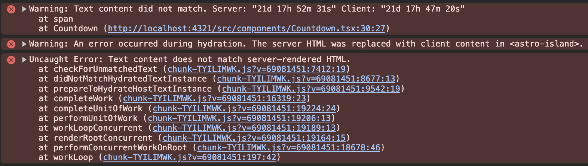

Hi friends 👋

I’ve launched a custom Astro front-end for my Hashnode blog. I wanted to have **static pages** that work **without JavaScript**, while still having access to Hashnode’s best-in-class Neptune editor ❤️. Astro generates static pages by rendering your components on the server side. This is a big plus but it introduces the possibility of **React Hydration Errors**.

A React Hydration Error occurs when the HTML generated by React on the server is different from the HTML generated by React on the client.

If you prefer to watch the video version where I also walk you through **how to fix React Hydration Errors** in Astro, here’s a video I made for you!

<div class="embed-wrapper"><div class="embed-loading"><div class="loadingRow"></div><div class="loadingRow"></div></div><a class="embed-card" href="https://youtu.be/WaVIeduz8Vg">https://youtu.be/WaVIeduz8Vg</a></div>

So while static pages worked for 99% of my site, there was a problem…

I wanted a *Countdown* component that shows you the current promotion I’m running on my React Custom Hooks Course. This component had to be dynamic, counting down the *days, hours, minutes, and seconds* you have left until the promotion ends.

The new time is set in the `useEffect` below:

```typescript
// Countdown.tsx
const Countdown = () => {
  const [time, setTime] = useState(() => formatTime(timeLeft));

  useEffect(() => {
    const interval = setInterval(() => {
      timeLeft = PROMOTION_END - Date.now();
      setTime(formatTime(timeLeft));
    }, 1000);
    return () => clearInterval(interval);
  }, []);

  return <span id="countdown">Time left: {time}</span>;
};
```

To get the time changing I had to make this component client-side rendered with Astro, using the `client:load` directive:

```typescript
// header.astro
<Countdown client:load />
```

Because I made Countdown client-side render, but it was already server-side rendering, I’ve run into the famous **React Hydration Error**.


When the Countdown component was rendered on the server side, it had one date. However, when it was rendered on the client side a few seconds later, it had a different date.

This is the perfect recipe for a **React Hydration Error**:



Let’s see two ways to fix this hydration error for our dynamic React component in Astro.

# Return Null on Server Side rendering {#heading-return-null-on-server-side-rendering}

We know that `useEffect` doesn’t run while the React component is rendered on the server side. We can use this knowledge to track when the component is client-side rendered by having a boolean state that changes to false when `useEffect` runs during mount:

```typescript
const Countdown = () => {
  const [time, setTime] = useState(() => formatTime(timeLeft));
  // true, because we're on the server by default
  const [isLoading, setIsLoading] = useState(true);

  useEffect(() => {
    setIsLoading(false); // Okay, now we're on the client
    const interval = setInterval(() => {
      timeLeft = PROMOTION_END - Date.now();
      setTime(formatTime(timeLeft));
    }, 1000);
    return () => clearInterval(interval);
  }, []);

  if (isLoading) return null; // while on the server return null

  return <span id="countdown">Time left: {time}</span>;
};
```

This solution fixes the hydration error, but it makes our component a bit more complicated with an extra state, due to how Astro renders our component.

Not the best solution… Let’s see if Astro can fix the problem!

# Use client:only=”react” {#heading-use-clientonlyreact}

Astro gives you [*Directives*](https://docs.astro.build/en/reference/directives-reference/#client-directives) *that* control how Astro hydrates the components it renders.

One of these directives is `client:only={string}`.

When this directive is applied, Astro skips the server rendering of a component and renders it only on the client. It works like `client:load` by loading, rendering, and hydrating the component right away when the page loads.

Applying this directive in my case looked like this:

```typescript
// header.astro
<Countdown client:only="react" />
```

This also made the hydration error disappear, without changing the complexity of the React component itself!

Win-win!

# Browser extensions and error 418 {#heading-browser-extensions-and-error-418}

The production console looks like this:

```text
Uncaught Error: Minified React error #418; visit https://react.dev/errors/418?args[]=HTML&args[]= for the full message or use the non-minified dev environment for full errors and additional helpful warnings.
```

[react.dev/errors/418](https://react.dev/errors/418) decodes it to **Hydration failed because the server rendered HTML didn't match the client.** As a result this tree will be regenerated on the client. The page also says a browser extension can mess with the HTML before React loaded.

[#425](https://react.dev/errors/425) is `Text content does not match server-rendered HTML.` [#423](https://react.dev/errors/423) means React recovered by client-rendering the entire root.

The countdown can be fine and you still get this. Grammarly, LastPass, ColorZilla, a dark-mode extension, or a translation extension changed the DOM after the HTML arrived and before React hydrated.

ColorZilla writes `cz-shortcut-listen="true"` on `<body>`. Grammarly writes `data-gr-ext-installed` and `data-new-gr-c-s-check-loaded`. Dark Reader writes `data-darkreader-mode` on `<html>`. LastPass inserts a node next to a password field. A translation extension replaces the text.

Open the page in a private window, extensions off, or disable them and reload. If the error is gone, an extension caused it. If it is still there, the mismatch is in the component, same as the countdown.

The screenshot above is the React 18 dev output: `Text content did not match`, then `Hydration failed because the initial UI does not match what was rendered on the server.` React 19 prints one message and a diff. A `+` line is what the browser had. A `-` line is the server HTML.

Extra attributes log a different message, still only in dev: a tree hydrated but some attributes of the server rendered HTML didn’t match the client properties. This won’t be patched up. The diff is the same shape, `+` for the browser and `-` for the server, and the text mentions browser extensions. Production does not report that one as minified #418. The attribute stays in the DOM.

React 19 skips unexpected tags in `<head>` and `<body>`. An extension’s custom element on `<body>` is skipped. A `<div>` prepended in `<body>` can still be taken for your own node, and then hydration fails. A node inside the island fails the same way, and so does rewritten text. That mismatch is the #418 a production build still throws.

`suppressHydrationWarning` skips the check for one element. One level deep: the attributes and the text of that element. A child is a separate check. React will not patch mismatched text, so if you put it on the countdown the server’s time stays on screen. [`hydrateRoot`](https://react.dev/reference/react-dom/client/hydrateRoot#suppressing-unavoidable-hydration-mismatch-errors) documents that limit.

Next.js hydrates `<html>` and `<body>` from `app/layout.tsx`, so the prop goes on both. The [Next.js hydration error page](https://nextjs.org/docs/messages/react-hydration-error) lists browser extensions as a cause, and the same one-level limit.

```typescript
// app/layout.tsx
export default function RootLayout({
  children,
}: {
  children: React.ReactNode;
}) {
  return (
    <html lang="en" suppressHydrationWarning>
      <body suppressHydrationWarning>{children}</body>
    </html>
  );
}
```

Astro’s partial hydration only runs React inside the island you mark with `client:load` or `client:only`. The `<html>` and `<body>` in the layout are not React elements:

```typescript
// src/layouts/Layout.astro
<html lang="en">
  <body>
    <slot />
  </body>
</html>
```

The prop belongs on the React element the diff names:

```typescript
return (
  <div suppressHydrationWarning>
    {children}
  </div>
);
```

React then skips the attribute check on that `div`. A node inserted under it is a child, so the check still runs.

When the diff is your own output, two different times, keep the markup deterministic. The server HTML and the first client render have to match. The `isLoading` flag above returns `null` on the server and on the first client render, then `useEffect` flips it. `useEffect` still does not run during server rendering.

If an extension keeps rewriting the inside of the island, or the first render can only be correct in the browser, skip the server HTML:

```typescript
// header.astro
<Countdown client:only="react" />
```

`client:only="react"` loads immediately, same as `client:load`, and Astro does not server-render the component. No server HTML, so that island has nothing to mismatch. You lose the static markup for that component. For a countdown, I can live with that.

# Conclusion {#heading-conclusion}

In conclusion, dealing with React Hydration Errors in Astro can be challenging, but with the right approach, it is manageable. By **understanding the root cause** of these errors and utilizing Astro's directives effectively, you can ensure your dynamic components work seamlessly.

Whether you choose to return null on server-side rendering or use the `client:only="react"` directive, both methods offer viable solutions to maintain the integrity of your static and dynamic content.

If a private window makes the hydration message disappear, a browser extension changed the DOM before React ran. That case is the section above.

Happy coding!
