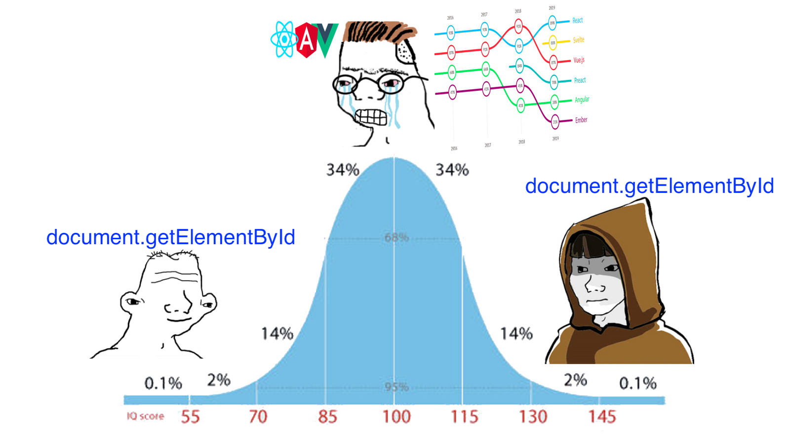

In this post, I'll give you my experience from interviewing a couple of Senior Engineers for software developer positions - front-end, full-stack or backend.

This is not a technical guide that you can print and use as a cheat sheet during an interview. I'm sure you'll find gazillions of those on the internet and pull up one if that's your thing.

There will be also no coding questions.

You don't need to be a genius to create web apps, and once you learn how to do it's clear you can code. What sets some engineers apart is their behind-the-scenes work, like stopping a risky refactoring that could have introduced flakiness in your system or adding a useful pattern that's now used throughout your company's code.

*While writing the last few paragraphs about this guide I realized that interviewing people for senior positions looked more like talking to a fellow engineer you bumped into during a meetup. It's about exchanging ideas and learning how they do things or what would they improve and how. From code quality, to cost of software solutions to testing and reliability. I haven't asked any senior engineers to write even a single line of code during these interviews.*

This guide will give you my approach and mindset when it comes to interviewing senior engineers - where I come to my first point:

## Forget about seniority. {#heading-forget-about-seniority}

Is it interviewing a senior engineer or interviewing an engineer for a senior position?

If you work for the big guys at FAANG you'll have a well-defined engineering leveling guide that you can use to pinpoint at any time what level an engineer is.

But, if you don't work for the 1%, chances are, what counts as a senior in one company is a solid mid-level engineer at another.

This is why, as the first step, I like to forget for a moment at which level the candidate is and focus on what the position requires.

This step also helps you to eliminate any discussion that is probably not relevant for you - like how the candidate's current or former company used to measure engineer seniority - and instead, focus on who you want for this position.

Well, who do you want?

Hard to tell without being specific about technologies, right?

While the responsibilities of a senior engineer can be diverse, there are a few common ones. We'll discuss those later.

It's a good idea to start with a topic that can be discussed extensively. This acts as an effective icebreaker and also reveals a lot about your candidate.

## How do they build stuff? {#heading-how-do-they-build-stuff}

Ask them what's the last project they've built from the ground up. Without diving into the specifics of the business - which their NDA might prevent and that's fine - ask them about day-to-day IT-heavy lifting stuff that you do no matter what kind of project you work on: CI/CD, testing, refactoring, delivering features, stability, meeting deadlines, code quality

One thing I look for in engineers for senior positions is a much broader understanding of the software development lifecycle.

At the beginning of your career coding is all new and shiny. One feature after the other, one helper module after the other - despite already having 5 separate ways to do the same thing. Doesn't matter, code is life! (This was me like 10 years ago, sorry for all the tech-debt)

When you hit the mid-tier of the software development game everything clicks. You come to conclusions faster, realize all the edge cases, the potential bottlenecks, cut through your entire infrastructure code with your machete (don't bring a machete to work) and make refactoring PRs that will quickly lift you to the top of that sweet contribution chart. Some of the refactorings will be a great success, others will make man cry.

At the peak of your mid-tier indestructibility, you realize, some of this is not needed.

Then you evolve, just backwards.

It is when you notice you don't need an ORM with annotation support to launch a static website or that you don't need React for a browser plugin that is intended to have 3 buttons total.

Listening to engineers telling you about how they built stuff worth 10 whiteboard interviews.

## Hands-on experience? {#heading-hands-on-experience}

Here are some typical responsibilities for senior engineers. When discussing their accomplishments or projects at their current company, it's worthwhile to explore some of these subjects.

### Tech decision making {#heading-tech-decision-making}

Let's imagine for a moment that we're not part of FAANG and don't have unlimited resources. How do these engineers select their tools, frameworks, and third-party solutions? Which platforms do they use to host these solutions, and why? Keep in mind that a free solution isn't always without cost, particularly if abandoning it later leads to a messy refactoring process.

### Prioritisation and estimates {#heading-prioritisation-and-estimates}

If they are not full-stack developers, consider asking questions such as how they determine which parts of the system to refactor. Inquire about how they assess the effort required for refactoring and whether they use any specialized tools. Is it worthwhile to use those tools, and are there any superior alternatives?

### Monitoring {#heading-monitoring}

Since you will likely discuss refactoring, an excellent follow-up would be to explore how they evaluate the impact of the refactorings and other enhancements.

Which tools do they use to initially identify areas needing improvement? How do they ensure that the implemented changes lead to improvements?

### Security {#heading-security}

Y'all keeping your server secrets in a Google Doc file or an .env pushed into main give me a fist bump

Sometimes, these engineers cannot be held responsible for certain existing practices within an organization. However, when I hear a security horror story, I am confident they would know better. Ask them what security measures they would put in place if they were responsible for managing security.

### Reliability {#heading-reliability}

On the grand scale of things, you can have a:

* cheap
    
* well-monitored
    
* secure
    

codebase and infrastructure, but it's useless if it's not performing its intended functionality. Senior engineers are often the ones with the best overview and the most comprehensive understanding of the entire system. Ask them about decoupled architectures, system design, incident management, and how they ensure that what went wrong once doesn't go wrong again.

### Business understanding {#heading-business-understanding}

Do they analyze business requirements and develop solutions that enhance business value? How do they deliver these solutions without disrupting business operations and ensuring that users can utilize the system without interruption? This might be a good opportunity to discuss CI/CD if you haven't already.

### Collaboration {#heading-collaboration}

Last but not least, collaboration. Good engineers are force multipliers. If you find the right fit, someone who's not afraid of sharing their hard-earned lessons and teaching others can make a huge impact on businesses. Good communication is essential for interacting with other members of the team or teams, including engineers, designers, and product managers, to deliver the right software solutions.

## TODOs {#heading-todos}

As I mentioned earlier, my interviews resembled casual conversations at meetups. They were informal, with no coding or stress involved. I briefly touched on some general responsibilities, but as the discussion progresses, you need to adapt to the engineer's profile. If you notice that they are more involved in technical decision-making and less in understanding the business side, focus on that area.

Good luck hiring your next engineer!
