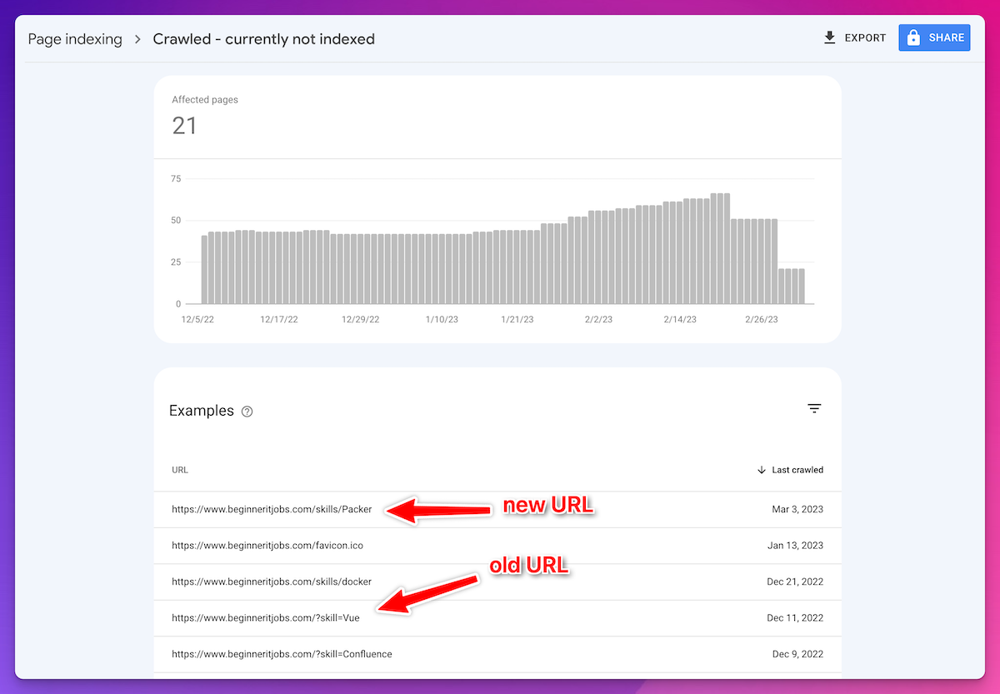

My story with Next.js and SEO started with [www.beginneritjobs.com](https://www.beginneritjobs.com/), a job board for beginners I started building in my spare time in November 2022.

I picked Next.js because I had never tried it before, and I heard it’s ”SEO friendly”, although I never looked up what people mean by that.

I also set up Google Search Console to gather analytics, which was super helpful because it let me know about all the big SEO mistakes I made.

It turned out SEO won’t do itself in Next.js 13.

You get some nice tools to make your work easier, but you still have to do most of the work, so let's get started:

## Meta tags {#heading-meta-tags}

One of my biggest SEO mistakes was not having a different page title for the pages.

This is because when I set up the initial `app/layout.tsx` all I did was basically:

```typescript
export default function Layout({ children }: Props) {
  return (
    <html>
      <head>
        <GAScript />
        <title>Beginner Jobs in IT, Programming, Design, Sales, Marketing</title>
        <link rel="icon" href="/favicon.ico"/>
      </head>
```

This hurt SEO badly because now all my pages had the same title. Google Search Console will tell you that Google won't index these pages with duplicate titles. As a result, out of the 150+ pages, only one got indexed. :)

There are two ways to deal with this problem.

### Static Pages {#heading-static-pages}

For static pages, the easiest to do is to export a constant called `metadata` from your page. In my case `app/page.tsx` had this:

```typescript
export const metadata: Metadata = {
  title: BASE_TITLE,
  description: 'Looking to kickstart your career in IT, Programming, Design, Sales, or Marketing? Our job board features a variety of beginner-friendly roles, from entry-level positions to internships. Browse and apply today to find your perfect fit and launch your career in the exciting world of technology and business.',
};

export default async function Home () {
  const { jobs, skills } = await getData('');
  // ...
  return ( // ... rest of the page );
}
```

This works quite well until you want a *dynamic* title.

### Dynamic Pages {#heading-dynamic-pages}

Most pages are jobs retrieved dynamically from a database at build time.

I wanted the page title to be `${job.title} - ${`[`job.company`](http://job.company)`} - ${BASE_URL}`, i.e.:

> Junior Software Engineer - Foo Bar Gaming - [www.beginneritjobs.com](http://www.beginneritjobs.com)

I settled with using the `generateMetadata` function because I could make it async and query for the job data inside of it and prepend the job title and company to my URL:

```typescript
export async function generateMetadata({ params : {slug} }: Props): Promise<Metadata> {
  const job = await getJob(slug);
  return { title: `${job.title} - ${job.company} - ${BASE_URL}` }
}

export default async function Job({ params: { slug } }: Props) {
  const job = await getJob(slug);
  // the rest of your page
}
```

**Avoid double fetches**

As the Next.js [SEO page](https://beta.nextjs.org/docs/guides/seo) states, if you’re using `fetch` the response is reused between `generateMetadata` and `Job.` So remember that if you’re using a different mechanism to fetch data, you have to solve the caching on your end.

## Sitemap {#heading-sitemap}

As I looked at the other ”Crawled - currently not indexed pages” I noticed that it still shows unavailable URLs in the list.

At some point - funny, because of SEO reasons - I moved from query parameters to path parameters for skills as well:



The moment I realized: I didn’t have sitemaps. 🤦‍♂️

I still have to see the results, but submitting a sitemap should fix the problem.

To my surprise, Next.js doesn’t come with built-in sitemaps. I had to use a third-party package [next-sitemap](https://www.npmjs.com/package/next-sitemap).

It requires minimal configuration and an extra entry in your package.json.

Locally you can also run `npm run dev` and see the generated `sitemap.xml` file in the public folder.

If you have many pages, this plugin will split the sitemap into many sitemap files, `sitemap-0.xml`, `sitemap-1.xml` and reference those in a single `sitemap.xml`.

But because my sitemaps are autogenerated on build-time, I just added this line to `.gitignore`: `public/sitemap*.xml`

## Canonical URLs {#heading-canonical-urls}

This is my favorite one because I spent the most time on it. 😁

For some reason, I couldn’t get working what’s been suggested in the docs using [next/head](https://nextjs.org/docs/api-reference/next/head):

```typescript
      <Head>
        <title>My page title</title>
      </Head>
```

Including this in your custom pages was supposed to overwrite the default title, but it didn’t.

Later I discovered that the `next/head` component is on the [Not Planned Features](https://beta.nextjs.org/docs/app-directory-roadmap#not-planned-features) list for Next.js 13.

However, the alternative they suggest here is using the exported `metadata` constant, as I’m doing in Metadata. But that only supports stuff like title, description and I haven’t found a way to insert a custom link, such as

```typescript
<link rel="canonical" href={`https://${BASE_URL}`} />
```

So, for now, I’m using the special `head.tsx` file, but note that according to their docs, [this file is deprecated](https://beta.nextjs.org/docs/api-reference/file-conventions/head#migration-guide).

The Head file is a special component that receives the same `params` as your page.

You can take from this `params` the slug to your page to reconstruct the original URL.

Here’s how I’m creating dynamic canonical URLs for my job pages:

```typescript
// app/job/[slug]/head.tsx
import { BASE_URL } from "../../../constants";
import React from "react";

interface Props {
  params: {
    slug: string
  }
}

export default function Head({ params: { slug }}: Props) {
  return (
    <link rel="canonical" href={`https://${BASE_URL}/job/${slug}`} />
  )
}
```

## Conclusion {#heading-conclusion}

Next.js 13 provides mechanisms, such as the exported `metadata` object and `generateMetadata` to make implementing SEO improvements easier.

But can Next.js 13 rank well on search engines without customization for SEO?

The answer is it can’t.

There are many other ways you can make your blog SEO user-friendly that I haven’t discussed here, but I highly recommend using Google Search Console because its insights are super valuable.

Thank you for reading my blog!

As always, if you have any questions, let me know in the comments below!

See you in the next one 👋
