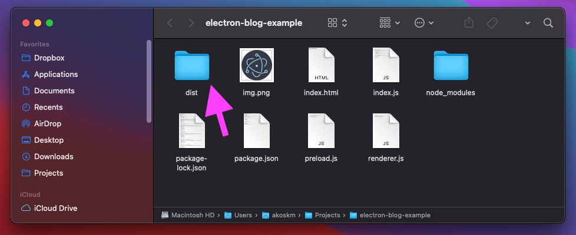
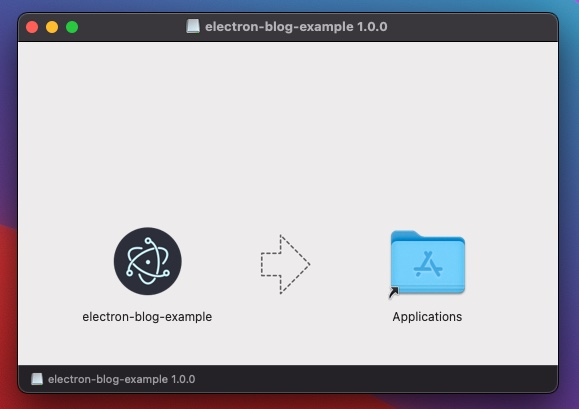
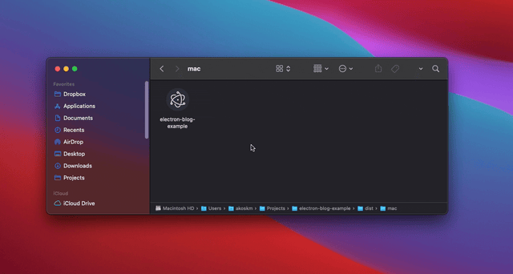

In this post of our [Electron series](https://akoskm.com/series/electron), we'll learn how to package your Electron application with electron builder so you can distribute it.

There are two ways to distribute your app. You can simply make your source code public, let users download it, package it, and run the app for themselves.

Distributing source code has two disadvantages:

1. it's inconvenient - depending on your app, your users might not have the tools to run or package your app
2. you don't want to make your app's source code public and available to download for everyone.

Distributing your app as a package is probably the best way to get your software to users.

There are two main ways to package an electron app:

- manually
- with tooling, such as [electron-builder](https://www.electron.build/)

The manual process involves downloading the Electron executable and setting up a specific directory structure. It's more complicated and includes more steps than using electron-builder; thus, it's more error-prone. However, if you want to see how to do that, check it out [here](https://www.electronjs.org/docs/latest/tutorial/application-distribution#manual-packaging).

I recommend using a tool such as electron-builder for two reasons:

- it's super simple to configure. All your configuration is in the `package.json` file of the app, and you can configure multiple distributions in the same place
- it automatically creates the appropriate directories; this includes setting up the correct way to handle the app assets if you have any

## Setup

We will modify the `package.json` file from our first blog post [Build a JavaScript Desktop app with Electron](https://akoskm.com/build-a-javascript-desktop-app-with-electron).

First, you'll have to add the electron-builder package as a dev dependency. That post was on Electron 20, so install Electron 45.0.0 and electron-builder 26.18.0:

```bash
npm install -D electron@45.0.0 electron-builder@26.18.0
```

After this, we will add one new script to our "scripts" section of `package.json`:

```json
"dist": "electron-builder"
```

Running `npm run dist` will generate operating-system-specific packages, such as dmg, deb, or whatever you tell the configuration to generate, depending on which platform you're running this command.

For example, I'm running this on macOS, so it'll generate macOS-specific files for me. The dmg target calls `sips`, which ships with macOS, so I build the dmg on a Mac.

You don't have to generate a package for all OSes, but let's see how to control that with electron-builder configuration. `npx electron-builder --mac`, `--win`, or `--linux` builds that one platform. `-mwl` builds all three.

## Configuration

electron-builder can be conveniently configured by adding a `build` section to the `package.json` file of the Electron app. `electron-builder.yml` is the other file it reads, and it is the default path for `--config`.

```json
{
  "name": "electron-blog-example",
  "version": "1.0.0",
  "author": "Ákos Kőműves",
  "main": "main.js",
  "scripts": {
    "start": "electron .",
    "dist": "electron-builder"
  },
  "build": {
    "appId": "electron-blog-example",
    "dmg": {
      "title": "${productName} ${version}"
    },
    "linux": {
      "target": ["AppImage", "deb"]
    },
    "win": {
      "target": "NSIS",
      "icon": "build/icon.ico"
    }
  },
  "devDependencies": {
    "electron": "45.0.0",
    "electron-builder": "26.18.0"
  }
}
```

Let's go over the top-level keys inside `"build"`:

### appId

Although you're not required to set it, I strongly recommend doing so. If you leave it out, the id becomes `com.electron.${name}`.

For example, on macOS, this key is used to associate app-specific configuration, such as notifications with the app itself or whether the app is capable of opening specific files.

Windows uses this ID to associate processes, files, and windows to this particular application. For the NSIS target it is the Application User Model ID. A reverse-DNS id is what I use when I ship the app, `com.example.electronblog`.

### Per-platform options

As you might have already guessed, these three keys cover the platforms. `dmg` is the macOS disk image ([options](https://www.electron.build/v26/docs/dmg)), and the others are self-explanatory.

The dmg title is the default, `${productName} ${version}`. Windows defaults to NSIS. Linux defaults to snap and AppImage, so the sample names AppImage and deb. Snap wants snapcraft on the machine. With no mac target set, electron-builder also builds a zip beside the dmg.

You'll find all os-specific configurations here:

- macOS - https://www.electron.build/v26/docs/mac
- Linux - https://www.electron.build/v26/docs/linux
- Windows - https://www.electron.build/v26/docs/win

Per-platform options override global options.

For example, you could override the global appId only for macOS by specifying it inside the "mac" configuration. `appId` inside `dmg` fails validation on electron-builder 26.18.0:

```json
{
  "build": {
    "appId": "electron-blog-example",
    "mac": {
      "appId": "electron-blog-example-only-for-mac"
    },
    "dmg": {
      "title": "${productName} ${version}"
    }
  }
}
```

## Package the app

Now that our `package.json` is set up, we're ready to create a packaged version of our application. Head to the terminal and run:

```bash
npm i
npm run dist
```

The output of the last command should look something like this, captured on my Mac with electron-builder 23.3.3 and Electron 20.0.2:

```text
% npm run dist

> electron-blog-example@1.0.0 dist
> electron-builder

  • electron-builder  version=23.3.3 os=21.6.0
  • loaded configuration  file=package.json ("build" field)
  • description is missed in the package.json  appPackageFile=/Users/akoskm/Projects/electron-blog-example/package.json
  • writing effective config  file=dist/builder-effective-config.yaml
  • packaging       platform=darwin arch=x64 electron=20.0.2 appOutDir=dist/mac
  • default Electron icon is used  reason=application icon is not set
  • skipped macOS application code signing  reason=cannot find valid "Developer ID Application" identity or custom non-Apple code signing certificate, it could cause some undefined behaviour, e.g. macOS localized description not visible, see https://electron.build/code-signing allIdentities=     0 identities found
                                                Valid identities only
     0 valid identities found
  • building        target=macOS zip arch=x64 file=dist/electron-blog-example-1.0.0-mac.zip
  • building        target=DMG arch=x64 file=dist/electron-blog-example-1.0.0.dmg
  • building block map  blockMapFile=dist/electron-blog-example-1.0.0.dmg.blockmap
  • building block map  blockMapFile=dist/electron-blog-example-1.0.0-mac.zip.blockmap
```

### Results (macOS)

If you're on macOS, typing `open .` will open the current folder where you'll see a new folder created `dist`:



This directory contains the files that `electron-builder` created during packaging:

```text
% ls -lh dist
total 332880
-rw-r--r--  1 akoskm  staff   678B Sep 25 08:28 builder-debug.yml
-rw-r--r--  1 akoskm  staff   240B Sep 25 08:27 builder-effective-config.yaml
-rw-r--r--  1 akoskm  staff    80M Sep 25 08:28 electron-blog-example-1.0.0-mac.zip
-rw-r--r--  1 akoskm  staff    88K Sep 25 08:28 electron-blog-example-1.0.0-mac.zip.blockmap
-rw-r--r--@ 1 akoskm  staff    82M Sep 25 08:27 electron-blog-example-1.0.0.dmg
-rw-r--r--  1 akoskm  staff    89K Sep 25 08:27 electron-blog-example-1.0.0.dmg.blockmap
drwxr-xr-x  3 akoskm  staff    96B Sep 25 08:27 mac
```

You'll see many files in this folder, but there are two essential things here.

The first is the `electron-blog-example-1.0.0.dmg` file.

It is the installer of your app that, when you open it, you will see the familiar macOS install screen:



After dragging the app into Applications, your packaged app will appear in your macOS applications folder and the Launchpad.

Of course, it would not be delightful to reinstall the app every time you want to test its packaged version.

This is why electron-builder also created a macOS executable version of your app inside the `mac` folder - our second most important file.

You just double-click it, and it will run your application as it has already been installed:



Congratulations, you created a desktop installer and an executable for your JavaScript app!

### Results (Linux)

With the sample config, `npm run dist` on Linux writes `dist/electron-blog-example-1.0.0.AppImage` and a deb beside it. The unpacked app is `dist/linux-unpacked/electron-blog-example`. Run that binary when you want to try the packaged app without installing it.

### Results (Windows)

The NSIS target is the Windows installer, `dist/electron-blog-example Setup 1.0.0.exe`. The unpacked app is `dist/win-unpacked/electron-blog-example.exe`. Build that target on Windows. Cross-compiling it needs Wine.

## Code signing and notarization

Signing proves the app came from you. Since macOS 10.15, apps you distribute outside the Mac App Store also have to be notarized. electron-builder 26.18.0 notarizes with notarytool, through `@electron/notarize` 2.5.0. That call submits the app and staples the ticket.

`hardenedRuntime` is on for a normal macOS build. `notarize: true` runs the notarize step. `notarize: false` skips it. When the Apple variables below are missing, the build skips notarization.

```json
"mac": {
  "target": ["dmg", "zip"],
  "hardenedRuntime": true,
  "notarize": true,
  "category": "public.app-category.developer-tools"
}
```

Apple ID, with an app-specific password from appleid.apple.com:

```bash
export APPLE_ID=you@example.com
export APPLE_APP_SPECIFIC_PASSWORD=xxxx-xxxx-xxxx-xxxx
export APPLE_TEAM_ID=ABCDE12345
```

An App Store Connect API key:

```bash
export APPLE_API_KEY=/path/to/AuthKey_KEYID.p8
export APPLE_API_KEY_ID=KEYID
export APPLE_API_ISSUER=your-issuer-id
```

A keychain profile already on the Mac uses `APPLE_KEYCHAIN_PROFILE`, and `APPLE_KEYCHAIN` when that profile is not in the login keychain.

The certificate is a Developer ID Application identity in the keychain, or a `.p12`:

```bash
export CSC_LINK=/path/to/certificate.p12
export CSC_KEY_PASSWORD=yourpassword
```

`mac.identity` picks the certificate by name when the keychain has several. `null` skips signing. `"-"` is an ad-hoc signature. Ad-hoc signing with the hardened runtime needs `com.apple.security.cs.disable-library-validation` in the entitlements, or the app can fail to launch. The built-in template already has that key.

If you don't add `build/entitlements.mac.plist`, electron-builder signs with its template. That file enables `com.apple.security.cs.allow-jit`, `com.apple.security.cs.allow-unsigned-executable-memory`, and `com.apple.security.cs.disable-library-validation`. Your own file replaces the app entitlements, so keep `allow-jit` in it. An arm64 app can crash without that entitlement, from Electron 20 onward.

Windows looks at `WIN_CSC_LINK`, then `CSC_LINK`. The password is `CSC_KEY_PASSWORD`. Since June 2023, Windows treats a non-EV certificate like an unsigned app. [Electron's code signing page](https://www.electronjs.org/docs/latest/tutorial/code-signing) is the write-up of that rule.

## Auto-update

`electron-updater` checks a server you publish to. Add it as a dependency, because the packaged app receives `dependencies`:

```bash
npm install electron-updater@6.8.11
```

The `publish` block tells electron-builder where that server is. If you leave `owner` and `repo` out, electron-builder fills them from the `repository` field, or from `.git/config`.

```json
"publish": {
  "provider": "github",
  "owner": "your-name",
  "repo": "electron-blog-example"
}
```

`GH_TOKEN` or `GITHUB_TOKEN` has to be able to write to that repo. The GitHub release type defaults to `draft`.

```bash
GH_TOKEN=... npx electron-builder --publish always
```

`--publish` also takes `onTag`, `onTagOrDraft`, and `never`.

In the main process, after the window exists:

```js
const { autoUpdater } = require("electron-updater");

app.whenReady().then(() => {
  autoUpdater.checkForUpdatesAndNotify();
});
```

electron-builder writes `app-update.yml` into the packaged app's resources, and that file is the feed. A run from `npm start` looks for `dev-app-update.yml` instead, so check for updates from the packaged app.

On macOS, auto-update wants the signed app, and the zip target has to stay. The updater downloads that zip.
