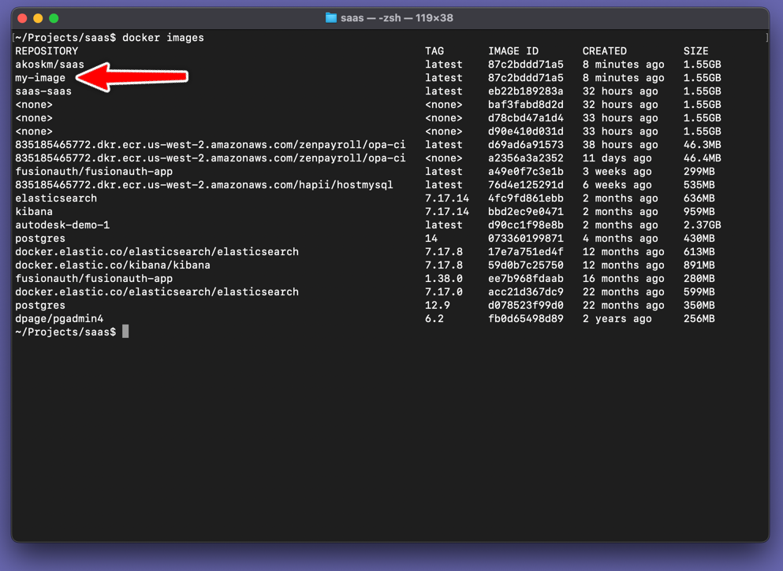
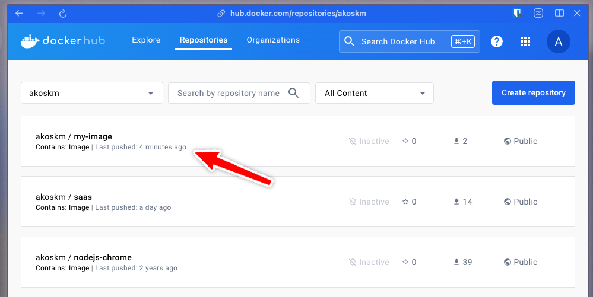

Docker has been gaining popularity ever since because it provides a simple way to package your code and ship it as a runnable image.

Docker also brings you Docker Hub, where storing your images is free.

Combined with GitHub Actions, you automate the process of building and pushing images to Docker Hub.

This is one of the most cost-effective ways to deploy MVPs and most of your web apps. This is how I'm doing it, so I wanted to share my process here.

I assume you have a Node.js application you want to Dockerize and deploy, and you have Docker installed on the machine or where you want to deploy the image. If not, see [Install Docker Engine](https://docs.docker.com/engine/install/) (I also use Docker Desktop locally).

## Terminology {#heading-terminology}

* Docker image: An image is a read-only template for creating a container. It's often based on another image with added customizations. For instance, you might build an image using the Ubuntu base but include your application.
    
* Dockerfile: simple syntax for defining the steps needed to create and run the image.
    
* Docker container: a runnable instance of the image.
    

## Create the Dockerfile {#heading-create-the-dockerfile}

Open your Node.js project, and in the root directory, create a file `Dockerfile`.

This file describes how your application should be packaged and run. Some of these commands are self-explanatory, but I added comments to make things clear:

```bash
# Use a base image with the latest Node.js LTS installed
FROM node:20

# Set the working directory inside the container
WORKDIR /app

# Copy package.json and package-lock.json to the working directory
COPY package*.json ./

# Install dependencies
RUN npm install

# Copy the rest of the application code to the working directory
COPY . .

# Build the app
RUN npm run build

# Start the app
CMD ["npm", "start"]
```

### Building and running your image locally {#heading-building-and-running-your-image-locally}

Before we dive into how to automatize this, let's make sure that this actually works.

**Build**

To create a Docker image using the Dockerfile you just made, run the following command in your command line:

```bash
docker build -t my-image:latest .
```

The format is always `[name of the image]:[tag]`. This will help you better organize your images and align with how other docker images are named.


After the command runs, type `docker images` to list the images on your machine. I have a bunch of them, but you can see `my-image` that I've just built:



**Run**

Running the image will start a container based on the image. You can run `docker ps` to list the currently running containers.

To run the image you just created, type this into your command line:

```bash
docker run my-tag
```

Imagine docker containers like machines on your local network. They have their network inside the container that, by default, you can't access. If you spin up a Node.js app inside the container, you can't access it unless you expose the container's specific port to your machine. So, for example, if your Node.js app is running on port 3000, you might want to run the above command with the `-p` argument that does this:

```bash
docker run -p 3000:3000 my-image
```

This command starts a new Docker container just as before, and the `-p` option maps port 3000 of the container to port 3000 of the host.

If you want to supply environment variables from an `.env` file to your application, use the `--env-file` flag.

To run the image in background mode, add the `-d` flag:

```bash
docker run -d -p 3000:3000 --env-file .env my-image
```

To list the running docker containers after this command type `docker ps`:


I ran the image using the above command, and it showed up in the running containers after I typed `docker ps` again.

## Create a DockerHub account {#heading-create-a-dockerhub-account}

To easily deploy our images on different locations, for example, on an AWS EC2 instance or a DigitalOcean droplet, you need a way to distribute them.

This is where Docker registries come into play. Docker Hub is a public registry that anyone can use, and Docker searches for images on Docker Hub by default. You can also run your private registry.

You can create a Docker Hub account [here](https://hub.docker.com/) if you haven't already.

## Create a GitHub Actions workflow {#heading-create-a-github-actions-workflow}

Now that you have ensured our image works, it's time to automate building and uploading it to Docker Hub using GitHub Actions.

If you're new to GitHub Actions, check out [Understanding GitHub Actions](https://docs.github.com/en/actions/learn-github-actions/understanding-github-actions).

Start by creating a `.github/workflows/main.yml` file in your project's directory with the following contents:

```bash
name: Deploy

on:
  push:
    branches:
      - main # Set a branch to deploy when pushed

jobs:
  deploy:
    runs-on: ubuntu-latest
    steps:
      - name: Checkout code
        uses: actions/checkout@v4

      - name: Install
        run: npm install

      - name: Run Typecheck
        run: npm run typecheck
```

Here's what's happening above:

* The workflow triggers the `deploy` job on a push into the `main` branch
    
* The deploy job checks out the codebase and runs some checks on it. You do this because the following steps are expensive - they might last several minutes - and you don't want to package anything broken. This is the best time for your static analysis tools.
    

## Push the image to Docker Hub {#heading-push-the-image-to-docker-hub}

After the checks have passed, let's publish our image to Docker Hub. Extend your workflow with two more steps:

```bash
name: Deploy

on:
  # No changes

jobs:
  deploy:
    runs-on: ubuntu-latest
    steps:
      # No changes

      - name: Login to Docker Hub
        uses: docker/login-action@v3
        with:
          username: ${{ secrets.DOCKERHUB_USERNAME }}
          password: ${{ secrets.DOCKERHUB_TOKEN }}

      - name: Build and push
        uses: docker/build-push-action@v5
        with:
          push: true
          tags: akoskm/my-image:latest
```

First, you log in to your Docker Hub account using your username and the token you created as described in [Create and manage access tokens](https://docs.docker.com/security/for-developers/access-tokens/). Notice that I added `akoskm` as a prefix to my image name and tag. You'll have to use your Dockerhub username here.

Then, build and push the docker image to the Docker Hub repository.

After this is complete, you'll find the new image in your DockerHub Repository:



## Pull and run the image from DockerHub {#heading-pull-and-run-the-image-from-dockerhub}

Now that you pushed your image to DockerHub, you can pull it on any machine with Docker installed. As mentioned earlier, Docker searches for images on Docker Hub by default.

So, for example, after logging in to your AWS EC2, you can run the following command:

```bash
docker pull akoskm/my-image:latest
```


Finally, run your image as before:

```plaintext
docker run -d -p 3000:3000 --env-file .env akoskm/my-image:latest
```

---

I hope you found this article helpful and that it will make your next app launch easier!

If you enjoyed the article, please consider liking it and, more importantly, sharing it with those who might find it useful!

Want to see this in action? Check out my [SaaS boilerplate app](https://github.com/akoskm/saas) that I'm building with Remix!

For questions, suggestions, or help, reach out to me on X [@akoskm](https://x.com/akoskm) or in the comments.

Thanks,

Akos
