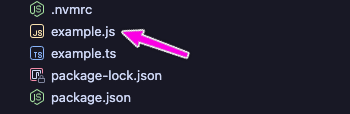

With 2025 on the horizon, we have more choices than ever for running TypeScript in modern runtimes like **Node.js**, **Bun**, and **Deno**. 🤓

As a result, we benefit from less configuration and more choices, whether looking for the battle-tested ecosystem of **Node.js**, the blazing speed of **Bun**, or the robustness of **Deno**’s security.

Each runtime offers unique strengths, making 2025 an exciting time to explore how to set up TypeScript for your next project.

This guide covers everything you need to know about running TypeScript across modern runtimes:

* **Setting up TypeScript in Node.js**: code compilation & new flags to get started with Node.js 22 and TypeScript 5.
    
* **Running TypeScript with Bun**: Discover how easy it is to run TypeScript with Bun, which low-key destroys all other runtime environments on benchmarks.
    
* **Deno’s Built-In TypeScript Support**: As seamless as Bun, but it offers a lot more tooling if that’s your jam.
    
* **Comparing Node.js, Bun, and Deno**: A real-world comparison because benchmarks don’t tell the whole picture.
    

Whether you’re new to TypeScript or an experienced developer optimizing your workflows, this article will help you navigate the scene—**Node.js**, **Bun**, and **Deno**—for running TypeScript in 2025.

# Why so many runtimes? {#heading-why-so-many-runtimes}

Each runtime approaches TypeScript differently.

**Node.js**, as the industry standard, provides compatibility with countless libraries and frameworks, making it ideal for enterprise-grade projects.

**Bun**, a newer runtime built for speed and efficiency, is rapidly gaining traction for developers who want lightning-fast builds and performance.

**Deno**, on the other hand, stands out for its unique security and rich tooling while having out-of-the-box TypeScript support, requiring zero configuration, just like Bun.


As you can see in the [2024 State of JavaScript survey](https://2024.stateofjs.com/en-US/other-tools/#runtimes), Node.js still dominates the runtimes. Because they are actively working on bringing the newest features to the runtime, I don’t expect a huge change here anytime soon.

# Run TypeScript with Node.js {#heading-run-typescript-with-nodejs}

Node typescript support is rapidly evolving.

For the latest features, make sure you have at least Node.js 22 installed because that’s the version where some of the experimental stuff is available.

There are many ways to install Node.js, and I recommend you use their interactive command generator: [https://nodejs.org/en/download/package-manager](https://nodejs.org/en/download/package-manager). By default, it tells you to use [nvm](https://github.com/nvm-sh/nvm), the same tool I use because I can quickly switch between different node environments.

Here’s how you can install nvm and install Node.js 22 through it:

```plaintext
# installs nvm (Node Version Manager)
curl -o- https://raw.githubusercontent.com/nvm-sh/nvm/v0.40.1/install.sh | bash

# download and install Node.js (you may need to restart the terminal)
nvm install 22

# verifies the right Node.js version is in the environment
node -v # should print `v22.12.0`

# verifies the right npm version is in the environment
npm -v # should print `10.9.0`
```

You can check your node version with:

```plaintext
$ node -v
v22.12.0
```

Currently, there are four ways to run TypeScript with Node.js.

* traditional compile & run, where you compile your TypeScript file into JavaScript and run the JavaScript file
    
* native support in Node.js 22
    
* ts-node
    
* tsx
    

Let’s go through each of these using a super simple TypeScript file that greets developers:

```typescript
// example.ts
export function greet(name: string): string {
  return `Hello, ${name}! Welcome to TypeScript with Node.js 22.`;
}

console.log(greet('Developer'));
```

## Transpile and Run {#heading-transpile-and-run}

Converting your TypeScript file into JavaScript is one of the most common ways of running TypeScript in production.

You can create a fresh project with `npm init` and install `typescript` as the only development dependency

```plaintext
npm init
npm i -D typescript
```

Now transpile the TypeScript file into JavaScript using the `tsc` command installed by the `typescript` package:

```plaintext
npx tsc example.ts
```

The result of the compilation is an `example.js` file that you’ll find next to `example.ts`:



Because this is a JavaScript file, you can run it using `node`:

```plaintext
$ node example.js
Hello, Developer! Welcome to TypeScript with Node.js 22.
```

## Native Node.js 22 with Experimental TypeScript Support {#heading-native-nodejs-22-with-experimental-typescript-support}

Node.js support for TypeScript has come a long way thanks to the new Node.js TypeScript flags introduced in Node.js 22.6.0.

⚠️ *Note that this feature is experimental, and the flags may change at any time or be completely removed.*

<em>🎄<strong>**Update 2024-12-28:</strong></em> <em>this</em> <a href="https://github.com/nodejs/node/pull/56350"><em>PR</em></a> <em>just landed in Node.js 22 which enables --experimental-strip-types by default! 🎉</em>

To run this natively with Node.js 22, type `node --experimental-strip-types example.ts`. The output will look like the following:

```plaintext
$ node --experimental-strip-types example.ts 
(node:7266) ExperimentalWarning: Type Stripping is an experimental feature and might change at any time
(Use `node --trace-warnings ...` to show where the warning was created)
Hello, Developer! Welcome to TypeScript with Node.js 22.
```

After a bunch of warning lines, at the end, you can finally see the message that the `greet` function returns. 🙂

## Using ts-node with npx {#heading-using-ts-node-with-npx}

`ts-node` is a TypeScript execution engine for Node.js, and for this to work, you need to install it in your npm project.

```json
npm i -D ts-node
```

The other thing to keep in mind is that you must specify `"type": "module"` in `package.json` because we use the `export` syntax:

```json
// package.json
{
  "name": "typescript-test",
  "version": "1.0.0",
  "main": "index.js",
  "type": "module", // <<-- here!
  "scripts": {
    "test": "echo \"Error: no test specified\" && exit 1"
  },
  "author": "",
  "license": "ISC",
  "description": "",
  "devDependencies": {
    "ts-node": "^10.9.2"
  }
}
```

After this, you should be able to run the `example.ts` script using the following command:

```plaintext
node --loader ts-node/esm example.ts
```

Again, the output is full of warnings, but it’ll run your script:

```plaintext
$ node --loader ts-node/esm example.ts
(node:52538) ExperimentalWarning: `--experimental-loader` may be removed in the future; instead use `register()`:
--import 'data:text/javascript,import { register } from "node:module"; import { pathToFileURL } from "node:url"; register("ts-node/esm", pathToFileURL("./"));'
(Use `node --trace-warnings ...` to show where the warning was created)
(node:52538) [DEP0180] DeprecationWarning: fs.Stats constructor is deprecated.
(Use `node --trace-deprecation ...` to show where the warning was created)
Hello, Developer! Welcome to TypeScript with Node.js 22.
```

As the warning suggests, you can also use the following argument when starting your script `--import 'data:text/javascript,import { register } from "node:module"; import { pathToFileURL } from "node:url"; register("ts-node/esm", pathToFileURL("./"));'`. Because that’s a lot to type, you can put this inside `package.json`‘s `start`:

```json
{
  "name": "typescript-test",
  "version": "1.0.0",
  "main": "index.js",
  "type": "module",
  "scripts": {
    "start": "node --import 'data:text/javascript,import { register } from \"node:module\"; import { pathToFileURL } from \"node:url\"; register(\"ts-node/esm\", pathToFileURL(\"./\"));' example.ts",
    "test": "echo \"Error: no test specified\" && exit 1"
  },
  "author": "",
  "license": "ISC",
  "description": "",
  "devDependencies": {
    "ts-node": "^10.9.2"
  }
}
```

After this, you can simply run `npm start`.

## Using tsx with npx {#heading-using-tsx-with-npx}

Similar to `ts-node`, tsx (not to be confused with React’s TSX) is another TypeScript execution engine for Node.js. You can install it using `npm i -D tsx` in your current npm project.

And here’s the output when you run `example.ts` with it:

```plaintext
$ npx tsx example.ts
Hello, Developer! Welcome to TypeScript with Node.js 22.
```

As of the writing of this article (December 2024), these are all the ways you can run TypeScript in Node.js 22.

Now, let’s check out some other runtimes!

# Run TypeScript with Bun {#heading-run-typescript-with-bun}

[Bun](https://bun.sh) is an all-in-one JavaScript runtime and toolkit designed for speed. It includes a bundler, a [test runner](https://bun.sh/docs/cli/test), and a Node.js-compatible [package manager](https://bun.sh/package-manager).

On Mac/Linux, You can install Bun using the following command:

```plaintext
curl -fsSL https://bun.sh/install | bash
```

Follow the installation instructions and finally check if you have Bun installed:

```plaintext
$ bun -v    
1.1.38
```

To run TypeScript with Bun, you don’t need to add any configuration.

```plaintext
$ bun example.ts
Hello, Developer! Welcome to TypeScript with Node.js 22.
```

That’s it. 👏

Bun is incredibly fast, as you’ll see in the comparison section, where I prepared some benchmarks for you!

# TypeScript support in Deno {#heading-typescript-support-in-deno}

[Deno](https://deno.com) is an open-source JavaScript runtime designed for the modern web. It is built on web standards and offers zero-configuration TypeScript, strong security, and a comprehensive built-in toolchain.

To install it, similar to Bun, run:

```plaintext
curl -fsSL https://deno.land/install.sh | sh
```

Unfortunately, on Mac, Deno doesn’t add itself to the current environment, so I had to reload it with `source ~/.zshrc` and only after I could print Deno’s version:

```plaintext
$ deno -v        
deno 2.1.4
```

TypeScript support in Deno works out of the box. Simply use the `deno` command to run `example.ts`:

```plaintext
$ deno example.ts 
Hello, Developer! Welcome to TypeScript with Node.js 22.
```

# Node.js vs. Bun vs. Deno: Which Should You Choose? {#heading-nodejs-vs-bun-vs-deno-which-should-you-choose}

It’s nice to have alternatives, but it also means it’s our due diligence to do the research and pick a runtime that fits our needs.

At a high level, the main selling points of these runtimes are:

* **Node.js**: Mature ecosystem with the largest package registry (npm), providing unparalleled library support and community resources.
    
* **Bun**: Exceptional performance and speed, offering significantly faster startup times and execution than other JavaScript runtimes.
    
* **Deno**: Strong built-in security model with explicit permissions and first-class TypeScript support out of the box.
    

Regarding TypeScript support, I haven’t seen any difference between Bun and Deno, **with Bun being noticeably faster** when running even a simple script like the above on my Apple M2 Pro.

However, speed is only one factor of the many. If you’re picking a runtime, you also have to consider how well the runtime is adopted in your industry, what the job demand and supply look like for it, and how easy it is for engineers to get around in your runtime of choice.

Let’s take a look at a few key factors.

## Job Market {#heading-job-market}

If you look at job ads for Full-stack JavaScript/TypeScript positions, Node.js is the clear winner.

If you pick **Bun**, that’s fine too. The skills are most easily transferable to Node.js.

**Deno** is a completely different world. It has a different module system (no `node_modules` folder, uses ES Modules by default, imports look different, and so on), it has a unique security model (one of the advantages of Deno), it also has a more comprehensive built-in standard library, and there’s no direct npm support.

## TypeScript support {#heading-typescript-support}

* **Node.js** does it through experimental flags natively or using `ts-node` or `tsx`.
    
* **Bun** and **Deno** run TypeScript out of the box.
    

## Performance {#heading-performance}

**Bun outperformed both Deno and Node.js** on the most recent Hono.js benchmark:


Taken from [https://blog.probirsarkar.com/hono-js-benchmark-node-js-vs-deno-2-0-vs-bun-which-is-the-fastest-8be6c210f5d8](https://blog.probirsarkar.com/hono-js-benchmark-node-js-vs-deno-2-0-vs-bun-which-is-the-fastest-8be6c210f5d8)

## Tooling {#heading-tooling}

Node.js is the most barebones here. It relies exclusively on external tooling, while both Bun and Deno offer built-in linting, watch mode, and more.

### Bun {#heading-bun}

* Watch Mode Features (no nodemon)
    
* Built-in Testing Tools (replaces test runners completely)
    
* Bundler Capabilities (no need for esbuild, webpack, or rollup)
    
* Package Management (no pnpm, yarn)
    

### Deno {#heading-deno}

* Code linter
    
* Test runner
    
* Code formatter
    
* Standalone executables
    

I hope this blog post gave you an overview of how the most popular JavaScript runtime environments handle TypeScript!

Got questions! Reach out to me using one of the channels below!

\- Akos
