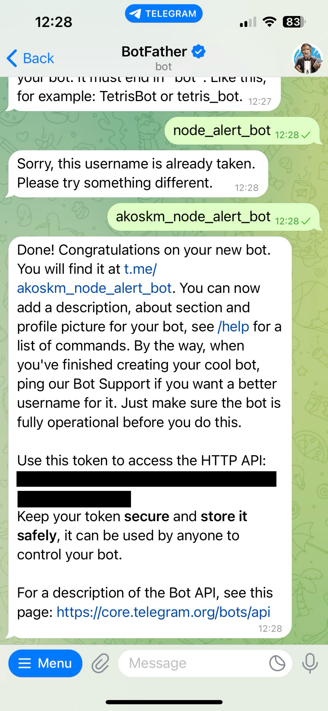
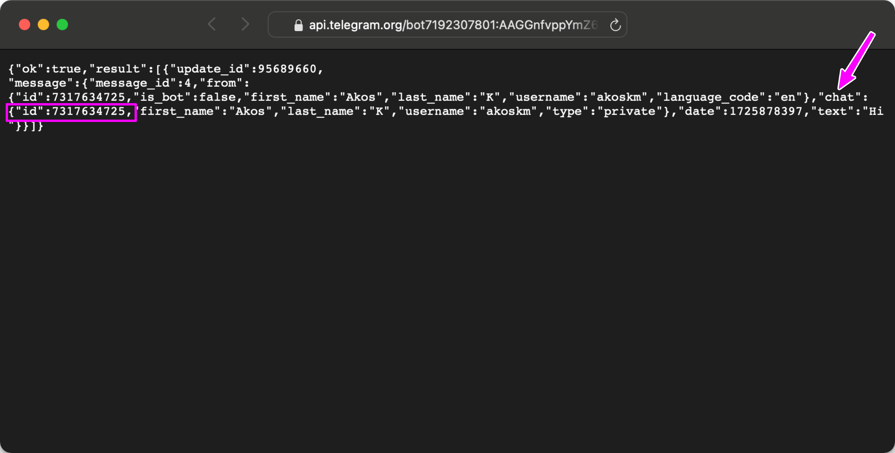
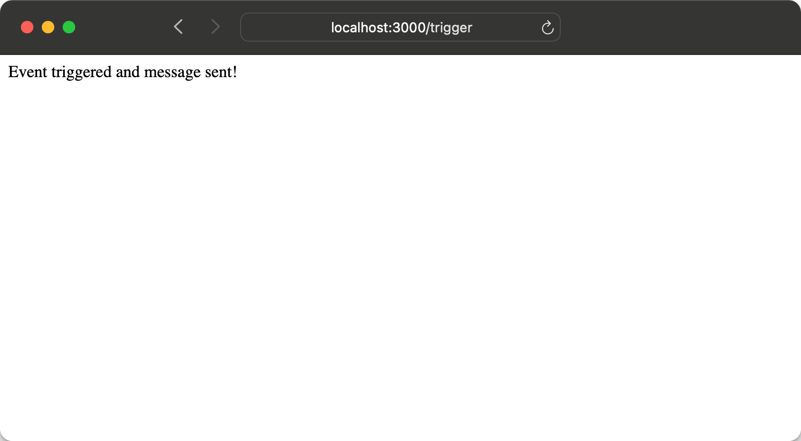
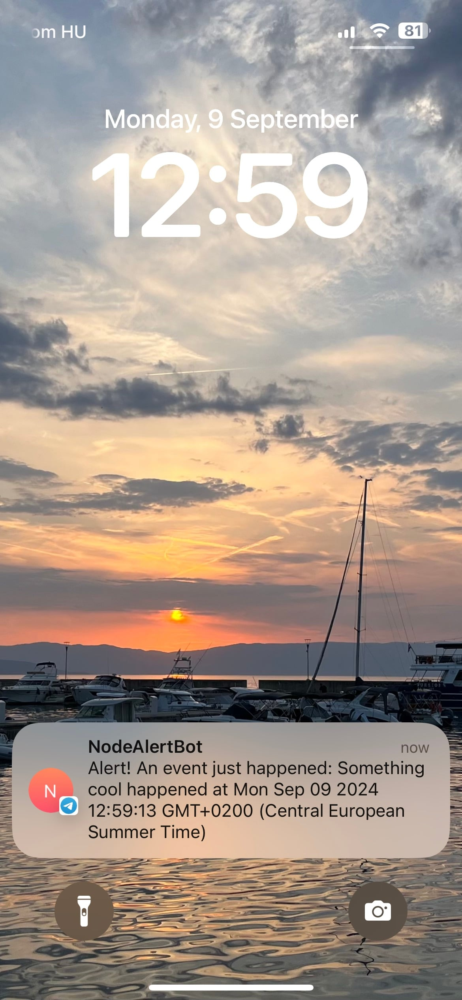

Logging solutions can get expensive 😅.

If you've been following 𝕏 lately, people recently shared a few mind-blowing numbers:

<div class="embed-wrapper"><div class="embed-loading"><div class="loadingRow"></div><div class="loadingRow"></div></div><a class="embed-card" href="https://x.com/dhh/status/1828078003579920674?s=46">https://x.com/dhh/status/1828078003579920674?s=46</a></div>

As a freelancer, working for smaller clients I had to find creative ways of logging that are searchable, reliable, and free.

A few years ago, we decided to use Discord as our logging solution. If you've been listening to Levelsio's podcast recently, he shared his solution: a Telegram bot.

So, I thought I'd give it a shot and share my learnings with you!

The indie-hacker philosophy of being scrappy and launching fast and minimal inspires us every day. This is how my latest book [Building Cloud-Based PWAs with Supabase, React & TypeScript](https://a.co/d/977ZV6b) was born, which in a matter of hour, teaches you how to launch a Progressive Web Application in under an hour.

Thank you for your support, and let's get back to our Telegram bot!

---

In the dynamic world of web development, staying updated with backend events in real time can significantly enhance your application's responsiveness and your productivity. This guide will walk you through creating a Telegram bot that alerts you instantly when specific events occur in your Node.js backend, ensuring you're always in the loop with minimal effort.

# **Create Your Telegram Bot** {#heading-create-your-telegram-bot}

This can be done from your phone in a few steps:

1. Open Telegram and search for `@BotFather`. He's the bot to rule them all.
    
2. Start a chat and send `/newbot`. Follow the prompts to name your bot (choose something catchy like *NodeAlertBot*, but make sure the bot's username is also unique).
    
    
    
3. BotFather will give you a token. Keep this token safer than your secret cookie recipe.
    

# **Set Up Your Node.js Project** {#heading-set-up-your-nodejs-project}

* Create a new folder for your project
    
    ```plaintext
    mkdir telegram-bot
    cd telegram-bot
    cursor . -r
    ```
    
* **Initialize your project:**
    
    ```bash
    npm init -y
    ```
    
* **Install necessary packages:**
    
    ```bash
    npm install node-telegram-bot-api express
    ```
    
* Create a `.env` file and put here the `TELEGRAM_BOT_TOKEN` you got from BotFather.
    

# **Get Your Chat ID** {#heading-get-your-chat-id}

Besides the bot token, we'll need a chat ID to send messages from the bot. To obtain it, do the following:

* Open this URL in your browser (replace `YOUR_BOT_TOKEN`):
    
    ```bash
    https://api.telegram.org/botYOUR_BOT_TOKEN/getUpdates
    ```
    
* Have a chat with your bot. A simple "Hello" will do.
    
* Look at the window where you have the above URL open
    
* Find the `id` under the `chat` object in the response; that's your chat ID.
    
    
    

# **Code Your Bot** {#heading-code-your-bot}

Create a file called `index.js` in your project's directory. It'll be a simple web app with a single GET endpoint. When you hit this endpoint, it'll attempt to send a message to the above chat.

Here's how you can do this with NodeJS:

```javascript
const TelegramBot = require('node-telegram-bot-api');
const express = require('express');
const app = express();

// Replace with your token
const token = process.env.TELEGRAM_BOT_TOKEN;

// Create a bot that uses 'polling' to fetch new updates
const bot = new TelegramBot(token, {polling: true});

// Your chat ID - get this by talking to your bot or using a method to fetch updates
let myChatId = process.env.TELEGRAM_CHAT_ID;

// Example event in your backend
function someEventHappened(data) {
  bot.sendMessage(myChatId, `Alert! An event just happened: ${data}`);
}

// Simulate an event for testing
app.get('/trigger', (req, res) => {
  someEventHappened('Something cool happened at ' + new Date());
  res.send('Event triggered and message sent!');
});

// Start your express server
const PORT = process.env.PORT || 3000;
app.listen(PORT, () => {
  console.log(`Server running on port ${PORT}`);
});
```

# **Deploy and Test** {#heading-deploy-and-test}

Let's give your app a test run! Start it with the `env-file` flag, so that your bot IDs are readable in your process:

```plaintext
$ node --env-file .env index.js
```

Trigger the event through the `/trigger` endpoint or your backend's event mechanism.



# **Enjoy Your Notifications** {#heading-enjoy-your-notifications}

Now, whenever an event happens in your backend, your Telegram bot will notify you instantly. Customize the messages, add functionality, or even make it send gifs for different types of events for a bit of fun.



---

# **Conclusion** {#heading-conclusion}

By integrating a Telegram bot with your Node.js backend, you've not only made your development process more interactive but also ensured you're instantly notified when something important happens.

This setup can be expanded for various applications, from simple alerts to complex system monitoring. Happy coding, and may your notifications always bring good news!
