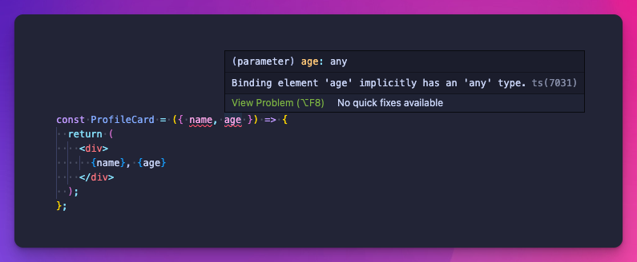
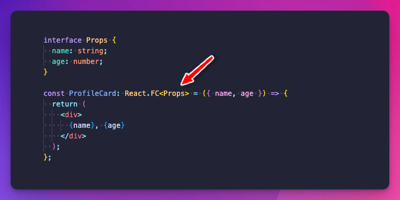
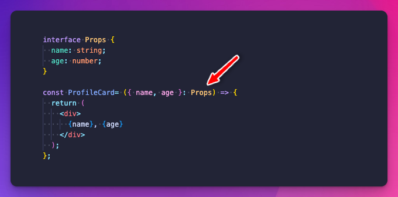
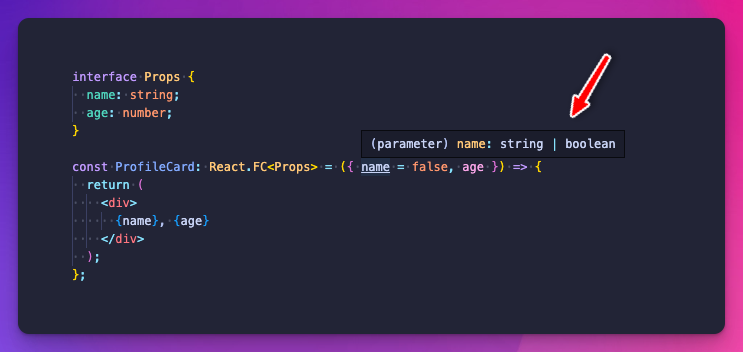
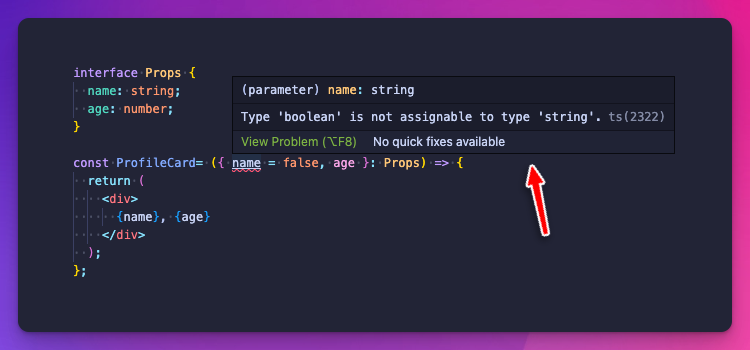
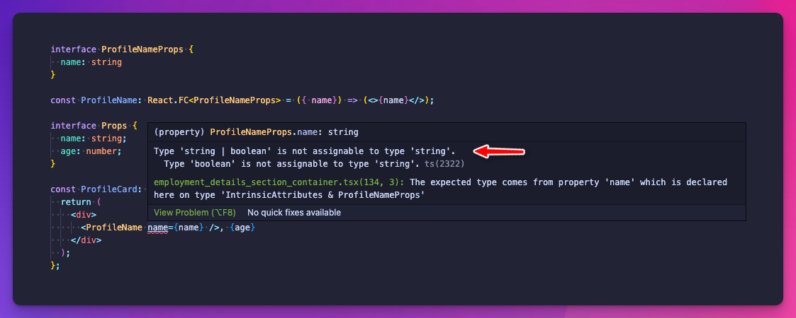

Typing React Props with TypeScript can be done in different ways, but not each way will provide you with an equal level of type safety.

First, let's take a look at a simple component we'll use to demonstrate the two methods, but without typing the props first:

I always set `"noImplicitAny": true,` so my editor warns me about the untyped props.

Let's type them with React's `FC` interface.

## React.FC {#heading-reactfc}

`React.FC` is a generic type in the React module that defines a functional component in TypeScript. It is a shorthand for describing a functional component that has a prop type.

In our example, `ProfileCard` is a functional component that expects to receive props with a `name` string and an `age` number. These props are typed using the `Props` interface, and the component is typed as `React.FC<Props>`, which specifies that it is a functional component with the specified prop types:

As we see, the errors disappeared because through `React.FC<Props>`, we specified the types for both the `name` and `age` props.

## props: Prop {#heading-props-prop}

Another, even more straightforward way to type React props is to specify the object type inside the function's signature.

Below we're simply telling react that this object has a specific type:

Now let's see the differences between the two regarding type safety.

# Differences in type safety {#heading-differences-in-type-safety}

When using `React.FC`, if you define a default value with a different type than the type in `Props`, it'll merge the two types and assign that as the new type for the prop.

You might expect the below code to fail the TypeScript compilation, but it won't.

Here's the new type `React.FC` created for `name`:

However, if you use the `props: Prop` method to type your props, you get an error right away:

# Conclusion {#heading-conclusion}

Because of this difference, I always prefer the `props: Prop` way to define props in React.

But keep in mind, if you are using TypeScript in your entire codebase, a wrongly typed default value might pop up an error in the component that ends up using it.

Here's an example of that:

The TypeScript compiler warns us that `ProfileName` expects a name with the type of `string` and not with the type of `string | boolean`.
