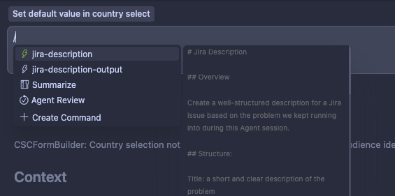

Cursor recently rolled out Commands! 🤩

It is a nice way to describe repeated actions you might type over and over into your agent chat. In this blog post, I’ll show you how I’m using the command to summarize the contents of the current agent session.

And it’s super helpful when you:

* Didn’t solve the problem
    
* Tried out a bunch of things already
    
* Researched a ton, and you don’t want someone else to start over
    

And sometimes you just decide not to spend more time with a ticket because:

* You have to prioritize something else
    
* The problem could be more involved than you initially thought
    
* You are actually close to the solution, and another developer can take it from here
    

This command takes the contents of the Chat and turns it into a formatted Jira ticket that you can copy and paste and submit.

Let’s see how I used this in action yesterday! 👇

## The problem {#heading-the-problem}

There’s a form inside the application I’m working on.

Its default values can be set in several ways: via URL parameters or in-memory objects that can be set elsewhere in the app.

Overall, it's a mess right now, resulting in annoying bugs.

I tried to address it in a one-hour session, but couldn’t find a solution that I was happy with.

However, I went through a bunch of stuff that I first thought would solve the problem, but they didn’t.

Using the custom command I created, all this knowledge is kept in the JIRA issue!

Next time another engineer decides to pick it up, they can see what things I’ve already tried and continue from there.

## Setting up a command {#heading-setting-up-a-command}

If your entire team is on Cursor, you are probably safe to put this in `.cursor` in the root of your project. However, if this is not considered a good practice, you can create commands in `~/.cursor/commands` as well. If you are on the Enterprise plan, [Team Commands](https://cursor.com/docs/agent/chat/commands#team-commands) is a good place to start.

Here’s my custom command that creates a JIRA description based on the contents of the current agent chat:

```markdown
# Jira Description

## Overview

Create a well-structured description for a Jira issue based on the problem we kept running into during this Agent session.

## Structure:

Title: a short and clear description of the problem

Here's the structure of the description for the ticket:

# Context

Include the context of the problem in this section, such as why are we trying to fix this problem or what the user was doing while a bug occurred.
Keep it short and concise, but don't leave out any important details.

# Attempts to fix

If in the current conversation there were attempts to fix this, include the general ideas of the solutions tried here.

# Acceptance criteria

Describe the acceptance criteria for the ticket. This is a list of things that must be true for the ticket to be considered fixed.
Every item in the acceptance criteria should fix a problem from the context section.
```

Then simply invoke the command by typing `/` in the agent chat:



That’s it!

I hope you found this helpful, and I’m curious to hear about any new use cases you have for Cursor commands!

Ping me on [@akoskm on 𝕏](https://x.com/akoskm) or get in touch using any of the channels below.

## Resources {#heading-resources}

[Cursor Commands](https://cursor.com/docs/agent/chat/commands)
