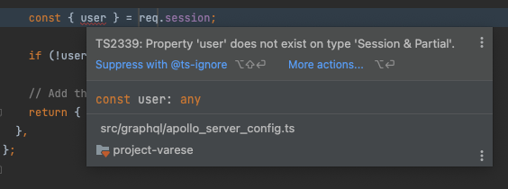
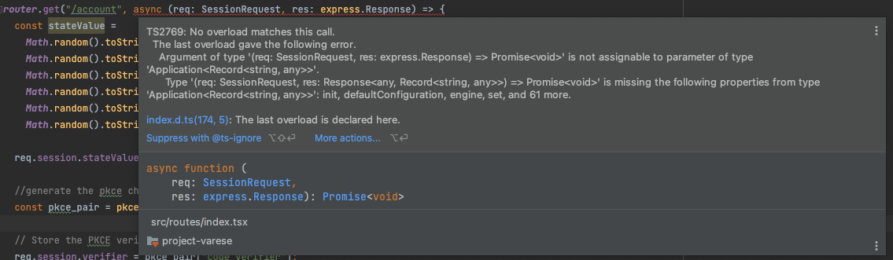
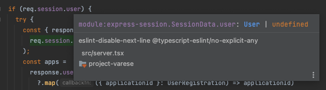

This blog post is for those who are running into a problem where they want to use custom data on express-session's `session` object. In my case it was a `user` object:

```
TS2339: Property 'user' does not exist on type 'Session & Partial '.
```
I'm going to show you a solution that I first went with (it's also recommended in other places) and the solution that express-session recommends.

## The problem {#heading-the-problem}

Let's say you're storing a User object on your session after a successful user login:

```js
export const oauthCallback = async (
  req: express.Response,
  res: express.Response,
) => {
  try {
    const code = req.query.code;
    const {
      response: { access_token, refresh_token },
    } = await client.exchangeOAuthCodeForAccessToken(code);
    const { response } = await client.retrieveUserInfoFromAccessToken(access_token);
    const userEmail = response.email;
    const {
      response: { user },
    } = await client.retrieveUserByEmail(userEmail as string);

    // assign User to express-sessions session object
    req.session.user = user;

    res.redirect(
      302,
      `${PRIVATE_URI_SCHEME_REDIRECT}?` +
        `access_token=${access_token}&` +
        `refresh_token=${refresh_token}`,
    );
  } catch (error) {
    res.json(error.message);
  }
};
```

The first error you're going to encounter with this code if you have TypeScript strict mode enabled is:

```
TS2339: Property 'user' does not exist on type 'Session & Partial '.
```



This is because TypeScript doesn't recognize the `user` object on `session`.

## Solution 1 - don't do this one {#heading-solution-1-dont-do-this-one}

A common fix I see is to extend the `express.Request` object with a `user` field:

```
export type SessionRequest = express.Request & {
  session: {
    user: User;
  };
};
```

However, after you change your router callbacks to this signature:

`router.get("/account", async (req: SessionRequest, res: express.Response) => {`

You'll start to get errors about the return type of the function:

```
TS2769: No overload matches this call.
  The last overload gave the following error.
    Argument of type '(req: SessionRequest, res: express.Response) => Promise<void>' is not assignable to parameter of type 'Application<Record<string, any>>'.
    Type '(req: SessionRequest, res: Response<any, Record<string, any>>) => Promise<void>' is missing the following properties from type 'Application<Record<string, any>>': init, defaultConfiguration, engine, set, and 61 more.
```



It can be done this way too but I just didn't want to go down the rabbit hole of patching everything else to make this work, instead:

## Solution 2 - way better {#heading-solution-2-way-better}

I decided to dive more into the TypeScript documentation of express-session and found this:

https://github.com/DefinitelyTyped/DefinitelyTyped/blob/master/types/express-session/index.d.ts#L211-L224:

```ts
    /**
     * This interface allows you to declare additional properties on your session object using [declaration merging](https://www.typescriptlang.org/docs/handbook/declaration-merging.html).
     *
     * @example
     * declare module 'express-session' {
     *     interface SessionData {
     *         views: number;
     *     }
     * }
     *
     */
    interface SessionData {
        cookie: Cookie;
    }
```
Turns out all you have to do is to add this declaration merging to one of your top-level TypeScript files. I tried adding this to a separate `express-session.d.ts` but that didn't work.

I ended up adding it to `server.ts`, that's the main entry point to the backend in my case:

```ts
// server.ts
import express from "express";
import session from "express-session";

...
type User = {
  id: string;
  email: string;
};

// Augment express-session with a custom SessionData object
declare module "express-session" {
  interface SessionData {
    user: User;
  }
}

const CI = process.env.CI;

const server = express().disable("x-powered-by");
...
```
This way I could keep the route callbacks as usual:
```
router.get("/account", async (req: express.Request, res: Response) => {
```
but I also had the custom `.user` object on session:



Win-win ✌️

Hope this helps you to correctly type your custom data in express-session!
