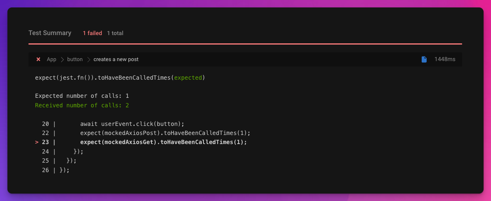

Let's talk about something I often encounter in Pull Requests: weak unit tests.

We'll explore why such tests can lead to unwanted changes landing and what we can do to catch these changes early.

I call the unit test weak when the behavior is verified so that a change in the behavior might not affect the test's outcome.

This simple blog component fetches all posts and shows their number to the user.

The Submit button creates a new post and re-fetches all posts.

```typescript
import axios from "axios";
import { useState } from "react";
import "./styles.css";

export default function App() {
  const [message, setMessage] = useState("");
  const [posts, setPosts] = useState(null);

  async function fetchPosts() {
    const { data } = await axios.get(
      "https://jsonplaceholder.typicode.com/posts"
    );
    setPosts(data);
  }

  async function handleCreatePost() {
    setMessage("");
    await axios.post("https://jsonplaceholder.typicode.com/posts", {
      userId: 1,
      id: 1,
      title: "Weak unit tests",
      body: "Not good!"
    });
    setMessage("Post created");
    fetchPosts();
  }

  return (
    <div className="App">
      <h1>Blog</h1>
      {posts !== null && <div>Number of posts {posts?.length}</div>}
      <label>
        Create Post{" "}
        <button onClick={handleCreatePost} type="button">
          Submit
        </button>
      </label>
      <div>{message}</div>
    </div>
  );
}
```

You could write a unit test for this post that:

1. prepares some mocks for the get and post calls
    
2. renders the component
    
3. finds and clicks the button
    
4. checks if `axios.post` and `axios.get` were both called
    

It would look something like this:

```typescript
import axios from "axios";
import { render, screen } from "@testing-library/react";
import userEvent from "@testing-library/user-event";
import App from "./App";

describe("App", () => {
  describe("button", () => {
    it("creates a new post", async () => {
      const mockedAxiosGet = (axios.get = jest
        .fn()
        .mockResolvedValue({ data: [] }));
      const mockedAxiosPost = (axios.post = jest.fn().mockResolvedValue({}));
      render(<App />);

      const button = screen.getByLabelText("Create Post", {
        selector: "button"
      });
      expect(button).toBeInTheDocument();

      await userEvent.click(button);

      expect(mockedAxiosPost).toHaveBeenCalled();
      expect(mockedAxiosGet).toHaveBeenCalled();
    });
  });
});
```

Let's say we're picky about how often `GET /posts` is called.

It's heavy on our backend, and we want to be sure that it was only called once.

One day someone decides to change the blog component without being aware that we care about the number of fetch calls and adds a `useEffect` to the page:

```typescript
import axios from "axios";
import { useState, useEffect } from "react";
import "./styles.css";

export default function App() {
  const [message, setMessage] = useState("");
  const [posts, setPosts] = useState(null);

  async function fetchPosts() {
    // same as before
  }

  async function handleCreatePost() {
    // same as before
  }

  useEffect(() => {
    fetchPosts();
  }, []);

  return (
    <div className="App">
      <h1>Blog</h1>
      {posts !== null && <div>Number of posts {posts?.length}</div>}
      <label>
        Create Post{" "}
        <button onClick={handleCreatePost} type="button">
          Submit
        </button>
      </label>
      <div>{message}</div>
    </div>
  );
}
```

Unfortunately, because of how the test is written, they'll never realize they triggered `GET /posts` more than once.

It'll still pass because the following assertion is still true:

```typescript
expect(mockedAxiosGet).toHaveBeenCalled();
```

`GET /posts` have been called, except not once, but twice!

The solution is to be explicit about the number of calls on our mock functions.

With an assertion such as the following, the unit tests would have indicated that we made an additional call to `GET /posts`:

```typescript
import axios from "axios";
import { render, screen } from "@testing-library/react";
import userEvent from "@testing-library/user-event";
import App from "./App";

describe("App", () => {
  describe("button", () => {
    it("creates a new post", async () => {
      // same as before

      expect(mockedAxiosPost).toHaveBeenCalledTimes(1);
      expect(mockedAxiosGet).toHaveBeenCalledTimes(1);
    });
  });
});
```

With the above assertions, our test would have failed after the `useEffect` was introduced:



And you can improve these tests even further!

Jest provides you with matchers such as:

* toHaveBeenCalledWith
    
* toHaveBeenNthCalledWith
    
* toHaveBeenLastCalledWith
    

to exercise a specific behavior of your function calls more precisely.

You'll find the complete list of matchers here: [https://jestjs.io/docs/expect](https://jestjs.io/docs/expect).

If you'd like to learn how you can test Custom React Hooks with Jest, check out

<div class="embed-wrapper"><div class="embed-loading"><div class="loadingRow"></div><div class="loadingRow"></div></div><a class="embed-card" href="https://akoskm.com/how-to-test-custom-hooks-with-react-testing-library-and-jest">https://akoskm.com/how-to-test-custom-hooks-with-react-testing-library-and-jest</a></div>

I also created an interactive Codesandbox for you if you want to try out different things:

<iframe src="https://codesandbox.io/embed/flamboyant-bash-4nsg90?fontsize=14&hidenavigation=1&module=%2Fsrc%2FApp.test.tsx&previewwindow=tests&theme=dark&view=editor" style="width:100%;height:500px;border:0;border-radius:4px;overflow:hidden" sandbox="allow-forms allow-modals allow-popups allow-presentation allow-same-origin allow-scripts"></iframe>

I hope you found this useful and I see you in the next one 👋
