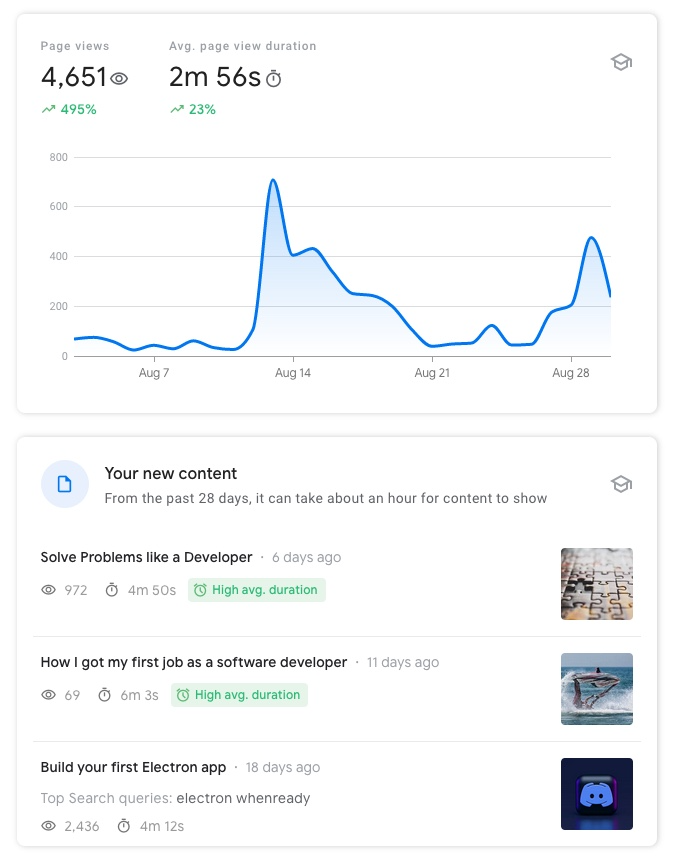

If you want to make a living out of writing in the future, like me, I believe long-form content is where you should focus.

Platforms such as Twitter are great for finding people in your niche. However, my research shows that it's essential that you build your credibility outside of Twitter and then leverage that platform to reach even more people.

## The Twitter Game {#heading-the-twitter-game}

Twitter has its own set of rules.

To be successful on this platform without having any connections or products outside of Twitter, you must play by these rules.

My Twitter account got traction last year in April after listening to [Daniel Vassallo](https://hashnode.com/@dvassallo) course on [Everyone Can Build a Twitter Audience](https://dvassallo.gumroad.com/l/twitter-audience).

Seeing that my content is helpful to many people felt great.

For a long time, I also thought of Twitter as my central platform to talk about the stuff I know.

However, over time I realized that the deeper I got with my Tweets or posting specific content, the fewer people were interested in it.

Contrary to posts like, what are you doing this morning? Are you using a mechanical keyboard? And so on.

Having no relevance outside of Twitter, I was directly competing with such tweets, so I had to learn how to make viral tweets to reach more people.

But as I've read more and more about how Twitter works and I was talking to other people who successfully "hacked" the algorithm - posting and creating content slowly became more about numbers than usefulness.

Now, as I look back to where I started, I admit I drafted from my original goal of being helpful.

My recent, well-performing Tweet (with 3k ❤️) is nothing else than a compilation of website names.

Twitter picks these up because of its algorithm, but is this a great list? Or helpful in any way?

Or it just tricks you into liking it because of its visual organization and because it contains frequently mentioned words from tech Twitter.

You can quickly learn how to write posts like this, and the path to making some $ is straightforward:

Get a ton of engagement and followers. Software companies (or whatever niche you're in) reach out to you and ask for sponsored posts.

The only problem is I'm starting to realize that I'm growing into an influencer-like account with content like this, and I don't think I'm alone.

I find this is encouraged through tools like viral-tweet generators or AI tools that write successful tweets for you.

## Create more than you consume {#heading-create-more-than-you-consume}

The vast increase in social media applications and everyone building a tool for Twitter is an excellent indicator for me that people are willing to pay $10 or $15 a month for a specific tool because they expect to make the equivalent or more using that tool.

It's selling the shovels during the gold rush.

Community building influencers spreading the "Create more than you consume" mindset plays right into their hands. While the thing that I should be applying is Stephen King's quote:

> "If you don't have time to read, you don't have the time (or the tools) to write. Simple as that."

With the vast amount of short, user or AI-generated content, its value becomes questionable to me.

## Twitter and long-form content {#heading-twitter-and-long-form-content}

A tweet's lifetime, in my case, is only about 48 hours. After that, even if it was a viral one, it stopped receiving likes, comments, or retweets.

A blog post lives forever and continues to get traffic through SEO.

On Twitter, you'll rarely see viral threads that convey complex ideas.

But you'll see many similar tweets that say the same thing in different formats.

And you'll often find that specific software appears on top of each Twitter thread - indicating a promotion involving multiple accounts, but often not indicating that a company paid for that tweet.

And this is becoming a real problem.

<a class="embed-card" href="https://twitter.com/GergelyOrosz/status/1549695256819548163?s=20&amp;t=NwdrpKRrFx93WaAc4HVimQ">https://twitter.com/GergelyOrosz/status/1549695256819548163?s=20&amp;t=NwdrpKRrFx93WaAc4HVimQ</a>

For people who want to try how it looks to make money from social media, doing promos is very appealing - and you might get the chance to do it sooner than you think.

It did appeal to me, and I did sponsored posts.

But is it about sharing valuable content in your niche anymore?

## Building credibility outside of Twitter {#heading-building-credibility-outside-of-twitter}

Wise people use their creative juice to create long-form content *outside* of Twitter, not *for Twitter*.

Here's a great quote from Scott Hanselman from [Your words are wasted](https://www.hanselman.com/blog/your-words-are-wasted):

> And still you tweet giving all your life's precious remaining keystrokes to a company and a service that doesn't love or care about you - to a service that can't even find a tweet you wrote a month ago.

All the big names do at least one SaaS, book, or course in their niche, and they're just sharing thoughts or short wisdom from their books or courses.

And believe me, this builds credibility like crazy.

[Arvid Kahl](https://twitter.com/arvidkahl) had about 10k followers on Twitter just a year ago. I read his fantastic book [Zero to Sold](https://zerotosold.com/), which he actively promoted back then. In the meantime, he wrote another book, [The Embedded Entrepreneur](https://embeddedentrepreneur.com), and now he's at almost 80k followers.

[Daniel Vassallo](https://twitter.com/dvassallo) a year ago had a book published [The Good Parts of AWS](https://dvassallo.gumroad.com/l/aws-good-parts) and a course Everyone Can Build a Twitter Audience. In the meantime, he started a paid community. He's been through an insane growth as well.

[Gergely Orosz](https://twitter.com/GergelyOrosz) started his blog, [The Pragmatic Engineer](https://blog.pragmaticengineer.com/) in 2015. He has been writing articles continuously since then. In 2020 he started making a living from writing his weekly newsletter.

These people had incredible growth because they did something remarkable outside of Twitter.

## My new guidelines {#heading-my-new-guidelines}

My focus begins to shift thanks to them, and it appears to be working!

Last month I was focusing on getting long, quality articles; as I hoped, the reading time for these longer posts increased.

Indicating that people want to read what I write! 😊

My top priority should always remain:

Provide value

Long-form, quality content provides more value. It takes more time to create and consume, so I better get it right.

And here's a new one:

Respect your readers' time more than your own.

This rule will ensure that I'm putting in the time to research, gather links and explain what I understood after exploring the subject. It shouldn't happen that reading documentation on your own or figuring it out by yourself should take less time than reading my take on it.

I want to save you time!
