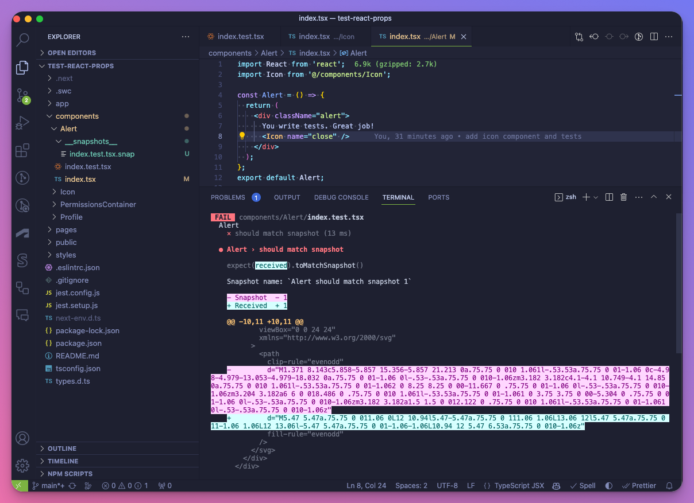

## Introduction to Jest Snapshots {#heading-introduction-to-jest-snapshots}

All right, let's talk about testing! 😇

First, I'd like to applaud you for testing your apps! I'm happy that you understand the importance of testing in software development, its value to developers and businesses, and how it can help everyone move faster with more confidence. 👏👏👏

> This guide assumes that you have Jest set up in your project. If you don't, visit their [Getting Started](https://jestjs.io/docs/getting-started) document. If you want to set up a project quickly that comes with jest and React configured, there's Next.js template for you: `npx create-next-app --example with-jest with-jest-app`. There's also a GitHub repo at the end of the article!

The Snapshot testing concept is super simple:

Snapshot is a recorded DOM state that can be used to compare against future renders to detect any changes that may have occurred in the UI.

Snapshots are plain text files generated by Jest.

When Jest runs tests containing any of the snapshot matchers (`toMatchSnapshot`, `toMatchInlineSnapshot`, etc), old snapshots are compared against current snapshots.

If there's a difference, the test fails.

This is all you need to know about Jest Snapshots and their high-level usage.

Now let's talk about when it makes sense to use them:

### When to use Jest Snapshots {#heading-when-to-use-jest-snapshots}

I assume you're already using Jest and probably some other testing tools, but you never used Snapshots. I understand you. That was me a week ago. 😅

Let's take a look at this React component:

```javascript
import React from 'react';
import Icon from './Icon';

const Alert = () => {
  return (
    <div className="alert">
      You write tests. Great job!
      <Icon name="close" />
    </div>
  );
};

export default Alert;
```

Without diving into the implementation, let's assume that `Icon` returns an SVG icon that looks like an `X` when the value of the name property is `"close"`.

How could we test that the user sees this `X` and not a different icon, like a ✅?

We could use something like Visual Regression Testing, but that's a new domain to explore and extra effort to implement.

With `@testing-library/react`, we cannot test props. According to its philosophy, you can only assert things that the users will see - the user certainly won't see the `name="close"` is passed to Icon, but the SVG that this property value will result in.

This is where Jest Snapshots come into play.

But before we see how they help us, let's take a moment to think about when we should avoid them.

### When to avoid Jest Snapshots {#heading-when-to-avoid-jest-snapshots}

Like any other tool, they're suitable for a specific job, but not everything.

Let's say you have a vast DOM tree with components maintained by several different teams.

Because you should commit the snapshots into the Git repository of your project, it means that if you're working on components that combine several other components from different teams, you'll run into conflicts if they use snapshot testing as well.

In my experience, Jest Snapshots don't work well with large component trees, tests with big datasets, or when the component's content can change between test runs, like when using randomization or timestamps.

## Writing your first Jest Snapshot test {#heading-writing-your-first-jest-snapshot-test}

Snapshot tests are like regular tests. The only difference is that they use some of the *snapshot matchers*.

This is important, and it took me a little while to figure out why Jest won't generate any snapshots:

> If you don't use any snapshot matchers in your test, no snapshot is generated.

But if you think about it, it makes perfect sense. With this, you also avoid having another list of entries or flags that should indicate whether Jest should generate snapshots.

### Creating a test file {#heading-creating-a-test-file}

Let's create a super simple test file for our `Alert` component:

```typescript
import React from 'react';
import { render, screen } from '@testing-library/react';
import Alert from './index';

describe('Alert', () => {
  it('should match snapshot', () => {
    const { container } = render(<Alert />);
    expect(container).toMatchSnapshot();
  });
});
```

### Running the test and generating a snapshot {#heading-running-the-test-and-generating-a-snapshot}

When you run `npm test` in the example project I linked at the end of this blog it generates a snapshot file:


As I mentioned earlier, the best practice is to commit these snapshots.

I don't have them in the repository at the end of this blog, so you can generate them and see how they change when you update the components.

## Updating and maintaining Jest Snapshots {#heading-updating-and-maintaining-jest-snapshots}

As the name already tells - Snapshots capture a component's state at a given time. As your application evolves, this component changes, and you have to update your snapshots.

Thankfully, this is super simple to do!

### Updating snapshots when changes are made {#heading-updating-snapshots-when-changes-are-made}

Let's say I updated the name on the Icon property to:

```typescript
<Icon name="open" />
```

As a result, the `Icon` component returns a different `SVG` and because of this, the DOM is also different. And because a snapshot is just a recorded DOM state, it's also different.

Let's run `npm test` after this change and see what happens:



As you can see, Jest shows we have a difference between the previously generated snapshot and the one received.

Jest also offers an interactive menu at the end of each test run that contains some shortcuts we could use:

```bash
 › Press u to update failing snapshots.
 › Press i to update failing snapshots interactively.
```

Once you press `u`, Jest reruns the test and also updates the snapshot:


### Handling snapshot conflicts {#heading-handling-snapshot-conflicts}

Because snapshots are checked into the repo, it's inevitable to run into conflicts at some point.

You can choose either to resolve these conflicts manually or - what I like to do - to discard either the incoming or the current changes and simply regenerate the snapshot.

This solution "feels better" since snapshots are generated and shouldn't be manually edited.

## Advanced Jest Snapshot techniques {#heading-advanced-jest-snapshot-techniques}

The above is how most of you will use Jest Snapshots. However, I'd like to mention some aspects of Jest that suit different scenarios.

First, what if you don't like snapshots being written into separate files?

### Inline snapshots {#heading-inline-snapshots}

Everything you learned about Jest Snapshots so far applies to inline snapshots. As the name already suggests, the only difference is that Inline Snapshots are not written into external files but directly into your test.

You don't need any additional setup for this. Simply use the `toMatchInlineSnapshot()` with no arguments and run `npm test`:


When we run `npm test` Jest detects the use of inline snapshots from the matcher. Jest also tells us that the external snapshot file is obsolete, and we can press `u` to remove the file, which is what I did above.

After pressing `u` you can also see that the file `index.test.tsx.snap` disappears from the file tree.

### Snapshot resolvers {#heading-snapshot-resolvers}

Jest can be configured with `snapshotResolver` to output snapshot files into a custom path. For example, you could change the default `__snapshots__` directory to `__tests__` using a resolver like this.

The [documentation](https://jestjs.io/docs/configuration#snapshotresolver-string) shows you how to use the functions of a custom `snapshotResolver` module.

## Conclusion {#heading-conclusion}

Although I've been writing tests with Jest for years, I never tried snapshots.

Nearly every project I have worked on has emphasized the unit-testing aspect of Jest. However, I now understand that there are certain UI components, such as SVG elements, that can and should be validated with Jest Snapshots if we are already using Jest. This can be accomplished without resorting to other techniques that require additional setup, such as Visual Regression Testing.

If you're already using Jest in your project, I suggest you give it a shot and create some coverage for the components that render some kind of SVG art.

If you're not using Jest or Snapshots but want to try it, here's a [GitHub repo](https://github.com/akoskm/test-react-props) I created to help you get started!

Happy Snapshotting!
