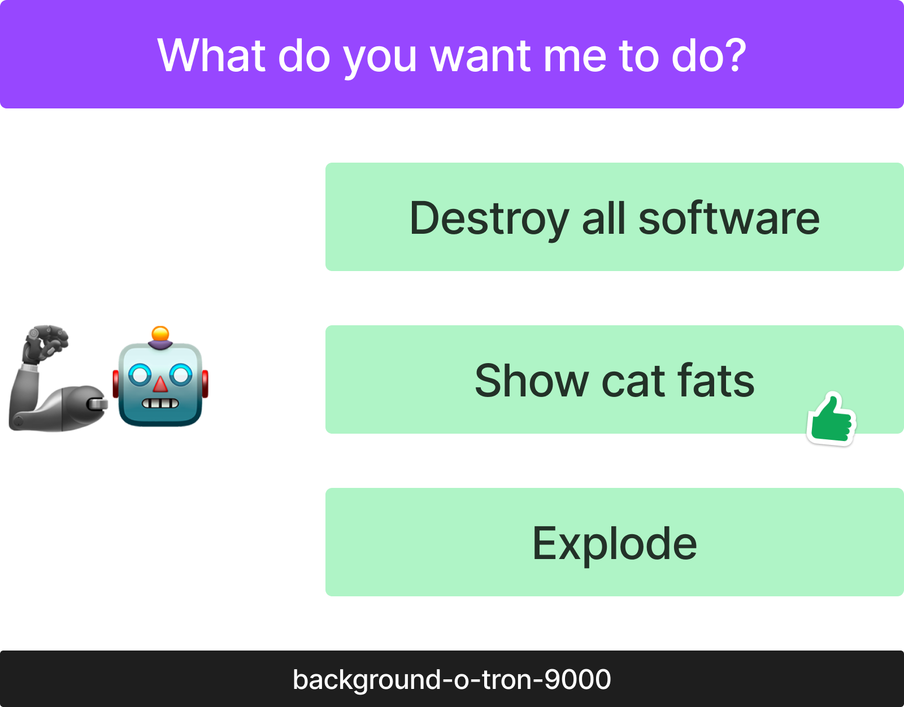
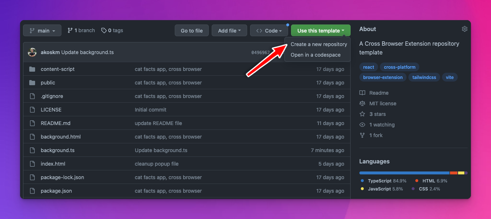

Let’s figure out how we can make API calls from our browser extension with the help of background scripts and asynchronous functions! No 3rd party library is needed!

This is also the third part of the [cross browser extensions series](https://akoskm.com/series/cross-browser-extension), and I hope you’re just excited as I am! 😁

So!

You’d like to level up your browser extension-building game and want to make some API calls from your extension. Great choice!

The best extensions don’t exist in a void.

They all communicate with some backend and send requests back and forth.

We discussed the fundamental concepts of browser extensions in [Building a Cross Browser Extension in 2022](https://akoskm.com/building-a-cross-browser-extension#heading-background).

Now I’d like you to revisit the part about [background scripts](https://akoskm.com/building-a-cross-browser-extension#heading-background).

The Background script, similar to the [main process](https://akoskm.com/use-nodejs-in-electron#heading-processes-in-electron) in an Electron app, is your” backend” if you will.

It doesn’t have access to the page’s contents and only exists in its world.

This world might seem empty at first sight, but it is extensible beyond infinity and gives your extension all kinds of powers.

One of these powers is to make API calls.

If you’d like to support my work and you’re interested in the “behind the scenes” of this blog, check out my free newsletter:

<div class="hn-embed-widget" id="substack"></div>

To show you the power of communicating with APIs from your extension, we're going to build Cat Facts!

A questionably helpful browser extension that shows you facts about cats. 😄


I will base the app’s development on the code I already shared with you in [https://github.com/akoskm/vite-react-tailwindcss-browser-extension-simple](https://github.com/akoskm/vite-react-tailwindcss-browser-extension-simple).

Of course, there will be a different repository for CatFacts at the end of this post!

# How and where to do the API calls? {#heading-how-and-where-to-do-the-api-calls}

Our browser extensions’” background” script will be the place for these operations.

Let’s revisit how it looked like last time:

```javascript
import browser from "webextension-polyfill";

browser.runtime.onMessage.addListener((msg, sender, response) => {
  console.log('message received from content script: ', msg);
  return true;
});
```

I like to think about the background script as a backend or proxy server.

Your content script is the client.

The client knows *what* it needs to do but *doesn’t know how*.

But it can send basic messages to the background script that *knows the how*!



And this is precisely what we’re going to do from our content script:

```javascript
import browser from "webextension-polyfill";

function handleClick () {
  browser.runtime.sendMessage({ action: 'show cat facts' });
}

function App() {
  return (
    <div ...
  )
}
```

# Background script as a proxy {#heading-background-script-as-a-proxy}

It’s important to note that we’ll be sending asynchronous messages back to our content script.

To support this, we have two choices, as [MDN explains](https://developer.mozilla.org/en-US/docs/Mozilla/Add-ons/WebExtensions/API/runtime/onMessage) in detail.

But essentially, `browser.runtime.onMessage.addListener` either has to:

*   return a new Promise
    
*   return true
    

Because I believe working with the async await API instead of the Promise API is much cleaner, I’m going to use that:

```typescript
// background.ts
browser.runtime.onMessage.addListener((msg, sender, response) => {
  handleMessage(msg, response);
  return true; // don't forget to add return true
});
```

Now I can make an asynchronous `handleMessage` function and use async-await to do my API calls when the right message arrives from the content script:

```typescript
// background.ts
async function handleMessage({ action, value }) {
  if (action === 'show cat facts') {
    const result = await fetch('https://meowfacts.herokuapp.com/');

    const { data } = await result.json();

    response({ message: 'success', data });
  } else {
    response({data: null, error: 'Unknown action'});
  }
}

browser.runtime.onMessage.addListener((msg, sender, response) => {
  handleMessage(msg, response);
  return true;
});
```

# Handling the response in content-script {#heading-handling-the-response-in-content-script}

Because of the asynchronous response from `sendMessage`, we need to turn our `handleClick` listener into an async function too:

```javascript
// App.tsx
async function handleOnClick() {
  const {data} = await browser.runtime.sendMessage({action: 'fetch'});
  setFact(data);
}
```

This is it! You just made your first API call from your cross-browser extension!

# Copy this! {#heading-copy-this}

Finally, I created a template repository that you can clone with ease, and you’ll get the cat-facts app as a template repository in seconds!



**GitHub:** [https://github.com/akoskm/vite-react-tailwindcss-browser-extension](https://github.com/akoskm/vite-react-tailwindcss-browser-extension)

If you liked this post, give it some emojis, comment, and share it on your social media!

If you run into trouble, don’t hesitate to comment or reach out to me on [Twitter](http://twitter.com/akoskm) or [Mastodon](https://fosstodon.org/@akoskm)!

See you in the next one! 👋
