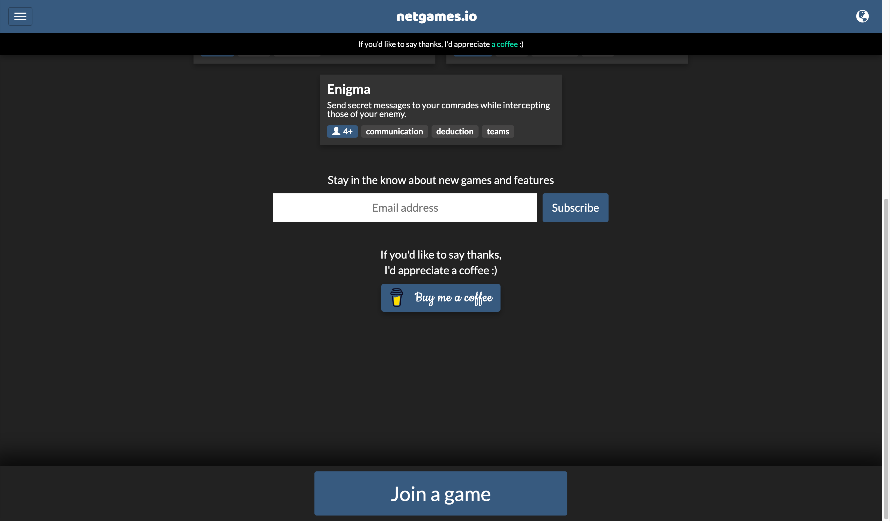

# 1. Buy Me a Coffee {#heading-1-buy-me-a-coffee}

🔗 https://buymeacoffee.com

Integration is as simple as embedding a button anywhere on your webpage.
You can see it in action on https://netgames.io/games/

The setup is super easy, there is no monthly fee but they take 5% of every transaction.
Integrates well with Stripe and PayPal.

# 2. Ko-fi {#heading-2-ko-fi}

🔗 https://ko-fi.com

It's a similar service to Buy Me a Coffee, here you can see a detailed comparison of the two https://rigorousthemes.com/blog/ko-fi-vs-buy-me-a-coffee-which-is-better/

Ko-fi lets you create a little portfolio on their platform that can serve as a hub for accepting payments.

Once this portfolio of yours is ready you can start sharing it everywhere and accepting donations.

# 3. Flattr {#heading-3-flattr}

🔗 https://flattr.com/

Flattr is a great way to accept sponsorships for your open source repositories. It accepts one time & monthly recurring payments 

# 4. Liberapay {#heading-4-liberapay}

🔗 https://en.liberapay.com/

recurring donations platform, no fees aside from payment processor fees (PayPal and Stripe)

# 5. Hashnode Sponsors {#heading-5-hashnode-sponsors}

🔗 https://hashnode.com/sponsors

If you're blogging on @hashnode Hashnode Sponsors is the easiest way to get started with donations. It integrates with Stripe and you can enable it for your blog with a click:
