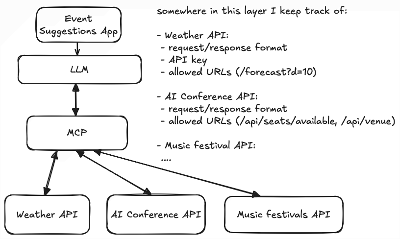
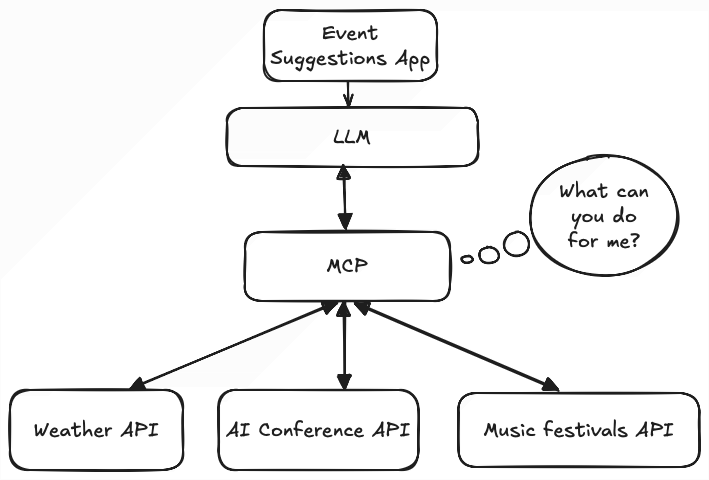

If you've been following the MCP hype and thinking all this time, "this isn't anything new", you were right.

MCPs provide a standardized way to expose resources or capabilities to LLMs. It’s more like a standard than a technology breakthrough. And now you’re thinking, we can expose app capabilities through REST endpoints as we’ve been doing it for decades?

Again, you’re not wrong.

So why do we need a standard?

Imagine we’re creating an app that can suggest events in a city based on the weather. If it’s a rainy day, you might go to a tech conference and listen to your favorite tech personality. If it’s sunny, you might listen to some music in the open.

The architecture before MCPs for such an app looked something like this:



Then you also might have used multiple weather API, in case one wasn’t available or you wanted to compare different results:

```plaintext
# Weather API 1
GET /api/v1/london/forecast-10-days
# Weather API 2
GET /api/v1/forecast?d=10&city=london
```

The LLM doesn't know how to interact with these APIs, so you'd have to hardcode the host, the endpoints, the HTTP method, the query keys or path params, the request and response format.

And this works fine until you have two weather APIs around the globe, but what if there are more? Similar to this, there can be tons of websites suggesting events, but each doing it slightly differently.

If you want to create an LLM that can suggest events based on the weather for the next few days, this is a lot of endpoints to hardcode.

But this is where MCP comes into play!

# The MCP Architecture {#heading-the-mcp-architecture}

MCP is a client-server architecture at its core.

## The Host {#heading-the-host}

The host is your application, which gathers input from the user, such as where they are located right now and when they’re looking for some activity.

The host initiates the connection to the MCP Server using an MCP client.

## MCP Client {#heading-mcp-client}

The client is part of the Host application, and its role is to:

* Initiate and maintain a connection with the MCP Server
    
* Discover what the MCP Server can do for the client
    

Here’s an example of calling the Weather MCP server for a specific city.

The import in older examples is `@modelcontextprotocol/sdk`. That package is v1. Current code uses `@modelcontextprotocol/client` and `@modelcontextprotocol/server`.

```typescript
import { Client } from "@modelcontextprotocol/client";
import { StdioClientTransport } from "@modelcontextprotocol/client/stdio";

async function useWeatherMCP() {
  const client = new Client({ name: "weather-client", version: "1.0.0" });
  await client.connect(
    new StdioClientTransport({
      command: "node",
      args: ["weather-server.js"],
    })
  );

  const result = await client.callTool({
    name: "weather_forecast",
    arguments: { city: "london" },
  });

  console.log("Weather forecast:", result.content);
}
```

## MCP Server {#heading-mcp-server}

The MCP Server is responsible for the execution of prompts, tool calls, and resource access.

Here’s an example of a Weather MCP that returns the forecast for a city based on some static data:

```typescript
import { McpServer } from "@modelcontextprotocol/server";
import { serveStdio } from "@modelcontextprotocol/server/stdio";
import * as z from "zod/v4";

const weatherData: Record<string, { date: string; temperature: number; condition: string }[]> = {
  london: [{ date: "2025-04-27", temperature: 15, condition: "Sunny" }],
};

function createServer() {
  const server = new McpServer({ name: "weather-server", version: "1.0.0" });

  server.registerTool(
    "weather_forecast",
    {
      description: "Get weather forecast for a city",
      inputSchema: z.object({ city: z.string() }),
    },
    async ({ city }) => {
      // This is where the magic happens, but I'm just returning some dummy data
      const forecast = weatherData[city.toLowerCase()] || [];
      return {
        content: [{ type: "text", text: JSON.stringify(forecast) }],
      };
    }
  );

  return server;
}

void serveStdio(createServer);
```

# What makes MCPs special? {#heading-what-makes-mcps-special}

The protocol.

A standardized way to list available resources, tools, and prompts that the MCP can recognize, run, and answer.

No new AI black magic here, simply an agreement on how MCP Servers and Clients communicate.



If I had to summarize the main takeaway of all this, to me it would be that MCP Client will always know what they can do with MCP Servers using the following API:

```typescript
client.listPrompts
client.listResources
client.listTools
```

We went from storing how we can interact with different servers and APIs to asking those APIs what they can do for us.

This is so much better than having those endpoints hardcoded because the LLMs can just ask the servers what they can do for them.

This eliminates most of the work that came from staying up to date with API formats, for example, adapting your app to handle a new URL or the removal of a field from the response.

# The MCP message format {#heading-the-mcp-message-format}

The first time a weather tool call comes back empty, I stop reading the SDK error and look at the message the client actually sent.

The MCP Inspector shows that JSON in the sidebar. On a local server you can read it off stdin.

## Requests, responses, and notifications {#heading-requests-responses-and-notifications}

MCP messages are JSON-RPC 2.0.

A request carries `jsonrpc`, an `id`, a `method`, and usually `params`. The `id` is a string or a number. It is never `null`, and it must not match another request that is still waiting.

The response copies that `id`. Success puts the payload in `result`. Failure puts `code` and `message` in `error`. This one means the server never found the tool:

```json
{
  "jsonrpc": "2.0",
  "id": 3,
  "error": {
    "code": -32602,
    "message": "Unknown tool: weather_forecast"
  }
}
```

A notification has a `method` and no `id`. The other side does not reply. On stdio, cancelling a call that is still running looks like this:

```json
{
  "jsonrpc": "2.0",
  "method": "notifications/cancelled",
  "params": {
    "requestId": 2,
    "reason": "User aborted the forecast"
  }
}
```

On the current spec, Streamable HTTP cancels by closing that request’s response stream. Older Streamable HTTP servers still take a `notifications/cancelled` POST.

## The initialize request {#heading-the-initialize-request}

Run the client above as written and the first message is `initialize`. `connect()` does that by default, which is what older servers still require. Pass `{ versionNegotiation: { mode: "auto" } }` as the second argument to `new Client` and it probes with `server/discover`, then uses the `_meta` messages below when the server supports them.

```json
{
  "jsonrpc": "2.0",
  "id": 1,
  "method": "initialize",
  "params": {
    "protocolVersion": "2025-11-25",
    "capabilities": {},
    "clientInfo": {
      "name": "weather-client",
      "version": "1.0.0"
    }
  }
}
```

The server answers with the same `id`, the protocol version it will use, and the capabilities it actually has:

```json
{
  "jsonrpc": "2.0",
  "id": 1,
  "result": {
    "protocolVersion": "2025-11-25",
    "capabilities": {
      "tools": {
        "listChanged": true
      }
    },
    "serverInfo": {
      "name": "weather-server",
      "version": "1.0.0"
    }
  }
}
```

The client then sends this, with no `id`, to say it is ready for normal calls:

```json
{
  "jsonrpc": "2.0",
  "method": "notifications/initialized"
}
```

The current spec dropped that handshake. There is no session to open. Every request carries its own protocol version and client capabilities in `params._meta`, and a server has to implement `server/discover` for when you want the capability list before you call a tool.

```json
{
  "jsonrpc": "2.0",
  "id": "discover-1",
  "method": "server/discover",
  "params": {
    "_meta": {
      "io.modelcontextprotocol/protocolVersion": "2026-07-28",
      "io.modelcontextprotocol/clientInfo": {
        "name": "weather-client",
        "version": "1.0.0"
      },
      "io.modelcontextprotocol/clientCapabilities": {}
    }
  }
}
```

```json
{
  "jsonrpc": "2.0",
  "id": "discover-1",
  "result": {
    "resultType": "complete",
    "supportedVersions": ["2026-07-28"],
    "capabilities": {
      "tools": {}
    },
    "_meta": {
      "io.modelcontextprotocol/serverInfo": {
        "name": "weather-server",
        "version": "1.0.0"
      }
    },
    "instructions": "Returns a static forecast for a city.",
    "ttlMs": 3600000,
    "cacheScope": "public"
  }
}
```

A server from the `initialize` era leaves `_meta` and `resultType` off. If `resultType` is missing, read the result as complete.

## tools/list and tools/call {#heading-tools-list-and-tools-call}

`client.listTools` and `client.callTool` are these two methods.

`tools/list` is how the client asks what it can call. On the current spec `_meta` is required on the request, and the list result carries `ttlMs` and `cacheScope` so the client knows how long it may cache the list.

```json
{
  "jsonrpc": "2.0",
  "id": 2,
  "method": "tools/list",
  "params": {
    "_meta": {
      "io.modelcontextprotocol/protocolVersion": "2026-07-28",
      "io.modelcontextprotocol/clientInfo": {
        "name": "weather-client",
        "version": "1.0.0"
      },
      "io.modelcontextprotocol/clientCapabilities": {}
    }
  }
}
```

```json
{
  "jsonrpc": "2.0",
  "id": 2,
  "result": {
    "resultType": "complete",
    "tools": [
      {
        "name": "weather_forecast",
        "description": "Get weather forecast for a city",
        "inputSchema": {
          "type": "object",
          "properties": {
            "city": {
              "type": "string"
            }
          },
          "required": ["city"]
        },
        "outputSchema": {
          "type": "object",
          "properties": {
            "temperature": {
              "type": "number"
            },
            "condition": {
              "type": "string"
            }
          },
          "required": ["temperature", "condition"]
        }
      }
    ],
    "ttlMs": 300000,
    "cacheScope": "public",
    "_meta": {
      "io.modelcontextprotocol/serverInfo": {
        "name": "weather-server",
        "version": "1.0.0"
      }
    }
  }
}
```

`inputSchema` is the arguments. `outputSchema`, when the tool has one, is the shape of `structuredContent` on the result. The call itself:

```json
{
  "jsonrpc": "2.0",
  "id": 3,
  "method": "tools/call",
  "params": {
    "name": "weather_forecast",
    "arguments": {
      "city": "london"
    },
    "_meta": {
      "io.modelcontextprotocol/protocolVersion": "2026-07-28",
      "io.modelcontextprotocol/clientInfo": {
        "name": "weather-client",
        "version": "1.0.0"
      },
      "io.modelcontextprotocol/clientCapabilities": {}
    }
  }
}
```

```json
{
  "jsonrpc": "2.0",
  "id": 3,
  "result": {
    "resultType": "complete",
    "content": [
      {
        "type": "text",
        "text": "{\"temperature\":15,\"condition\":\"Sunny\"}"
      }
    ],
    "structuredContent": {
      "temperature": 15,
      "condition": "Sunny"
    },
    "isError": false,
    "_meta": {
      "io.modelcontextprotocol/serverInfo": {
        "name": "weather-server",
        "version": "1.0.0"
      }
    }
  }
}
```

Playwright MCP (`@playwright/mcp`) is a stdio server on this same format. A host that opens a page is calling tools such as `browser_navigate` and `browser_click`.

## What a tool result looks like {#heading-what-a-tool-result-looks-like}

`content` is an array. Each item’s `type` is `text`, `image`, `audio`, `resource`, or `resource_link`.

`text` is a string. `image` and `audio` put base64 in `data` and set `mimeType`. `resource` embeds the contents. `resource_link` is a URI and a name, and the client still has to read it.

A `content` array with the forecast text, a map tile, and the embedded payload:

```json
[
  {
    "type": "text",
    "text": "Sunny, 15°C"
  },
  {
    "type": "image",
    "data": "base64-encoded-png",
    "mimeType": "image/png"
  },
  {
    "type": "resource",
    "resource": {
      "uri": "weather://london/forecast",
      "mimeType": "application/json",
      "text": "{\"temperature\":15,\"condition\":\"Sunny\"}"
    }
  }
]
```

If the tool defined an `outputSchema`, `structuredContent` has to match it. Also return that JSON as a `text` item. Clients that only read `content` can still see it.

When the call fails inside the tool, an unknown city or the upstream timing out, `isError` is `true` and the explanation is in `content`, so the model can read it and try again:

```json
{
  "jsonrpc": "2.0",
  "id": 4,
  "result": {
    "resultType": "complete",
    "content": [
      {
        "type": "text",
        "text": "Unknown city: atlantis"
      }
    ],
    "isError": true
  }
}
```

An unknown tool name comes back as the protocol `error` above. The model is much less likely to fix that one by retrying.

## stdio and Streamable HTTP {#heading-stdio-and-streamable-http}

stdio is a child process. The client writes one JSON object per line to the server’s stdin and reads one JSON object per line from stdout. The JSON must not contain a raw newline, so the blocks above are for reading. On the wire each message is a single line:

```plaintext
{"jsonrpc":"2.0","id":2,"method":"tools/list","params":{"_meta":{"io.modelcontextprotocol/protocolVersion":"2026-07-28","io.modelcontextprotocol/clientInfo":{"name":"weather-client","version":"1.0.0"},"io.modelcontextprotocol/clientCapabilities":{}}}}
{"jsonrpc":"2.0","id":2,"result":{"resultType":"complete","tools":[],"ttlMs":300000,"cacheScope":"public"}}
```

stdout is only for those messages. A `console.log` in the server splits one of them in half. Logs go to stderr.

Streamable HTTP is one endpoint, something like `https://example.com/mcp`. Every client message is its own POST. The body is one JSON-RPC object, the same object you would have written to stdin. The client sends `Accept: application/json, text/event-stream`, and `MCP-Protocol-Version` has to match `io.modelcontextprotocol/protocolVersion` in `_meta`. `Mcp-Method` is the method. `Mcp-Name` is the tool name on `tools/call`.

```http
POST /mcp HTTP/1.1
Content-Type: application/json
Accept: application/json, text/event-stream
MCP-Protocol-Version: 2026-07-28
Mcp-Method: tools/call
Mcp-Name: weather_forecast

{"jsonrpc":"2.0","id":3,"method":"tools/call","params":{"name":"weather_forecast","arguments":{"city":"london"},"_meta":{"io.modelcontextprotocol/protocolVersion":"2026-07-28","io.modelcontextprotocol/clientInfo":{"name":"weather-client","version":"1.0.0"},"io.modelcontextprotocol/clientCapabilities":{}}}}
```

The server answers that POST with `Content-Type: application/json` and one JSON-RPC response, or with `Content-Type: text/event-stream` when it wants to send progress for this request and then the response. A notification the server accepts comes back as `202 Accepted` with an empty body.

The older HTTP+SSE transport, a long-lived GET for events and a separate POST for messages, is deprecated. New servers use Streamable HTTP.

# How LLMs fit into this? {#heading-how-llms-fit-into-this}

So far, we’ve been calling `listTools` and `callTool` ourselves, and looking at the JSON those send. Where does the LLM come into play?

The LLM acts as a mediator between your input and selecting the right action based on the server's capabilities.

So in the case of our event suggestion app, you’d tell the application something like this:

*Find me something to do tomorrow at 4PM.*

Then rely on the LLM to select what tool to interact with. This is how this would look in the code:

```typescript
const userQuery = req.body.query;

const client = new Client({ name: "event-client", version: "1.0.0" });
const { tools } = await client.listTools();

const prompt = `
  You're an assistant that interacts with an MCP Server that has the following
  tools available ${JSON.stringify(tools)}. Select the appropriate tool
  based on the clients query ${userQuery} and extract the parameters to call it.
`;

const toolSelection = await this.openai.chat.completions.create({
  messages: [
    {
      "role": "system",
      "content": prompt
    },
    ...messages
  ],
  model: "gpt-4o-mini",
});

// Call the selected tool
const result = await client.callTool({
  name: toolSelection.tool,
  arguments: toolSelection.arguments,
});
```

# Further Read {#heading-further-read}

* Introduction: [https://modelcontextprotocol.io](https://modelcontextprotocol.io)
    
* Example MCP Servers to study: [https://modelcontextprotocol.io/examples](https://modelcontextprotocol.io/examples)
    
    I recommend you look at the PostgreSQL example: [https://github.com/modelcontextprotocol/servers-archived/blob/main/src/postgres/index.ts](https://github.com/modelcontextprotocol/servers-archived/blob/main/src/postgres/index.ts) (that repo is archived).
    
* MCP Inspector to develop and debug MCPs: [https://modelcontextprotocol.io/docs/tools/inspector](https://modelcontextprotocol.io/docs/tools/inspector)
    
* A huge list of MCP Servers you can use: [https://github.com/punkpeye/awesome-mcp-servers](https://github.com/punkpeye/awesome-mcp-servers)
    

# What’s Next? {#heading-whats-next}

Try to run an MCP Server.

Here’s how to get started:

1. Create a node TypeScript project with Node and use the MCP Server from the getting started [here](https://github.com/modelcontextprotocol/typescript-sdk#getting-started).
    
2. Run the server
    
3. Use the [Inspector tool](https://modelcontextprotocol.io/docs/tools/inspector) to list the available resources
    

I wrote a short book on building these servers in TypeScript, [Model Context Protocol: Build MCP Servers with TypeScript](https://akoskm.com/books/).
