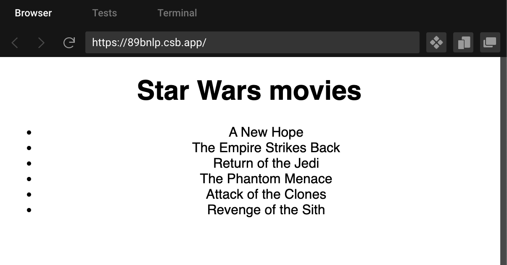

In GraphQL-powered React apps, testing component behavior based on GraphQL data is a common scenario. Let's see how to achieve that with MockedProvider.

Usually, you have to consider three cases for such components and their tests:

* Loading
    
* Success
    
* Error
    

But you also want to avoid calling the real endpoint, which in our case, is `https://swapi-graphql.netlify.app/.netlify/functions/index`. This is a public GraphQL endpoint returning data about Star Wars movies.

What you don't want to avoid is checking out my newsletter! I returned to part-time freelancing in February. Besides my musings about content, I also want to share some of my strategies for finding the first clients and effectively closing some jobs after being inactive for ***six*** years. So almost starting fresh.

<div class="hn-embed-widget" id="substack"></div>

Now back to our application!

# Movie App setup {#heading-movie-app-setup}

Here's what the app looks like in the Browser:



The entire app is in Codesandbox: [https://codesandbox.io/s/test-react-components-with-mocked-graphql-data-89bnlp?file=/src/FilmsPage.test.tsx](https://codesandbox.io/s/test-react-components-with-mocked-graphql-data-89bnlp?file=/src/FilmsPage.test.tsx).

Share it with anyone or create a fork to play with it.

In this application the `App.tsx` component is where the `ApolloProvider` is being set up:

```typescript
import "./styles.css";
import FilmsPage from "./FilmsPage";
import { ApolloProvider, ApolloClient, InMemoryCache } from "@apollo/client";

const client = new ApolloClient({
  uri: "https://swapi-graphql.netlify.app/.netlify/functions/index",
  cache: new InMemoryCache()
});

export default function App() {
  return (
    <ApolloProvider client={client}>
      <FilmsPage />
    </ApolloProvider>
  );
}
```

And the `FilmsPage.tsx` is the component running the query using `useQuery` from `@apollo/client`:

```typescript
import { gql, useQuery } from "@apollo/client";

export const GET_FILMS = gql`
  {
    allFilms {
      edges {
        node {
          id
          title
        }
      }
    }
  }
`;

export default function FilmsPage() {
  const { loading, error, data } = useQuery(GET_FILMS);

  if (loading) return <p>Loading...</p>;
  if (error) return <p>Error: {error.message}</p>;

  return (
    <div className="App">
      <h1>Star Wars movies</h1>
      <ul>
        {data.allFilms.edges.map(
          ({ node }: { node: { id: string; title: string } }) => (
            <li key={node.id}>{node.title}</li>
          )
        )}
      </ul>
    </div>
  );
}
```

# Testing objectives {#heading-testing-objectives}

Our goal is to test all three component states:

* Loading
    
* Error: ...
    
* Success: movies are in the response, and we render them
    

To prepare such a test, start by creating a file next to `FilmsPage.tsx` component and name it `FilmsPage.test.tsx`. First, we will test the Errors state and, implicitly, the Loading state. You'll see why.

## Error {#heading-error}

The first and most important part of this test is about setting up the `MockedProvider`:

```typescript
    const mocks = [
      {
        request: {
          query: GET_FILMS
        },
        error: new Error("Something went wrong")
      }
    ];

    render(
      <MockedProvider mocks={mocks}>
        <FilmsPage />
      </MockedProvider>
    );
```

[`MockedProvider`](https://www.apollographql.com/docs/react/api/react/testing/#mockedprovider) mocks [`ApolloProvider`](https://www.apollographql.com/docs/react/api/react/hooks/#the-apolloprovider-component) and instead of sending an actual network request, it lets you specify the exact response payload for a given GraphQL operation.

In the above example, the response we specified is an error response.

We expect the `if (error) return <p>Error: {error.message}</p>;` branch of our component to run and render the error message.

This is the only thing we want to test for this scenario:

```typescript
    await waitFor(() =>
      expect(screen.queryByText("Loading...")).not.toBeInTheDocument()
    );
    expect(screen.getByText("Error: Something went wrong")).toBeInTheDocument();
```

Check out the entire file in the [Codesandbox](https://codesandbox.io/s/test-react-components-with-mocked-graphql-data-89bnlp?file=/src/FilmsPage.test.tsx).

Because we wait for the Loading state to disappear, we also implicitly test the Loading state with this test.

Let's write a test for the success state.

## Success {#heading-success}

This time the mock will look different. Instead of `error`, we will supply a `result` object containing a `data` key.

I won't include the `mockData` here because it's rather long. The only thing you must be careful about is that the response you're mocking must match the structure of the response you're getting from the actual API.

```typescript
    const mocks = [
      {
        request: {
          query: GET_FILMS
        },
        result: {
          data: mockData
        }
      }
    ];

    render(
      <MockedProvider mocks={mocks}>
        <FilmsPage />
      </MockedProvider>
    );
```

In the test, similarly to the error case, first, we will wait for the `Loading...` message to disappear, then we'll look at the screen and check if the movies we returned in the fake response appeared:

```typescript
    await waitFor(() =>
      expect(screen.queryByText("Loading...")).not.toBeInTheDocument()
    );
    expect(screen.getByText("Luke Skywalker in Portugal")).toBeInTheDocument();
    expect(screen.getByText("Darth Vader singing lessons")).toBeInTheDocument();
```

# Conclusion {#heading-conclusion}

That's it!

You just tested your React component by providing some fake GraphQL data to it with the help of `MockedProvider`.

To learn more about Apollo GraphQL, check out their excellent [developer documentation](https://www.apollographql.com/docs/), where you will find super-detailed tutorials.

As always, thanks for reading my blog, and see you at the next one.

Bye 👋
