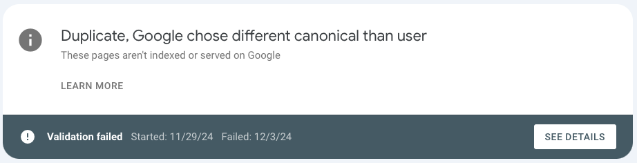
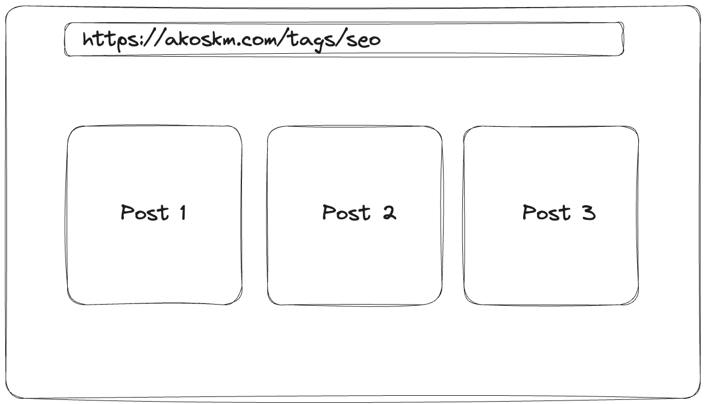
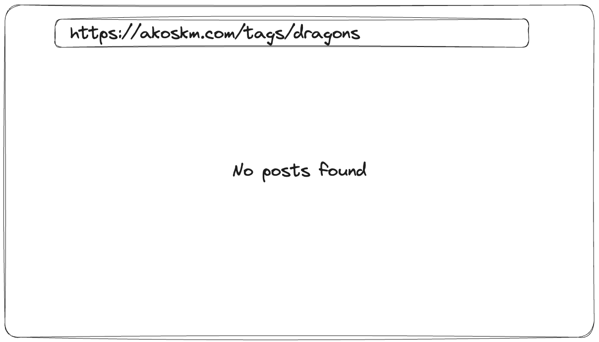
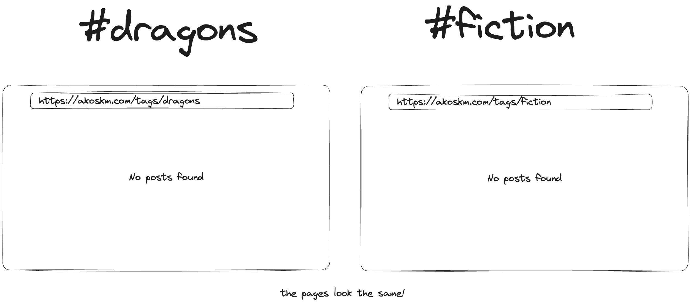
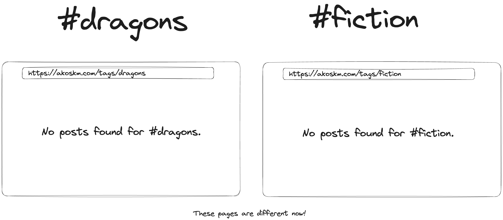

I’ll show you the easiest way to avoid this common error in Google Search Console when using Next.js for your website. And don’t worry if you’re using other frameworks, the idea is the same!

Addressing this issue is important because it will improve your site’s ranking, and it’s an easy fix to implement.

So, let’s jump straight into the problem you’re seeing:

> *Page is not indexed: Duplicate, Google chose different canonical than user*
> 
> **URL is not on Google**



If you’ve taken SEO seriously, *as you should*, if you’re building a blog or any web app where you want to get pages indexed, you’ll be looking at your analytics tools a lot.

Previously, I wrote about [How to Make Next.js 13 More SEO-Friendly](https://akoskm.com/how-to-make-nextjs-13-more-seo-friendly) because that was 99% of the solution. However, when these errors started popping up, I didn’t even know what was going on.

# The Cause {#heading-the-cause}

This error basically means that Google has identified **duplicate content** on your site and has chosen a different URL as the canonical version instead of the one you specified.

But how is that possible?

Let me show you an example.

Imagine you have a personal blog where readers can filter your blog posts by tags:

`https://akoskm.com/tags/seo`

The result is likely a page containing an infinite scroll or pagination, listing all your blog posts for this tag.



But now let’s open a tag that doesn’t exist:



```typescript
export default async function Home({ params: { slug } }: Props) {
  const tagName = decodeURIComponent(slug);
  const { posts, tags } = await getData(tagName);

  
  if (!posts.length) {
    return (
      <p className="text-lg font-bold text-center text-gray-600 my-8">
        No posts found
      </p>
    );
  }

  return posts.map((post: BlogData) => <BlogCard key={post.id} post={post} />);
}
```

Because I don’t write much about dragons anymore, I won’t have any posts for this tag, and a “No posts found” page will appear.

But here’s what happens when you type a different tag that you also don’t have any posts for:



This sits at the heart of this problem.

Google already identified that the page that looks like the one you rendered `#fiction` was already rendered for the tag `#dragons`.

# The Solution {#heading-the-solution}

Instead of just rendering “*No posts found”*, I included the tag name in the message I displayed to the user.

Now, even for tags that don’t have any posts, I’m displaying a different page:

```typescript
export default async function Home({ params: { slug } }: Props) {
  const tagName = decodeURIComponent(slug);
  const { posts, tags } = await getData(tagName);

  if (!posts.length) {
    return (
      <p className="text-lg font-bold text-center text-gray-600 my-8">
        No posts found for{" "}
        <span className="text-blue-500">{tagName}</span>.
      </p>
    );
  }

  return posts.map((post: BlogData) => <BlogCard key={post.id} post={post} />);
}
```

With the above change, when the user goes to a page that doesn’t have any posts, I’m rendering a tag-specific page:



Because the pages now looked different, the `Page is not indexed: Duplicate, Google chose different canonical than user` messages disappeared from Google Search Console!

Simple yet effective!

I hope this will help you eliminate one more issue that brings down the score of your site, and you’ll rank higher!

\- Akos
