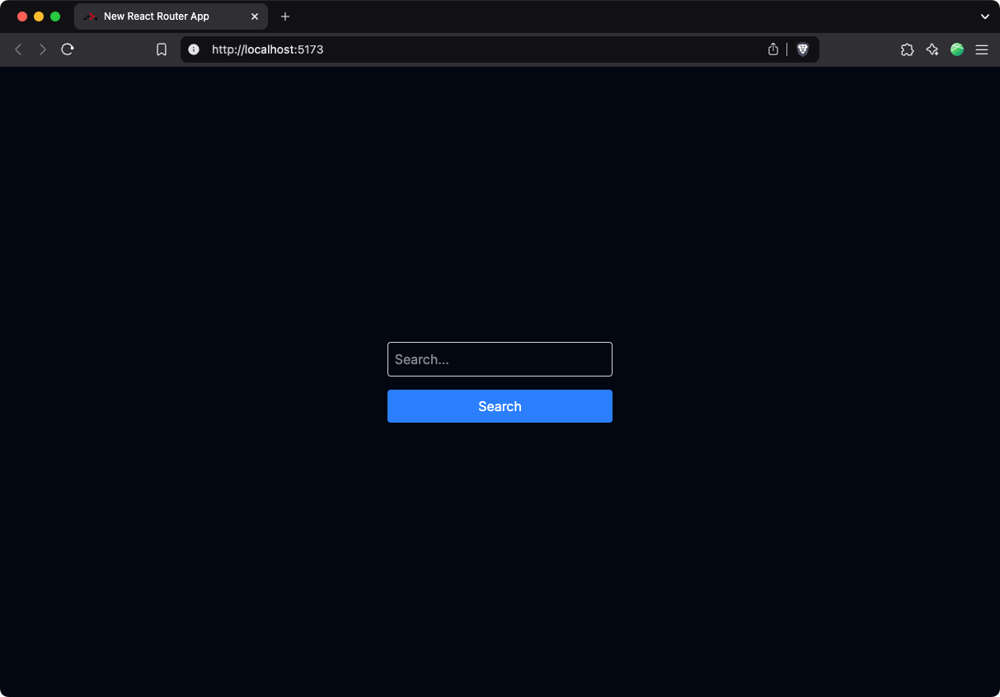
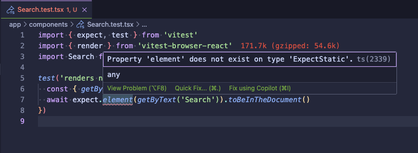
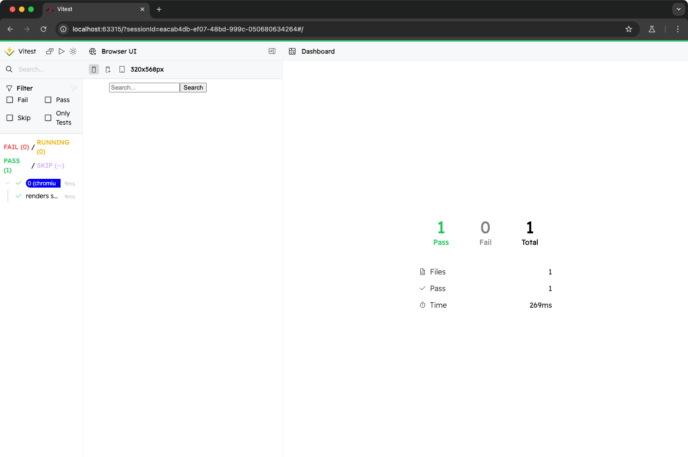
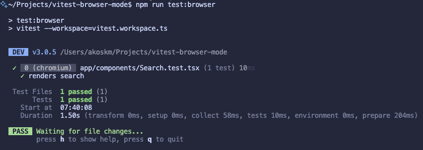

Vitest and React Testing Library are great for component testing. We all love to see those console messages with our tests passing so we can confidently kick off that deployment. However, unit testing front-end components was always a bit tricky for two reasons:

* We didn’t actually see the components that were rendered during testing
    
* We didn’t know how they would behave in a real browser since we’d be using JSDom or HappyDOM to simulate a browser for our tests. These are far less complex than real browsers, so the tests aren’t that reliable after all.
    

[Vitest Browser Mode](https://vitest.dev/guide/browser/) was created to address the above problems.

Although you’ll see Playwright here, this is not end-to-end testing. That requires a lot more setup compared to Browser Mode, which can be accomplished by only a few lines.

Let’s see how.

## Project Setup {#heading-project-setup}

If you have an existing project, skip to Vitest Setup.

### React Router with a simple Search component {#heading-react-router-with-a-simple-search-component}

To kick things off, I’m creating a [React Router](https://reactrouter.com/) project:

```typescript
npx create-react-router@latest
```

This will set you up with a simple React application. Just make sure it runs as expected by opening `http://localhost:5173/`.

```plaintext
$ npm run dev            

> dev
> react-router dev

Re-optimizing dependencies because lockfile has changed
  ➜  Local:   http://localhost:5173/
  ➜  Network: use --host to expose
  ➜  press h + enter to show help
```

Let’s create a new folder `components` with one file inside `Search.tsx`. This will be our simple search component, styled with TailwindCSS:

```typescript
import React, { useState } from 'react';

const Search: React.FC = () => {
  const [query, setQuery] = useState('');

  const handleInputChange = (event: React.ChangeEvent<HTMLInputElement>) => {
    setQuery(event.target.value);
  };

  const handleSearch = () => {
    console.log('Searching for:', query);
    // Add your search logic here
  };

  return (
    <div className="flex flex-col items-center justify-center min-h-screen">
      <div className="w-full max-w-md">
      <input
        type="text"
        value={query}
        onChange={handleInputChange}
        placeholder="Search..."
        className="w-full p-2 border border-gray-300 rounded mb-4"
      />
      <button
        onClick={handleSearch}
        className="w-full p-2 bg-blue-500 text-white rounded"
      >
        Search
      </button>
      </div>
    </div>
  );
};

export default Search;
```

Now open `app/welcome/welcome.tsx` and replace the contents with the following:

```typescript
import Search from "~/components/Search";

export function Welcome() {
  return (
    <main className="flex items-center justify-center">
      <Search />
    </main>
  );
}
```

After this, just reload the app, and you should see something like this:



Don’t see this input? Leave a comment or contact me on hello at akoskm dot com.

## Vitest Setup {#heading-vitest-setup}

### Vitest Browser Mode {#heading-vitest-browser-mode}

Once you verify that the new React Router project is running, in the root of your project folder, run the command `npx vitest init browser`.


This will ask you some basic questions about your project and will generate you a couple of files to get started:

* [workspace](https://vitest.dev/guide/workspace.html) files
    
* a HelloWorld component and a HelloWorld browser test - **remove these**
    

There are a couple of things you still need to change to make browser tests work. Let’s go through these.

### Add some tests {#heading-add-some-tests}

First, let’s create a simple test next to our `Search.tsx` component `app/components/Search.test.tsx`:

```typescript
import { expect, test } from 'vitest'
import { render } from 'vitest-browser-react'
import Search from './Search'

test('renders search', async () => {
  const { getByText } = render(<Search />)
  await expect.element(getByText('Search')).toBeInTheDocument()
})
```

React Router created a TypeScript project for you, so you’ll get errors whenever you try to use a library whose types are unknown to TypeScript:



Luckily, this is something we can easily fix.

### Types Configuration {#heading-types-configuration}

Add `@vitest/browser/matchers` to `compilerOptions.types` inside `tsconfig.json`:

```plaintext
{
  // ...
  "compilerOptions": {
    "lib": ["DOM", "DOM.Iterable", "ES2022"],
    "types": ["node", "vite/client", "@vitest/browser/matchers"],
    // ...
  }
}
```

### Vitest Configuration {#heading-vitest-configuration}

Right now, the CLI tool creates an invalid configuration object, and if you try to run your test, you’d get this error:

```plaintext
Error: @vitest/browser/context can be imported only inside the Browser Mode. Your test is running in forks pool. Make sure your regular tests are excluded from the "test.include" glob pattern.
```

There’s an [issue](https://github.com/vitest-dev/vitest/issues/7403) and a [PR](https://github.com/vitest-dev/vitest/pull/7475) for this already, so let’s hope I can remove this step soon 🤞

While this is an issue, you can just fix the configuration for yourself by opening `vitest.workspace.ts` and replacing `configs` with `instances`

```typescript
import { defineWorkspace } from 'vitest/config'

export default defineWorkspace([
  // If you want to keep running your existing tests in Node.js, uncomment the next line.
  // 'vite.config.ts',
  {
    extends: 'vite.config.ts',
    test: {
      browser: {
        enabled: true,
        provider: 'playwright',
        // https://vitest.dev/guide/browser/playwright
        // before ❌
        // configs: [
        // ],
        // after ✅
        instances: [
          { browser: 'chromium' },
        ],
      },
    },
  },
])
```

There’s one more error we’ll run into, so let’s fix that.

## Vite Setup {#heading-vite-setup}

Now you could run the tests using the `npm run test:browser` command that the CLI tool suggested, and your selected browser would show up, but you’d still be seeing an error: ***React Router Vite plugin can't detect preamble***.

```plaintext
app/components/Search.test.tsx
Error: React Router Vite plugin can't detect preamble. Something is wrong.
 - /app/components/Search.tsx:1:466
```

You can see how to fix this in my other blog post about Vitest and React Router, but I’ll also provide the configuration for this case.

<div class="embed-wrapper"><div class="embed-loading"><div class="loadingRow"></div><div class="loadingRow"></div></div><a class="embed-card" href="https://akoskm.com/react-router-vitest-example?x-host=akoskm.com#heading-cant-detect-preamble">https://akoskm.com/react-router-vitest-example?x-host=akoskm.com#heading-cant-detect-preamble</a></div>

To fix this error, you simply have to disable React Router when the tests are running using `!process.env.VITEST && reactRouter()`. Open `vite.config.ts` and make the following change:

```typescript
import { reactRouter } from "@react-router/dev/vite";
import tailwindcss from "@tailwindcss/vite";
import { defineConfig } from "vite";
import tsconfigPaths from "vite-tsconfig-paths";

export default defineConfig({
  // before 
  // plugins: [tailwindcss(), reactRouter(), tsconfigPaths()],
  // after 👇
  plugins: [tailwindcss(), !process.env.VITEST && reactRouter(), tsconfigPaths()],
});
```

That’s it! Now you can run your first test in Browser Mode!

## Running The Tests {#heading-running-the-tests}

You can do this by using `npx vitest` or with `npm run test:browser` that’s a command `vitest init` injected into your `package.json` file. The browser should show up immediately, and you should see the test for your Search component passing:



You’ll also see the test passing in the terminal:



## Conclusions {#heading-conclusions}

You just learned how to set up Vitest Browser Mode in a React Router project.

As a quick reminder, here’s a checklist for your next project:

1. **Vitest Initialization**: Run `npx vitest init browser` in the root of your project to set up Vitest Browser Mode.
    
2. **Types Configuration**: Add `@vitest/browser/matchers` to `compilerOptions.types` in `tsconfig.json` to fix TypeScript errors.
    
3. **Fix Vitest Configuration**: Open `vitest.workspace.ts` and replace `configs` with `instances`.
    
4. **Vite Configuration**: Modify `vite.config.ts` to disable React Router during tests using `!process.env.VITEST && reactRouter()`.
    

## GitHub Repo {#heading-github-repo}

[https://github.com/akoskm/vitest-browser-mode](https://github.com/akoskm/vitest-browser-mode)
