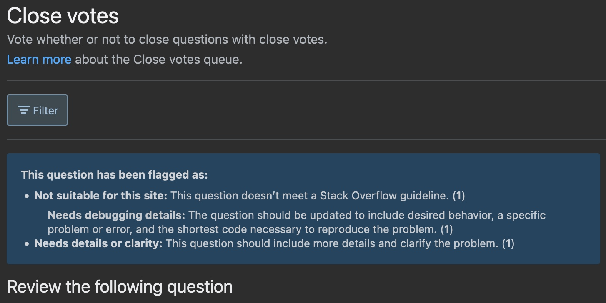

What I'm going to tell you here is applicable not only in software development, technical writing, and design but also in life.

> “A problem well stated is a problem half solved.”

A quote by John Dewey - who wasn't a programmer. 😄 As you can see, the general problem-solving process is quite similar in different fields of life.

By the end of this post, you'll learn how to efficiently solve problems like a developer!

And remember, problem-solving is just another skill. You have to practice it to get better at it!

But first, let me tell you about how this article was born.

---

It was a Tuesday evening when I looked up the weekly challenge title for this week:

> When you are stuck as a developer/software engineer, what do you
do?

and jumped right into writing! You bet I didn't! I would be still working on that article!

Here's what I did instead:

1. I researched the topic and found that people refer to being stuck in programming in two different ways:

  a) when you get stuck on a particular problem

  b) when you get stuck in your career, let's say on a junior level

2. Then I was thinking about if a) or b) fits my competencies better - I decided to go with a)
3. Then, I researched what most people do when they are stuck in programming. I do this because of two reasons:

  a) I don't want to repeat what's already written

  b) To see how my advice diverges from what you read online. It is useful in setting the tone of the article.

4. Finally, I did some Google Trends and Keyword Research to find a title and...

this is where I start writing.

---

## This is where problem-solving begins {#heading-this-is-where-problem-solving-begins}

The first and foremost step in every problem-solving process:

**Understanding the problem.**

<div class="embed-wrapper"><div class="embed-loading"><div class="loadingRow"></div><div class="loadingRow"></div></div><a class="embed-card" href="https://twitter.com/akoskm/status/1529756992419635201">https://twitter.com/akoskm/status/1529756992419635201</a></div>

There's nothing before and could be something after, but only if you understand the problem.

Otherwise, it's either a hit or a miss!

But what do you do when you already understand the problem but can't solve it?

I'm going to share all my strategies in this post 🤜🤛

## You don't understand the problem {#heading-you-dont-understand-the-problem}

I often see beginner developers not being open about the lack of understanding of the problem they have to solve. When I asked one of our former colleagues why he spent days working on something that should've been a built-in function call, he finally told me that he didn't fully understand the problem. But it took me some time to get this answer.

In reality, this is the first thing you want to communicate.

Not understanding a problem doesn't show you're incompetent to solve it.

Here are some reasons why I told someone I don't understand the problem:
 - it wasn't defined well
 - someone on the team wrote this who had years of accumulated knowledge of the system, so it contained lots of implicit knowledge
 - it was written in a rush

So here are some steps I'm going through when I don't understand the problem:

### Do you have enough context? {#heading-do-you-have-enough-context}

I recently joined a team that works on a social app. I was assigned the task that's about avoiding duplicate PayPal email addresses during PayPal setup. The codebase is vast, with many microservices.

Me also being new to the whole system, a few questions immediately popped up:
 - how the users are setting up their PayPal currently
 - how can I reach this screen so I can verify that the behavior is incorrect
 
After asking an engineer these questions, they immediately pointed me to the place in the code where this needs to be added. It turned out there's a microservice handling PayPal setup, and this is where I needed to implement the check.

I can't even estimate how long it would have taken for me to find this place alone.

### Ask for help {#heading-ask-for-help}

Senior developers, stakeholders, or Product Owners, someone has to know why they need this thing!

I've seen countless feature requests that didn't make sense or should have been extensions of an existing feature.

Don't be afraid to ask for clarification or propose a better alternative!

### Share your findings {#heading-share-your-findings}

Not every problem gets solved!

Fun fact: the first feature ticket that got assigned to me when I started working as a React engineer remained unsolved until I was in the company 😅

Jokes aside, some problems are just too hard to tackle alone.

It's also possible that when the need for X or Y showed, the people who put together a task weren't aware if it was technically achievable.

You might realize this at the very beginning, but you might spend hours or days researching before you come to this conclusion.

Documenting your findings as you go is a great idea to ensure:

1\) next time whoever picks up the work that you didn't finish, they don't have to start over
2\) based on your discoveries, the product owners might come up with a completely different idea that you can solve
3\) there'll be a trace that you did the proper research and did your best trying to solve this problem. They might give you more research to do!

## You understand the problem {#heading-you-understand-the-problem}

### Can you solve it alone? {#heading-can-you-solve-it-alone}
Maybe the knowledge of other teams could be helpful here? What if they have more context than you do? It might take them a few minutes to build something that would take you days. Maybe someone already did research and documented their findings as I suggested in [Share your findings](#heading-share-your-findings)?

Reach out to your peers to be the most effective. Schedule some time for pair-programming.

But don't try to shift the work to someone else.

Do you think someone else should do the work because it would take them significantly less time and effort to complete it? Let the person know who assigned the task to you and ask their opinion!

Mistakes happen. Between some crazy deadlines, I got a task to set up a build process in Google Cloud Platform for a mini-project that I was doing. I never worked with GCP, but we had a dedicated DevOps engineer, and I contacted him immediately! I had a build working in less than an hour.

Don't think for a second that this means you don't want to work - this action only shows that you're aware that time is everyone's most important resource, and you want to manage it as effectively as possible.

*Always show appreciation and give a shoutout to people who came forward and supported you, no matter how small the effort was.*

### Is it too big of a problem - break it down {#heading-is-it-too-big-of-a-problem-break-it-down}

#### Step-by-step {#heading-step-by-step}

Are there more moving parts?

Do you need to fetch emails and filter them by tags before writing the Subjects to a Google Sheet - this requires at least two clients:

One for reading the emails and one for writing to the sheet.

You can even build these as separate MVPs. More on that in the next section.

#### Function by function {#heading-function-by-function}

Can I write features that work separately from each other?

If the answer is yes, these are great candidates for unit tests. Do you need a function that converts user-entered data into an ISO date? Do you also have to forward this date to a function, that adds 30 days to it, composes a message with this date, and sends an email? 

Perfect:

```
describe('convertToIsoDate', () => { ... })

describe('addDays', () => { ... })

describe('getEmailBody', () => { ... })

describe('send email', () => { ... })
```

Start implementing these functions one by one. Verify their behavior and finally combine them into a feature!

### MVP? {#heading-mvp}

MVP is not only a fancy word for creating small, working products.

You can create a Minimum Viable Product for a feature you have to build.

Let's say you have the following task: when a user clicks a button, you read some data from a Google Sheet and save that data into the database.

If we assume that the app you're working on already has some data access layer, your MVP here would be a function that reads data from Google Sheets and does nothing else.

Once that is done, you can examine the data. You probably want to reformat the array-like data before you write it into the database.

And only this is when you start working on the actual database write.

## Things you should avoid at the start: {#heading-things-you-should-avoid-at-the-start}

### Google & StackOverflow {#heading-google-andamp-stackoverflow}

Fortunately, the StackOverflow vote system doesn't allow low-quality or too specific questions. This doesn't mean you can't waste your time on these sites searching for answers or posting a question that you should ask your peers instead.



I'm mainly using Google as a tool to arrive faster at pages I want to see.

Here are a few examples from my search history to demonstrate my point:

```
NodeJS DERIVEBITSREQUEST
react-router Outlets
electron-builder copy resources
character from keycode in JavaScript
```

I could've found all these things by opening NodeJS, React-Router, Electron builder, or MDN Docs. Finally, using their search to search for these keywords.

Doing this process through search engines saves me time.

Sometimes I spot a detailed article mentioning an issue with a thing I just searched.
I read this first to see if I'm affected by this problem.

I never use Google when I'm building something from scratch. If I want to use some new technology and I'm not familiar with their vocabulary, syntax, and best practices, I never use Google.

The reasons for this?

Low-quality articles.

It's easy to trick search engines into ranking an article high. It's mostly the good combination of keywords and formatting your text correctly.

Does it follow the latest best practices of that library - Google doesn't know that.

Things I would never Google for:

"How to build a form with Formik" - what I would do instead is check out Formik's beautiful [Get Started](https://formik.org/docs/overview) page, and become familiar with what problem Formik solves, how to install it, and build my first form with it.

### Abuse other people's time {#heading-abuse-other-peoples-time}

Remember, you have to understand the problem you want to solve.

And people can't do the "understanding" part for you.

When you approach more experienced developers with such intention, their first question will most probably be something like:
 - show me what you've tried so far
 - please share your current findings with me, and I'll get back to you shortly

If it turns out you didn't do your homework, it just comes through as disrespectful. And it's not even efficient!

It is quite different than doing extensive research and [Sharing your findings](#heading-share-your-findings), as I mentioned above.

Also, don't use senior engineers as a filter for your code. If you didn't understand the problem, see [I don't understand the problem](#heading-i-dont-understand-the-problem).

Don't write code and hope that it might solve the thing you were asked to do.
As impossible as it sounds, I've seen people doing this.

Senior engineers will probably notice that you had no clue about what you should be doing. Don't abuse their time!

## When nothing else works {#heading-when-nothing-else-works}

Go for a walk! Make a coffee or your favorite beverage!

Sometimes your brain might not be happy with that task you want to tackle in the late afternoon.

I always tell people we're not factory workers and the mantras such as:
 - you should be writing 80 lines of code a day
 - solving at least two tasks per day

They don't apply anymore.

As a programmer, you'll have bad days, good days, and OK days.

I have a migraine, so when the weather gets bad, my eyes want to pop out when I look at the screen for longer. Because of this, I take frequent breaks.

On good days, I'm in such a zen mode that I forget to stand up for hours - which is bad for me I know!

Also, consider that a solution written by a tired mind might not be as high quality.

So even if you push yourself into solving a task, you might just want to rewrite it tomorrow anyway.

> “ A problem is a chance for you to do your best.”
> --Duke Ellington

In case you're looking for some takeaways from this article, just remember the above quote. 😄

Every problem-solving exercise opens ways to collaborate with your colleagues.

To forge new relationships that is really important if you want to get ahead in your career.

Problem solving also gives you a chance to understand the codebase better.

To develop your cognitive abilities and gain experience with a certain technology.

Problems are awesome! Now go and solve some of them! 🔥
