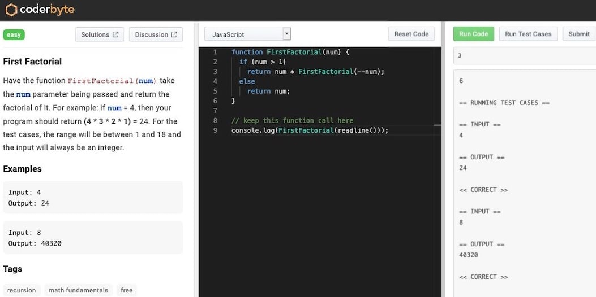
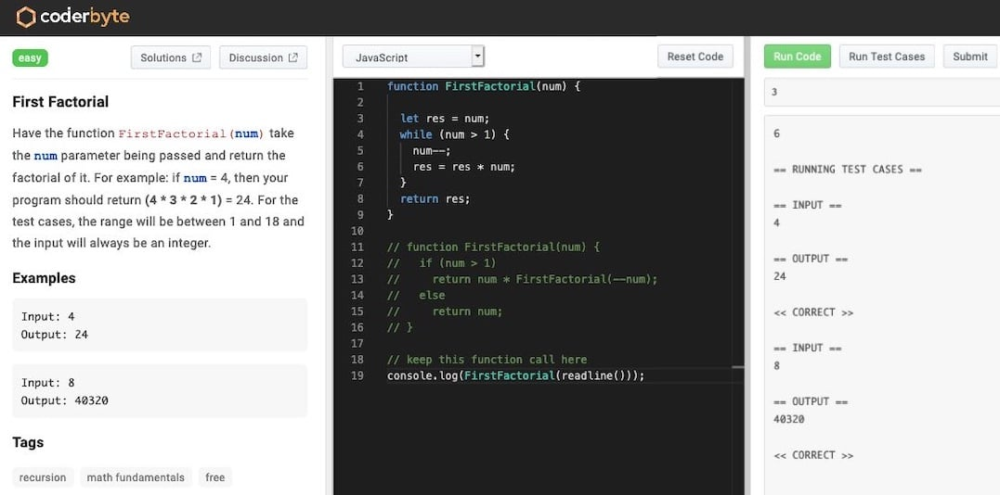

When working on projects, apply these practices to keep development costs optimal, increase confidence in the software, and let the project move faster.

And now for the readers who think that the ultimate cost-saving is to not write tests, ever:

<a class="embed-card" href="https://twitter.com/eduardsi/status/1381633331230601221?s=20">https://twitter.com/eduardsi/status/1381633331230601221?s=20</a>

### What are implementation details? {#what-are-implementation-details}

Let’s say you release software that sorts To-do list items by their weight.
To sort this list, you used [Insertion sort](https://en.wikipedia.org/wiki/Insertion_sort) because of its simplicity.
This is one of the lists your software displays:

- 4 whole eggs
- 1 cup of whole cow's milk
- 120 grams of oats

One day you decide to replace the sort algorithm with [Bucket sort](https://en.wikipedia.org/wiki/Bucket_sort).
Is this change going to impact how your users interact with this software? Think about the release notes, should you explain why you did this change? Probably not.

Congratulations, you just spotted an implementation detail!

### Why I should avoid testing them? {#why-i-should-avoid-testing-them}

Tests coupled to a specific implementation become useless when that implementation changes. Money thrown away, basically. Organized software development is all about not burning through your budget as quickly as possible while still making some business impact, right?

Or, as [@tastapod](https://twitter.com/tastapod) puts it in one of his [talks](https://www.youtube.com/watch?v=4Y0tOi7QWqM):

> ”... sustainably minimizing lead time to business impact and that is the goal of the system of work that we call software development.”

Writing code costs a lot. Whether we add functionality, tests, it costs to write, understand, maintain, and improve the code.
Usually, the more code you have the higher the development costs are.

Solving business requirements without creating new code would be ideal, but that's not always an easy task.

### Am I testing the right thing? {#am-i-testing-the-right-thing}

During my studies, we were *obsessed* with coding challenges. I came across this site called [Coderbyte](https://coderbyte.com/) that hosts such challenges and realized how well it represents this idea of what to test.

The UI immediately creates the right separation. The panels from left to right represent the requirements, the software, and the tests.

The business requirement here is to write a program that calculates the factorial of an integer.

Let's pretend for a moment that we like the idea of testing implementation details. In fact, all we do is test implementation details so this one is going to be easy! We should definitely test the number of recursive function calls for a given input.

Now, fast forward a year.

We took a course from Data Structures and Algorithms and we learned we can turn recursions into loops.
We come up with this brand new way of calculating factorials:

We're excited to try this new algorithm, but our test won't pass anymore. The recursion is gone!

The biggest problem with such tests is that they don't increase confidence in our software. The only thing they show is the presence of recursion, an implementation detail that might change in the future.

You'll run into the same problem while working on any kind of software over a period of time. Your development skills might improve during that period, you rewrite some of your code, but the problems you solve remain the same.

Focus on the business requirements while writing tests so they keep working even after the implementation changes.

<a class="embed-card" href="https://twitter.com/rauchg/status/807626710350839808?s=20">https://twitter.com/rauchg/status/807626710350839808?s=20</a>

Do you write tests at all? Are you thinking about what's the best way to test your software?

Cover Photo by Startup Stock Photos from Pexels.
