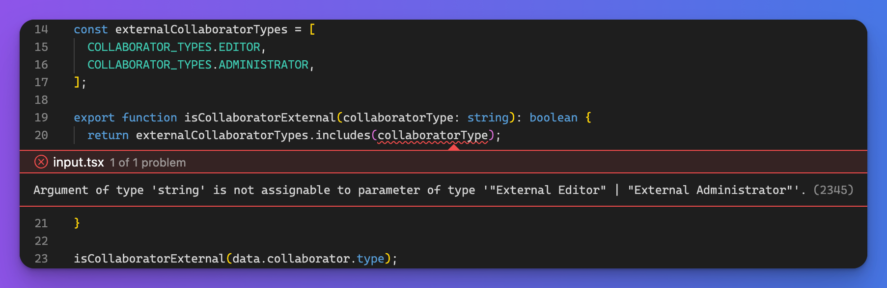
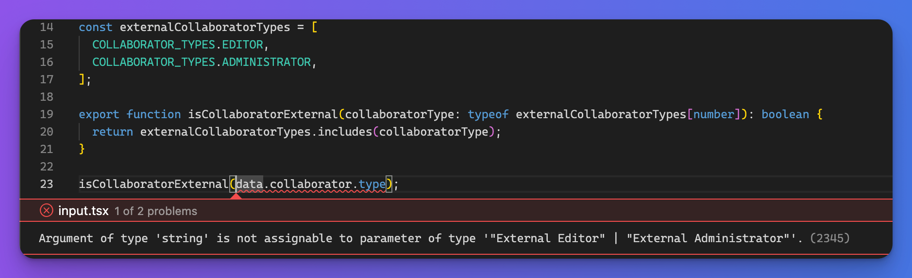
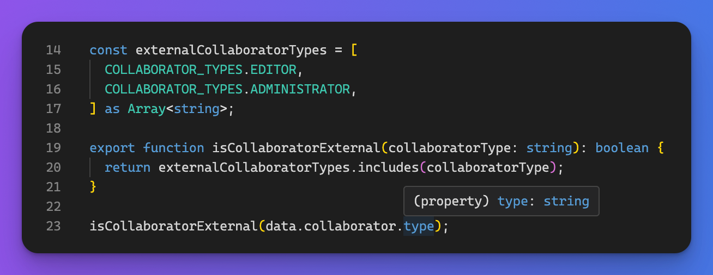

Utility functions are part of every project.

You might organize them in folders called helper, lib, or shared, but their function is the same:

They make sure your business logic stays consistent in your game.

(Drop a like if you love the rhyme. 🤫🎤💥)

We've spent the past few months moving around and converting JavaScript to TypeScript files, including such helpers, in a GitHub repo with around 40k+ files tracked in Git (so this size is without node\_modules or any generated files). We do this because the TypeScript check runs for ages on a project of this size, so we're introducing TypeScript Project References and splitting the app into smaller parts to speed up the checks. But this is a topic for another blog post.

Some of these files turned into TypeScript were the so-called "helpers". These functions encapsulate some business logic you want to be consistent in your entire app.

We did and reviewed a bunch of such conversions and noticed a pattern.

TypeScript developers love `as`.


Writing `as` is telling the compiler: *trust me bro I've got this*.

Let's look at a utility function from a blog engine. You have different collaborators and need to know if a collaborator is external. For completeness, the collaborator type is a user input that can be any of the values listed or an arbitrary string.

```javascript
// isCollaboratorExternal.js

export const COLLABORATOR_TYPES = {
  "EDITOR": "External Editor",
  "ADMINISTRATOR": "External Administrator",
  "GUEST": "Guest",
  "OTHER_COLLABORATOR": "Other Collaborator"
};

const externalCollaboratorTypes = [
  COLLABORATOR_TYPES.EDITOR,
  COLLABORATOR_TYPES.ADMINISTRATOR,
];

export function isCollaboratorExternal(collaboratorType) {
  return externalCollaboratorTypes.includes(collaboratorType);
}
```

Now, let's say somewhere in your code, you call this function:

```typescript
// admin-panel.tsx

const { data } = useQuery<{ collaborator: { type: string } }>();

isCollaboratorExternal(data.collaborator.type);
```

How would you convert the `isCollaboratorExternal` function to TypeScript, so it plays nicely with the rest of the app?

The type of `data.collaborator.type` is of `string`, so it would make sense to make the following conversion:

```typescript
// isCollaboratorExternal.ts

export function isCollaboratorExternal(collaboratorType: string):boolean {
  return externalCollaboratorTypes.includes(collaboratorType);
}
```

But, uh oh, TypeScript isn't happy about this:



The reason for `Argument of type 'string' is not assignable to parameter of type '"External Editor" | "External Administrator"'.` is the fact that `externalCollaboratorTypes` only contains `"External Editor"` and `"External Administrator"` and it's not just an arbitrary string.

So why not type the argument as something that is one of the `externalCollaboratorTypes`:



The function definition now looks good, but when you call it with a response from our backend, TypeScript knows you might get an arbitrary string that's not `"External Editor"` or `"External Administrator"`.

Usually, this is when `as` happens:

```typescript
// isCollaboratorExternal.ts

export function isCollaboratorExternal(collaboratorType: string): boolean {
  return externalCollaboratorTypes.includes(collaboratorType as any);
}
```

Of course, this is one way to deal with the problem, but it's not a fair TypeScript conversion if you turn off type-checking.

But what else could you do?

The `collaboratorType` has to remain an arbitrary string because this helper operates on random input from users.

If you tell the compiler that the list `externalCollaboratorTypes` is a list of strings - which it is - you can leave the `collaboratorType: string` for the helper input - which is also realistic - and TypeScript will love this solution:



Now, you can pass in the arbitrary string as the `collaboratorType` and TypeScript will check if it's of the values in the `externalCollaboratorTypes` array.

Here's a [TypeScript playground](https://www.typescriptlang.org/play?#code/MYewdgzgLgBAJgQygmBeGBvAUDGoA2+CARiAE5LkBcmOuMUAngA4CmNA5AOoCWAXgjJwOdAL5ZRAbixZWAD2blYoSLADCAeQAyWgIIAhDQCVdAFWMB9UwE0ACgFEAymlq4ARPYAiASXNG3NB5yUKxkYAj4MPZwPFDkbgA0dG66ngCy3gBy3o6mJn4BMEEhYREwunAAtjxgPNAUcWSJyQDiAKpOpoVuLQCurNDN7hqmABL2RhaaOgbGZsbdGlAAFqEwaiCEJOSUTRIwCBB44NDSWCrQMPIl4fgbW6QN5KYsAy4A2nTTeob5ljYORwAOi8vmMSVw31mf0mAKcQNSGWyuRhSQAumd5IoyLAAGa9MDAKA8cAwOr3IiPXb2YKhW4ACgIlJ2jRebBo9RqAHMAJQ0UibVgIMCuGBkVhQXphK600p3TbMp5kNkDIE1YD4XpwAaMhXbJUqnnScRYcl6qmNGk3CL0xDIIFM-W7IFMNhGmSyBRKGD4wnE0lmh4s8hWukRfS6oMG140V2sEC4mXW+VR3YqiDvMC9SrEUJovkwAX4IUi7C4cWS6XXMMpxVp14QNWEzXaiCRuus17uk2Bjsh2W3CN2hAO83BsguruSIA) where you can experiment with this code.
