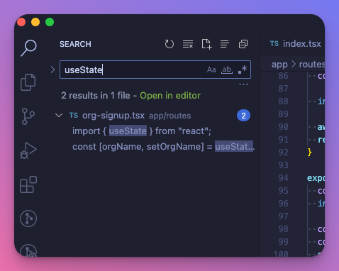

It's been eleven years since I set foot in the world of full-stack development. This path was not chosen out of preference, but rather out of necessity. Working with small companies from the start, the only chance to advance was to be as versatile as possible.

I appreciate the technology I can work with today, as it hasn't always been this impressive.

Between 2012 and 2014, our local environment's reload time after making changes to HTML or CSS was measured in *minutes*. Java, JSF, and J2EE marked my entry into full-stack development. Although it felt enterprise-like on the backend, frontend development was a nightmare.

This forced us to explore ways of shipping frontends separately from the backends. This is how I discovered, Backbone.js, Angular, and later React. Since 2014, I have used CRA, Next.js, and Razzle around React, but nothing felt as right as Remix.

Let me explain.

## Separation of concerns {#heading-separation-of-concerns}

If I think about these years, this separation has always existed in some form.

There was the server and the client. Two separate projects. Context switching, or at least project-switching all the time.

Let's say you were working on a simple TODO app, and you wrote this frontend code:

```typescript
import React, { useState } from 'react';

const TodoComponent = () => {
  const [title, setTitle] = useState('');

  const handleSubmit = async () => {
    await fetch('/todo', {
      method: 'POST',
      headers: { 'Content-Type': 'application/json' },
      body: JSON.stringify({ title }),
    });
  };

  return (
    <div>
      <input
        type="text"
        value={title}
        onChange={(e) => setTitle(e.target.value)}
        placeholder="Enter todo title"
      />
      <button onClick={handleSubmit}>Add Todo</button>
    </div>
  );
};

export default TodoComponent;
```

This is great, but is there anything else `/todo` expects besides the title? What I would do at this point is open up the API endpoint implementing `POST /todo`:

```typescript
import { addTodo } from "~/todoStore";

app.post('/todo', (req, res) => {
  const { title, description } = req.body;

  if (!title || !description) {
    return res.status(400).json({ error: 'Missing required fields' });
  }

  addTodo({
    title,
    description
  });

  res.status(201).json({});
});
```

And then, I would figure out that I must provide `description` too. Back to the frontend code, add a new field, send it to the backend, and so on.

### The Remix way {#heading-the-remix-way}

In Remix, when I want to create a simple Todo form that accepts some text input and sends it to the backend, I do:

* everything in the same file
    
* without registing an endpoint in a router
    
* without importing all kinds of wrappers and reading framework-specific documentation
    

Remix builds heavily on existing Web APIs, which I think is the reason why it can stay so lean.

If you write a Todo form with a single input *and* an endpoint that records that input, it would all go into the same file and look like this:

```typescript
import { json } from "@remix-run/node";
import type { ActionFunctionArgs } from "@remix-run/node";
import { Form } from "@remix-run/react";
import { addTodo } from "~/todoStore";

export async function action({ request }: ActionFunctionArgs) {
  const formData = await request.formData();
  const { todo } = Object.fromEntries(formData.entries());
  await addTodo(todo);
  return json({ ok: true });
}

export default function Index() {
  return (
    <Form method="post">
      <label htmlFor="todo">Item name</label>
      <input type="text" name="todo"/>
      <input type="text" name="description"/>
      <button>Add</button>
    </Form>
  );
}
```

Sorcery, right?

Backend *and* the frontend, next to each other.

Here's what else you see above:

**Form** - a Remix way of doing `<form>`. If you would submit this plain form with a `<button>` you would actually make a `POST` request to the server. However, with `Form` Remix realizes this `POST` intent, intercepts it, and turns the `POST` into a `fetch`.

**action** - this is the default action invoked by submitting the only form on this page. Inside `action` you're writing your backend code.

<div class="embed-wrapper"><div class="embed-loading"><div class="loadingRow"></div><div class="loadingRow"></div></div><a class="embed-card" href="https://media.giphy.com/media/9r75ILTJtiDACKOKoY/giphy.gif">https://media.giphy.com/media/9r75ILTJtiDACKOKoY/giphy.gif</a></div>

## No more states {#heading-no-more-states}

### Form Inputs {#heading-form-inputs}

Totally unexpected, but throughout the building of my [SaaS boilerplate](https://github.com/akoskm/saas) with Remix, I used `useState` once in the entire project:



This was surprising, given that I have a Sign-up form separate for users and organizations, a Sign-in form, a User invite, and an edit form.

That's a lot of forms!

Yet, as you saw from the example above, because of how Remix handles form submissions, in most cases your usual:

```typescript
const [email, setEmail] = useState('');

onChange={(e) => setEmail(e.target.value)}
```

isn't necessary.

### Loading states {#heading-loading-states}

Indicating the loading state and disabling buttons at the right time are all something we've done.

And we probably did it like this:

```typescript
const [loading, setLoading] = useState(false);

async function handleSubmit(data) {
  setLoading(true);
  await fetch(...);
  setLoading(false);
}
```

Remix handles this (and a bunch of other common use cases) with its built-in hooks. One of them is [`useNavigation`](https://remix.run/docs/en/main/hooks/use-navigation). It's a simple hook that returns you the current state of the page navigation:

* **idle** - the page is idling, no requests are being made
    
* **submitting** - an `action` is being called, likely after a form submission
    
* **loading** - The loaders for the next routes are being called to render the next page - we didn't discuss loaders here, but [check them out](https://remix.run/docs/en/main/hooks/use-loader-data#useloaderdata).
    

Based on `navigation.state`, you always know if there is an action running on your page or if it's just idling. If it's the latter, it's probably safe to remove that loading indicator or re-enable that button.

## Standards {#heading-standards}

I highly recommend you go over the [30-minute tutorial](https://remix.run/docs/en/main/start/tutorial) of Remix that explains how it works in-depth.

Remix builds on "old-school web" instead of reinventing the wheel. The way a form POST is turned into fetch requests is a good example of that.

It encourages the use of existing Web APIs. This is from their landing page:

> Remix is a full stack web framework that lets you focus on the user interface and work back through web standards to deliver a fast, slick, and resilient user experience. People are gonna love using your stuff.

Which I think summarizes what Remix represents.

It also encourages *you* to think differently and use web standards. This is how, probably for the first time ever, I found a platform API for something that I always used a library for:

<div class="embed-wrapper"><div class="embed-loading"><div class="loadingRow"></div><div class="loadingRow"></div></div><a class="embed-card" href="https://twitter.com/akoskm/status/1730226106018476324">https://twitter.com/akoskm/status/1730226106018476324</a></div>

## Conclusion {#heading-conclusion}

I gave Remix a shot without any big expectations, and it blew me away. Guess this is when they say *to* *underpromise* *and* *overdeliver*.

I'll keep using Remix for my future projects. The one I'm building is a [SaaS boilerplate](https://github.com/akoskm/saas) that combines Remix with FusionAuth, a customer authentication and authorization platform. Another tool that makes developers' lives awesome.

Huge congrats to the Remix team.

Make sure to check out their [website](https://remix.run/) and join their [Discord](https://rmx.as/discord).
