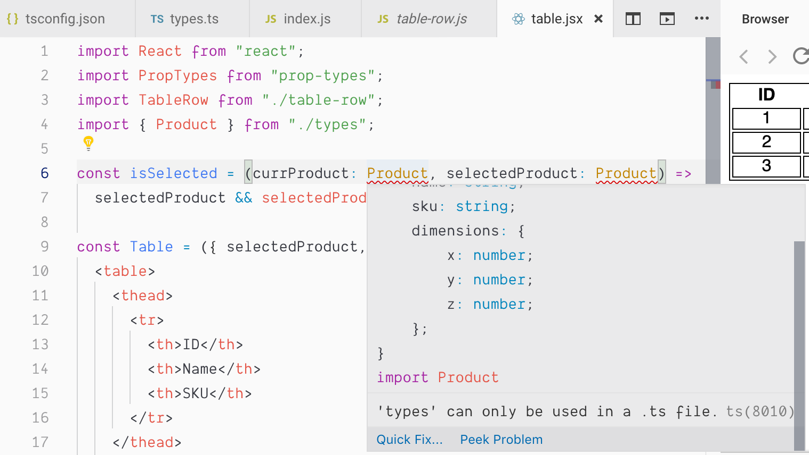
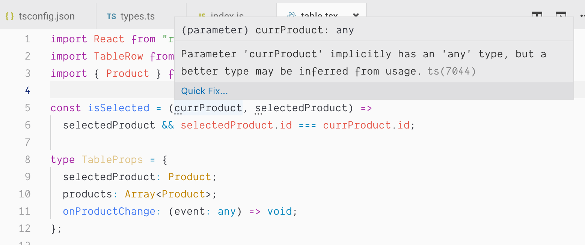
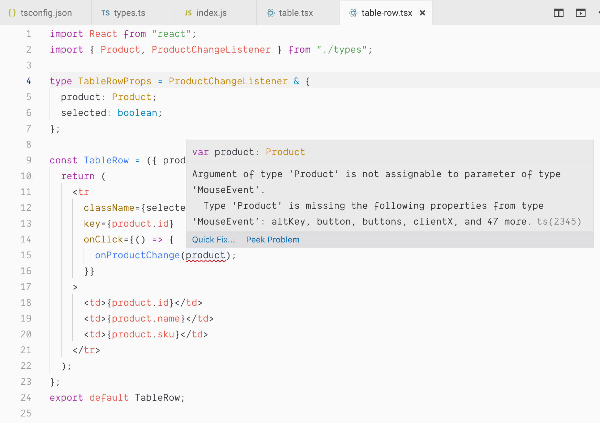

# Introduction {#introduction}

In the [previous post](https://akoskm.hashnode.dev/use-react-context-to-dry-up-your-components), we talked about ”plumbing” in React and how it affects the readability of our code.

We used React Context to avoid passing down the same props to multiple layers of components and to avoid repeating PropTypes definitions.

While React Context did eliminate the repetitions in our code, it introduced a different problem.

Our components became less explicit:

```jsx
const Sidebar = () => (
  <div className="sidebar">
    <DetailsPanel />
    <DimensionsPanel />
  </div>
);
```

hiding the fact that both of these need some data in order to work. We could argue that not passing down props negatively affects the readability and maintainability of this code.

So I asked myself, could we stay explicit without repeating PropTypes? The answer is yes, by using TypeScript to describe the props of our components.

Of course, TypeScript does a lot more than that. It adds types to JavaScript, which makes your code more readable and easier to maintain. It makes some editors smarter, enhances autocomplete features, and shows information about the TypeScript types you're using, and many more.

We'll work on the [sidebar-table app](https://codesandbox.io/s/table-sidebar-layout-without-usecontext-xk591) from the previous post, which still has the prop repetitions.
To get started with TypeScript in your project, I recommend following one of the [official guides](https://www.typescriptlang.org/samples/index.html). Here we'll jump straight into adding types to the app.

One of the things I like about TypeScript is that you can add it incrementally to your project.
You can introduce TypeScript only to some parts of your codebase and leave the rest of the app untouched.

Having that in mind, first, we'll convert the `Table` component which currently looks like this:

```jsx
import React from "react";
import PropTypes from "prop-types";
import TableRow from "./table-row";

const isSelected = (currProduct, selectedProduct) =>
  selectedProduct && selectedProduct.id === currProduct.id;

const Table = ({ selectedProduct, products, onProductChange }) => (
  <table>
    <thead>
      <tr>
        <th>ID</th>
        <th>Name</th>
        <th>SKU</th>
      </tr>
    </thead>
    <tbody>
      {products.map(currProduct => (
        <TableRow
          selected={isSelected(currProduct, selectedProduct)}
          key={currProduct.id}
          product={currProduct}
          onProductChange={onProductChange}
        />
      ))}
    </tbody>
  </table>
);
Table.propTypes = {
  selectedProduct: PropTypes.shape({
    id: PropTypes.number.isRequired,
    name: PropTypes.string.isRequired,
    sku: PropTypes.string.isRequired,
    dimensions: PropTypes.shape({
      x: PropTypes.number.isRequired,
      y: PropTypes.number.isRequired,
      z: PropTypes.number.isRequired
    })
  }),
  products: PropTypes.arrayOf(
    PropTypes.shape({
      id: PropTypes.number.isRequired,
      name: PropTypes.string.isRequired,
      sku: PropTypes.string.isRequired,
      dimensions: PropTypes.shape({
        x: PropTypes.number.isRequired,
        y: PropTypes.number.isRequired,
        z: PropTypes.number.isRequired
      }).isRequired
    }).isRequired
  ),
  onProductChange: PropTypes.func.isRequired
};
export default Table;
```

We immediately notice a few things:
 - `products` has the same props as `selectedProduct` wrapped in an array
 - the `isSelected` function receives two products but there is no indication of that

Let's start by defining our first type: `Product`.

# TypeScript types {#typescript-types}

When rewriting existing, PropTypes-based components to TypeScript we're looking for [basic TypeScript types](https://www.typescriptlang.org/docs/handbook/basic-types.html) that could replace PropTypes, but essentially:

```
PropTypes.bool ➡ boolean

PropTypes.number ➡ number

PropTypes.string ➡ string

PropTypes.arrayOf(PropTypes.number) ➡ Array<number>
```

Use `any` to opt-out compile-time checks for a variable.

Use `void` to indicate that a function returns undefined.

A function that accepts any parameter and returns undefined (could be a click handler) would look like this:

```ts
onClick: (event: any) => void
```

Yeah, I know, such handlers are called with a specific event type, but we're going to talk about that later.

After having a basic understanding of which TypeScript types could replace certain PropTypes, we can define Product as:

```
export type Product = {
  id: number;
  name: string;
  sku: string;
  dimensions: {
    x: number;
    y: number;
    z: number;
  };
};
```

Don't forget to rename the files when you're adding types, js to ts and jsx to tsx:



Now that we have the Product type ready, we can replace the `propTypes` part of the `Table` component:

```ts
type TableProps = {
  selectedProduct: Product;
  products: Array<Product>;
  onProductChange: (event: any) => void;
};
```

TypeScript also makes your editor smarter by giving clues about where you could improve your code:



# Components with TypeScript {#components-with-typescript}

Finally, our `Table` component looks like this:

```tsx
import React from "react";
import TableRow from "./table-row";
import { Product } from "./types";

type TableProps = {
  selectedProduct: Product;
  products: Array<Product>;
  onProductChange: (event: any) => void;
};

const isSelected = (currProduct: Product, selectedProduct: Product) =>
  selectedProduct && selectedProduct.id === currProduct.id;

const Table = ({ selectedProduct, products, onProductChange }: TableProps) => (
  <table>
    <thead>
      <tr>
        <th>ID</th>
        <th>Name</th>
        <th>SKU</th>
      </tr>
    </thead>
    <tbody>
      {products.map((currProduct: Product) => (
        <TableRow
          selected={isSelected(currProduct, selectedProduct)}
          key={currProduct.id}
          product={currProduct}
          onProductChange={onProductChange}
        />
      ))}
    </tbody>
  </table>
);
export default Table;
```

Let's convert `TableRow` in the same fashion:

```tsx
import React from "react";
import { Product } from "./types";

type TableRowProps = {
  product: Product;
  onProductChange: (event: any) => void;
  selected: boolean;
};

const TableRow = ({ product, onProductChange, selected }: TableRowProps) => {
  return (
    <tr
      className={selected ? "selected" : undefined}
      key={product.id}
      onClick={() => {
        onProductChange(product);
      }}
    >
      <td>{product.id}</td>
      <td>{product.name}</td>
      <td>{product.sku}</td>
    </tr>
  );
};
export default TableRow;
```

see <a href="https://codesandbox.io/embed/table-sidebar-layout-with-plumbing-xk591?fontsize=14">here</a> the original version.

# TypeScript Interfaces {#typescript-interfaces}

We notice the repetition of the `onProductChange: (event: any) => void;` function in `TableProps` and `TableRowProps`, and we're going to use [Interfaces](https://www.typescriptlang.org/docs/handbook/interfaces.html) to solve this problem.

Interfaces are constraints between the interface and the implementing type.
They make sure that all (or some) properties or functions are present on the type that uses the interface.

Interfaces and types are mostly interchangeable, but there are some restrictions:
 - [Typescript: Interfaces vs Types](https://stackoverflow.com/a/52682220/407466)
 - [Interface vs Type alias in TypeScript 2.7](https://medium.com/@martin_hotell/interface-vs-type-alias-in-typescript-2-7-2a8f1777af4c)

We can create an interface with a method and share it between `TableRowProps` and `TableProps`.

We'll use [MouseEvent](https://developer.mozilla.org/en-US/docs/Web/API/MouseEvent) to describe the incoming event of our click handler (*Spoiler alert*: this declaration is wrong, but TypeScript will warn us 🎉):

```ts
export interface ProductChangeListener {
  onProductChange: (event: MouseEvent) => void;
}
```

Both types and interfaces can extend other interfaces, but the syntax is different:

 - types extending interfaces:
```ts
type TableRowProps = ProductChangeListener & {
  product: Product;
  selected: boolean;
};
```

 - interfaces extending interfaces
```ts
interface TableRowProps extends ProductChangeListener {
  product: Product;
  selected: boolean;
}
```

# Catching early bugs {#catching-early-bugs}

After updating `TableRowProps`, the editor immediately warns us about the error we made:



We defined our interface method to accept `MouseEvent` instead of `Product`. Let's fix the interface declaration:

```ts
export interface ProductChangeListener {
  onProductChange: (event: Product) => void;
}
```

We successfully cleaned up these two components from PropTypes repetitions, and you can find the updated code [here](https://codesandbox.io/s/table-sidebar-layout-with-typescript-2si7g).

Do you use TypeScript? Do you think this introduces more complexity than PropTypes?

Let me hear your thoughts on this in the comment section!

Cover photo by <a href="https://unsplash.com/@maxvdo?utm_source=unsplash&utm_medium=referral&utm_content=creditCopyText">Max van den Oetelaar</a> on <a href
