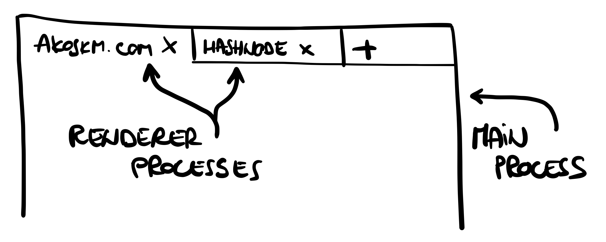
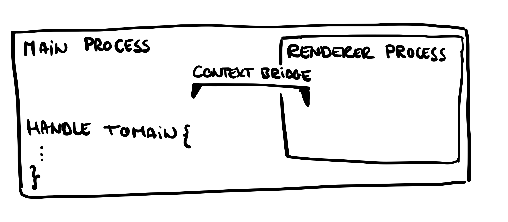
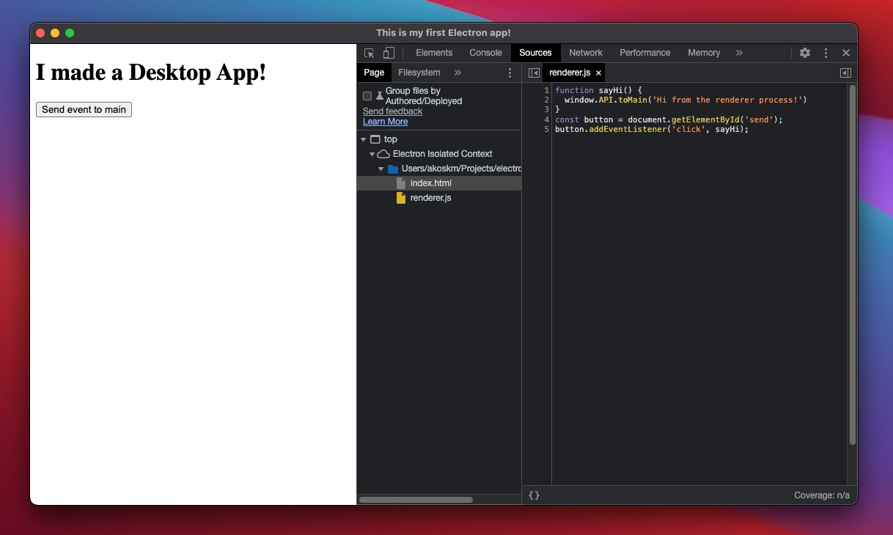
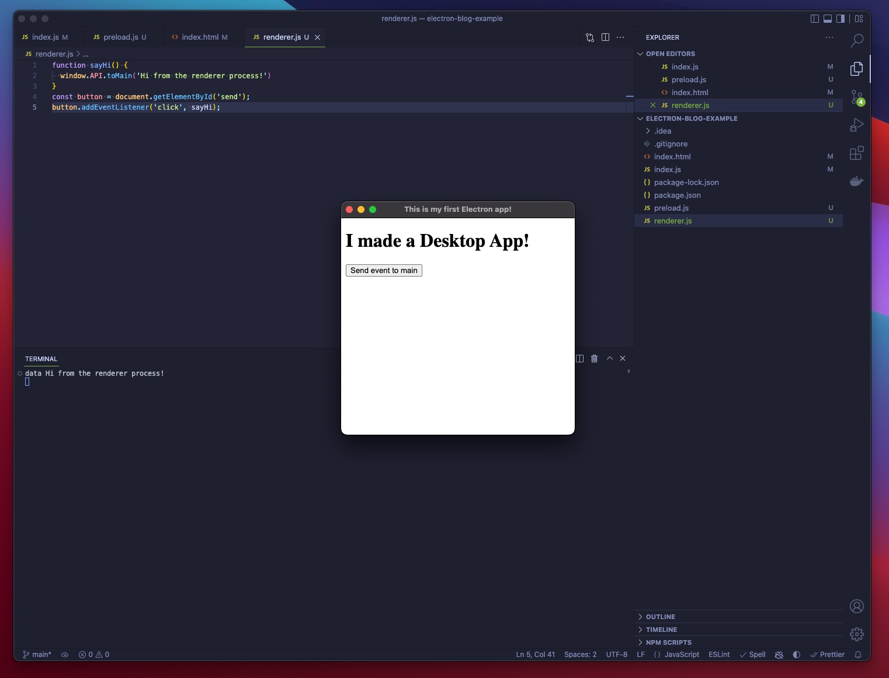

The ability to write JavaScript Desktop applications is not the only reason we love Electron soo much.

Unlike a traditional JavaScript application, not only Electron has access to everything a web browser offers! It can also use everything that NodeJS has to offer!

The combined access to both the browser and NodeJS API is where the true power of Electron lies:
 - saving to the local file system
 - screen recording
 - capturing inputs

Just think of Discord, Slack, or VSCode.

The approach I'm going to show you is considered secure, but keep in mind that allowing an electron app to access the NodeJS API is equivalent to running shell commands with a click of a button!

## Processes in Electron {#heading-processes-in-electron}

To work with [`contextBridge`](https://www.electronjs.org/docs/latest/api/context-bridge), we must understand that Electron has two processes: the Main and the Renderer processes.

Think of them as the browser and its tabs:



The two processes communicate with each other through their respective modules [`ipcRenderer`](https://www.electronjs.org/docs/latest/api/ipc-renderer) and [`ipcMain`](https://www.electronjs.org/docs/latest/api/ipc-main).

This communication is called interprocess communication, and the idea is simple:

The Main process is capable of listening to specific events, and the Renderer process can trigger these events and optionally pass some data.

In practice, this isn't any more complicated than sending some user input from the browser to a backend API.

Just as you can't send data to endpoints that don't exist in a backend app and expect an answer, you won't get a response from events that the Main process isn't listening to!

You can read more about the Electron Process Model [here](https://www.electronjs.org/docs/latest/tutorial/process-model).

## Preload.js {#heading-preloadjs}

Historically, there are different ways to access `ipcRender` from the renderer process, secure and less secure.

Here's how you would access `ipcRenderer` without `contextBridge`:

```js
const {
  ipcRenderer
} = require("electron");

window.send = function(channel, data){
  // allow channels
  let validChannels = ["toMain"];
  if (validChannels.includes(channel)) {
    ipcRenderer.send(channel, data);
  }
};
```

The main drawback of this approach is that `window.send` and its definition is exposed in the app directly. An attacker could open the dev tools and see what channels you allow for commutation and what kind of data you send and receive from the app.
But probably the most dangerous is that the attacker could reassign `window.send` with a different definition.

`contextBridge` offers a solution to this. With the help of a "preload" script, it can hide the `ipcRenderer` calls and only expose a single function to the renderer process.

It would look something like this:

```js
contextBridge.exposeInMainWorld('API', {
  toMain: (args) => {
    ipcRenderer.invoke('toMain', args)
  }
})
```
Now, with the preload script active in your render process, you would only do this:

```
window.send = function(data) {
  window.API.toMain(data)
} 
```
This kind of context isolation makes a huge difference because, this time, the only thing visible from the dev tools is a proxy call to an API object.

## Set up the channels {#heading-set-up-the-channels}
Before sending some data, we must set up the channel in the main process it will listen to.

Remember, you can only trigger the channel to which the main process is listening.

Our `main.js` file looked like this in our previous post:

```
const { app, BrowserWindow } = require("electron");

const createWindow = () => {
  const win = new BrowserWindow({
    width: 400,
    height: 400,
  });
  win.loadFile("./index.html");
};

app.whenReady().then(() => {
  createWindow();
});
```

We're going to make three changes:
 - import the `ipcMain` module
 - begin listening to a specific channel
 - point to the `preload.js` script - we're going to fill in the contents later

```diff
-const { app, BrowserWindow } = require("electron");
+const path = require('path');
+const { app, BrowserWindow, ipcMain } = require("electron");
 
 const createWindow = () => {
+  const preloadScriptPath = path.join(__dirname, 'preload.js');
+
   const win = new BrowserWindow({
     width: 400,
     height: 400,
+    webPreferences: {
+      contextIsolation: true, preload: preloadScriptPath,
+    }
   });
   win.loadFile("./index.html");
+
+  ipcMain.handle('toMain', async function toMain(_event, data) {
+    console.log('data', data);
+  })
 };
```

You might be wondering what `contextIsolation` is. This flag ensures that the code in `preload.js` and the code run by the `index.html` website run in different contexts.

This is a critical security consideration since, without this, the website could access Electron internals and all the powerful APIs that the preload script has access to!

Let's create the `preload.js` file:

```js
const { contextBridge, ipcRenderer } = require('electron')

contextBridge.exposeInMainWorld('API', {
  toMain: (args) => {
    ipcRenderer.invoke('toMain', args)
  }
});
```
You can have multiple bridges, and each bridge can expose numerous functions.
In our simple scenario, we have one bridge and one function exposed:



## Send data to the channel {#heading-send-data-to-the-channel}

Here's how our index file looked like before
```
<!DOCTYPE html>
<html>
  <head>
    <title>This is my first Electron app!</title>
    <meta http-equiv="Content-Security-Policy" content="default-src 'self'; script-src 'self'">
  </head>
  <body>
    <h1>I made a Desktop App!</h1>
    <button id="send">Send event to main</button>
    <script src="./renderer.js"></script>
  </body>
</html>
```

We're only going to include a new script here and a button to trigger the function we exposed:

```diff
   </head>
   <body>
     <h1>I made a Desktop App!</h1>
+    <button id="send">Send event to main</button>
+    <script src="./renderer.js"></script>
   </body>
 </html>
```

And here are the contest of the `renderer.js` script:

```
function sayHi() {
  window.API.toMain('Hi from the renderer process!')
}
const button = document.getElementById('send');
button.addEventListener('click', sayHi);
```

Now run the app with `npm start` and bring up the dev tools (Option+Command+I is the hotkey on Mac), and look at the Sources tab:



The only thing we see here is the contents of the renderer method - the bridge and the `ipcRenderer` calls aren't visible.

Because of this, no one can modify them or see any details of our implementation.

If you click the button "Hi from the renderer process!" it should be printed to the console:



Important to note that this console log didn't appear in your browser as it would with a browser-based application but appeared on the output of the host operating system.

The logging was made possible by the interprocess communication between the Renderer and the Main process.

Congratulations! You just used NodeJS in your Electron application!

What you do next with the NodeJS API in your Desktop App is up to you. 🤖
