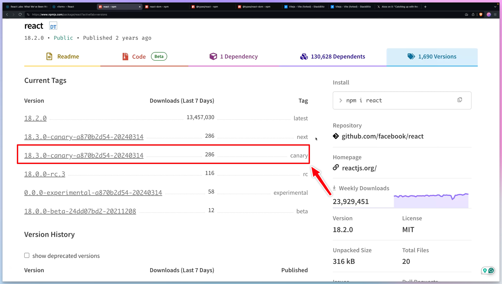

One reason React remains the top framework is its ability to stay updated, address current challenges developers encounter, and act on them.

Let's delve into the core features that are stirring excitement among developers.

For each hook, I will explain what it does and give a real-world use case.

I also made a video about me trying out all these features and explained how you can do the same, so if you prefer that version, click here:

<a class="embed-card" href="https://www.youtube.com/watch?v=TB6bAl3nOA8">https://www.youtube.com/watch?v=TB6bAl3nOA8</a>

All right!

Now, let's dive into the new hooks.

## **🔍 useFormState: Interactivity Redefined** {#heading-useformstate-interactivity-redefined}

`useFormState` will be key for simplifying server interactions.

1. **Capabilities**: This hook manages form submission states and captures server responses.
    
2. **Practicality in Action**: Imagine a login process. `useFormState` can immediately display server responses, like a "Login Failed" message, directly enhancing user engagement and feedback. No need for the usual `useEffect`+`setMessage` combo.
    
3. **Implementation Insight**: In use, `useFormState` can handle server communication during form actions, capturing and presenting server responses easily.
    

## **🔄 useFormStatus: Keeping Users Informed** {#heading-useformstatus-keeping-users-informed}

`useFormStatus` focuses on enhancing the form submission experience.

1. **Function**: It provides a `pending` flag, toggling between true or false to indicate submission progress.
    
2. **User Experience**: This flag will be a huge help in displaying loading animations or changing button texts during data submission, keeping users engaged and informed.
    

## **🌈 useOptimistic: Proactive Feedback** {#heading-useoptimistic-proactive-feedback}

React 19 introduces the `useOptimistic` hook, which adds a layer of dynamic user feedback to web applications.

1. **Understanding** `useOptimistic`: This hook is designed for scenarios where you want to anticipate a successful outcome. It allows developers to update the UI optimistically, assuming the best-case scenario post an action like a form submission.
    
2. **Real-World Use Case**: Imagine a login form. With `useOptimistic`, you can immediately show a message like "Loading your dashboard..." after the user hits submit, even before the server responds. This optimistic feedback can enhance the user experience by making interactions feel faster and more responsive.
    
3. **Balancing Optimism with Reality**: Once the actual server response arrives, the hook transitions from the optimistic state to the real outcome. For instance, if the login fails, it will replace the "Loading your dashboard..." message with an appropriate error message.
    

## **🚀 Leveraging Canary Versions in React 19** {#heading-leveraging-canary-versions-in-react-19}

Want to test out React 19? Here's how you can find the latest canary version and use it in your app:

1. **Finding Canary Versions**: Visit [`npmjs.com`](http://npmjs.com), search for "react", and navigate to the versions tab. Look for versions tagged as "canary".
    
    
    
2. **Choosing the Right Version**: Avoid versions released on the same day due to potential issues. Opt for a version released at least a day or two ago.
    
3. **Synchronizing Versions**: Ensure that your `react-dom` version matches your React version. Copy the version numbers and update your `package.json` file in your development environment.
    
4. **Installation**: Run `npm install` and `npm run dev` to start experiencing the latest features of React 19.
    

If you'd like to give React 19 a shot *now*, you can also use this [Stackblitz](https://stackblitz.com/edit/vitejs-vite-urqenp?file=src%2Fmain.tsx) I created.

---

React 19 will be an amazing release!

How are you planning to integrate these hooks into your work? Share your thoughts and strategies below! 👇

For a deeper dive, check out the full video [here](https://youtu.be/TB6bAl3nOA8) and stay on top of the latest in React development. Happy coding, and stay inspired! 🎉💻🌐

**Join the Discussion: What's your take on React 19's new features, and how will you use them in your projects? Comment below!** 💬🤔🚀

Sources:

* React blog: [https://react.dev/blog/2024/02/15/react-labs-what-we-have-been-working-on-february-2024](https://react.dev/blog/2024/02/15/react-labs-what-we-have-been-working-on-february-2024)
