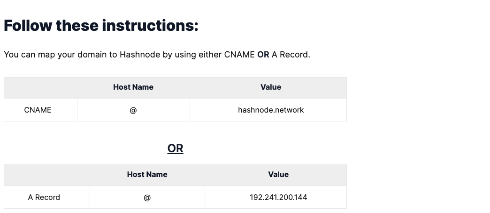
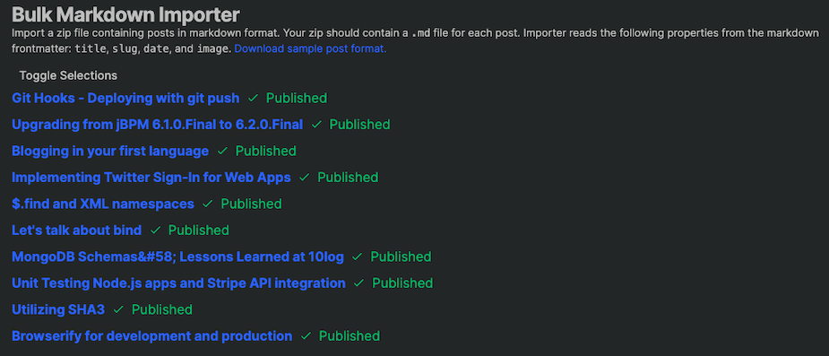
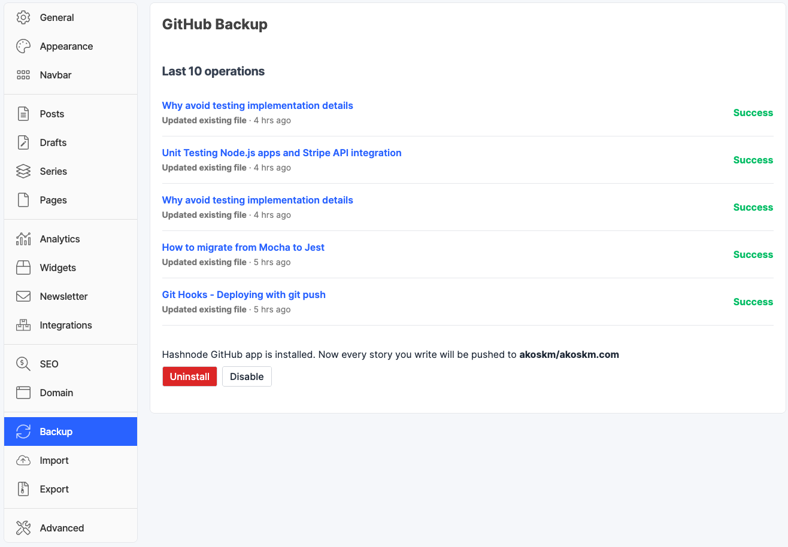

My story begins on WordPress in 2008. Here's my [first-ever blog post](https://mydailyhash.wordpress.com/2008/08/12/the-realy-_first_-post/). 🙀

I was writing a ton.

In 2013 I left the platform. I realized I wanted more freedom, more customization, markdown, my own template, GitHub pages, all the cool things.

What I didn't realize back then is that probably I couldn't get myself to write.

So I spent 9 years tweaking my GitHub Pages template.

And occasionally writing a blog post, once or twice a year.

Things are different now, probably because of the huge mental decluttering I was doing the past years. Now I have to organize my ideas in Notion, I listen to professional writers, take their courses, and write more.

I didn't set up any crazy expectations for myself, like write two articles a week.
Come on, I wrote *two articles a year*.

So as the desire for more writing and less tweaking grew stronger, things started to get in the way. I started to change minor things as I educated myself on stuff like SEO - thanks to [Csaba Kissi](https://hashnode.com/@Csaba). Of course, it was a disaster:

<a class="embed-card" href="https://twitter.com/akoskm/status/1391671853748477952?s=20">https://twitter.com/akoskm/status/1391671853748477952?s=20</a>

Spoiler alert - I couldn't.

This is when I started looking at the well-known platforms out there:

- Medium.com
- Dev.to
- Hashnode.com

I wrote an article on each of these - actually just republished one of my original articles from akoskm.com - to experience:

- writing
- reading
- the community

# Medium {#medium}

is a complete trainwreck. Do you know how you get unlimited articles on Medium? [You don't sign in.](https://hassanzaid.medium.com/how-to-get-unlimited-access-to-medium-articles-583a71fc7b92) If you're signed in you have more limitations.
I have no idea about the community, nobody read my post - maybe it was the tagging, SEO, or I can't write.
I haven't read through their TOS but I'm concerned about who owns the content that I write.
I didn't like the fact that I don't have backup options.
The writing experience was kinda... I like markdown and I think their editor is very limited.

# Dev to {#dev-to}

is very similar in styling and in writing experience to Hashnode. The only thing that turned me down was basically the custom domain. I might cross-post there, but the winner is:

# Hashnode {#hashnode}

writing/reading experience is similar but where it really shines is:

### Custom domain was a breeze to set up {#custom-domain-was-a-breeze-to-set-up}

I entered my custom domain and it generated me exact instructions, provided helpful tips, told me what to expect when I do this:

Ignore that it says the transition could take up to 24 hours because you'll start panicking after 10 minutes. For me, this transition took about 15 minutes.

### Markdown import? Of my entire old blog? Huh? {#markdown-import-of-my-entire-old-blog-huh}

[Catalin Pit](https://hashnode.com/@Catalinpit) helped me a ton on Twitter resolving some issues around this, thank you. 🙇‍♂️

### Backups {#backups}

It's trivial to set up. You need an empty repository on GitHub. When you grant access to the Hashnode plugin you can restrict it to that particular empty repository.

### Community {#community}

I had a very warm welcome even before posting a thing. Ambassadors reached out to me on Twitter and some of them helped me in DMs.

### How the heck this is free? {#how-the-heck-this-is-free}

Yeah, at this point you should be really suspicious so I looked at this also. Hashnode is VC-founded. VC funding is where a business regardless of the profitability of another business - but hoping in future profitability, throws a ton of money at that other business.

[Sandeep Panda](https://hashnode.com/@sandeep) co-founder talks about this here:

https://hashnode.com/post/hashnode-is-changing-more-about-our-business-model-new-mission-and-goal-ckbhowv9100lyzes1oo6qneri

and here:

https://hashnode.com/post/what-is-hashnode-teams-revenue-citikdci40q0y9o53ajqftt7z

# Conclusion {#conclusion}

If you're like me, wanting to write but always finding other things to tweak on your blog, stop it.

Find a platform that respects your work and makes you write.

If you use [this](https://hashnode.com/@akoskm/joinme) link to sign up I even get a free T-shirt. 🤗

If you'd like to connect & chat I'm available on [Twitter](https://twitter.com/akoskm).

> Cover Photo by [乐融 高](https://unsplash.com/@glr0115?utm_source=unsplash&utm_medium=referral&utm_content=creditCopyText) on [Unsplash](https://unsplash.com/s/photos/box?utm_source=unsplash&utm_medium=referral&utm_content=creditCopyText)
