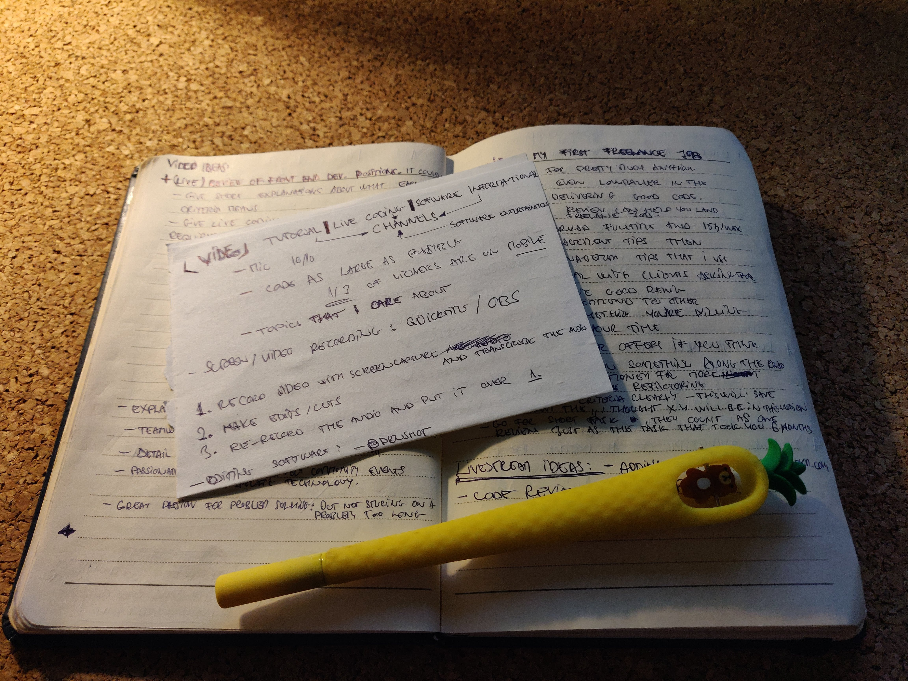

Every year, around February I'm running out of motivation. This lasts about 2 to 3 weeks.
I don't know what causes this - maybe my New Year Resolutions are lagging.

At the end of these periods, I always end up with a *life-changing* to-do list.

When I look at it I realize, these are the same items as last year, and another year has passed.

Making a YouTube video is an item that I'm trying to cross out on my list for the past two years.

It's not that I completely procrastinated on it each year, my notebook is full of video ideas:

These notes are taken from

[How to start a coding YouTube channel by freeCodeCamp](https://www.youtube.com/watch?v=AsTagX5tG4E)

It's a brilliant video that features well-known creators from the industry.
I don't know how many times I re-watched it, took notes, prepared my ideas, then started working on them.

I kept all my Audio and Screen Recordings, some of them are from 2019.

But I never released anything.

Why?

# Mental blocks {#mental-blocks}

## Validation {#validation}
I often heard myself saying:

> Sure, someone's going to watch that. I mean, come on, it's in the documentation. What's the point of recording it?

I'm not reading `README` files anymore, I'm devouring them.

After being in the industry for more than 10 years, I realize that not much has changed.
Sure, there is better tooling it's _much_ easier to get started with almost anything. But I notice the similarities between a `pom.xml` from Maven when I did Java back in 2011 and between `package.json`.

After all these years, when I look at new tech, I soon start to recognize some patterns.

This is why recording videos on basic topics never made sense to me, but I ignored an important point:

And here goes my first mental block:

I dismissed my ideas because I validated them against a one-person audience: me.

Concepts that are basic for someone who spent a decade in the industry could be life-changing for people who just want to get started.

## Finding the best idea {#finding-the-best-idea}

I recorded my first video about contributing to an open-source project.

This is an idea that doesn't appear anywhere in my notebook, I never wrote any script or even bullet points for it.

It was a Saturday morning and I had to make a PR for an open-source library and it hit me:

*I should record this.*

There goes the video planning, scripting, and all that stuff. I guess it's more doing and less planning for me.

So my second mental block was: iterating too much on ideas. Trying to find the perfect topic, instead of recording something that has some value.

You can't iterate if you never ship.

## Comfort {#comfort}
Does it worth the effort to do all the screen recording, the audio, get the code examples right. Fail first, then fail a second and a third time? A day of work just so that I can say at the end of the day: yeah, it was a lame idea anyway.

I don't have to do this.

There many other things that I could do *right now* that would make me feel better, or in my case until next year, February.

So my third mental block is:

Being comfortable. I convinced myself to not change anything so that I can complain about not making progress next year.

Funny, at some point this even made sense to me. If a problem appears rarely you might not want to deal with it immediately or at all.

But there's a *huge* catch:

This change compounds. It's not only that entering YouTube is not going to haunt me next year. It already caused a bunch of other things *right now* that I'm happy about.

# Real blocks {#real-blocks}

## Audio {#audio}
It's in the freeCodeCamp video, it's part of every YouTube tutorial. It makes sense on an audio-visual medium:

The first real blocker: Get a decent microphone.

Of course, I explained to myself, why a microphone wouldn't help me.

You might have already heard about GAS (Gear Acquisition Syndrome). As the name implies, it's about collecting stuff. When purchasing a piece of gear is the prerequisite for a specific activity:

> Once I have that fitness watch, I'll start exercising

We all know how this ends. I was telling myself:

The reason why you think you need a microphone is that you have GAS instead of good ideas. You wouldn't record anything even with a quality mic.

So I gathered all my strength and bought a microphone.

There are two knobs on the Rode NT-USB mic that I purchased.
With the top knob, you can set the feedback to the max. This means you'll hear back yourself, from the microphone, over your headphones.
I'm not gonna lie, I was listening to my voice for about 10 minutes.

Is it a happy end, did I record that video? I almost didn't.

## Video Editing {#video-editing}
I was already familiar with [OBS (Open Broadcaster Software)](https://obsproject.com/) from my failed years in video production.
At least I didn't have to learn that from the beginning.

I set up my microphone, found a non-distracting background, and started recording.

I recorded the whole thing in one turn. Some sentences I said twice or even three times and I wanted to cut those in iMovie.

I quickly realized: iMovie can't handle `.mkv` videos - that was the format that OBS created.

<a class="embed-card" href="https://twitter.com/akoskm/status/1409077512055951363">https://twitter.com/akoskm/status/1409077512055951363</a>

*Hooray*, I thought! One more reason to not mess with this, I can't even edit my videos.
It's finally time to do something else!
After some fight with myself, I thought, *not this time*!

I found [DaVinci Resolve](https://www.blackmagicdesign.com/products/davinciresolve/) on the App Store that could import and edit my recording. The app is fantastic, I'm going to use it for my next video as well.

I spent an hour editing a 10-minute long video but I knew I'm close to getting rid of a task that's on my to-do list for 2 years.

# Conclusion {#conclusion}
I could've edited a bit longer, I should have tweaked the audio, but the thing is:

<a class="embed-card" href="https://twitter.com/akoskm/status/1409132826231021569">https://twitter.com/akoskm/status/1409132826231021569</a>

it's doesn't matter if this video is perfect or not:

 - it's already a huge win for me because I did something I both dreamed about and also avoided
 - as my friend put it: think of your YouTube videos as small oil wells. Each of them produces views over time, some more, some less. The overall performance of the channel is what matters.

If I end up creating more content on my channel I'll always proudly look back at this first video.

The moment when I defeated the constant wishing and not doing.

You can watch my first YouTube video here:

<a class="embed-card" href="https://youtu.be/QAFBRfsmHng">https://youtu.be/QAFBRfsmHng</a>

I'm new to all this so every bit of information helps.

What should I do differently, what you enjoyed/found annoying so please leave a comment below or reach out to me on [Twitter](https://twitter.com/akoskm).

Thank you 🙌

Photo by <a href="https://unsplash.com/@noahsilliman?utm_source=unsplash&utm_medium=referral&utm_content=creditCopyText">Noah Silliman</a> on <a href="https://unsplash.com/s/photos/alone?utm_source=unsplash&utm_medium=referral&utm_content=creditCopyText">Unsplash</a>
